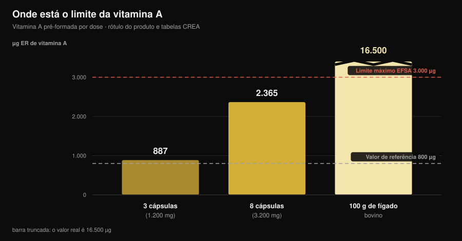
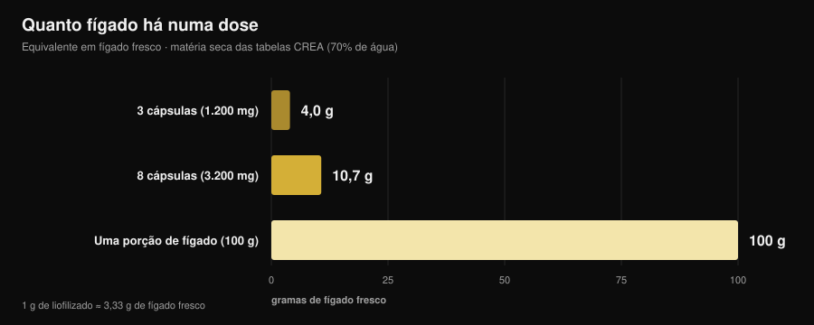

# Suplementos de fígado bovino: funcionam mesmo?

Por [Giammaria Loi](/autore/giammaria-loi) · atualizado a 15 de novembro de 2026

O fígado desidratado em cápsulas é a categoria de suplementos que mais cresce, e é vendida com uma frase só: "o multivitamínico da natureza". A frase é verdadeira sobre o fígado. O problema é que numa cápsula não há fígado: há uma fração de uma porção. E no único ponto em que a quantidade conta mesmo — a vitamina A — a margem entre "útil" e "demais" é mais estreita do que qualquer rótulo diz.

## Em resumo

- **Três cápsulas valem cerca de 4 gramas de fígado.** Uma dose típica declara 1.200 mg de fígado liofilizado. O fígado fresco é 70% água (tabelas CREA), logo 1.200 mg de pó correspondem a cerca de **4 g de fígado real**: um vinte e cinco avos de uma porção de 100 g.
- **A vitamina A é o único nutriente que chega em dose relevante.** Um produto à venda na Europa declara 887 µg por 3 cápsulas, 111% do valor de referência diário. Cobre 0,38 mg (38%), B12 4,32 µg (172%). O resto é irrelevante.
- **O teto de segurança está perto, não longe.** Em 2024 a EFSA confirmou para a vitamina A pré-formada um nível máximo tolerável de **3.000 µg ER por dia**, com base na teratogenicidade. A dose máxima impressa em alguns rótulos (8 cápsulas) já chega a cerca de 2.400 µg.
- **O fígado real ultrapassa o limite sozinho.** 100 g de fígado bovino contêm 16.500 µg de vitamina A (CREA): mais de **cinco vezes** o máximo diário. Por isso a EFSA recomenda limitar fígado e vísceras a uma vez por mês ou menos, e evitá-los na gravidez.
- **Sobre força, energia e músculo não há um único estudo controlado.** A investigação sobre suplementos de fígado desidratado e treino é inexistente: zero ensaios aleatorizados. Tudo o que se lê sobre isso é anedota.

*Gráfico Nurvan. Cápsulas: valores declarados no rótulo de um suplemento de fígado liofilizado à venda na Europa (887 µg de vitamina A por 3 cápsulas de 1.200 mg; o valor para 8 cápsulas é proporcional à dose máxima indicada pelo fabricante). Fígado fresco: tabelas de composição CREA, fígado de bovino, 16.500 µg ER por 100 g. Limite máximo: EFSA, 2024.*

## O que são e o que prometem

Vendem-se como *organ supplements* ou simplesmente *beef liver*: fígado bovino liofilizado ou desidratado e encapsulado, muitas vezes com a menção *grass-fed*. O argumento é ancestral — os nossos antepassados comiam os órgãos, nós não — e nutricional: o fígado é mesmo um dos alimentos mais densos em micronutrientes que existem.

Nesse último ponto os números dão-lhes razão. Segundo as tabelas de composição de alimentos do CREA, 100 g de fígado de bovino fornecem 16.500 µg de vitamina A em equivalente de retinol, 3,7 mg de cobre, 3,30 mg de riboflavina, 8,8 mg de ferro, 42 µg de selénio, 6 mg de zinco e 20 g de proteína por 142 kcal. Nenhum multivitamínico imita esse perfil de forma tão completa.

O salto lógico que nunca é declarado é a passagem do alimento para a cápsula.

## Quanto fígado há, de facto, numa dose

O fígado fresco contém 70 g de água por cada 100 g. Quando é liofilizado fica a matéria seca: cerca de 30 g por cada 100 g de partida. A conta cabe numa linha.

Uma dose típica — três cápsulas — declara **1.200 mg de fígado liofilizado**. Dividido por 0,30, corresponde a cerca de **4 g de fígado fresco**. A dose máxima indicada pelo mesmo fabricante, oito cápsulas, são 3.200 mg de pó: **menos de 11 g de fígado**.

*Gráfico Nurvan. Conversão a partir da matéria seca: fígado de bovino com 70,0 g de água por 100 g (tabelas CREA), logo 1 g de liofilizado ≈ 3,33 g de fígado fresco. Doses de rótulo: 1.200 mg para 3 cápsulas, 3.200 mg para 8 cápsulas.*

Ter esta proporção em mente resolve metade das dúvidas sobre o produto. Se o que procura no fígado precisa de quantidade — proteína, ferro, zinco —, as cápsulas nunca lho darão: seriam precisas vinte e cinco doses para igualar uma porção. Se algo no fígado está concentradíssimo, a cápsula dá o suficiente para contar. E isso acontece com apenas um desses nutrientes.

## O único nutriente que conta: a vitamina A

Um suplemento de fígado liofilizado do mercado europeu declara, por três cápsulas: vitamina A 887 µg (111% do valor nutricional de referência), vitamina B12 4,32 µg (172%), cobre 0,38 mg (38%). O ferro nem sequer é declarado.

A vitamina A do fígado é retinol, ou seja vitamina A **pré-formada**: não é o betacaroteno das cenouras, que o corpo converte apenas na medida em que precisa. O retinol acumula-se no seu fígado e não tem válvula de escape.

Em 2024 o painel NDA da EFSA reavaliou toda a literatura e confirmou o nível máximo tolerável para a vitamina A pré-formada em adultos: **3.000 µg ER por dia**, válido para homens, mulheres em idade fértil, grávidas e lactantes. O efeito crítico em que esse número assenta é a **teratogenicidade**, o dano ao desenvolvimento embrionário.

Três cápsulas com 887 µg não são um problema para um adulto saudável: é cerca de um terço do limite. O problema surge quando se somam três coisas que se somam com facilidade: a dose máxima que muitos fabricantes indicam no próprio rótulo (8 cápsulas, cerca de 2.400 µg), um multivitamínico que já contém vitamina A, e o fígado verdadeiro no prato. Porque o fígado real sai da escala sozinho: 100 g valem 16.500 µg, **5,5 vezes o máximo diário**. Não é um detalhe teórico — é a razão pela qual a EFSA escreve que as populações europeias ficam abaixo do limite apenas se fígado e vísceras forem comidos uma vez por mês ou menos.

Que uma refeição de fígado mexe mesmo com a bioquímica está medido: num estudo com mulheres não grávidas, uma única refeição de fígado rica em vitamina A multiplicou por três a cinco a exposição em 24 horas ao ácido 13-cis-retinoico e ao seu metabolito 4-oxo, os compostos por trás da toxicidade. Que o excesso não é hipótese mostram-no os casos clínicos: três intoxicações por vitamina A após ingestão de fígado de peixe descritas pelo centro antivenenos de Marselha, com dor de cabeça, náuseas, descamação da pele e, numa grávida, um aborto espontâneo.

E o excesso crónico, não o agudo, tem um alvo menos visível: o osso. Uma revisão de 2024 na *Frontiers in Endocrinology* resume o quadro com honestidade: em estudos pré-clínicos, doses elevadas de vitamina A reduzem de forma inequívoca a massa óssea cortical, enquanto no humano as associações clínicas são discordantes, e uma meta-análise encontrou risco aumentado de fratura da anca tanto com níveis baixos como altos de vitamina A no sangue. Não é uma condenação: é o motivo pelo qual "quanto mais, melhor" não se aplica a este nutriente.

> **Se está grávida ou a tentar engravidar, não tome estes suplementos sem falar antes com o seu médico.** A EFSA recomenda explicitamente evitar produtos à base de fígado na gravidez, e o limite de 3.000 µg foi construído precisamente sobre esse risco.

## O que a investigação diz mesmo

| Afirmação comum | Veredito | Fonte |
|---|---|---|
| "O fígado é o multivitamínico da natureza" | **Confirmado** para o alimento: 100 g cobrem vitamina A, cobre, B2, ferro, selénio e zinco | CREA, tabelas de composição |
| "Então as cápsulas são um multivitamínico" | **Desmentido**: 3 cápsulas = cerca de 4 g de fígado. Só a vitamina A chega em dose relevante | Rótulo do produto + CREA |
| "É só comida, não pode fazer mal" | **Desmentido**: a vitamina A pré-formada tem um teto de 3.000 µg/dia por teratogenicidade, e a hipervitaminose A por fígado está documentada em clínica | EFSA, 2024; Schmitt et al., 2020 |
| "Quanto mais tomar, melhor" | **Desmentido**: o excesso crónico de vitamina A reduz a massa óssea cortical em modelos animais e uma meta-análise assinala mais fraturas da anca nos extremos | Lerner, 2024 |
| "Dão energia, testosterona, recuperação, massa" | **Não verificável**: nenhum estudo controlado sobre suplementos de fígado desidratado e desempenho ou composição corporal | Pesquisa no PubMed, sem ECA |
| "Ótimos contra o cansaço por falta de ferro" | **A precisar**: o ferro melhora o desempenho apenas em quem é deficiente, e os estudos usam cerca de 100 mg diários de ferro elementar. As cápsulas nem declaram o ferro | Pengelly et al., 2024 |
| "Grass-fed significa mais seguro" | **Não verificável**: a alimentação do animal não reduz o teor de vitamina A, que é o ponto crítico | — |

### A pergunta anterior: o que está dentro da cápsula?

Há uma pergunta que antecede todas: o rótulo diz a verdade? Para esta categoria em concreto não existem análises independentes publicadas. O que existe é um panorama geral pouco tranquilizador sobre suplementos não autorizados como medicamentos: numa análise de 2025 a 40 produtos de *Andrographis paniculata* comprados em 13 países, o teor real do princípio ativo ia de 29% a 174% do declarado — só dois produtos estavam rotulados com rigor — e três produtos comprados online continham contaminantes tóxicos, incluindo mercúrio e pesticidas.

Não é um estudo sobre fígado bovino e não deve ser lido como tal. É a razão pela qual, num produto cujo único nutriente relevante tem um teto de segurança, a origem e os controlos de lote contam mais do que o argumento da frente da embalagem.

## Como aplicar

1. **Decida porque o está a tomar.** Se a resposta é "pela vitamina A e pela B12", esse motivo existe e sustenta-se. Se é "pela força" ou "pela energia", não há nada para medir: nenhum estudo o testou.
2. **Some a vitamina A, não faça a média das sensações.** Ponha no papel cápsulas, multivitamínico e quantas vezes por mês come fígado. O teto são 3.000 µg por dia de vitamina A pré-formada, e o fígado real parte-o sozinho.
3. **Não ultrapasse a dose mínima indicada sem motivo.** As "8 cápsulas" de dose máxima que aparecem em algumas embalagens levam a cerca de 2.400 µg: quase toda a margem disponível, gasta num produto sem estudos de eficácia.
4. **Se come fígado, trate esse dia como dia cheio.** Uma porção normal cobre a necessidade várias vezes: nesse dia as cápsulas não servem, e na semana seguinte também não.
5. **Gravidez, tentativa de engravidar, doenças do fígado, hemocromatose, terapêutica com retinoides: fale com o médico antes.** Aqui não se trata de otimizar, trata-se de segurança, e a decisão não é de um artigo.
6. **Se o objetivo é massa, olhe primeiro para a proteína.** Quatro gramas de fígado não são uma fonte proteica. Sobre como ficam os pós de carne face ao whey escrevemos à parte: [beef protein face ao whey](/pt/blog/beef-protein-proteina-de-carne-vs-whey-pt).

> **Nurvan: a vitamina A é a app que a soma, não a sua memória**
>
> O risco desta categoria não é uma cápsula, é a soma de várias fontes. No Nurvan regista os suplementos com dose e horário no módulo de suplementação, e o diário alimentar construído sobre os dados CREA conta a vitamina A que já chega da comida, fígado incluído. Assim o total do dia é um número que vê, não uma estimativa. [Experimentar o Nurvan](https://nurvan.app)

## Perguntas frequentes

**Os suplementos de fígado bovino funcionam?**
Como fonte de vitamina A pré-formada e de vitamina B12 sim, e o rótulo declara-o. Como ajuda para força, energia, recuperação ou massa muscular não há estudos controlados: a investigação sobre fígado desidratado e desempenho é inexistente. As quantidades de proteína, ferro e zinco numa dose são demasiado baixas para contar.

**Quantas cápsulas de fígado por dia se podem tomar?**
Os fabricantes indicam geralmente de 3 a 8 cápsulas. O verdadeiro limite não é a cápsula mas o total diário de vitamina A pré-formada, que para a EFSA não deve ultrapassar 3.000 µg ER em adultos. Com 887 µg por cada três cápsulas, oito cápsulas chegam já a cerca de 2.400 µg, sem contar multivitamínicos e alimentos.

**Melhor as cápsulas ou comer fígado?**
São coisas diferentes. Uma porção de fígado dá todo o perfil de micronutrientes, mas 100 g contêm 16.500 µg de vitamina A, mais de cinco vezes o limite diário: por isso a EFSA sugere uma vez por mês ou menos. As cápsulas dão uma fração do perfil numa dose controlável. Se procura o nutriente, escolha pela frequência com que o quer tomar; se procura a refeição, escolha o fígado e ponha-o na agenda, não na rotação.

**Podem tomar-se na gravidez?**
Não sem falar com o médico. A EFSA recomenda evitar produtos à base de fígado na gravidez e em quem está a planear engravidar, e o limite máximo de vitamina A pré-formada assenta precisamente no risco de malformações.

## Leia também

- [Beef protein: a proteína de carne vale o whey?](/pt/blog/beef-protein-proteina-de-carne-vs-whey-pt) — o outro produto "de origem bovina" vendido com argumentos ancestrais, medido com dados.
- [Ranking de suplementos para a força: o que diz a ciência](/pt/blog/ranking-suplementos-forca-tier-list) — onde estão, por ordem de evidência, os suplementos que contam para quem treina.
- [Que magnésio escolher e quanto é preciso](/pt/blog/que-magnesio-escolher-dose-e-formas) — como se lê um rótulo quando a forma e a dose mudam tudo.

## Fontes

1. CREA — Centro de investigação Alimentos e Nutrição. Tabelas de composição de alimentos, ficha "Fegato di bovini" (fígado de bovino; por 100 g de parte edível: água 70,0 g; proteína 20,0 g; vitamina A equivalente de retinol 16.500 µg; riboflavina 3,30 mg; ferro 8,8 mg; cobre 3,7 mg; zinco 6 mg; selénio 42 µg). [alimentinutrizione.it](https://www.alimentinutrizione.it/tabelle-nutrizionali/115320)
2. EFSA Panel on Nutrition, Novel Foods and Food Allergens (NDA); Turck D, Bohn T, Castenmiller J, et al., 2024. Scientific opinion on the tolerable upper intake level for preformed vitamin A and β-carotene. *EFSA Journal* 22(6):e8814. [PMID 38846679](https://pubmed.ncbi.nlm.nih.gov/38846679/) · [DOI 10.2903/j.efsa.2024.8814](https://doi.org/10.2903/j.efsa.2024.8814)
3. Lerner UH, 2024. Vitamin A — discovery, metabolism, receptor signaling and effects on bone mass and fracture susceptibility. *Front Endocrinol* 15:1298851. [PMID 38711977](https://pubmed.ncbi.nlm.nih.gov/38711977/) · [DOI 10.3389/fendo.2024.1298851](https://doi.org/10.3389/fendo.2024.1298851)
4. Hartmann S, Brørs O, Bock J, Blomhoff R, Bausch J, Wiegand UW, Hartmann D, Hornig DH, 2005. Exposure to retinoic acids in non-pregnant women following high vitamin A intake with a liver meal. *Int J Vitam Nutr Res* 75(3):187-194. [PMID 16028634](https://pubmed.ncbi.nlm.nih.gov/16028634/) · [DOI 10.1024/0300-9831.75.3.187](https://doi.org/10.1024/0300-9831.75.3.187)
5. Schmitt C, Domangé B, Torrents R, de Haro L, Simon N, 2020. Hypervitaminosis A Following the Ingestion of Fish Liver: Report on 3 Cases from the Poison Control Center in Marseille. *Wilderness Environ Med* 31(4):454-456. [PMID 32861618](https://pubmed.ncbi.nlm.nih.gov/32861618/) · [DOI 10.1016/j.wem.2020.06.003](https://doi.org/10.1016/j.wem.2020.06.003)
6. Pengelly M, Pumpa K, Pyne DB, Etxebarria N, 2024. Iron deficiency, supplementation, and sports performance in female athletes: A systematic review. *J Sport Health Sci* 14:101009. [PMID 39536912](https://pubmed.ncbi.nlm.nih.gov/39536912/) · [DOI 10.1016/j.jshs.2024.101009](https://doi.org/10.1016/j.jshs.2024.101009)
7. Bourqui A, Morin H, Huber R, Csajka C, Podmore C, Wolfender JL, Queiroz Ferreira E, Rodondi PY, 2025. Quality assessment of Andrographis paniculata products reveals significant labelling inaccuracies and contaminations. *Swiss Med Wkly* 155:4728. [PMID 41397381](https://pubmed.ncbi.nlm.nih.gov/41397381/) · [DOI 10.57187/s.4728](https://doi.org/10.57187/s.4728)

Valores de rótulo citados no texto e nos gráficos: ficha de produto de um suplemento de fígado bovino liofilizado à venda na Europa (por 3 cápsulas: 1.200 mg de fígado liofilizado, vitamina A 887 µg, cobre 0,38 mg, vitamina B12 4,32 µg; dose máxima diária indicada 8 cápsulas). Verificação de ausência de estudos: pesquisa no PubMed por suplementos de fígado desidratado e treino ou desempenho, sem qualquer ensaio aleatorizado. Tema escolhido a partir de sinais de tendência de novembro de 2026 sobre a categoria organ supplements, com conteúdos concorrentes compostos quase só por fichas de produto. Fontes científicas consultadas através do PubMed.

**Giammaria Loi** é o fundador do Nurvan. Treina com pesos desde 2012, trabalha como personal trainer e coach certificado FIPE desde 2013 e compete em powerlifting a nível nacional desde 2018. Cada artigo que assina parte dos estudos científicos e chega ao que funciona mesmo no ginásio. [Página do autor](/autore/giammaria-loi)

> Nota: conteúdo informativo, não substitui a opinião de um médico ou profissional qualificado.
