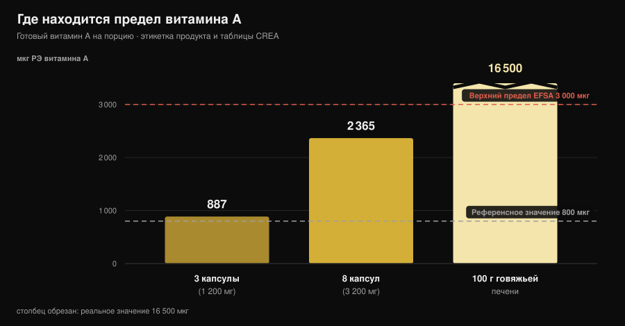
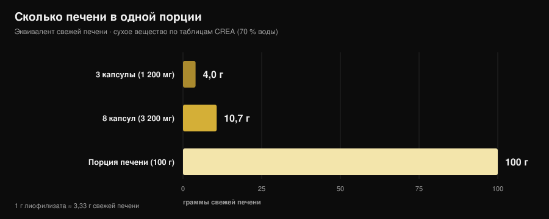

# Добавки из говяжьей печени: есть ли польза?

Автор: [Giammaria Loi](/autore/giammaria-loi) · обновлено 15 ноября 2026 года

Высушенная печень в капсулах — самая быстрорастущая категория добавок, и продаётся она одной фразой: «природный мультивитамин». О печени фраза верна. Проблема в том, что в капсуле печени нет: там доля порции. И в единственном месте, где количество действительно важно — витамин A, — зазор между «полезно» и «слишком много» уже, чем говорит любая этикетка.

## Коротко

- **Три капсулы — это примерно 4 грамма печени.** Типичная порция заявляет 1 200 мг лиофилизированной печени. Свежая печень на 70% состоит из воды (таблицы CREA), поэтому 1 200 мг порошка соответствуют примерно **4 г настоящей печени**: одной двадцать пятой части порции в 100 г.
- **Витамин A — единственный нутриент в значимой дозе.** Один из продуктов, продающихся в Европе, заявляет 887 мкг на 3 капсулы, то есть 111% суточной референсной величины. Медь 0,38 мг (38%), B12 4,32 мкг (172%). Всё остальное несущественно.
- **Предел безопасности рядом, а не далеко.** В 2024 году EFSA подтвердило для готового витамина A верхний допустимый уровень потребления в **3 000 мкг РЭ в сутки**, исходя из тератогенности. Максимальная доза, напечатанная на некоторых этикетках (8 капсул), уже доходит примерно до 2 400 мкг.
- **Настоящая печень превышает лимит сама по себе.** В 100 г говяжьей печени 16 500 мкг витамина A (CREA): более чем **в пять раз** выше суточного максимума. Поэтому EFSA рекомендует ограничивать печень и субпродукты одним разом в месяц или реже и избегать их при беременности.
- **О силе, энергии и мышцах нет ни одного контролируемого исследования.** Работ по добавкам из высушенной печени и тренировкам не существует: ноль рандомизированных испытаний. Всё, что об этом пишут, — анекдоты.

*График Nurvan. Капсулы: значения, заявленные на этикетке добавки из лиофилизированной печени, продающейся в Европе (887 мкг витамина A на 3 капсулы по 1 200 мг; показатель для 8 капсул пропорционален максимальной дозе, указанной производителем). Свежая печень: таблицы состава CREA, печень крупного рогатого скота, 16 500 мкг РЭ на 100 г. Верхний предел: EFSA, 2024.*

## Что это такое и что обещают

Их продают как *organ supplements* или просто *beef liver*: лиофилизированная или высушенная говяжья печень в капсулах, часто с пометкой *grass-fed*. Аргумент — предковый (наши предки ели органы, мы нет) и нутрициологический: печень действительно один из самых насыщенных микронутриентами продуктов.

В последнем цифры на их стороне. По таблицам состава продуктов CREA, 100 г говяжьей печени дают 16 500 мкг витамина A в ретиноловом эквиваленте, 3,7 мг меди, 3,30 мг рибофлавина, 8,8 мг железа, 42 мкг селена, 6 мг цинка и 20 г белка при 142 ккал. Ни один мультивитамин не повторяет этот профиль настолько полно.

Логический скачок, который никогда не проговаривают, — переход от продукта к капсуле.

## Сколько печени на самом деле в одной порции

Свежая печень содержит 70 г воды на 100 г. После лиофилизации остаётся сухое вещество: около 30 г на каждые 100 г исходного продукта. Расчёт укладывается в строчку.

Типичная порция — три капсулы — заявляет **1 200 мг лиофилизированной печени**. Разделив на 0,30, получаем примерно **4 г свежей печени**. Максимальная доза, указанная тем же производителем, восемь капсул, — это 3 200 мг порошка, то есть **менее 11 г печени**.

*График Nurvan. Пересчёт из сухого вещества: говяжья печень содержит 70,0 г воды на 100 г (таблицы CREA), значит 1 г лиофилизата ≈ 3,33 г свежей печени. Дозы с этикетки: 1 200 мг на 3 капсулы, 3 200 мг на 8 капсул.*

Если держать эту пропорцию в голове, половина вопросов о продукте отпадает сама. Если из печени вам нужно то, что требуется в количестве — белок, железо, цинк, — капсулы этого не дадут никогда: чтобы сравняться с одной порцией, понадобилось бы двадцать пять доз. Если же что-то в печени сконцентрировано предельно, капсула даёт достаточно, чтобы это считалось. И это относится ровно к одному из этих нутриентов.

## Единственный нутриент, который считается: витамин A

Добавка из лиофилизированной печени на европейском рынке заявляет на три капсулы: витамин A 887 мкг (111% референсного значения), витамин B12 4,32 мкг (172%), медь 0,38 мг (38%). Железо не указано вовсе.

Витамин A печени — это ретинол, то есть **готовый** витамин A: не бета-каротин из моркови, который организм превращает лишь в нужном объёме. Ретинол накапливается в вашей печени, и предохранительного клапана у него нет.

В 2024 году панель NDA EFSA пересмотрела всю литературу и подтвердила верхний допустимый уровень потребления готового витамина A для взрослых: **3 000 мкг РЭ в сутки**, одинаково для мужчин, женщин детородного возраста, беременных и кормящих. Критический эффект, на котором построено это число, — **тератогенность**, то есть вред развитию эмбриона.

Три капсулы по 887 мкг для здорового взрослого не проблема: это около трети предела. Проблема начинается, когда складываются три вещи, а складываются они легко: максимальная доза, которую многие производители сами печатают на этикетке (8 капсул, около 2 400 мкг), мультивитамин, уже содержащий витамин A, и настоящая печень на тарелке. Потому что настоящая печень выходит за шкалу сама по себе: 100 г — это 16 500 мкг, **в 5,5 раза больше суточного максимума**. Это не теоретическая деталь — именно поэтому EFSA пишет, что европейское население остаётся ниже предела только при употреблении печени и субпродуктов раз в месяц или реже.

Что приём печени действительно сдвигает биохимию, измерено: в исследовании у небеременных женщин один приём пищи с печенью с высоким содержанием витамина A повысил суточную экспозицию к 13-цис-ретиноевой кислоте и её 4-оксо-метаболиту — соединениям, стоящим за токсичностью, — в три-пять раз. Что избыток не гипотеза, показывает клиника: три случая отравления витамином A после употребления рыбьей печени, описанные токсикологическим центром Марселя, с головной болью, тошнотой, шелушением кожи и, у беременной женщины, выкидышем.

У хронического избытка, в отличие от острого, мишень менее заметная: кость. Обзор 2024 года в *Frontiers in Endocrinology* честно подводит итог: в доклинических работах высокие дозы витамина A однозначно снижают кортикальную костную массу, тогда как у человека клинические связи противоречивы, а один метаанализ нашёл повышенный риск перелома шейки бедра и при низких, и при высоких уровнях витамина A в крови. Это не приговор — это причина, по которой «чем больше, тем лучше» к этому нутриенту неприменимо.

> **При беременности или планировании беременности не принимайте эти добавки, не обсудив их предварительно с врачом.** EFSA прямо рекомендует избегать продуктов из печени во время беременности, а предел в 3 000 мкг построен именно на этом риске.

## Что на самом деле говорит наука

| Распространённое утверждение | Вердикт | Источник |
|---|---|---|
| «Печень — природный мультивитамин» | **Подтверждено** для продукта: 100 г покрывают витамин A, медь, B2, железо, селен и цинк | CREA, таблицы состава |
| «Значит, капсулы — это мультивитамин» | **Опровергнуто**: 3 капсулы ≈ 4 г печени. В значимой дозе приходит только витамин A | Этикетка продукта + CREA |
| «Это же просто еда, вреда не будет» | **Опровергнуто**: у готового витамина A есть потолок 3 000 мкг/сут по тератогенности, а гипервитаминоз A от печени описан в клинике | EFSA, 2024; Schmitt et al., 2020 |
| «Чем больше приму, тем лучше» | **Опровергнуто**: хронический избыток витамина A снижает кортикальную костную массу в моделях на животных, а метаанализ указывает на больше переломов бедра на обоих краях | Lerner, 2024 |
| «Дают энергию, тестостерон, восстановление, массу» | **Не проверяемо**: нет ни одного контролируемого исследования по добавкам из высушенной печени и работоспособности или составу тела | Поиск в PubMed, РКИ не найдены |
| «Отлично от усталости при нехватке железа» | **Требует уточнения**: железо улучшает работоспособность только при дефиците, и в исследованиях используют около 100 мг элементарного железа в сутки. Капсулы железо даже не декларируют | Pengelly et al., 2024 |
| «Grass-fed значит безопаснее» | **Не проверяемо**: кормление животного не снижает содержание витамина A, а именно оно критично | — |

### Вопрос, который идёт раньше: что внутри капсулы?

Есть вопрос, предшествующий всем остальным: говорит ли этикетка правду? Для этой конкретной категории независимых опубликованных анализов нет. Зато есть не слишком успокаивающая общая картина по добавкам, не зарегистрированным как лекарства: в анализе 2025 года 40 продуктов с *Andrographis paniculata*, купленных в 13 странах, реальное содержание действующего вещества составляло от 29% до 174% заявленного — точно маркированы были лишь два продукта, — а три продукта, купленных онлайн, содержали токсичные примеси, включая ртуть и пестициды.

Это не исследование говяжьей печени и читать его так не следует. Это причина, по которой для продукта, у единственного значимого нутриента которого есть потолок безопасности, происхождение и контроль партий важнее, чем надпись на лицевой стороне.

## Как это применить

1. **Решите, зачем вы это принимаете.** Если ответ «ради витамина A и B12» — такая причина существует и выдерживает проверку. Если «ради силы» или «ради энергии» — измерять нечего: это не проверял никто.
2. **Складывайте витамин A, а не усредняйте ощущения.** Выпишите капсулы, мультивитамин и то, сколько раз в месяц вы едите печень. Потолок — 3 000 мкг готового витамина A в сутки, и настоящая печень пробивает его в одиночку.
3. **Не превышайте указанную минимальную дозу без причины.** «8 капсул» максимальной дозы на некоторых упаковках дают около 2 400 мкг: почти весь доступный запас, потраченный на продукт без исследований эффективности.
4. **Если вы едите печень, считайте этот день полным.** Обычная порция перекрывает потребность многократно: в этот день капсулы не нужны, и на следующей неделе тоже.
5. **Беременность, планирование беременности, болезни печени, гемохроматоз, терапия ретиноидами — сначала к врачу.** Здесь речь не об оптимизации, а о безопасности, и решение принимает не статья.
6. **Если цель — масса, сначала посмотрите на белок.** Четыре грамма печени не источник белка. О том, как мясные порошки смотрятся рядом с сывороточным протеином, мы писали отдельно: [beef protein против сывороточного](/ru/blog/beef-protein-govyazhiy-protein-protiv-syvorotochnogo).

> **Nurvan: витамин A складывает приложение, а не ваша память**
>
> Риск этой категории — не одна капсула, а сумма нескольких источников. В Nurvan вы вносите добавки с дозой и временем в модуль добавок, а дневник питания, построенный на данных CREA, считает витамин A, который уже приходит с едой, включая печень. Так дневной итог становится числом, которое вы видите, а не оценкой на глаз. [Попробовать Nurvan](https://nurvan.app)

## Частые вопросы

**Работают ли добавки из говяжьей печени?**
Как источник готового витамина A и витамина B12 — да, и этикетка это заявляет. Как помощь для силы, энергии, восстановления или мышечной массы контролируемых исследований нет: работ по высушенной печени и работоспособности не существует. Количества белка, железа и цинка в порции слишком малы, чтобы иметь значение.

**Сколько капсул печени в день можно принимать?**
Производители обычно указывают от 3 до 8 капсул. Настоящее ограничение — не капсула, а суточная сумма готового витамина A, которая по EFSA не должна превышать 3 000 мкг РЭ у взрослых. При 887 мкг на три капсулы восемь капсул уже дают около 2 400 мкг, не считая мультивитаминов и пищи.

**Что лучше: капсулы или есть печень?**
Это разные вещи. Порция печени даёт весь профиль микронутриентов, но 100 г содержат 16 500 мкг витамина A, более чем впятеро выше суточного предела: поэтому EFSA советует раз в месяц или реже. Капсулы дают долю профиля в управляемой дозе. Если вам нужен нутриент, выбирайте по желаемой частоте приёма; если вам нужна еда, выбирайте печень и ставьте её в календарь, а не в ротацию.

**Можно ли принимать их при беременности?**
Не без консультации с врачом. EFSA рекомендует избегать продуктов из печени при беременности и при её планировании, а верхний предел для готового витамина A построен именно на риске пороков развития.

## Читайте также

- [Beef protein против сывороточного: что говорят исследования](/ru/blog/beef-protein-govyazhiy-protein-protiv-syvorotochnogo) — другой «говяжий» продукт, который продают предковыми аргументами, проверенный данными.
- [Рейтинг спортивных добавок для силы: что говорит наука](/ru/blog/reyting-sportivnykh-dobavok-dlya-sily) — где стоят, по силе доказательств, добавки, которые имеют значение для тренирующихся.
- [Какой магний выбрать и сколько его нужно](/ru/blog/kakoy-magniy-vybrat-doza-i-formy) — как читать этикетку, когда форма и доза меняют всё.

## Источники

1. CREA — Исследовательский центр пищевых продуктов и питания. Таблицы состава продуктов, карточка «Fegato di bovini» (печень крупного рогатого скота; на 100 г съедобной части: вода 70,0 г; белок 20,0 г; витамин A в ретиноловом эквиваленте 16 500 мкг; рибофлавин 3,30 мг; железо 8,8 мг; медь 3,7 мг; цинк 6 мг; селен 42 мкг). [alimentinutrizione.it](https://www.alimentinutrizione.it/tabelle-nutrizionali/115320)
2. EFSA Panel on Nutrition, Novel Foods and Food Allergens (NDA); Turck D, Bohn T, Castenmiller J, et al., 2024. Scientific opinion on the tolerable upper intake level for preformed vitamin A and β-carotene. *EFSA Journal* 22(6):e8814. [PMID 38846679](https://pubmed.ncbi.nlm.nih.gov/38846679/) · [DOI 10.2903/j.efsa.2024.8814](https://doi.org/10.2903/j.efsa.2024.8814)
3. Lerner UH, 2024. Vitamin A — discovery, metabolism, receptor signaling and effects on bone mass and fracture susceptibility. *Front Endocrinol* 15:1298851. [PMID 38711977](https://pubmed.ncbi.nlm.nih.gov/38711977/) · [DOI 10.3389/fendo.2024.1298851](https://doi.org/10.3389/fendo.2024.1298851)
4. Hartmann S, Brørs O, Bock J, Blomhoff R, Bausch J, Wiegand UW, Hartmann D, Hornig DH, 2005. Exposure to retinoic acids in non-pregnant women following high vitamin A intake with a liver meal. *Int J Vitam Nutr Res* 75(3):187-194. [PMID 16028634](https://pubmed.ncbi.nlm.nih.gov/16028634/) · [DOI 10.1024/0300-9831.75.3.187](https://doi.org/10.1024/0300-9831.75.3.187)
5. Schmitt C, Domangé B, Torrents R, de Haro L, Simon N, 2020. Hypervitaminosis A Following the Ingestion of Fish Liver: Report on 3 Cases from the Poison Control Center in Marseille. *Wilderness Environ Med* 31(4):454-456. [PMID 32861618](https://pubmed.ncbi.nlm.nih.gov/32861618/) · [DOI 10.1016/j.wem.2020.06.003](https://doi.org/10.1016/j.wem.2020.06.003)
6. Pengelly M, Pumpa K, Pyne DB, Etxebarria N, 2024. Iron deficiency, supplementation, and sports performance in female athletes: A systematic review. *J Sport Health Sci* 14:101009. [PMID 39536912](https://pubmed.ncbi.nlm.nih.gov/39536912/) · [DOI 10.1016/j.jshs.2024.101009](https://doi.org/10.1016/j.jshs.2024.101009)
7. Bourqui A, Morin H, Huber R, Csajka C, Podmore C, Wolfender JL, Queiroz Ferreira E, Rodondi PY, 2025. Quality assessment of Andrographis paniculata products reveals significant labelling inaccuracies and contaminations. *Swiss Med Wkly* 155:4728. [PMID 41397381](https://pubmed.ncbi.nlm.nih.gov/41397381/) · [DOI 10.57187/s.4728](https://doi.org/10.57187/s.4728)

Значения с этикетки, приведённые в тексте и на графиках: карточка товара добавки из лиофилизированной говяжьей печени, продающейся в Европе (на 3 капсулы: 1 200 мг лиофилизированной печени, витамин A 887 мкг, медь 0,38 мг, витамин B12 4,32 мкг; указанная максимальная суточная доза 8 капсул). Проверка отсутствия исследований: поиск в PubMed по добавкам из высушенной печени и тренировкам или работоспособности, рандомизированных испытаний не найдено. Тема выбрана по трендовым сигналам ноября 2026 года по категории organ supplements, где конкурирующий контент состоит почти исключительно из карточек товара. Научные источники найдены через PubMed.

**Giammaria Loi** — основатель Nurvan. Занимается с отягощениями с 2012 года, работает персональным тренером и коучем с сертификацией FIPE с 2013 года и выступает в пауэрлифтинге на национальном уровне с 2018 года. Каждая статья, которую он подписывает, начинается с научных исследований и заканчивается тем, что действительно работает в зале. [Страница автора](/autore/giammaria-loi)

> Примечание: информационный материал, он не заменяет консультацию врача или квалифицированного специалиста.
