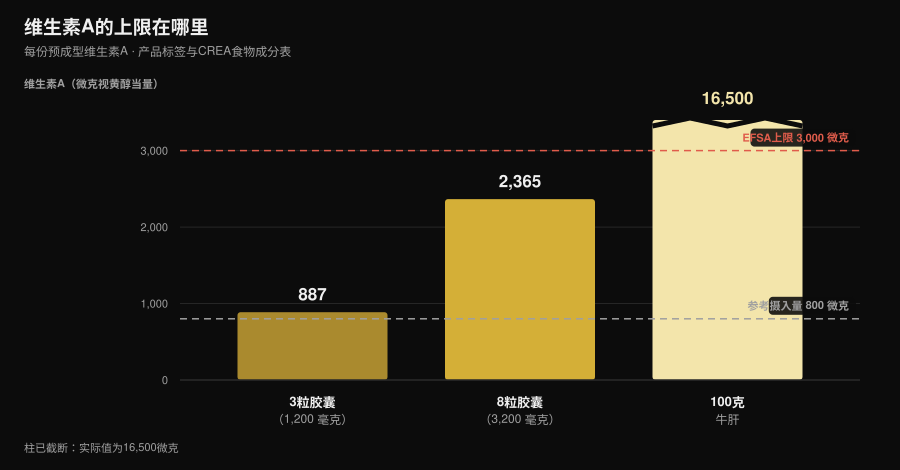
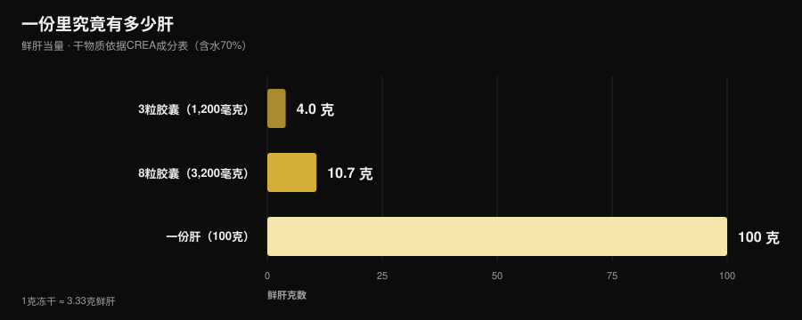

# 牛肝补充剂真的有用吗？一文看懂剂量与风险

作者：[Giammaria Loi](/autore/giammaria-loi) · 更新于2026年11月15日

胶囊装的干燥牛肝是当下增长最快的补剂品类，而它的卖点只有一句话：“大自然的复合维生素”。这句话用来形容肝脏是对的。问题在于，一粒胶囊里并没有肝脏，只有一份食物的零头。而在剂量真正重要的那一项上——维生素A——“有用”和“过量”之间的距离，比任何标签告诉你的都要近。

## 要点速览

- **三粒胶囊约等于4克肝脏。** 典型一份标示1,200毫克冻干肝脏。新鲜肝脏含水70%（CREA成分表），所以1,200毫克粉末相当于约**4克真肝**：一份100克肝脏的二十五分之一。
- **维生素A是唯一达到有效剂量的营养素。** 欧洲在售的一款产品标示每3粒含887微克，为每日参考值的111%。铜0.38毫克（38%），B12 4.32微克（172%）。其余都可以忽略。
- **安全上限很近，不远。** EFSA在2024年确认，预成型维生素A的可耐受最高摄入量为**每日3,000微克视黄醇当量**，依据是致畸性。某些标签上印的最大日剂量（8粒）已达约2,400微克。
- **真正的肝脏自己就超标。** 100克牛肝含16,500微克维生素A（CREA）：是每日上限的**五倍多**。因此EFSA建议把肝脏和内脏限制在每月一次或更少，孕期则应避免。
- **关于力量、精力和增肌，没有任何一项对照研究。** 干燥肝脏补充剂与训练的研究是空白：零项随机对照试验。你读到的相关说法都是个人经验。

*Nurvan 图表。胶囊：欧洲在售某冻干牛肝补充剂的标签标示值（每3粒1,200毫克，含维生素A 887微克；8粒的数值按厂家标示的最大剂量等比推算）。新鲜肝脏：CREA食物成分表，牛肝，每100克16,500微克视黄醇当量。上限：EFSA，2024年。*

## 它们是什么，又承诺了什么

它们以 *organ supplements* 或直接以 *beef liver* 的名义销售：冻干或干燥的牛肝装入胶囊，常标注 *grass-fed*（草饲）。卖点一半是“祖先叙事”——祖先吃内脏，我们不吃——一半是营养学：肝脏确实是现存微量营养素密度最高的食物之一。

在后一点上，数字站在他们这边。根据CREA食物成分表，100克牛肝提供16,500微克维生素A（视黄醇当量）、3.7毫克铜、3.30毫克核黄素、8.8毫克铁、42微克硒、6毫克锌和20克蛋白质，热量142千卡。没有哪种复合维生素能如此完整地复制这个谱型。

从未被说明的那一步，是从食物跳到胶囊。

## 一份里究竟有多少肝

新鲜肝脏每100克含70克水。冻干后剩下的是干物质：每100克原料约30克。算式只要一行。

典型一份——三粒胶囊——标示**1,200毫克冻干肝脏**。除以0.30，约等于**4克鲜肝**。同一厂家标示的最大剂量八粒，是3,200毫克粉末，也就是**不到11克肝脏**。

*Nurvan 图表。由干物质换算：牛肝每100克含水70.0克（CREA成分表），因此1克冻干粉 ≈ 3.33克鲜肝。标签剂量：3粒1,200毫克，8粒3,200毫克。*

记住这个比例，关于这类产品的一半疑问就自己解决了。如果你想从肝脏里拿到的是需要“论量”的东西——蛋白质、铁、锌——胶囊永远给不了：要凑齐一份，得吃二十五份胶囊。反过来，如果肝脏里某样东西浓度极高，那么胶囊给的量就足以算数。而这只适用于其中一种营养素。

## 唯一算数的营养素：维生素A

欧洲市场上一款冻干肝脏补充剂标示每三粒含：维生素A 887微克（参考值的111%）、维生素B12 4.32微克（172%）、铜0.38毫克（38%）。铁甚至没有标示。

肝脏中的维生素A是视黄醇，也就是**预成型**维生素A：它不是胡萝卜里的β-胡萝卜素，后者身体只按需转化。视黄醇会在你的肝里累积，而且没有泄压阀。

2024年，EFSA的NDA专家组重新审阅了全部文献，确认成人预成型维生素A的可耐受最高摄入量为**每日3,000微克视黄醇当量**，适用于男性、育龄女性以及孕期和哺乳期女性。这个数字所依据的关键效应是**致畸性**，即对胚胎发育的损害。

三粒887微克对健康成年人不是问题：大约是上限的三分之一。问题出在三件事相加，而它们很容易相加：许多厂家自己印在标签上的最大剂量（8粒，约2,400微克）、本就含维生素A的复合维生素，以及餐桌上真正的肝脏。因为真肝自己就超出量级：100克即16,500微克，是每日上限的**5.5倍**。这不是理论细节——正是因此，EFSA写明欧洲人群只有在肝脏和内脏每月吃一次或更少时，才会保持在上限以下。

一餐肝脏确实会改变体内生化，这一点被测量过：在一项针对非孕期女性的研究中，单次高维生素A的肝脏餐，使24小时内13-顺式视黄酸及其4-氧代代谢物——毒性背后的化合物——的暴露量升高了三到五倍。过量并非假设，临床案例也说明了这一点：马赛中毒控制中心报告的三例食用鱼肝后维生素A中毒，表现为头痛、恶心、皮肤脱屑，其中一名孕妇流产。

慢性过量（而非急性）还有一个不易察觉的靶点：骨骼。2024年发表于《Frontiers in Endocrinology》的一篇综述把图景说得很诚实：临床前研究中，高剂量维生素A明确降低皮质骨量；而在人体中，临床关联并不一致，一项荟萃分析发现血液维生素A水平过低和过高时，髋部骨折风险都升高。这不是定罪——这是“吃得越多越好”不适用于这种营养素的原因。

> **孕期或备孕期间，服用这类补充剂前请先咨询医生。** EFSA明确建议孕期避免肝脏类产品，而3,000微克这个上限正是基于这一风险设定的。

## 研究到底怎么说

| 常见说法 | 结论 | 来源 |
|---|---|---|
| “肝脏是大自然的复合维生素” | **属实**（针对食物）：100克可覆盖维生素A、铜、B2、铁、硒和锌 | CREA成分表 |
| “所以胶囊就是复合维生素” | **不成立**：3粒≈4克肝脏，只有维生素A达到有效剂量 | 产品标签＋CREA |
| “它就是食物，吃不坏” | **不成立**：预成型维生素A有每日3,000微克的上限（依据致畸性），由肝脏引起的维生素A过多症有临床记录 | EFSA, 2024；Schmitt et al., 2020 |
| “吃得越多越好” | **不成立**：慢性维生素A过量在动物模型中降低皮质骨量，荟萃分析提示两端极值下髋部骨折更多 | Lerner, 2024 |
| “能提升精力、睾酮、恢复、围度” | **无法验证**：没有任何关于干燥肝脏补充剂与运动表现或身体成分的对照研究 | PubMed 检索，未见随机对照试验 |
| “对缺铁引起的疲劳很好” | **需要限定**：铁只对缺铁者改善表现，研究使用的剂量约为每日100毫克元素铁。胶囊连铁都没标 | Pengelly et al., 2024 |
| “草饲更安全” | **无法验证**：动物的饲养方式并不降低维生素A含量，而这才是关键点 | — |

### 更前面的问题：胶囊里到底是什么

有一个问题先于其他所有问题：标签说的是真的吗？针对这一特定品类，目前没有已发表的独立检测。存在的是一个关于“非按药品批准”的补充剂的普遍图景，并不令人安心：2025年一项分析检测了在13个国家购买的40款*穿心莲*产品，有效成分实测含量为标示值的29%到174%——只有两款标注准确——其中三款线上购买的产品含有有毒污染物，包括汞和农药。

这不是针对牛肝的研究，也不应被当作如此。它说明的是：对于唯一有效营养素带有安全上限的产品，原料来源和批次检测比包装正面的宣传语更重要。

## 怎么落地

1. **先想清楚你为什么吃。** 如果答案是“为了维生素A和B12”，这个理由成立。如果是“为了力量”或“为了精力”，没有任何可衡量的东西：没有研究测试过。
2. **把维生素A加起来，而不是凭感觉平均。** 把胶囊、复合维生素，以及每月吃几次肝脏写下来。上限是每日3,000微克预成型维生素A，而真肝自己就能突破。
3. **没有理由就不要超过标示的最低剂量。** 某些包装上“8粒”的最大剂量会带来约2,400微克：几乎用掉全部可用余量，而这个产品并没有有效性研究。
4. **吃了肝脏，就把那天算作“吃满”。** 一份正常分量数倍覆盖需要量：那天不需要胶囊，接下来那一周也不需要。
5. **孕期、备孕、肝病、血色病、维A酸类药物治疗期间：先和医生谈。** 这里不是优化问题，而是安全问题，决定权不在一篇文章。
6. **如果目标是增肌，先看蛋白质。** 4克肝脏不是蛋白质来源。关于牛肉蛋白粉与乳清的比较，我们另有一篇：[牛肉蛋白粉还是乳清蛋白](/zh/blog/niurou-danbai-fen-haishi-rujiang-danbai)。

> **Nurvan：维生素A由App来加总，而不是靠你的记忆**
>
> 这个品类的风险不在一粒胶囊，而在多个来源相加。在Nurvan里，你可以在补剂模块中记录补充剂的剂量和时间，而基于CREA数据构建的饮食日记会统计食物中已经带来的维生素A——包括肝脏。这样当天的总量就是一个你看得见的数字，而不是估计。[试用 Nurvan](https://nurvan.app)

## 常见问题

**牛肝补充剂有用吗？**
作为预成型维生素A和维生素B12的来源，有用，标签上也写明了。作为提升力量、精力、恢复或肌肉量的手段，没有对照研究：干燥肝脏与运动表现的研究是空白。一份里的蛋白质、铁和锌含量都太低，不足以起作用。

**牛肝胶囊一天能吃几粒？**
厂家通常标示3到8粒。真正的限制不是胶囊数，而是当天预成型维生素A的总量，EFSA认为成人不应超过3,000微克视黄醇当量。按每三粒887微克计算，八粒已约2,400微克，还没算复合维生素和食物。

**吃胶囊好还是吃肝脏好？**
这是两件事。一份肝脏给你完整的微量营养素谱，但100克含16,500微克维生素A，超过每日上限五倍，这正是EFSA建议每月一次或更少的原因。胶囊给的是谱型的一小部分，但剂量可控。如果你要的是营养素，按你想服用的频率来选；如果你要的是一餐，就选肝脏，并把它排进日程，而不是放进日常轮换。

**孕期可以吃吗？**
不要在没有咨询医生的情况下服用。EFSA建议孕期以及备孕期间避免肝脏类产品，而预成型维生素A的上限正是基于致畸风险设定的。

## 延伸阅读

- [牛肉蛋白粉还是乳清蛋白：研究怎么说](/zh/blog/niurou-danbai-fen-haishi-rujiang-danbai) —— 另一款用“祖先叙事”销售的牛源产品，用数据来衡量。
- [力量补剂等级榜：研究怎么说](/zh/blog/liliang-buji-dengji-bang) —— 按证据强弱排列，训练者真正需要关注的补剂在哪一档。
- [如何选择镁：剂量与形式](/zh/blog/ruhe-xuanze-mei-jiliang-yu-xingshi) —— 当形式和剂量决定一切时，标签该怎么读。

## 参考来源

1. CREA —— 意大利食品与营养研究中心。食物成分表，“Fegato di bovini”（牛肝）条目（每100克可食部：水70.0克；蛋白质20.0克；维生素A视黄醇当量16,500微克；核黄素3.30毫克；铁8.8毫克；铜3.7毫克；锌6毫克；硒42微克）。[alimentinutrizione.it](https://www.alimentinutrizione.it/tabelle-nutrizionali/115320)
2. EFSA Panel on Nutrition, Novel Foods and Food Allergens (NDA); Turck D, Bohn T, Castenmiller J, et al., 2024. Scientific opinion on the tolerable upper intake level for preformed vitamin A and β-carotene. *EFSA Journal* 22(6):e8814. [PMID 38846679](https://pubmed.ncbi.nlm.nih.gov/38846679/) · [DOI 10.2903/j.efsa.2024.8814](https://doi.org/10.2903/j.efsa.2024.8814)
3. Lerner UH, 2024. Vitamin A — discovery, metabolism, receptor signaling and effects on bone mass and fracture susceptibility. *Front Endocrinol* 15:1298851. [PMID 38711977](https://pubmed.ncbi.nlm.nih.gov/38711977/) · [DOI 10.3389/fendo.2024.1298851](https://doi.org/10.3389/fendo.2024.1298851)
4. Hartmann S, Brørs O, Bock J, Blomhoff R, Bausch J, Wiegand UW, Hartmann D, Hornig DH, 2005. Exposure to retinoic acids in non-pregnant women following high vitamin A intake with a liver meal. *Int J Vitam Nutr Res* 75(3):187-194. [PMID 16028634](https://pubmed.ncbi.nlm.nih.gov/16028634/) · [DOI 10.1024/0300-9831.75.3.187](https://doi.org/10.1024/0300-9831.75.3.187)
5. Schmitt C, Domangé B, Torrents R, de Haro L, Simon N, 2020. Hypervitaminosis A Following the Ingestion of Fish Liver: Report on 3 Cases from the Poison Control Center in Marseille. *Wilderness Environ Med* 31(4):454-456. [PMID 32861618](https://pubmed.ncbi.nlm.nih.gov/32861618/) · [DOI 10.1016/j.wem.2020.06.003](https://doi.org/10.1016/j.wem.2020.06.003)
6. Pengelly M, Pumpa K, Pyne DB, Etxebarria N, 2024. Iron deficiency, supplementation, and sports performance in female athletes: A systematic review. *J Sport Health Sci* 14:101009. [PMID 39536912](https://pubmed.ncbi.nlm.nih.gov/39536912/) · [DOI 10.1016/j.jshs.2024.101009](https://doi.org/10.1016/j.jshs.2024.101009)
7. Bourqui A, Morin H, Huber R, Csajka C, Podmore C, Wolfender JL, Queiroz Ferreira E, Rodondi PY, 2025. Quality assessment of Andrographis paniculata products reveals significant labelling inaccuracies and contaminations. *Swiss Med Wkly* 155:4728. [PMID 41397381](https://pubmed.ncbi.nlm.nih.gov/41397381/) · [DOI 10.57187/s.4728](https://doi.org/10.57187/s.4728)

正文与图表中引用的标签数值：欧洲在售某冻干牛肝补充剂的产品页（每3粒：冻干肝脏1,200毫克，维生素A 887微克，铜0.38毫克，维生素B12 4.32微克；标示最大日剂量8粒）。无证据核查：在PubMed检索干燥肝脏补充剂与训练或运动表现，未找到任何随机对照试验。选题依据2026年11月关于organ supplements品类的趋势信号，该主题的竞争内容几乎全部为产品页。科学文献通过PubMed检索。

**Giammaria Loi** 是 Nurvan 的创始人。他自2012年开始力量训练，自2013年起担任持有FIPE认证的私人教练，并自2018年起在全国级别参加力量举比赛。他署名的每一篇文章都从科学研究出发，落到健身房里真正有效的做法。[作者页面](/autore/giammaria-loi)

> 说明：本文为信息性内容，不能替代医生或合格专业人员的意见。
