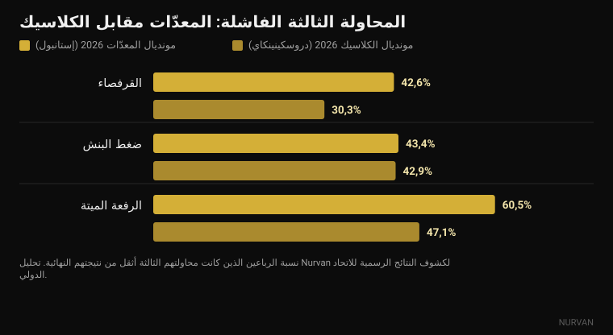
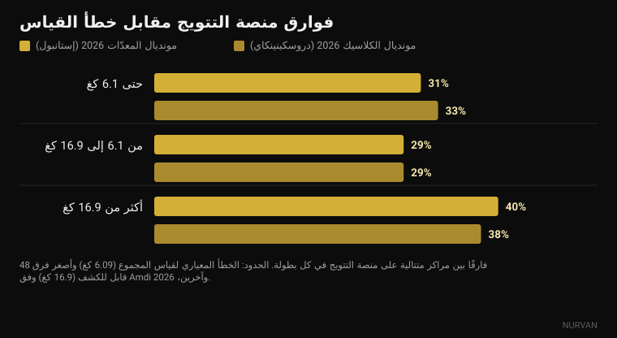

# مونديال المعدّات 2026: النتائج والمحاولة الثالثة

بقلم [Giammaria Loi](/autore/giammaria-loi) · تحديث 16 نوفمبر 2026

اختُتمت يوم الأحد 15 نوفمبر في إسطنبول بطولة العالم المفتوحة بالمعدّات، ونشر الاتحاد الدولي كشوف النتائج الرسمية في اليوم نفسه. حمّلت الوثيقتين كاملتين — الرجال والسيدات — ووضعتهما بجانب كشوف بطولة العالم الكلاسيكية في يونيو. إلى جانب منصات التتويج، خرج رقم يساوي في الصالة أكثر من أي رقم قياسي: كم مرة تبقى المحاولة الثالثة على الأرض.

## باختصار

- **أوكرانيا وكندا تحصدان لقبي الفرق.** لدى الرجال تفوز أوكرانيا بـ51 نقطة أمام تايبيه الصينية (42) واليابان (38)؛ ولدى السيدات تفوز كندا بـ43 نقطة أمام تايبيه الصينية (42) والبرازيل (34).
- **32 رقمًا قياسيًا عالميًا في سبعة أيام**: 17 لدى الرجال و15 لدى السيدات، موزّعة على الفئة المفتوحة (9) وماسترز 1 (9) وماسترز 2 (9) والشباب (5).
- **الرفعة الميتة هي الحركة الأكثر إخفاقًا.** في إسطنبول حمّل **60.5%** من الرباعين في محاولتهم الثالثة وزنًا أعلى من النتيجة التي انتهوا بها. في البطولة الكلاسيكية كانت النسبة 47.1%.
- **فارق واحد من كل ثلاثة على المنصة يقع داخل خطأ القياس**: 31% من الفوارق بين المراكز المتتالية كانت 6.09 كغ أو أقل، وهو الخطأ المعياري لقياس المجموع (Amdi وآخرون، 2026).
- **المعدّات تعاقب سوء التقدير بقسوة أكبر**: 13.4% من المشاركين في إسطنبول أنهوا البطولة دون مجموع صحيح، مقابل 1.4% في البطولة الكلاسيكية.

## من فاز في إسطنبول

أقيمت بطولة العالم المفتوحة بالمعدّات في إسطنبول بتركيا **من 9 إلى 15 نوفمبر 2026**. تسجّل الكشوف الرسمية **179 رباعًا من 34 دولة**، في ثماني فئات وزن للرجال وثماني للسيدات.

أفضل نتيجة في البطولة للأوكراني **Kostiantyn Musiienko**: **1064.5 كغ** في وزن 93 كغ و115.44 نقطة IPF GL، مع رقمين قياسيين عالميين في الفئة المفتوحة في ضغط البنش (352.0 كغ) وفي المجموع. خلفه في الوزن نفسه زميله Volodymyr Rysiiev بـ1025 كغ.

لدى السيدات، أفضل نتيجة لـ**Kelsey McCarthy** (الولايات المتحدة) في وزن 69 كغ: **655.0 كغ** و113.88 نقطة IPF GL، ورقم قياسي عالمي في الفئة المفتوحة. قبل عام في كلوج-نابوكا فازت بالوزن نفسه بـ652.5 كغ: أضافت 2.5 كغ، وكان ذلك كافيًا للرقم القياسي.

في ترتيب الفرق تحتفظ **أوكرانيا** بلقب الرجال (51 نقطة، أمام تايبيه بـ42 واليابان بـ38 ثالثة بنقاط أفضل خمسة أمام النرويج). ويذهب لقب السيدات إلى **كندا** (43 نقطة)، وتايبيه ثانية بـ42 والبرازيل ثالثة بـ34.

أكثر نتيجة لفتت انتباهي كانت في وزن 74 كغ للرجال: فاز **Jarosław Olech** البولندي، مواليد **1974**. اثنان وخمسون عامًا، في الفئة المفتوحة — أي أمام رباعين في عمر أبنائه — بمجموع 865 كغ وثلاثة أرقام قياسية عالمية في ماسترز 2 (قرفصاء 360 كغ، بنش 205 كغ، مجموع 865 كغ). خلفه Lawson Lillo الأمريكي مواليد 2006: عشرون عامًا، و852.5 كغ، مع رقم قياسي عالمي للشباب في المجموع. اثنان وثلاثون عامًا فارق في العمر، و12.5 كغ فارق في المجموع. تناولت العلاقة بين العمر والقوة بتوسّع في مقال [بطولة العالم للمخضرمين في رينو](/ar/blog/butulat-almukhadramin-2026-alquwa-walumr).

## إيطاليا في إسطنبول: برونزية وستة رباعين

| الرباع | الوزن | المركز | المجموع |
| --- | --- | --- | --- |
| Giovanni Mancinelli | 120 كغ | الثالث | 972.5 كغ |
| Stefano Caneo | 66 كغ | الخامس | 652.5 كغ |
| Davide Cecchetti | 93 كغ | الثامن | 852.5 كغ |
| Diego Milani | 74 كغ | التاسع | 760.0 كغ |
| Caterina Caravaggio | 69 كغ | الخامسة | 552.5 كغ |
| Silvia Marostica | 76 كغ | العاشرة | 530.0 كغ |

الميدالية من نصيب **Giovanni Mancinelli**، ثالثًا في وزن 120 كغ بقرفصاء 410 كغ وبنش 257.5 كغ ورفعة ميتة 305 كغ. أنهى فريق الرجال تاسعًا بـ19 نقطة وفريق السيدات تاسع عشر بـ7 نقاط.

## الرقم الذي لا تُظهره المقاطع: المحاولة الثالثة

في المنافسة لديك ثلاث محاولات لكل حركة. الثالثة تحسم اليوم، وهي الأقل ظهورًا: المقاطع تعرض الرفعات الصحيحة، لا الأثقال التي بقيت في مكانها.

أما الكشوف فتُظهر كل شيء. إذا كان الوزن المعلَن في المحاولة الثالثة أعلى من النتيجة النهائية لذلك الرباع، فالمحاولة فاشلة — ويمكن عدّ ذلك سطرًا بسطر. فعلت ذلك في بطولتي العالم لعام 2026: بطولة المعدّات في إسطنبول و[البطولة الكلاسيكية في دروسكينينكاي](/ar/blog/butulat-almuaddat-2026-kam-tudif) في يونيو.

*تحليل Nurvan لكشوف النتائج الرسمية للاتحاد الدولي من بطولة العالم المفتوحة بالمعدّات 2026 (إسطنبول) والبطولة الكلاسيكية المفتوحة 2026 (دروسكينينكاي).*

تبرز ثلاث نقاط.

**الرفعة الميتة هي الأكثر إخفاقًا، وبفارق أكبر في المعدّات.** في إسطنبول كانت 60.5% من المحاولات الثالثة في الرفعة الميتة (92 من 152) أثقل من النتيجة النهائية؛ وفي الكلاسيك 47.1% (162 من 344). وهذا منطقي: الرفعة الميتة تختم اليوم، وفيها تُحسم الميدالية، وهي الحركة التي تساعد فيها المعدّات أقل ما يكون.

**في ضغط البنش لا يتغير شيء.** 43.4% في إسطنبول و42.9% في دروسكينينكاي: قميص البنش يسمح بأوزان أعلى، لكن نسبة المحاولات الثالثة الفاشلة متطابقة. الرباعون يذهبون إلى حافة ما يستطيعون، أينما كانت تلك الحافة.

**في القرفصاء تخفق المعدّات أكثر**: 42.6% مقابل 30.3%. مع البدلة ورباطات الركبة يضيق الهامش بين العمق الصحيح والمحاولة الملغاة، وخسارة القرفصاء الثالثة في بداية اليوم تثقل كل ما يليها.

وهناك رقم رابع أقسى: في إسطنبول **أنهى 24 رباعًا من 179 (13.4%) البطولة دون مجموع صحيح**. في البطولة الكلاسيكية في يونيو كانوا 5 من 351، أي 1.4%. في المعدّات يكلّف خطأ الاختيار البطولة كاملة بمعدل يقارب عشرة أضعاف.

## المنصة تُحسم داخل خطأ القياس

هنا تدخل دراسة نُشرت قبل أسابيع قليلة. قاس Amdi وزملاؤه (2026) مقدار تذبذب القوة القصوى لدى رباعي القوة على المستويين الإقليمي والوطني من أسبوع إلى آخر، فوجدوا خطأ قياس معياريًا قدره **4.16 كغ في القرفصاء و2.60 كغ في البنش و4.07 كغ في الرفعة الميتة و6.09 كغ في المجموع**. ثم حلّلوا خمسة عشر عامًا من بطولات الاتحاد الدولي لتقدير عدد الكيلوغرامات اللازمة لتقدّم مركز واحد: بين 14.3 و44.2 كغ في المجموع، بحسب المستوى والمركز. وخلصوا إلى أن **الفارق بين مركزين متتاليين يقع في معظم السياقات التنافسية داخل خطأ القياس**، وأن ذلك يظهر خصوصًا على مستوى بطولات العالم.

تحققت من هذه العبارة على بيانات إسطنبول. في كل فئة من الفئات الـ16 أخذت الفوارق بين المراكز المتتالية على المنصة (1-2، 2-3، 3-4): 48 فارقًا في المجموع.

*تحليل Nurvan لكشوف النتائج الرسمية للاتحاد الدولي. الحدود المرجعية وفق Amdi وآخرين، 2026: الخطأ المعياري لقياس المجموع 6.09 كغ، وأصغر فرق قابل للكشف نحو 16.9 كغ.*

**31% من فوارق المنصة كانت 6.09 كغ أو أقل**، و60% دون 16.9 كغ، والوسيط 12.5 كغ. البطولة الكلاسيكية في يونيو تعطي الصورة نفسها تقريبًا (33% و62%): هذه ليست خصوصية للمعدّات، بل هي طبيعة رياضة القوة على أعلى مستوى.

في ست حالات كان الفارق **صفرًا** بالضبط. في وزن 76 كغ للسيدات سجّلت ثلاث رباعات 610.0 كغ، ولم يفصل بينهن سوى وزن الجسم. في وزن 47 كغ سجّلت Wei-Ling Chen وFrankmary Duno 480.0 كغ لكلتيهما: الذهبية لـChen لأنها كانت أخف بـ450 غرامًا. وفي وزن 105 كغ للرجال أنهى Ian Bell وNicki Lentz-Nielsen البطولة بـ1050.0 كغ لكليهما.

بعبارة أخرى: على هذا المستوى لا يفوز أحد بفارق 20 كغ. يفوز من أخفق في محاولة واحدة أقل في ذلك اليوم.

## ماذا تقول الأبحاث فعلًا

**«في المعدّات المحاولة الثالثة شبه مجانية، فالتجهيزات تتكفّل بالأمر» — غير صحيح.** 60.5% من المحاولات الثالثة في الرفعة الميتة و42.6% من القرفصاء الثالثة في إسطنبول أُلغيت، و13.4% من الرباعين أنهوا دون مجموع مقابل 1.4% في الكلاسيك. المعدّات ترفع السقف لا هامش الخطأ.

**«في بطولة العالم يفوز الأقوى ببساطة» — يحتاج إلى تدقيق.** في 31% من الحالات كان الفارق على المنصة أصغر من الخطأ الذي يُقاس به المجموع (6.09 كغ وفق Amdi وآخرين، 2026)، وفي ست حالات كان صفرًا.

**«لتصبح قويًا عليك التمرّن دائمًا حتى الفشل العضلي» — غير صحيح.** في تحليلات Robinson وزملائه (2024) كانت مكاسب القوة متشابهة عبر مدى واسع من التكرارات المتبقية في الاحتياط: الذي يتحسّن مع الاقتراب من الفشل هو التضخّم العضلي لا القوة القصوى. وتصل مراجعة عن ضغط البنش إلى النصيحة العملية نفسها: تفضيل RPE/RIR وسرعة البار والتنظيم الذاتي على المجموعات حتى الفشل (Motlagh وLipps، 2024).

**«الـRIR غير دقيق بما يكفي لاختيار الأوزان» — يحتاج إلى تدقيق.** قاس Odgers وزملاؤه (2021) خطأ التقدير لدى رياضيين مدرَّبين: عند RPE 9، قرب الحد الأقصى، كان متوسط الخطأ 0.09-0.25 تكرار؛ وعند RPE 6 ارتفع إلى 0.71-1.19. الـRIR غير دقيق بعيدًا عن الفشل وموثوق قربه — عكس الطريقة الشائعة في استخدامه تمامًا. التفاصيل في [ما مدى دقة الـRIR](/ar/blog/ma-mada-diqat-rir).

**«بعد الخمسين لم تعد الفئة المفتوحة مكانك» — غير صحيح.** فاز Jarosław Olech، مواليد 1974، بوزن 74 كغ في الفئة المفتوحة بمجموع 865 كغ.

## كيف تطبّق هذا حتى لو لم تنافس

المحاولة الثالثة في المنافسة هي نفسها مجموعتك الثقيلة يوم الاثنين: تكرار واحد قرب الحد الأقصى، حيث يغيّر خطأ قدره 5 كغ النتيجة. ما يمكن أخذه.

1. **اختر الوزن من المجموعة السابقة لا من الجدول.** إذا خرجت المحاولة الثانية — أو مجموعتك الثقيلة الأولى — بطيئة ومضطربة، قلّل مقدار الزيادة. من خرجوا بلا مجموع في إسطنبول لم يكونوا ضعفاء: حدّدوا الرقم قبل أن يعرفوا كيف يسير يومهم.
2. **اجعل الزيادات صغيرة قرب الحد الأقصى.** فوق 90%، يساوي خطأ القياس الطبيعي وحده 4-6 كغ (Amdi وآخرون، 2026): زيادة 15 كغ على حد أقصى قدره 160 كغ مراهنة لا تدرّج.
3. **لا تلاحق الفشل العضلي في التمرين.** غير ضروري للقوة (Robinson وآخرون، 2024) ويزيد خطر الإجهاد الزائد (Motlagh وLipps، 2024). توقّف على بُعد 1-2 تكرار من الحد، واترك ما هو أقرب للمنافسة أو للاختبار.
4. **ثق بالـRIR حيث ينفع فقط.** قرب الفشل يكون التقدير دقيقًا؛ وعلى بُعد 4-5 تكرارات ستخطئ بأكثر من تكرار (Odgers وآخرون، 2021). للأوزان الخفيفة استخدم النسب المئوية أو السرعة لا الإحساس.
5. **تعامل مع الإحماء كمصدر معلومات.** مجموعات التدرّج ليست تأمينًا ضد الإصابة فقط: إنها تخبرك قبل وزن العمل إن كان اليوم يومك.

> ### اختر الوزن بالبيانات لا بالإحساس
> يسجّل Nurvan الوزن والتكرارات والـRIR لكل مجموعة، ويقترح مجموعات الإحماء تلقائيًا انطلاقًا من وزن اليوم، ويُظهر لك إن كان التدرّج صامدًا أم أنك تضيف أقراصًا فحسب. إنه قرار المحاولة الثالثة مطبَّقًا على كل تمرين. [جرّب Nurvan](https://nurvan.app)

## أسئلة شائعة

**متى أقيم مونديال المعدّات 2026 ومن فاز؟**
أقيم في إسطنبول بتركيا من 9 إلى 15 نوفمبر 2026. ذهب لقب الفرق إلى أوكرانيا لدى الرجال وكندا لدى السيدات؛ وأفضل النتائج الفردية كانت لـKostiantyn Musiienko (1064.5 كغ في وزن 93 كغ) وKelsey McCarthy (655.0 كغ في وزن 69 كغ).

**كم رقمًا قياسيًا عالميًا سُجّل؟**
اثنان وثلاثون وفق الكشوف الرسمية للاتحاد الدولي: 17 في منافسات الرجال و15 في منافسات السيدات، موزّعة على الفئة المفتوحة والشباب وماسترز 1 وماسترز 2.

**ما الفرق بين منافسات المعدّات والكلاسيك؟**
في المعدّات يُسمح ببدلة القرفصاء والرفعة الميتة وقميص البنش ورباطات الركبة؛ وفي الكلاسيك يُنافس الرباع بحزام وأكمام ركبة ورباطات معصم. قِستُ الفارق الحقيقي في الأرقام في [كم تضيف المعدّات](/ar/blog/butulat-almuaddat-2026-kam-tudif).

**كم يجب أن يتحسّن الرباع لتقدّم مركز واحد؟**
بين 14.3 و44.2 كغ في المجموع بحسب الجنس ومستوى البطولة والمركز (Amdi وآخرون، 2026). على المستوى العالمي تقع كثير من هذه الفوارق داخل خطأ القياس.

## اقرأ أيضًا

- [مونديال المعدّات 2026: كم تضيف المعدّات فعلًا](/ar/blog/butulat-almuaddat-2026-kam-tudif) — مقارنة فئة بفئة بين المعدّات والكلاسيك.
- [مونديال المخضرمين 2026: ماذا يفعل العمر بالقوة](/ar/blog/butulat-almukhadramin-2026-alquwa-walumr) — 443 رباعًا بين 40 و82 عامًا، بتحليل البيانات الرسمية.
- [ما مدى دقة الـRIR لديك؟ ما تقوله الدراسات](/ar/blog/ma-mada-diqat-rir) — أين ينفع التقدير وأين يخفق.

## المصادر

1. International Powerlifting Federation, 2026. Men's Results — 2026 IPF World Open Equipped Powerlifting Championships، إسطنبول، 09-15/11/2026. [كشف النتائج الرسمي PDF](https://www.powerlifting.sport/fileadmin/ipf/data/results/2026/equipped/Men_Results_2026_IPF_World_Open_Equipped_Powerlifting_Championships_2026-11-15.pdf)
2. International Powerlifting Federation, 2026. Women's Results — 2026 IPF World Open Equipped Powerlifting Championships، إسطنبول. [كشف النتائج الرسمي PDF](https://www.powerlifting.sport/fileadmin/ipf/data/results/2026/equipped/Women_Results_2026_IPF_World_Open_Equipped_Powerlifting_Championships_2026-11-15.pdf)
3. International Powerlifting Federation, 2026. Men's وWomen's Team Points — 2026 IPF World Open Equipped Powerlifting Championships. [صفحة النتائج الرسمية](https://www.powerlifting.sport/championships/results/2026/world-open-equipped-powerlifting-championships-2026)
4. International Powerlifting Federation, 2026. Results — 2026 IPF World Classic Powerlifting Championships، دروسكينينكاي، 13-21/06/2026. [صفحة النتائج الرسمية](https://www.powerlifting.sport/championships/results/2026/world-open-classic-powerlifting-championships-2026)
5. Amdi CH, Korakakis PA, Zourdos MC, Helms ER, Spence AJ, Robinson ZP, 2026. Reliability of Maximal Strength in Powerlifters and Performance Differences Required to Improve Competition Placing. Journal of Strength and Conditioning Research. PMID 42862018 — [doi:10.1519/JSC.0000000000005591](https://doi.org/10.1519/JSC.0000000000005591)
6. Robinson ZP, Pelland JC, Remmert JF, Refalo MC, Jukic I, Steele J, Zourdos MC, 2024. Exploring the Dose-Response Relationship Between Estimated Resistance Training Proximity to Failure, Strength Gain, and Muscle Hypertrophy: A Series of Meta-Regressions. Sports Medicine. PMID 38970765 — [doi:10.1007/s40279-024-02069-2](https://doi.org/10.1007/s40279-024-02069-2)
7. Odgers JB, Zourdos MC, Helms ER, Candow DG, Dahlstrom B, Bruno P, Sousa CA, 2021. Rating of Perceived Exertion and Velocity Relationships Among Trained Males and Females in the Front Squat and Hexagonal Bar Deadlift. Journal of Strength and Conditioning Research. PMID 33629974 — [doi:10.1519/JSC.0000000000003905](https://doi.org/10.1519/JSC.0000000000003905)
8. Motlagh JG, Lipps DB, 2024. The Contribution of Muscular Fatigue and Shoulder Biomechanics to Shoulder Injury Incidence During the Bench Press Exercise: A Narrative Review. Journal of Strength and Conditioning Research. PMID 39808810 — [doi:10.1519/JSC.0000000000004973](https://doi.org/10.1519/JSC.0000000000004973)

استُرجعت المصادر 5-8 عبر PubMed. أما تحليلات المحاولات الثالثة والمجاميع الملغاة وفوارق المنصة فهي أعمال أصلية من Nurvan، محسوبة على كشوف النتائج الرسمية للاتحاد الدولي المذكورة في البنود 1-4.

Giammaria Loi هو مؤسس Nurvan. يتمرّن بالأثقال منذ 2012، ويعمل مدربًا شخصيًا ومدرّبًا معتمدًا من FIPE منذ 2013، وينافس في رياضة القوة البدنية على المستوى الوطني منذ 2018. كل مقال يوقّعه ينطلق من الدراسات العلمية وينتهي عند ما ينفع فعلًا في الصالة.

> ملاحظة: محتوى تثقيفي، ولا يغني عن رأي الطبيب أو المختص.
