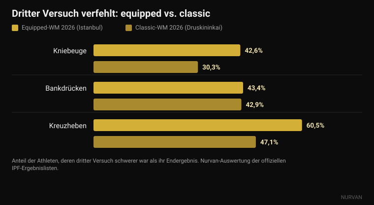
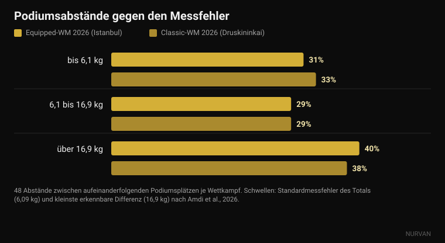

# Equipped-WM 2026: Ergebnisse und dritter Versuch

Von [Giammaria Loi](/autore/giammaria-loi) · aktualisiert am 16. November 2026

Am Sonntag, dem 15. November, endete in Istanbul die IPF-Weltmeisterschaft Open Equipped, und die IPF veröffentlichte noch am selben Tag die offiziellen Ergebnislisten. Ich habe beide vollständigen Dokumente geladen — Männer und Frauen — und sie neben die der Classic-WM vom Juni gelegt. Neben den Podestplätzen kam eine Zahl heraus, die im Training mehr wert ist als jeder Rekord: wie oft der dritte Versuch auf dem Boden liegen bleibt.

## Kurz gefasst

- **Die Ukraine und Kanada holen die Teamtitel.** Bei den Männern gewinnt die Ukraine mit 51 Punkten vor Chinesisch Taipeh (42) und Japan (38); bei den Frauen Kanada mit 43 Punkten vor Chinesisch Taipeh (42) und Brasilien (34).
- **32 Weltrekorde in sieben Tagen**: 17 bei den Männern, 15 bei den Frauen, verteilt auf Open (9), Master 1 (9), Master 2 (9) und Junior (5).
- **Kreuzheben ist die am häufigsten verfehlte Disziplin.** In Istanbul luden **60,5 %** der Athleten im dritten Kreuzheben mehr auf, als am Ende im Ergebnis stand. Bei der Classic-WM waren es 47,1 %.
- **Jeder dritte Podestabstand liegt im Messfehler**: 31 % der Abstände zwischen aufeinanderfolgenden Plätzen betrugen 6,09 kg oder weniger — der Standardmessfehler eines Totals (Amdi et al., 2026).
- **Equipped bestraft eine Fehlkalkulation weit härter**: 13,4 % der Starter in Istanbul beendeten den Wettkampf ohne gültiges Total, gegenüber 1,4 % bei der Classic-WM.

## Wer in Istanbul gewonnen hat

Die Open-Equipped-WM fand **vom 9. bis 15. November 2026** in Istanbul, Türkei, statt. Die offiziellen IPF-Listen führen **179 Athletinnen und Athleten aus 34 Nationen** in den acht Männer- und acht Frauenklassen.

Das beste Einzelergebnis erzielte der Ukrainer **Kostiantyn Musiienko**: **1064,5 kg** in der 93-kg-Klasse für 115,44 IPF-GL-Punkte, mit Open-Weltrekorden im Bankdrücken (352,0 kg) und im Total. Dahinter, in derselben Klasse, sein Landsmann Volodymyr Rysiiev mit 1025 kg.

Bei den Frauen geht die beste Wertung an **Kelsey McCarthy** (USA), 69 kg: **655,0 kg** und 113,88 IPF-GL-Punkte, Open-Weltrekord. Ein Jahr zuvor hatte sie in Cluj-Napoca dieselbe Klasse mit 652,5 kg gewonnen — 2,5 kg mehr genügten für den Rekord.

In der Teamwertung verteidigt die **Ukraine** den Männertitel (51 Punkte, vor Chinesisch Taipeh mit 42 und Japan mit 38, Dritter nach den Punkten der besten fünf vor Norwegen). Der Frauentitel geht an **Kanada** (43 Punkte), vor Chinesisch Taipeh (42) und Brasilien (34).

Das Ergebnis, das mich am meisten beschäftigt, steht in der 74-kg-Klasse der Männer: Gewinner ist **Jarosław Olech**, Pole, Jahrgang **1974**. Zweiundfünfzig Jahre alt, in der Open-Klasse — also gegen Athleten, die seine Kinder sein könnten — mit 865 kg Total und drei Master-2-Weltrekorden (Kniebeuge 360 kg, Bankdrücken 205 kg, Total 865 kg). Hinter ihm Lawson Lillo aus den USA, Jahrgang 2006: zwanzig Jahre alt, 852,5 kg und Junioren-Weltrekord im Total. Zweiunddreißig Jahre Altersunterschied, 12,5 kg Unterschied im Total. Ausführlicher habe ich das Thema bei den [Masters-Weltmeisterschaften in Reno](/de/blog/masters-wm-2026-kraft-und-alter) behandelt.

## Italien in Istanbul: eine Bronzemedaille und sechs Starter

| Athlet | Klasse | Platz | Total |
| --- | --- | --- | --- |
| Giovanni Mancinelli | 120 kg | 3. | 972,5 kg |
| Stefano Caneo | 66 kg | 5. | 652,5 kg |
| Davide Cecchetti | 93 kg | 8. | 852,5 kg |
| Diego Milani | 74 kg | 9. | 760,0 kg |
| Caterina Caravaggio | 69 kg | 5. | 552,5 kg |
| Silvia Marostica | 76 kg | 10. | 530,0 kg |

Die Medaille holt **Giovanni Mancinelli**, Dritter in der 120-kg-Klasse mit 410 kg Kniebeuge, 257,5 kg Bankdrücken und 305 kg Kreuzheben. Das Männerteam wird Neunter mit 19 Punkten, das Frauenteam Neunzehnter mit 7.

## Die Zahl, die in keinem Highlight-Video vorkommt: der dritte Versuch

Im Wettkampf hast du drei Versuche pro Disziplin. Der dritte entscheidet den Tag — und man sieht ihn am seltensten, weil Clips gültige Versuche zeigen, nicht Hanteln, die liegen bleiben.

In den Ergebnislisten steht dagegen alles. Ist das im dritten Versuch angemeldete Gewicht höher als das Endergebnis dieses Athleten, war der Versuch ungültig — das lässt sich Zeile für Zeile zählen. Ich habe es für beide WMs 2026 getan: die Equipped-WM in Istanbul und die [Classic-WM in Druskininkai](/de/blog/equipped-wm-2026-was-ausruestung-bringt) im Juni.

*Nurvan-Auswertung der offiziellen IPF-Ergebnislisten der Open-Equipped-WM 2026 (Istanbul) und der Open-Classic-WM 2026 (Druskininkai).*

Drei Dinge fallen auf.

**Kreuzheben wird am häufigsten verfehlt, und im Equipped deutlich häufiger.** In Istanbul waren 60,5 % der dritten Kreuzhebeversuche (92 von 152) schwerer als das Endergebnis; im Classic 47,1 % (162 von 344). Das passt: Kreuzheben beschließt den Tag, dort fällt die Medaille, und es ist die Disziplin, bei der die Ausrüstung am wenigsten hilft.

**Beim Bankdrücken ändert sich nichts.** 43,4 % in Istanbul, 42,9 % in Druskininkai: Das Bankshirt erlaubt mehr Gewicht, aber der Anteil verfehlter dritter Versuche bleibt identisch. Athleten gehen an die Grenze dessen, was möglich ist — wo immer diese Grenze liegt.

**Bei der Kniebeuge verfehlt Equipped häufiger**: 42,6 % gegenüber 30,3 %. Mit Anzug und Kniebandagen ist der Spielraum zwischen gültiger Tiefe und ungültigem Versuch kleiner, und eine verfehlte dritte Kniebeuge früh am Tag belastet alles Weitere.

Es gibt eine vierte, härtere Zahl: In Istanbul beendeten **24 von 179 Startern (13,4 %) den Wettkampf ohne gültiges Total**. Bei der Classic-WM im Juni waren es 5 von 351, also 1,4 %. Im Equipped kostet eine falsche Entscheidung fast zehnmal so oft den gesamten Wettkampf.

## Das Podium entscheidet sich innerhalb des Messfehlers

Hier kommt eine Studie ins Spiel, die vor wenigen Wochen erschienen ist. Amdi und Kollegen (2026) haben gemessen, wie stark die Maximalkraft von Powerliftern auf Regional- und Nationalniveau von Woche zu Woche schwankt, und fanden einen Standardmessfehler von **4,16 kg in der Kniebeuge, 2,60 kg im Bankdrücken, 4,07 kg im Kreuzheben und 6,09 kg im Total**. Anschließend werteten sie fünfzehn Jahre IPF-Wettkämpfe aus, um zu bestimmen, wie viele Kilo einen Platz nach vorn bringen: zwischen 14,3 und 44,2 kg im Total, je nach Niveau und Platzierung. Ihr Fazit: **In den meisten Wettkampfsituationen liegt der Unterschied zwischen zwei aufeinanderfolgenden Platzierungen innerhalb des Messfehlers** — und das gilt vor allem auf WM-Ebene.

Diesen Satz habe ich an den Daten von Istanbul überprüft. Für jede der 16 Klassen habe ich die Abstände zwischen aufeinanderfolgenden Podestplätzen genommen (1.-2., 2.-3., 3.-4.): insgesamt 48 Abstände.

*Nurvan-Auswertung der offiziellen IPF-Ergebnislisten. Referenzschwellen nach Amdi et al., 2026: Standardmessfehler des Totals 6,09 kg, kleinste erkennbare Differenz rund 16,9 kg.*

**31 % der Podestabstände betrugen 6,09 kg oder weniger**, 60 % lagen unter 16,9 kg, der Median bei 12,5 kg. Die Classic-WM im Juni ergibt fast dasselbe Bild (33 % und 62 %): Das ist keine Equipped-Eigenart, so funktioniert Powerlifting auf Weltniveau.

In sechs Fällen betrug der Abstand exakt **null**. In der 76-kg-Klasse der Frauen kamen drei Athletinnen auf jeweils 610,0 kg und wurden nur über das Körpergewicht getrennt. In der 47-kg-Klasse erzielten Wei-Ling Chen und Frankmary Duno beide 480,0 kg: Gold ging an Chen, weil sie 450 Gramm leichter war. In der 105-kg-Klasse der Männer beendeten Ian Bell und Nicki Lentz-Nielsen den Wettkampf beide mit 1050,0 kg.

Übersetzt: Auf diesem Niveau gewinnt niemand mit 20 kg Vorsprung. Es gewinnt, wer an diesem Tag einen Versuch weniger verfehlt.

## Was die Forschung wirklich sagt

**„Im Equipped ist der dritte Versuch fast geschenkt, die Ausrüstung trägt" — Widerlegt.** 60,5 % der dritten Kreuzhebeversuche und 42,6 % der dritten Kniebeugen in Istanbul wurden ungültig gewertet, und 13,4 % der Athleten blieben ohne Total gegenüber 1,4 % im Classic. Ausrüstung hebt die Decke, nicht den Fehlerspielraum.

**„Bei der WM gewinnt einfach der Stärkste" — Zu präzisieren.** In 31 % der Fälle war der Podestabstand kleiner als der Fehler, mit dem ein Total gemessen wird (6,09 kg, Amdi et al., 2026), und in sechs Fällen betrug er null.

**„Für Kraft muss man immer bis zum Muskelversagen trainieren" — Widerlegt.** In den Meta-Regressionen von Robinson und Kollegen (2024) waren die Kraftzuwächse über einen weiten Bereich von Wiederholungen in Reserve ähnlich: Es ist die Hypertrophie, die sich nahe am Versagen verbessert, nicht die Maximalkraft. Eine Übersichtsarbeit zum Bankdrücken kommt zum selben praktischen Rat: RPE/RIR, Hantelgeschwindigkeit und Autoregulation statt Sätze bis zum Versagen (Motlagh und Lipps, 2024).

**„RIR ist zu ungenau für die Gewichtswahl" — Zu präzisieren.** Odgers und Kollegen (2021) haben den Schätzfehler bei trainierten Athleten gemessen: Bei RPE 9, nahe der Grenze, lag der mittlere Fehler bei 0,09-0,25 Wiederholungen; bei RPE 6 stieg er auf 0,71-1,19. RIR ist fern vom Versagen ungenau und nahe daran verlässlich — genau umgekehrt zur üblichen Anwendung. Mehr dazu in [wie genau ist dein RIR](/de/blog/rir-wie-genau-wiederholungen-in-reserve).

**„Nach 50 ist die Open-Klasse nicht mehr dein Platz" — Widerlegt.** Jarosław Olech, Jahrgang 1974, gewann die 74-kg-Open-Klasse mit 865 kg.

## Wie du das anwendest, auch ohne Wettkampf

Ein dritter Versuch ist dasselbe wie dein schwerer Satz am Montag: eine Einzelwiederholung nahe der Grenze, bei der 5 kg über das Ergebnis entscheiden. Was bleibt.

1. **Wähle das Gewicht aus dem vorherigen Satz, nicht aus der Tabelle.** War der zweite Versuch — oder dein erster schwerer Satz — langsam und unsauber, verkleinere den Sprung. Die Athleten, die in Istanbul ohne Total blieben, waren nicht schwach: Sie hatten sich auf eine Zahl festgelegt, bevor sie wussten, wie der Tag läuft.
2. **Halte die Sprünge nahe am Maximum klein.** Über 90 % ist der natürliche Messfehler bereits 4-6 kg wert (Amdi et al., 2026): Ein Sprung von 15 kg bei einem 160-kg-Maximum ist eine Wette, keine Progression.
3. **Jage im Training nicht dem Muskelversagen nach.** Für Kraft ist es nicht nötig (Robinson et al., 2024) und es erhöht das Überlastungsrisiko (Motlagh und Lipps, 2024). Hör 1-2 Wiederholungen vor der Grenze auf und heb dir den Rest für Wettkampf oder Test auf.
4. **Vertraue dem RIR nur dort, wo er funktioniert.** Nahe am Versagen ist die Schätzung scharf; 4-5 Wiederholungen davor liegst du um mehr als eine Wiederholung daneben (Odgers et al., 2021). Für leichte Gewichte nimm Prozentwerte oder Geschwindigkeit, nicht das Gefühl.
5. **Behandle das Aufwärmen als Information.** Die Steigerungssätze sind nicht nur Verletzungsschutz: Sie sagen dir vor dem Arbeitsgewicht, ob heute der Tag ist.

> ### Wähle dein Gewicht nach Daten, nicht nach Gefühl
> Nurvan protokolliert Gewicht, Wiederholungen und RIR jedes Satzes, erstellt die Aufwärmsätze automatisch aus dem Arbeitsgewicht des Tages und zeigt dir, ob die Progression trägt oder du nur Scheiben auflegst. Es ist die Entscheidung des dritten Versuchs, angewandt auf jedes Training. [Nurvan ausprobieren](https://nurvan.app)

## Häufige Fragen

**Wann war die Equipped-WM 2026 und wer hat gewonnen?**
Sie fand vom 9. bis 15. November 2026 in Istanbul, Türkei, statt. Die Teamtitel gingen an die Ukraine (Männer) und Kanada (Frauen); die besten Einzelwertungen erzielten Kostiantyn Musiienko (1064,5 kg in der 93-kg-Klasse) und Kelsey McCarthy (655,0 kg in der 69-kg-Klasse).

**Wie viele Weltrekorde wurden aufgestellt?**
Zweiunddreißig laut den offiziellen IPF-Ergebnislisten: 17 bei den Männern und 15 bei den Frauen, verteilt auf Open, Junior, Master 1 und Master 2.

**Was ist der Unterschied zwischen Equipped und Classic?**
Im Equipped sind Kniebeuge- und Kreuzhebeanzug, Bankshirt und Kniebandagen erlaubt; im Classic wird mit Gürtel, Kniebandagen aus Neopren und Handgelenkbandagen gehoben. Wie stark sich die Zahlen tatsächlich ändern, habe ich in [was die Ausrüstung bringt](/de/blog/equipped-wm-2026-was-ausruestung-bringt) gemessen.

**Wie viel muss man zulegen, um einen Platz gutzumachen?**
Zwischen 14,3 und 44,2 kg im Total, je nach Geschlecht, Wettkampfniveau und Platzierung (Amdi et al., 2026). Auf Weltniveau liegen viele dieser Unterschiede innerhalb des Messfehlers.

## Lies auch

- [Equipped-WM 2026: was die Ausrüstung wirklich bringt](/de/blog/equipped-wm-2026-was-ausruestung-bringt) — der Vergleich Klasse für Klasse zwischen Equipped und Classic.
- [Masters-WM 2026: was das Alter mit der Kraft macht](/de/blog/masters-wm-2026-kraft-und-alter) — 443 Athleten von 40 bis 82 Jahren, ausgewertet aus offiziellen Daten.
- [Wie genau ist dein RIR? Was die Studien sagen](/de/blog/rir-wie-genau-wiederholungen-in-reserve) — wo die Schätzung funktioniert und wo nicht.

## Quellen

1. International Powerlifting Federation, 2026. Men's Results — 2026 IPF World Open Equipped Powerlifting Championships, Istanbul, 09.-15.11.2026. [Offizielle Ergebnisliste PDF](https://www.powerlifting.sport/fileadmin/ipf/data/results/2026/equipped/Men_Results_2026_IPF_World_Open_Equipped_Powerlifting_Championships_2026-11-15.pdf)
2. International Powerlifting Federation, 2026. Women's Results — 2026 IPF World Open Equipped Powerlifting Championships, Istanbul. [Offizielle Ergebnisliste PDF](https://www.powerlifting.sport/fileadmin/ipf/data/results/2026/equipped/Women_Results_2026_IPF_World_Open_Equipped_Powerlifting_Championships_2026-11-15.pdf)
3. International Powerlifting Federation, 2026. Men's und Women's Team Points — 2026 IPF World Open Equipped Powerlifting Championships. [Offizielle Ergebnisseite](https://www.powerlifting.sport/championships/results/2026/world-open-equipped-powerlifting-championships-2026)
4. International Powerlifting Federation, 2026. Results — 2026 IPF World Classic Powerlifting Championships, Druskininkai, 13.-21.06.2026. [Offizielle Ergebnisseite](https://www.powerlifting.sport/championships/results/2026/world-open-classic-powerlifting-championships-2026)
5. Amdi CH, Korakakis PA, Zourdos MC, Helms ER, Spence AJ, Robinson ZP, 2026. Reliability of Maximal Strength in Powerlifters and Performance Differences Required to Improve Competition Placing. Journal of Strength and Conditioning Research. PMID 42862018 — [doi:10.1519/JSC.0000000000005591](https://doi.org/10.1519/JSC.0000000000005591)
6. Robinson ZP, Pelland JC, Remmert JF, Refalo MC, Jukic I, Steele J, Zourdos MC, 2024. Exploring the Dose-Response Relationship Between Estimated Resistance Training Proximity to Failure, Strength Gain, and Muscle Hypertrophy: A Series of Meta-Regressions. Sports Medicine. PMID 38970765 — [doi:10.1007/s40279-024-02069-2](https://doi.org/10.1007/s40279-024-02069-2)
7. Odgers JB, Zourdos MC, Helms ER, Candow DG, Dahlstrom B, Bruno P, Sousa CA, 2021. Rating of Perceived Exertion and Velocity Relationships Among Trained Males and Females in the Front Squat and Hexagonal Bar Deadlift. Journal of Strength and Conditioning Research. PMID 33629974 — [doi:10.1519/JSC.0000000000003905](https://doi.org/10.1519/JSC.0000000000003905)
8. Motlagh JG, Lipps DB, 2024. The Contribution of Muscular Fatigue and Shoulder Biomechanics to Shoulder Injury Incidence During the Bench Press Exercise: A Narrative Review. Journal of Strength and Conditioning Research. PMID 39808810 — [doi:10.1519/JSC.0000000000004973](https://doi.org/10.1519/JSC.0000000000004973)

Die Quellen 5-8 wurden über PubMed recherchiert. Die Auswertungen zu dritten Versuchen, ungültigen Totals und Podestabständen sind originäre Nurvan-Analysen auf Basis der unter 1-4 zitierten offiziellen IPF-Ergebnislisten.

Giammaria Loi ist der Gründer von Nurvan. Er trainiert seit 2012 mit Gewichten, arbeitet seit 2013 als FIPE-zertifizierter Personal Trainer und Coach und startet seit 2018 im Kraftdreikampf auf nationalem Niveau. Jeder Artikel, den er zeichnet, beginnt bei den Studien und endet bei dem, was im Training wirklich funktioniert.

> Hinweis: informativer Inhalt, er ersetzt nicht den Rat einer Ärztin, eines Arztes oder einer Fachperson.
