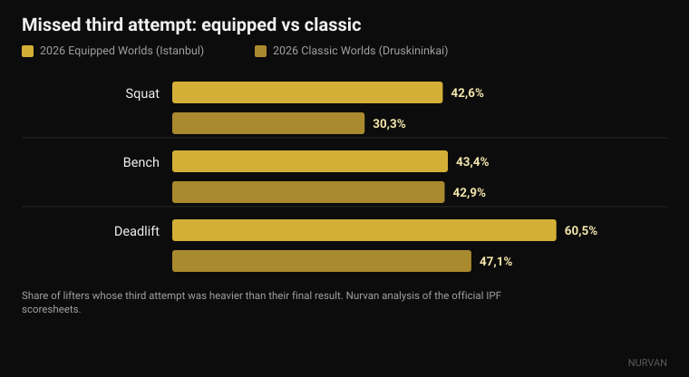
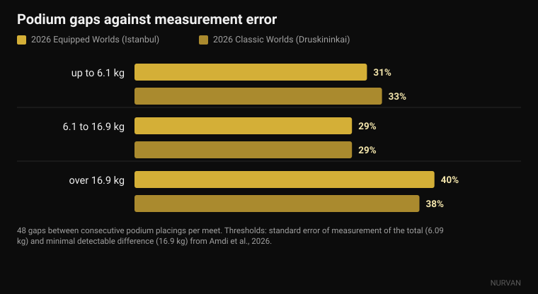

# Equipped Worlds 2026: results and the third attempt

By [Giammaria Loi](/autore/giammaria-loi) · updated 16 November 2026

The IPF World Open Equipped Championships closed in Istanbul on Sunday 15 November, and the IPF published the official scoresheets the same day. I pulled both full documents — men's and women's — and set them next to June's Classic Worlds. Beyond the podiums, one number matters more in the gym than any record: how often the third attempt stays on the floor.

## The short version

- **Ukraine and Canada take the team titles.** Ukraine won the men's standings with 51 points ahead of Chinese Taipei (42) and Japan (38); Canada won the women's with 43 points ahead of Chinese Taipei (42) and Brazil (34).
- **32 world records in seven days**: 17 in the men's events and 15 in the women's, spread across Open (9), Master 1 (9), Master 2 (9) and Junior (5).
- **The deadlift is the lift competitors misjudge most.** In Istanbul **60.5%** of lifters loaded a third deadlift heavier than the result they ended up keeping. At the Classic Worlds the figure was 47.1%.
- **One podium gap in three sits inside measurement error**: 31% of the gaps between consecutive podium placings were 6.09 kg or less — the standard error of measurement for a powerlifting total (Amdi et al., 2026).
- **Equipped punishes a bad call far harder**: 13.4% of entries in Istanbul finished without a valid total, against 1.4% at the Classic Worlds.

## Who won in Istanbul

The World Open Equipped Championships ran in Istanbul, Türkiye, **from 9 to 15 November 2026**. The official IPF scoresheets list **179 lifters from 34 nations** across the eight men's and eight women's weight classes.

The best score of the meet belongs to Ukraine's **Kostiantyn Musiienko**: **1064.5 kg** at 93 kg for 115.44 IPF GL points, with Open world records in the bench press (352.0 kg) and the total. His teammate Volodymyr Rysiiev was second in the same class with 1025 kg.

On the women's side the top score went to **Kelsey McCarthy** (USA) at 69 kg: **655.0 kg** and 113.88 IPF GL points, an Open world record. A year earlier in Cluj-Napoca she had won the same class with 652.5 kg. She added 2.5 kg — and that was enough for the record.

**Ukraine** retained the men's team title (51 points, ahead of Chinese Taipei on 42 and Japan on 38, third on best-five points ahead of Norway). The women's title went to **Canada** (43 points), with Chinese Taipei second on 42 and Brazil third on 34.

The result I keep coming back to is the men's 74 kg: it was won by **Jarosław Olech** of Poland, born in **1974**. Fifty-two years old, in the Open division, against lifters young enough to be his children — 865 kg total and three Master 2 world records (360 kg squat, 205 kg bench, 865 kg total). Second was Lawson Lillo of the USA, born 2006: twenty years old, 852.5 kg and a Junior world record total. Thirty-two years apart, 12.5 kg apart. I went deeper into what age does to strength in my piece on the [Masters Worlds in Reno](/en/blog/world-masters-powerlifting-2026-strength-age).

## Italy in Istanbul: one bronze, six lifters

| Lifter | Class | Place | Total |
| --- | --- | --- | --- |
| Giovanni Mancinelli | 120 kg | 3rd | 972.5 kg |
| Stefano Caneo | 66 kg | 5th | 652.5 kg |
| Davide Cecchetti | 93 kg | 8th | 852.5 kg |
| Diego Milani | 74 kg | 9th | 760.0 kg |
| Caterina Caravaggio | 69 kg | 5th | 552.5 kg |
| Silvia Marostica | 76 kg | 10th | 530.0 kg |

The medal came from **Giovanni Mancinelli**, third at 120 kg with a 410 kg squat, 257.5 kg bench and 305 kg deadlift. Italy's men finished ninth as a team with 19 points, the women nineteenth with 7.

## What the highlight reels never show: the third attempt

You get three attempts per lift. The third decides the meet — and it is the one you see least, because clips show made lifts, not loaded barbells that never move.

The scoresheets show everything. If the weight declared on the third attempt is heavier than that lifter's final result, the attempt was missed, and you can count that line by line. I did it for both 2026 World Championships: the equipped meet in Istanbul and the [Classic meet in Druskininkai](/en/blog/equipped-worlds-2026-how-much-gear-adds) in June.

*Nurvan analysis of the official IPF scoresheets from the 2026 World Open Equipped (Istanbul) and World Open Classic (Druskininkai) Championships.*

Three things stand out.

**The deadlift is missed most, and far more in equipped.** In Istanbul 60.5% of third deadlifts (92 of 152) were heavier than the final result; in classic, 47.1% (162 of 344). That tracks: the deadlift closes the day, it is where medals are won, and it is the lift the gear helps least.

**The bench press shows no difference at all.** 43.4% in Istanbul, 42.9% in Druskininkai. The bench shirt raises the weight on the bar, but the share of failed third attempts is identical. Lifters push to the edge of what they can do, whatever that edge happens to be.

**Equipped squats are missed more often**: 42.6% versus 30.3%. With a suit and knee wraps the margin between a valid depth and a red light is narrower, and a missed third squat early in the day colours everything that follows.

There is a fourth number, and it is harsher: **24 of 179 entries in Istanbul (13.4%) finished with no valid total**. At the Classic Worlds in June it was 5 of 351, or 1.4%. In equipped, a bad call costs you the entire meet almost ten times as often.

## The podium is decided inside measurement error

This is where a study published a few weeks ago comes in. Amdi and colleagues (2026) measured how much maximal strength varies week to week in regional- and national-level powerlifters and found a standard error of measurement of **4.16 kg in the squat, 2.60 kg in the bench press, 4.07 kg in the deadlift and 6.09 kg on the total**. They then analysed fifteen years of IPF competition data to work out how many kilos it takes to move up one place: between 14.3 and 44.2 kg on the total, depending on level and placing. Their conclusion is that **in most competitive contexts the difference between consecutive placings falls inside measurement error** — and that this is most true at World Championship level.

I checked that claim against Istanbul. For each of the 16 classes I took the gaps between consecutive podium placings (1st-2nd, 2nd-3rd, 3rd-4th): 48 gaps in all.

*Nurvan analysis of the official IPF scoresheets. Reference thresholds from Amdi et al., 2026: standard error of measurement of the total 6.09 kg, minimal detectable difference roughly 16.9 kg.*

**31% of podium gaps were 6.09 kg or smaller**, 60% were under 16.9 kg, and the median was 12.5 kg. June's Classic Worlds gave almost the same picture (33% and 62%): this is not an equipped quirk, it is how elite powerlifting works.

Six gaps were exactly **zero**. In the women's 76 kg three lifters all totalled 610.0 kg and were separated by bodyweight alone. At 47 kg, Wei-Ling Chen and Frankmary Duno both totalled 480.0 kg: gold went to Chen because she weighed 450 grams less. In the men's 105 kg, Ian Bell and Nicki Lentz-Nielsen both finished on 1050.0 kg.

Translated: at that level nobody wins by 20 kg. You win by missing one attempt fewer on the day.

## What the research actually says

**"In equipped the third attempt is nearly free, the gear holds you up" — Busted.** 60.5% of third deadlifts and 42.6% of third squats in Istanbul were red-lighted, and 13.4% of lifters finished without a total against 1.4% in classic. Gear raises the ceiling, not the margin for error.

**"At the Worlds the strongest lifter simply wins" — Needs nuance.** In 31% of cases the podium gap was smaller than the error with which a total can be measured (6.09 kg, Amdi et al., 2026), and in six cases it was zero.

**"To get strong you have to train to failure" — Busted.** In the meta-regressions by Robinson and colleagues (2024), strength gains were similar across a wide range of repetitions in reserve; it is hypertrophy that improves as sets end closer to failure, not maximal strength. A review of the bench press reaches the same practical advice: prioritise RPE/RIR, bar velocity and autoregulation over sets to failure (Motlagh and Lipps, 2024).

**"RIR is too imprecise to pick loads with" — Needs nuance.** Odgers and colleagues (2021) measured estimation error in trained lifters: at RPE 9, close to the limit, the average error was 0.09-0.25 reps; at RPE 6 it rose to 0.71-1.19. RIR is unreliable far from failure and accurate close to it — the opposite of how most people use it. More on that in [how accurate is RIR](/en/blog/how-accurate-is-rir).

**"Past 50 the Open division is not your place" — Busted.** Jarosław Olech, born 1974, won the Open 74 kg with 865 kg.

## How to use this, even if you never compete

A third attempt is the same animal as your Monday top set: a near-limit single where being 5 kg off changes the outcome. What to take from it.

1. **Pick the load from the previous set, not from the spreadsheet.** If your second attempt — or your first heavy set — came out slow and messy, shrink the jump. The lifters who bombed out in Istanbul were not weak; they had committed to a number before they knew how the day was going.
2. **Keep the jumps small near your max.** Above 90%, natural measurement error is already worth 4-6 kg (Amdi et al., 2026). A 15 kg jump on a 160 kg max is a bet, not a progression.
3. **Stop chasing failure in training.** It is not needed for strength (Robinson et al., 2024) and it raises overexertion risk (Motlagh and Lipps, 2024). Stop 1-2 reps short and save the near-limit work for meets and tests.
4. **Trust RIR only where it works.** Close to failure the estimate is sharp; 4-5 reps out you will be more than a rep off (Odgers et al., 2021). For lighter loads use percentages or velocity, not feel.
5. **Warm up like it is information.** Ramp-up sets are not just injury insurance — they tell you, before the working weight, whether today is the day.

> ### Pick your loads from data, not from feel
> Nurvan logs load, reps and RIR for every set, builds your warm-up ramp automatically from the day's working weight, and shows you whether the progression is holding or you are just adding plates. It is the third-attempt decision, applied to every session. [Try Nurvan](https://nurvan.app)

## Frequently asked questions

**When were the 2026 equipped Worlds and who won?**
They ran in Istanbul, Türkiye, from 9 to 15 November 2026. Ukraine took the men's team title and Canada the women's; the best individual scores were Kostiantyn Musiienko (1064.5 kg at 93 kg) and Kelsey McCarthy (655.0 kg at 69 kg).

**How many world records were set?**
Thirty-two according to the official IPF scoresheets: 17 in the men's events and 15 in the women's, across the Open, Junior, Master 1 and Master 2 divisions.

**What is the difference between equipped and classic powerlifting?**
Equipped allows a squat and deadlift suit, a bench shirt and knee wraps; classic is lifted with a belt, knee sleeves and wrist wraps. How much the numbers actually change is measured in [how much gear adds](/en/blog/equipped-worlds-2026-how-much-gear-adds).

**How much does a lifter have to improve to move up one place?**
Between 14.3 and 44.2 kg on the total depending on sex, competition level and placing (Amdi et al., 2026). At world level many of those differences sit inside measurement error.

## Read next

- [Equipped Worlds 2026: how much gear really adds](/en/blog/equipped-worlds-2026-how-much-gear-adds) — the class-by-class comparison between equipped and classic.
- [Masters Worlds 2026: what age does to strength](/en/blog/world-masters-powerlifting-2026-strength-age) — 443 lifters aged 40 to 82, analysed from official data.
- [How accurate is your RIR? What the studies say](/en/blog/how-accurate-is-rir) — where the estimate works and where it does not.

## Sources

1. International Powerlifting Federation, 2026. Men's Results — 2026 IPF World Open Equipped Powerlifting Championships, Istanbul, 09-15/11/2026. [Official scoresheet PDF](https://www.powerlifting.sport/fileadmin/ipf/data/results/2026/equipped/Men_Results_2026_IPF_World_Open_Equipped_Powerlifting_Championships_2026-11-15.pdf)
2. International Powerlifting Federation, 2026. Women's Results — 2026 IPF World Open Equipped Powerlifting Championships, Istanbul. [Official scoresheet PDF](https://www.powerlifting.sport/fileadmin/ipf/data/results/2026/equipped/Women_Results_2026_IPF_World_Open_Equipped_Powerlifting_Championships_2026-11-15.pdf)
3. International Powerlifting Federation, 2026. Men's and Women's Team Points — 2026 IPF World Open Equipped Powerlifting Championships. [Official results page](https://www.powerlifting.sport/championships/results/2026/world-open-equipped-powerlifting-championships-2026)
4. International Powerlifting Federation, 2026. Results — 2026 IPF World Classic Powerlifting Championships, Druskininkai, 13-21/06/2026. [Official results page](https://www.powerlifting.sport/championships/results/2026/world-open-classic-powerlifting-championships-2026)
5. Amdi CH, Korakakis PA, Zourdos MC, Helms ER, Spence AJ, Robinson ZP, 2026. Reliability of Maximal Strength in Powerlifters and Performance Differences Required to Improve Competition Placing. Journal of Strength and Conditioning Research. PMID 42862018 — [doi:10.1519/JSC.0000000000005591](https://doi.org/10.1519/JSC.0000000000005591)
6. Robinson ZP, Pelland JC, Remmert JF, Refalo MC, Jukic I, Steele J, Zourdos MC, 2024. Exploring the Dose-Response Relationship Between Estimated Resistance Training Proximity to Failure, Strength Gain, and Muscle Hypertrophy: A Series of Meta-Regressions. Sports Medicine. PMID 38970765 — [doi:10.1007/s40279-024-02069-2](https://doi.org/10.1007/s40279-024-02069-2)
7. Odgers JB, Zourdos MC, Helms ER, Candow DG, Dahlstrom B, Bruno P, Sousa CA, 2021. Rating of Perceived Exertion and Velocity Relationships Among Trained Males and Females in the Front Squat and Hexagonal Bar Deadlift. Journal of Strength and Conditioning Research. PMID 33629974 — [doi:10.1519/JSC.0000000000003905](https://doi.org/10.1519/JSC.0000000000003905)
8. Motlagh JG, Lipps DB, 2024. The Contribution of Muscular Fatigue and Shoulder Biomechanics to Shoulder Injury Incidence During the Bench Press Exercise: A Narrative Review. Journal of Strength and Conditioning Research. PMID 39808810 — [doi:10.1519/JSC.0000000000004973](https://doi.org/10.1519/JSC.0000000000004973)

Sources 5-8 were retrieved through PubMed. The analyses of third attempts, failed totals and podium gaps are original Nurvan work, computed from the official IPF scoresheets cited in points 1-4.

Giammaria Loi is the founder of Nurvan. He has been lifting since 2012, has worked as a FIPE-certified personal trainer and coach since 2013, and has competed in powerlifting at national level since 2018. Every article he writes starts from the research and ends with what actually works in the gym.

> Note: educational content, not a substitute for advice from a doctor or qualified professional.
