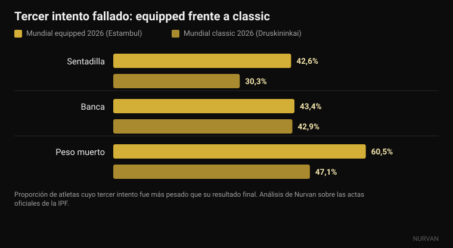
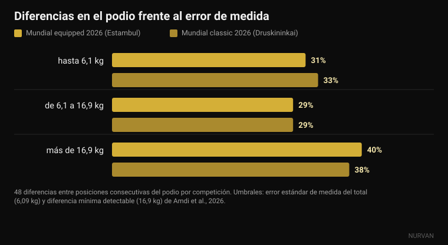

# Mundial equipped 2026: resultados y tercer intento

Por [Giammaria Loi](/autore/giammaria-loi) · actualizado el 16 de noviembre de 2026

El domingo 15 de noviembre se cerró en Estambul el Mundial IPF Open Equipped y la IPF publicó las actas oficiales ese mismo día. Me descargué los dos documentos completos —masculino y femenino— y los puse al lado de los del Mundial classic de junio. Más allá de los podios, salió un número que en el gimnasio vale más que cualquier récord: cuántas veces el tercer intento se queda en el suelo.

## En resumen

- **Ucrania y Canadá se llevan los títulos por equipos.** En hombres gana Ucrania con 51 puntos por delante de Taipéi Chino (42) y Japón (38); en mujeres, Canadá con 43 puntos por delante de Taipéi Chino (42) y Brasil (34).
- **32 récords del mundo en siete días**: 17 masculinos y 15 femeninos, repartidos entre Open (9), Master 1 (9), Master 2 (9) y Junior (5).
- **El peso muerto es el movimiento que más se falla.** En Estambul el **60,5%** de los atletas cargó un tercer peso muerto más pesado que el resultado que acabó conservando. En el classic la cifra fue del 47,1%.
- **Una de cada tres diferencias del podio cabe dentro del error de medida**: el 31% de las diferencias entre posiciones consecutivas fue de 6,09 kg o menos, el error estándar de medida de un total de powerlifting (Amdi et al., 2026).
- **El equipped castiga mucho más un mal cálculo**: el 13,4% de los inscritos en Estambul terminó sin total válido, frente al 1,4% del Mundial classic.

## Quién ganó en Estambul

El Mundial Open Equipped se disputó en Estambul, Turquía, **del 9 al 15 de noviembre de 2026**. Las actas oficiales de la IPF recogen **179 atletas de 34 países**, repartidos en las ocho categorías masculinas y las ocho femeninas.

La mejor marca absoluta es del ucraniano **Kostiantyn Musiienko**: **1064,5 kg** en 93 kg y 115,44 puntos IPF GL, con récords del mundo Open en press banca (352,0 kg) y en el total. Detrás, en la misma categoría, su compatriota Volodymyr Rysiiev con 1025 kg.

En mujeres la mejor puntuación fue de **Kelsey McCarthy** (Estados Unidos), 69 kg: **655,0 kg** y 113,88 puntos IPF GL, récord del mundo Open. Un año antes, en Cluj-Napoca, había ganado la misma categoría con 652,5 kg: sumó 2,5 kg y le bastó para el récord.

Por equipos, **Ucrania** revalida el título masculino (51 puntos, por delante de Taipéi con 42 y Japón con 38, tercero por los puntos de los cinco mejores frente a Noruega). El título femenino pasa a **Canadá** (43 puntos), con Taipéi segunda con 42 y Brasil tercero con 34.

El resultado que más me ha llamado la atención está en los 74 kg masculinos: ganó **Jarosław Olech**, polaco nacido en **1974**. Cincuenta y dos años, categoría Open —es decir, contra atletas que podrían ser sus hijos— y 865 kg de total, con tres récords del mundo Master 2 (sentadilla 360 kg, banca 205 kg, total 865 kg). Detrás, Lawson Lillo, estadounidense de 2006: veinte años, 852,5 kg y récord del mundo Junior en el total. Treinta y dos años de diferencia de edad y 12,5 kg de diferencia en el total. Si te interesa el tema, lo desarrollé al hablar del [Mundial master de Reno](/es/blog/mundial-master-powerlifting-2026-fuerza-edad).

## Italia en Estambul: un bronce y seis atletas

| Atleta | Categoría | Puesto | Total |
| --- | --- | --- | --- |
| Giovanni Mancinelli | 120 kg | 3.º | 972,5 kg |
| Stefano Caneo | 66 kg | 5.º | 652,5 kg |
| Davide Cecchetti | 93 kg | 8.º | 852,5 kg |
| Diego Milani | 74 kg | 9.º | 760,0 kg |
| Caterina Caravaggio | 69 kg | 5.ª | 552,5 kg |
| Silvia Marostica | 76 kg | 10.ª | 530,0 kg |

La medalla es de **Giovanni Mancinelli**, tercero en 120 kg con 410 kg de sentadilla, 257,5 de banca y 305 de peso muerto. El equipo masculino acabó noveno con 19 puntos y el femenino decimonoveno con 7.

## El dato que no sale en los resúmenes: el tercer intento

En competición tienes tres intentos por movimiento. El tercero decide la jornada, y es el que menos se ve: los vídeos muestran levantamientos válidos, no barras que se quedan quietas.

En las actas, en cambio, está todo. Si el peso declarado en el tercer intento es mayor que el resultado final de ese atleta, ese intento fue nulo, y eso se puede contar línea por línea. Lo hice con los dos Mundiales de 2026: el equipped de Estambul y el [classic de Druskininkai](/es/blog/mundial-equipped-2026-cuanto-suma-equipamiento) de junio.

*Análisis de Nurvan sobre las actas oficiales de la IPF del Mundial Open Equipped 2026 (Estambul) y del Mundial Open Classic 2026 (Druskininkai).*

Salen tres cosas.

**El peso muerto es el movimiento que más se falla, y mucho más en equipped.** En Estambul el 60,5% de los terceros pesos muertos (92 de 152) era más pesado que el resultado final; en classic, el 47,1% (162 de 344). Tiene sentido: el peso muerto cierra la jornada, es donde se juega la medalla y es el movimiento en el que el equipamiento ayuda menos.

**En press banca no cambia nada.** 43,4% en Estambul, 42,9% en Druskininkai: la camiseta de banca permite más kilos, pero el porcentaje de terceros intentos nulos es idéntico. Los atletas se acercan al límite de lo que pueden hacer, sea cual sea ese límite.

**En sentadilla el equipped falla más**: 42,6% frente a 30,3%. Con mono y rodilleras elásticas el margen entre profundidad válida e intento nulo es más estrecho, y una tercera sentadilla fallada al principio condiciona el resto.

Hay un cuarto número, más duro: en Estambul **24 atletas de 179 (el 13,4%) terminaron sin total válido**. En el Mundial classic de junio fueron 5 de 351, es decir el 1,4%. En equipped, un error de elección cuesta la competición entera casi diez veces más a menudo.

## El podio se decide dentro del error de medida

Aquí entra un estudio publicado hace pocas semanas. Amdi y colegas (2026) midieron cuánto varía la fuerza máxima de powerlifters de nivel regional y nacional de una semana a otra y encontraron un error estándar de medida de **4,16 kg en sentadilla, 2,60 kg en press banca, 4,07 kg en peso muerto y 6,09 kg en el total**. Después analizaron quince años de competiciones IPF para calcular cuántos kilos hacen falta para ganar una posición: entre 14,3 y 44,2 kg en el total, según el nivel y el puesto. Su conclusión es que **en la mayoría de los contextos competitivos la diferencia entre dos puestos consecutivos cae dentro del error de medida**, y que esto se nota sobre todo a nivel mundial.

Comprobé esa frase con los datos de Estambul. En cada una de las 16 categorías tomé las diferencias entre posiciones consecutivas del podio (1.º-2.º, 2.º-3.º, 3.º-4.º): 48 diferencias en total.

*Análisis de Nurvan sobre las actas oficiales de la IPF. Umbrales de referencia de Amdi et al., 2026: error estándar de medida del total 6,09 kg, diferencia mínima detectable unos 16,9 kg.*

El **31% de las diferencias del podio fue de 6,09 kg o menos**, el 60% quedó por debajo de 16,9 kg y la mediana fue de 12,5 kg. El Mundial classic de junio da casi la misma imagen (33% y 62%): no es una rareza del equipped, es cómo funciona el powerlifting de élite.

En seis casos la diferencia fue exactamente **cero**. En 76 kg femenino tres atletas totalizaron 610,0 kg y las separó solo el peso corporal. En 47 kg, Wei-Ling Chen y Frankmary Duno hicieron 480,0 kg las dos: oro para Chen porque pesaba 450 gramos menos. En 105 kg masculino, Ian Bell y Nicki Lentz-Nielsen cerraron ambos en 1050,0 kg.

Traducido: a ese nivel nadie gana por 20 kg. Gana quien, ese día, falla un intento menos.

## Qué dice realmente la investigación

**"En equipped el tercer intento sale casi gratis, el equipamiento aguanta" — Desmentido.** El 60,5% de los terceros pesos muertos y el 42,6% de las terceras sentadillas de Estambul fueron nulos, y el 13,4% de los atletas acabó sin total frente al 1,4% del classic. El equipamiento sube el techo, no el margen de error.

**"En el Mundial gana simplemente el más fuerte" — Hay que matizar.** En el 31% de los casos la diferencia del podio fue menor que el error con el que se mide un total (6,09 kg según Amdi et al., 2026), y en seis casos fue cero.

**"Para ganar fuerza hay que entrenar siempre al fallo" — Desmentido.** En las metarregresiones de Robinson y colegas (2024), las ganancias de fuerza fueron similares en un amplio rango de repeticiones en reserva: es la hipertrofia la que mejora acercándose al fallo, no la fuerza máxima. Una revisión sobre el press banca llega al mismo consejo práctico: priorizar RPE/RIR, velocidad de la barra y autorregulación frente a las series al fallo (Motlagh y Lipps, 2024).

**"El RIR es demasiado impreciso para elegir cargas" — Hay que matizar.** Odgers y colegas (2021) midieron el error de estimación en atletas entrenados: a RPE 9, cerca del límite, el error medio fue de 0,09-0,25 repeticiones; a RPE 6 subía a 0,71-1,19. El RIR es impreciso lejos del fallo y fiable cerca: justo al revés de como suele usarse. Lo desarrollé en [la precisión del RIR](/es/blog/rir-precision-repeticiones-en-reserva).

**"Pasados los 50 la categoría Open ya no es tu sitio" — Desmentido.** Jarosław Olech, nacido en 1974, ganó los 74 kg Open con 865 kg.

## Cómo aplicarlo aunque no compitas

Un tercer intento es lo mismo que tu serie pesada del lunes: una repetición cerca del límite donde fallar por 5 kg cambia el resultado. Qué llevarse.

1. **Elige la carga a partir de la serie anterior, no de la hoja de cálculo.** Si el segundo intento —o tu primera serie pesada— salió lento y sucio, reduce el salto. Los atletas que se quedaron sin total en Estambul no eran débiles: habían decidido el número antes de saber cómo iba el día.
2. **Haz saltos pequeños cerca del máximo.** Por encima del 90%, el error de medida natural ya vale 4-6 kg (Amdi et al., 2026): un salto de 15 kg sobre un máximo de 160 es una apuesta, no una progresión.
3. **No busques el fallo en el entrenamiento.** Para la fuerza no hace falta (Robinson et al., 2024) y aumenta el riesgo de sobreesfuerzo (Motlagh y Lipps, 2024). Párate a 1-2 repeticiones del límite y deja lo demás para la competición o los test.
4. **Fíate del RIR solo donde funciona.** Cerca del fallo la estimación es precisa; a 4-5 repeticiones del límite te equivocarás en más de una repetición (Odgers et al., 2021). Para cargas ligeras usa porcentajes o velocidad, no sensaciones.
5. **Calienta como si fuera información.** Las series de aproximación no son solo seguro antilesiones: te dicen, antes del peso de trabajo, si hoy es el día.

> ### Elige la carga con datos, no con sensaciones
> Nurvan registra carga, repeticiones y RIR de cada serie, te propone automáticamente las series de calentamiento a partir del peso del día y te muestra si la progresión aguanta o solo estás añadiendo discos. Es la decisión del tercer intento aplicada a cada entrenamiento. [Prueba Nurvan](https://nurvan.app)

## Preguntas frecuentes

**¿Cuándo fue el Mundial equipped 2026 y quién ganó?**
Se disputó en Estambul, Turquía, del 9 al 15 de noviembre de 2026. Los títulos por equipos fueron para Ucrania en hombres y Canadá en mujeres; las mejores marcas individuales fueron de Kostiantyn Musiienko (1064,5 kg en 93 kg) y Kelsey McCarthy (655,0 kg en 69 kg).

**¿Cuántos récords del mundo se batieron?**
Treinta y dos según las actas oficiales de la IPF: 17 en las categorías masculinas y 15 en las femeninas, repartidos entre Open, Junior, Master 1 y Master 2.

**¿Qué diferencia hay entre powerlifting equipped y classic?**
En equipped se permiten mono de sentadilla y peso muerto, camiseta de banca y rodilleras elásticas; en classic se compite con cinturón, rodilleras de neopreno y muñequeras. Cuánto cambian los números lo medí en [cuánto suma el equipamiento](/es/blog/mundial-equipped-2026-cuanto-suma-equipamiento).

**¿Cuánto tiene que mejorar un atleta para ganar un puesto?**
Entre 14,3 y 44,2 kg en el total según el sexo, el nivel de competición y el puesto (Amdi et al., 2026). A nivel mundial muchas de esas diferencias caen dentro del error de medida.

## Lee también

- [Mundial equipped 2026: cuánto suma el equipamiento](/es/blog/mundial-equipped-2026-cuanto-suma-equipamiento) — la comparación categoría por categoría entre equipped y classic.
- [Mundial master 2026: qué le pasa a la fuerza con la edad](/es/blog/mundial-master-powerlifting-2026-fuerza-edad) — 443 atletas de 40 a 82 años, analizados con datos oficiales.
- [¿Qué precisión tiene tu RIR? Lo que dicen los estudios](/es/blog/rir-precision-repeticiones-en-reserva) — dónde funciona la estimación y dónde no.

## Fuentes

1. International Powerlifting Federation, 2026. Men's Results — 2026 IPF World Open Equipped Powerlifting Championships, Estambul, 09-15/11/2026. [Acta oficial PDF](https://www.powerlifting.sport/fileadmin/ipf/data/results/2026/equipped/Men_Results_2026_IPF_World_Open_Equipped_Powerlifting_Championships_2026-11-15.pdf)
2. International Powerlifting Federation, 2026. Women's Results — 2026 IPF World Open Equipped Powerlifting Championships, Estambul. [Acta oficial PDF](https://www.powerlifting.sport/fileadmin/ipf/data/results/2026/equipped/Women_Results_2026_IPF_World_Open_Equipped_Powerlifting_Championships_2026-11-15.pdf)
3. International Powerlifting Federation, 2026. Men's y Women's Team Points — 2026 IPF World Open Equipped Powerlifting Championships. [Página oficial de resultados](https://www.powerlifting.sport/championships/results/2026/world-open-equipped-powerlifting-championships-2026)
4. International Powerlifting Federation, 2026. Results — 2026 IPF World Classic Powerlifting Championships, Druskininkai, 13-21/06/2026. [Página oficial de resultados](https://www.powerlifting.sport/championships/results/2026/world-open-classic-powerlifting-championships-2026)
5. Amdi CH, Korakakis PA, Zourdos MC, Helms ER, Spence AJ, Robinson ZP, 2026. Reliability of Maximal Strength in Powerlifters and Performance Differences Required to Improve Competition Placing. Journal of Strength and Conditioning Research. PMID 42862018 — [doi:10.1519/JSC.0000000000005591](https://doi.org/10.1519/JSC.0000000000005591)
6. Robinson ZP, Pelland JC, Remmert JF, Refalo MC, Jukic I, Steele J, Zourdos MC, 2024. Exploring the Dose-Response Relationship Between Estimated Resistance Training Proximity to Failure, Strength Gain, and Muscle Hypertrophy: A Series of Meta-Regressions. Sports Medicine. PMID 38970765 — [doi:10.1007/s40279-024-02069-2](https://doi.org/10.1007/s40279-024-02069-2)
7. Odgers JB, Zourdos MC, Helms ER, Candow DG, Dahlstrom B, Bruno P, Sousa CA, 2021. Rating of Perceived Exertion and Velocity Relationships Among Trained Males and Females in the Front Squat and Hexagonal Bar Deadlift. Journal of Strength and Conditioning Research. PMID 33629974 — [doi:10.1519/JSC.0000000000003905](https://doi.org/10.1519/JSC.0000000000003905)
8. Motlagh JG, Lipps DB, 2024. The Contribution of Muscular Fatigue and Shoulder Biomechanics to Shoulder Injury Incidence During the Bench Press Exercise: A Narrative Review. Journal of Strength and Conditioning Research. PMID 39808810 — [doi:10.1519/JSC.0000000000004973](https://doi.org/10.1519/JSC.0000000000004973)

Las fuentes 5-8 se recuperaron a través de PubMed. Los análisis de terceros intentos, totales nulos y diferencias del podio son elaboración original de Nurvan a partir de las actas oficiales de la IPF citadas en los puntos 1-4.

Giammaria Loi es el fundador de Nurvan. Entrena con pesas desde 2012, trabaja como entrenador personal y coach certificado FIPE desde 2013 y compite en powerlifting a nivel nacional desde 2018. Cada artículo que firma parte de los estudios científicos y llega a lo que funciona de verdad en el gimnasio.

> Nota: contenido informativo, no sustituye la opinión de un médico o profesional.
