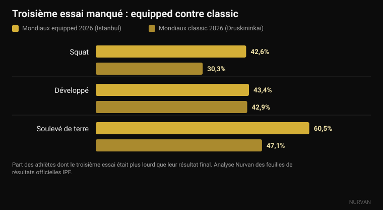
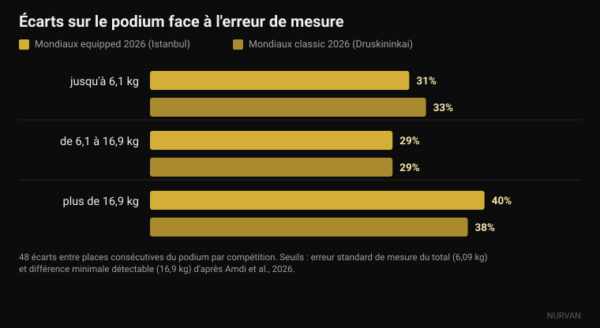

# Mondiaux equipped 2026 : résultats et 3e essai

Par [Giammaria Loi](/autore/giammaria-loi) · mis à jour le 16 novembre 2026

Les Championnats du monde IPF Open Equipped se sont terminés à Istanbul le dimanche 15 novembre, et l'IPF a publié les feuilles de résultats officielles le jour même. J'ai récupéré les deux documents complets — hommes et femmes — et je les ai mis en face de ceux des Mondiaux classic de juin. Au-delà des podiums, un chiffre compte plus en salle que n'importe quel record : combien de fois le troisième essai reste au sol.

## L'essentiel

- **L'Ukraine et le Canada repartent avec les titres par équipes.** Chez les hommes, l'Ukraine l'emporte avec 51 points devant le Taipei chinois (42) et le Japon (38) ; chez les femmes, le Canada avec 43 points devant le Taipei chinois (42) et le Brésil (34).
- **32 records du monde en sept jours** : 17 masculins et 15 féminins, répartis entre Open (9), Master 1 (9), Master 2 (9) et Junior (5).
- **Le soulevé de terre est le mouvement le plus mal évalué.** À Istanbul, **60,5 %** des athlètes ont chargé un troisième soulevé plus lourd que le résultat finalement conservé. Aux Mondiaux classic, 47,1 %.
- **Un écart de podium sur trois tient dans l'erreur de mesure** : 31 % des écarts entre places consécutives étaient de 6,09 kg ou moins, soit l'erreur standard de mesure d'un total (Amdi et al., 2026).
- **L'equipped sanctionne bien plus durement un mauvais choix** : 13,4 % des engagés d'Istanbul ont terminé sans total valide, contre 1,4 % aux Mondiaux classic.

## Qui a gagné à Istanbul

Les Mondiaux Open Equipped se sont tenus à Istanbul, en Türkiye, **du 9 au 15 novembre 2026**. Les feuilles officielles de l'IPF recensent **179 athlètes de 34 nations**, répartis dans les huit catégories masculines et les huit féminines.

Le meilleur score revient à l'Ukrainien **Kostiantyn Musiienko** : **1064,5 kg** en 93 kg pour 115,44 points IPF GL, avec des records du monde Open au développé couché (352,0 kg) et au total. Derrière lui, dans la même catégorie, son compatriote Volodymyr Rysiiev avec 1025 kg.

Chez les femmes, le meilleur score est de **Kelsey McCarthy** (États-Unis), 69 kg : **655,0 kg** et 113,88 points IPF GL, record du monde Open. Un an plus tôt, à Cluj-Napoca, elle avait gagné la même catégorie avec 652,5 kg : 2,5 kg de plus ont suffi pour le record.

Par équipes, l'**Ukraine** conserve le titre masculin (51 points, devant le Taipei chinois à 42 et le Japon à 38, troisième aux points des cinq meilleurs devant la Norvège). Le titre féminin passe au **Canada** (43 points), devant le Taipei chinois (42) et le Brésil (34).

Le résultat qui m'a le plus marqué est en 74 kg hommes : victoire de **Jarosław Olech**, Polonais né en **1974**. Cinquante-deux ans, catégorie Open — donc face à des athlètes qui pourraient être ses enfants — et 865 kg au total, avec trois records du monde Master 2 (squat 360 kg, développé 205 kg, total 865 kg). Derrière lui, Lawson Lillo, Américain né en 2006 : vingt ans, 852,5 kg et record du monde Junior au total. Trente-deux ans d'écart d'âge, 12,5 kg d'écart au total. J'ai développé le sujet en parlant des [Mondiaux masters de Reno](/fr/blog/mondiaux-masters-powerlifting-2026-force-age).

## L'Italie à Istanbul : un bronze et six athlètes

| Athlète | Catégorie | Place | Total |
| --- | --- | --- | --- |
| Giovanni Mancinelli | 120 kg | 3e | 972,5 kg |
| Stefano Caneo | 66 kg | 5e | 652,5 kg |
| Davide Cecchetti | 93 kg | 8e | 852,5 kg |
| Diego Milani | 74 kg | 9e | 760,0 kg |
| Caterina Caravaggio | 69 kg | 5e | 552,5 kg |
| Silvia Marostica | 76 kg | 10e | 530,0 kg |

La médaille est signée **Giovanni Mancinelli**, troisième en 120 kg avec 410 kg au squat, 257,5 au développé et 305 au soulevé de terre. L'équipe masculine finit neuvième avec 19 points, l'équipe féminine dix-neuvième avec 7.

## Le chiffre que les résumés ne montrent pas : le troisième essai

En compétition, vous avez trois essais par mouvement. Le troisième décide de la journée, et c'est celui qu'on voit le moins : les vidéos montrent les barres validées, pas celles qui ne bougent pas.

Les feuilles de résultats, elles, montrent tout. Si le poids annoncé au troisième essai est supérieur au résultat final de l'athlète, cet essai a été manqué — et cela se compte ligne par ligne. Je l'ai fait sur les deux Mondiaux 2026 : l'equipped d'Istanbul et le [classic de Druskininkai](/fr/blog/mondiaux-equipped-2026-apport-equipement) de juin.

*Analyse Nurvan des feuilles de résultats officielles IPF des Mondiaux Open Equipped 2026 (Istanbul) et Open Classic 2026 (Druskininkai).*

Trois choses ressortent.

**Le soulevé de terre est le plus manqué, et beaucoup plus en equipped.** À Istanbul, 60,5 % des troisièmes soulevés (92 sur 152) étaient plus lourds que le résultat final ; en classic, 47,1 % (162 sur 344). C'est logique : le soulevé clôt la journée, c'est là que se joue la médaille, et c'est le mouvement où l'équipement aide le moins.

**Au développé couché, aucune différence.** 43,4 % à Istanbul, 42,9 % à Druskininkai : la chemise de force permet des charges plus élevées, mais la part de troisièmes essais manqués reste identique. Les athlètes vont au bord de ce qu'ils peuvent faire, quel que soit ce bord.

**Au squat, l'equipped manque davantage** : 42,6 % contre 30,3 %. Avec combinaison et bandes de genoux, la marge entre profondeur valide et essai nul est plus étroite, et un troisième squat manqué en début de journée pèse sur tout le reste.

Il y a un quatrième chiffre, plus dur : à Istanbul, **24 athlètes sur 179 (13,4 %) ont terminé sans total valide**. Aux Mondiaux classic de juin, c'était 5 sur 351, soit 1,4 %. En equipped, une erreur de choix coûte la compétition entière près de dix fois plus souvent.

## Le podium se joue à l'intérieur de l'erreur de mesure

C'est ici qu'intervient une étude parue il y a quelques semaines. Amdi et ses collègues (2026) ont mesuré la variation hebdomadaire de la force maximale chez des powerlifters de niveau régional et national et ont trouvé une erreur standard de mesure de **4,16 kg au squat, 2,60 kg au développé, 4,07 kg au soulevé de terre et 6,09 kg au total**. Ils ont ensuite analysé quinze ans de compétitions IPF pour estimer combien de kilos il faut pour gagner une place : entre 14,3 et 44,2 kg au total, selon le niveau et le classement. Leur conclusion : **dans la plupart des contextes compétitifs, l'écart entre deux places consécutives tient dans l'erreur de mesure**, et c'est encore plus vrai au niveau mondial.

J'ai vérifié cette phrase sur les données d'Istanbul. Pour chacune des 16 catégories, j'ai relevé les écarts entre places consécutives du podium (1re-2e, 2e-3e, 3e-4e) : 48 écarts au total.

*Analyse Nurvan des feuilles de résultats officielles IPF. Seuils de référence d'après Amdi et al., 2026 : erreur standard de mesure du total 6,09 kg, différence minimale détectable environ 16,9 kg.*

**31 % des écarts de podium sont de 6,09 kg ou moins**, 60 % restent sous 16,9 kg, et la médiane est de 12,5 kg. Les Mondiaux classic de juin donnent presque la même image (33 % et 62 %) : ce n'est pas une bizarrerie de l'equipped, c'est le fonctionnement du powerlifting de haut niveau.

Dans six cas, l'écart a été exactement **nul**. En 76 kg femmes, trois athlètes ont toutes totalisé 610,0 kg et n'ont été séparées que par le poids de corps. En 47 kg, Wei-Ling Chen et Frankmary Duno ont fait 480,0 kg toutes les deux : l'or revient à Chen, plus légère de 450 grammes. En 105 kg hommes, Ian Bell et Nicki Lentz-Nielsen ont fini tous deux à 1050,0 kg.

Traduction : à ce niveau, personne ne gagne de 20 kg. On gagne en manquant un essai de moins le jour J.

## Ce que dit vraiment la recherche

**« En equipped, le troisième essai est presque gratuit, le matériel tient » — Faux.** 60,5 % des troisièmes soulevés et 42,6 % des troisièmes squats d'Istanbul ont été refusés, et 13,4 % des athlètes ont fini sans total contre 1,4 % en classic. L'équipement relève le plafond, pas la marge d'erreur.

**« Aux Mondiaux, c'est simplement le plus fort qui gagne » — À nuancer.** Dans 31 % des cas, l'écart de podium était inférieur à l'erreur de mesure d'un total (6,09 kg, Amdi et al., 2026), et nul dans six cas.

**« Pour devenir fort, il faut toujours aller à l'échec » — Faux.** Dans les méta-régressions de Robinson et ses collègues (2024), les gains de force sont similaires sur une large plage de répétitions en réserve : c'est l'hypertrophie qui progresse à mesure qu'on s'approche de l'échec, pas la force maximale. Une revue sur le développé couché aboutit au même conseil pratique : privilégier RPE/RIR, vitesse de barre et autorégulation plutôt que les séries à l'échec (Motlagh et Lipps, 2024).

**« Le RIR est trop imprécis pour choisir ses charges » — À nuancer.** Odgers et ses collègues (2021) ont mesuré l'erreur d'estimation chez des athlètes entraînés : à RPE 9, près de la limite, l'erreur moyenne était de 0,09 à 0,25 répétition ; à RPE 6, elle montait à 0,71-1,19. Le RIR est imprécis loin de l'échec et fiable près de l'échec — exactement l'inverse de l'usage courant. Détails dans [la précision du RIR](/fr/blog/rir-precision-repetitions-en-reserve).

**« Après 50 ans, la catégorie Open n'est plus pour vous » — Faux.** Jarosław Olech, né en 1974, a gagné les 74 kg Open avec 865 kg.

## Comment l'appliquer, même sans compétition

Un troisième essai, c'est la même chose que votre série lourde du lundi : une charge proche de la limite où 5 kg d'erreur changent le résultat. Ce qu'il faut en retenir.

1. **Choisissez la charge d'après la série précédente, pas d'après le tableur.** Si le deuxième essai — ou votre première série lourde — est sorti lent et brouillon, réduisez le saut. Les athlètes éliminés à Istanbul n'étaient pas faibles : ils avaient fixé un chiffre avant de savoir comment tournait la journée.
2. **Gardez des sauts courts près du maximum.** Au-delà de 90 %, l'erreur de mesure naturelle vaut déjà 4 à 6 kg (Amdi et al., 2026) : un saut de 15 kg sur un maximum de 160 est un pari, pas une progression.
3. **Arrêtez de chercher l'échec à l'entraînement.** Inutile pour la force (Robinson et al., 2024) et risque de surmenage accru (Motlagh et Lipps, 2024). Arrêtez-vous à 1-2 répétitions de la limite et gardez le reste pour la compétition ou les tests.
4. **Faites confiance au RIR là où il marche.** Près de l'échec, l'estimation est fine ; à 4-5 répétitions de la limite, vous vous tromperez de plus d'une répétition (Odgers et al., 2021). Pour les charges légères, utilisez des pourcentages ou la vitesse, pas les sensations.
5. **Échauffez-vous comme on collecte une information.** Les séries de montée en charge ne servent pas qu'à éviter les blessures : elles vous disent, avant la charge de travail, si c'est le bon jour.

> ### Choisissez vos charges avec des données, pas au feeling
> Nurvan enregistre charge, répétitions et RIR de chaque série, construit automatiquement vos séries d'échauffement à partir de la charge du jour et vous montre si la progression tient ou si vous ajoutez seulement des disques. C'est la décision du troisième essai appliquée à chaque séance. [Essayer Nurvan](https://nurvan.app)

## Questions fréquentes

**Quand ont eu lieu les Mondiaux equipped 2026 et qui a gagné ?**
À Istanbul, en Türkiye, du 9 au 15 novembre 2026. Les titres par équipes sont allés à l'Ukraine chez les hommes et au Canada chez les femmes ; les meilleurs scores individuels sont ceux de Kostiantyn Musiienko (1064,5 kg en 93 kg) et Kelsey McCarthy (655,0 kg en 69 kg).

**Combien de records du monde ont été battus ?**
Trente-deux d'après les feuilles officielles IPF : 17 chez les hommes et 15 chez les femmes, répartis entre Open, Junior, Master 1 et Master 2.

**Quelle différence entre powerlifting equipped et classic ?**
En equipped, combinaison de squat et de soulevé, chemise de force et bandes de genoux sont autorisées ; en classic, on concourt avec ceinture, genouillères et bandes de poignets. L'écart réel entre les deux est mesuré dans [ce que l'équipement apporte](/fr/blog/mondiaux-equipped-2026-apport-equipement).

**De combien faut-il progresser pour gagner une place ?**
Entre 14,3 et 44,2 kg au total selon le sexe, le niveau de compétition et le classement (Amdi et al., 2026). Au niveau mondial, beaucoup de ces écarts tiennent dans l'erreur de mesure.

## À lire aussi

- [Mondiaux equipped 2026 : ce que l'équipement apporte vraiment](/fr/blog/mondiaux-equipped-2026-apport-equipement) — la comparaison catégorie par catégorie entre equipped et classic.
- [Mondiaux masters 2026 : ce que l'âge fait à la force](/fr/blog/mondiaux-masters-powerlifting-2026-force-age) — 443 athlètes de 40 à 82 ans, analysés sur les données officielles.
- [Quelle est la précision de votre RIR ? Ce que disent les études](/fr/blog/rir-precision-repetitions-en-reserve) — où l'estimation fonctionne et où elle échoue.

## Sources

1. International Powerlifting Federation, 2026. Men's Results — 2026 IPF World Open Equipped Powerlifting Championships, Istanbul, 09-15/11/2026. [Feuille de résultats officielle PDF](https://www.powerlifting.sport/fileadmin/ipf/data/results/2026/equipped/Men_Results_2026_IPF_World_Open_Equipped_Powerlifting_Championships_2026-11-15.pdf)
2. International Powerlifting Federation, 2026. Women's Results — 2026 IPF World Open Equipped Powerlifting Championships, Istanbul. [Feuille de résultats officielle PDF](https://www.powerlifting.sport/fileadmin/ipf/data/results/2026/equipped/Women_Results_2026_IPF_World_Open_Equipped_Powerlifting_Championships_2026-11-15.pdf)
3. International Powerlifting Federation, 2026. Men's et Women's Team Points — 2026 IPF World Open Equipped Powerlifting Championships. [Page officielle des résultats](https://www.powerlifting.sport/championships/results/2026/world-open-equipped-powerlifting-championships-2026)
4. International Powerlifting Federation, 2026. Results — 2026 IPF World Classic Powerlifting Championships, Druskininkai, 13-21/06/2026. [Page officielle des résultats](https://www.powerlifting.sport/championships/results/2026/world-open-classic-powerlifting-championships-2026)
5. Amdi CH, Korakakis PA, Zourdos MC, Helms ER, Spence AJ, Robinson ZP, 2026. Reliability of Maximal Strength in Powerlifters and Performance Differences Required to Improve Competition Placing. Journal of Strength and Conditioning Research. PMID 42862018 — [doi:10.1519/JSC.0000000000005591](https://doi.org/10.1519/JSC.0000000000005591)
6. Robinson ZP, Pelland JC, Remmert JF, Refalo MC, Jukic I, Steele J, Zourdos MC, 2024. Exploring the Dose-Response Relationship Between Estimated Resistance Training Proximity to Failure, Strength Gain, and Muscle Hypertrophy: A Series of Meta-Regressions. Sports Medicine. PMID 38970765 — [doi:10.1007/s40279-024-02069-2](https://doi.org/10.1007/s40279-024-02069-2)
7. Odgers JB, Zourdos MC, Helms ER, Candow DG, Dahlstrom B, Bruno P, Sousa CA, 2021. Rating of Perceived Exertion and Velocity Relationships Among Trained Males and Females in the Front Squat and Hexagonal Bar Deadlift. Journal of Strength and Conditioning Research. PMID 33629974 — [doi:10.1519/JSC.0000000000003905](https://doi.org/10.1519/JSC.0000000000003905)
8. Motlagh JG, Lipps DB, 2024. The Contribution of Muscular Fatigue and Shoulder Biomechanics to Shoulder Injury Incidence During the Bench Press Exercise: A Narrative Review. Journal of Strength and Conditioning Research. PMID 39808810 — [doi:10.1519/JSC.0000000000004973](https://doi.org/10.1519/JSC.0000000000004973)

Les sources 5-8 ont été récupérées via PubMed. Les analyses des troisièmes essais, des totaux nuls et des écarts de podium sont des élaborations originales Nurvan, calculées sur les feuilles de résultats officielles IPF citées aux points 1-4.

Giammaria Loi est le fondateur de Nurvan. Il s'entraîne avec des charges depuis 2012, travaille comme entraîneur personnel et coach certifié FIPE depuis 2013 et dispute des compétitions de powerlifting au niveau national depuis 2018. Chaque article qu'il signe part des études scientifiques et aboutit à ce qui fonctionne vraiment en salle.

> Note : contenu informatif, qui ne remplace pas l'avis d'un médecin ou d'un professionnel.
