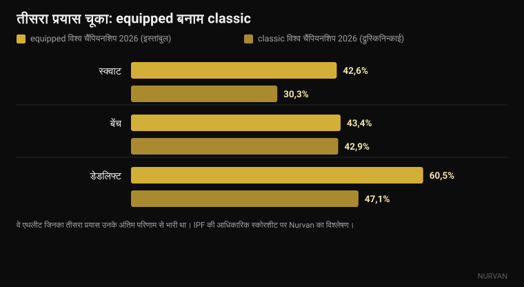
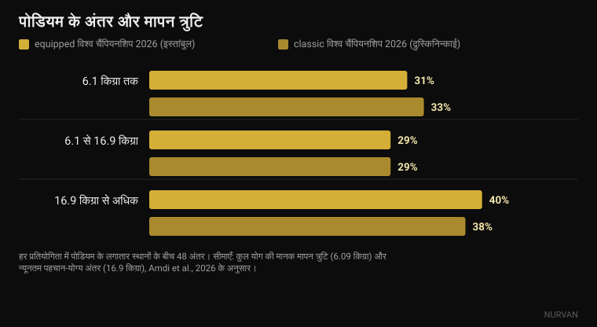

# Equipped वर्ल्ड 2026: नतीजे और तीसरा प्रयास

लेखक [Giammaria Loi](/autore/giammaria-loi) · अपडेट 16 नवंबर 2026

रविवार 15 नवंबर को इस्तांबुल में IPF वर्ल्ड ओपन equipped चैंपियनशिप खत्म हुई और IPF ने उसी दिन आधिकारिक स्कोरशीट जारी कर दीं। मैंने दोनों पूरे दस्तावेज़ — पुरुष और महिला — डाउनलोड किए और जून की classic वर्ल्ड चैंपियनशिप की शीट के साथ रखकर देखा। पोडियम के अलावा एक आँकड़ा निकला जो जिम में किसी भी रिकॉर्ड से ज़्यादा काम का है: तीसरा प्रयास कितनी बार ज़मीन पर ही रह जाता है।

## संक्षेप में

- **टीम खिताब यूक्रेन और कनाडा के।** पुरुषों में यूक्रेन 51 अंकों के साथ पहले, चीनी ताइपे (42) और जापान (38) आगे-पीछे; महिलाओं में कनाडा 43 अंकों के साथ पहले, चीनी ताइपे (42) और ब्राज़ील (34)।
- **सात दिनों में 32 विश्व रिकॉर्ड**: पुरुषों में 17 और महिलाओं में 15, जो ओपन (9), मास्टर 1 (9), मास्टर 2 (9) और जूनियर (5) वर्गों में बँटे हैं।
- **डेडलिफ्ट वह लिफ्ट है जिसका अंदाज़ा सबसे ज़्यादा गलत बैठता है।** इस्तांबुल में **60.5%** एथलीटों ने तीसरे डेडलिफ्ट में अपने अंतिम नतीजे से भारी वज़न लगाया। classic चैंपियनशिप में यह आँकड़ा 47.1% था।
- **तीन में से एक पोडियम अंतर मापन त्रुटि के भीतर है**: लगातार स्थानों के बीच 31% अंतर 6.09 किग्रा या उससे कम थे — यही कुल योग की मानक मापन त्रुटि है (Amdi et al., 2026)।
- **equipped में गलत अंदाज़े की सज़ा कहीं भारी है**: इस्तांबुल में 13.4% प्रतिभागी बिना वैध कुल योग के रहे, जबकि classic चैंपियनशिप में सिर्फ़ 1.4%।

## इस्तांबुल में कौन जीता

वर्ल्ड ओपन equipped चैंपियनशिप तुर्किये के इस्तांबुल में **9 से 15 नवंबर 2026** तक हुई। IPF की आधिकारिक शीट में **34 देशों के 179 एथलीट** दर्ज हैं, आठ पुरुष और आठ महिला भार वर्गों में।

पूरी चैंपियनशिप का सबसे बड़ा स्कोर यूक्रेन के **Kostiantyn Musiienko** का है: 93 किग्रा वर्ग में **1064.5 किग्रा** कुल योग और 115.44 IPF GL अंक, साथ में बेंच प्रेस (352.0 किग्रा) और कुल योग में ओपन विश्व रिकॉर्ड। उसी वर्ग में दूसरे स्थान पर उनके साथी Volodymyr Rysiiev, 1025 किग्रा के साथ।

महिलाओं में सबसे ऊँचा स्कोर **Kelsey McCarthy** (अमेरिका) का है, 69 किग्रा वर्ग: **655.0 किग्रा** और 113.88 IPF GL अंक, ओपन विश्व रिकॉर्ड। एक साल पहले क्लुज-नापोका में उन्होंने यही वर्ग 652.5 किग्रा से जीता था: 2.5 किग्रा और जोड़े, और रिकॉर्ड के लिए इतना ही काफ़ी रहा।

टीम वर्ग में **यूक्रेन** ने पुरुष खिताब बचाया (51 अंक, चीनी ताइपे 42 और जापान 38 से आगे; जापान बेहतरीन पाँच के अंकों पर नॉर्वे से आगे तीसरे स्थान पर)। महिला खिताब **कनाडा** के पास गया (43 अंक), चीनी ताइपे 42 के साथ दूसरे और ब्राज़ील 34 के साथ तीसरे स्थान पर।

जो नतीजा मेरे दिमाग़ में अटका रहा वह पुरुषों के 74 किग्रा वर्ग का है: जीते **Jarosław Olech**, पोलैंड के, जन्म **1974**। बावन साल की उम्र, ओपन वर्ग में — यानी ऐसे एथलीटों के सामने जो उनके बच्चों की उम्र के हो सकते हैं — 865 किग्रा कुल योग और तीन मास्टर 2 विश्व रिकॉर्ड (स्क्वाट 360 किग्रा, बेंच 205 किग्रा, कुल योग 865 किग्रा)। उनके पीछे 2006 में जन्मे अमेरिकी Lawson Lillo: बीस साल, 852.5 किग्रा और कुल योग में जूनियर विश्व रिकॉर्ड। उम्र में बत्तीस साल का फ़ासला, कुल योग में सिर्फ़ 12.5 किग्रा। उम्र और ताक़त पर मैंने [रीनो की मास्टर्स वर्ल्ड चैंपियनशिप](/hi/blog/masters-world-championship-2026-takat-aur-umra) वाले लेख में विस्तार से लिखा है।

## इस्तांबुल में इटली: एक कांस्य और छह एथलीट

| एथलीट | वर्ग | स्थान | कुल योग |
| --- | --- | --- | --- |
| Giovanni Mancinelli | 120 किग्रा | तीसरा | 972.5 किग्रा |
| Stefano Caneo | 66 किग्रा | पाँचवाँ | 652.5 किग्रा |
| Davide Cecchetti | 93 किग्रा | आठवाँ | 852.5 किग्रा |
| Diego Milani | 74 किग्रा | नौवाँ | 760.0 किग्रा |
| Caterina Caravaggio | 69 किग्रा | पाँचवाँ | 552.5 किग्रा |
| Silvia Marostica | 76 किग्रा | दसवाँ | 530.0 किग्रा |

पदक **Giovanni Mancinelli** का है, 120 किग्रा वर्ग में तीसरे स्थान पर — 410 किग्रा स्क्वाट, 257.5 किग्रा बेंच और 305 किग्रा डेडलिफ्ट। पुरुष टीम 19 अंकों के साथ नौवें और महिला टीम 7 अंकों के साथ उन्नीसवें स्थान पर रही।

## जो हाइलाइट्स में कभी नहीं दिखता: तीसरा प्रयास

प्रतियोगिता में हर लिफ्ट के तीन प्रयास मिलते हैं। तीसरा ही दिन तय करता है, और वही सबसे कम दिखता है: रील्स में सफल लिफ्ट दिखती हैं, वे बार नहीं जो हिले ही नहीं।

स्कोरशीट में सब कुछ होता है। अगर तीसरे प्रयास में घोषित वज़न उस एथलीट के अंतिम नतीजे से ज़्यादा है, तो वह प्रयास असफल रहा — और इसे पंक्ति-दर-पंक्ति गिना जा सकता है। मैंने यह 2026 की दोनों वर्ल्ड चैंपियनशिप पर किया: इस्तांबुल की equipped और जून की [द्रुस्किनिन्काई वाली classic](/hi/blog/equipped-world-championship-2026-gear-kitna-jodta-hai)।

*2026 वर्ल्ड ओपन equipped (इस्तांबुल) और वर्ल्ड ओपन classic (द्रुस्किनिन्काई) चैंपियनशिप की IPF आधिकारिक स्कोरशीट पर Nurvan का विश्लेषण।*

तीन बातें साफ़ दिखती हैं।

**डेडलिफ्ट सबसे ज़्यादा चूकती है, और equipped में कहीं ज़्यादा।** इस्तांबुल में 60.5% तीसरे डेडलिफ्ट (152 में से 92) अंतिम नतीजे से भारी थे; classic में 47.1% (344 में से 162)। यह समझ आता है: डेडलिफ्ट दिन का आख़िरी लिफ्ट है, पदक वहीं तय होता है, और गियर की मदद उसी में सबसे कम मिलती है।

**बेंच प्रेस में कोई फ़र्क़ नहीं।** इस्तांबुल में 43.4%, द्रुस्किनिन्काई में 42.9%: बेंच शर्ट बार पर ज़्यादा वज़न चढ़ाने देती है, पर असफल तीसरे प्रयासों का हिस्सा बिलकुल वही रहता है। एथलीट अपनी सीमा के किनारे तक जाते हैं, वह किनारा जहाँ भी हो।

**स्क्वाट में equipped ज़्यादा चूकता है**: 42.6% बनाम 30.3%। सूट और नी रैप्स के साथ वैध गहराई और रद्द प्रयास के बीच की गुंजाइश कम हो जाती है, और दिन की शुरुआत में चूका तीसरा स्क्वाट आगे सब पर भारी पड़ता है।

एक चौथा और कड़ा आँकड़ा भी है: इस्तांबुल में **179 में से 24 एथलीट (13.4%) बिना वैध कुल योग के रहे**। जून की classic चैंपियनशिप में यह 351 में से 5 था, यानी 1.4%। equipped में चुनाव की एक गलती लगभग दस गुना ज़्यादा बार पूरी प्रतियोगिता ले डूबती है।

## पोडियम मापन त्रुटि के भीतर तय होता है

यहाँ कुछ हफ़्ते पहले छपा एक अध्ययन काम आता है। Amdi और सहयोगियों (2026) ने क्षेत्रीय और राष्ट्रीय स्तर के पावरलिफ्टरों में अधिकतम ताक़त के हफ़्ते-दर-हफ़्ते उतार-चढ़ाव को मापा और मानक मापन त्रुटि पाई: **स्क्वाट में 4.16 किग्रा, बेंच में 2.60 किग्रा, डेडलिफ्ट में 4.07 किग्रा और कुल योग में 6.09 किग्रा**। फिर उन्होंने पंद्रह साल के IPF मुक़ाबलों का विश्लेषण कर निकाला कि एक स्थान ऊपर जाने के लिए कितने किलो चाहिए: कुल योग में 14.3 से 44.2 किग्रा, स्तर और स्थान के हिसाब से। उनका निष्कर्ष है कि **ज़्यादातर प्रतिस्पर्धी स्थितियों में दो लगातार स्थानों का अंतर मापन त्रुटि के भीतर ही आता है**, और यह वर्ल्ड चैंपियनशिप स्तर पर सबसे ज़्यादा सच है।

मैंने यह बात इस्तांबुल के आँकड़ों पर जाँची। सोलह वर्गों में से हर एक के लिए पोडियम के लगातार स्थानों के अंतर लिए (1-2, 2-3, 3-4): कुल 48 अंतर।

*IPF आधिकारिक स्कोरशीट पर Nurvan का विश्लेषण। संदर्भ सीमाएँ Amdi et al., 2026 से: कुल योग की मानक मापन त्रुटि 6.09 किग्रा, न्यूनतम पहचान-योग्य अंतर लगभग 16.9 किग्रा।*

**31% पोडियम अंतर 6.09 किग्रा या उससे कम थे**, 60% 16.9 किग्रा से नीचे रहे, और माध्यिका 12.5 किग्रा रही। जून की classic चैंपियनशिप लगभग वही तस्वीर देती है (33% और 62%): यह equipped की कोई विचित्रता नहीं, उच्च स्तर की पावरलिफ्टिंग ऐसी ही होती है।

छह मामलों में अंतर बिलकुल **शून्य** रहा। महिलाओं के 76 किग्रा वर्ग में तीन एथलीटों का कुल योग 610.0 किग्रा था और उन्हें सिर्फ़ शरीर के वज़न ने अलग किया। 47 किग्रा में Wei-Ling Chen और Frankmary Duno दोनों का 480.0 किग्रा रहा: स्वर्ण Chen को, क्योंकि वे 450 ग्राम हल्की थीं। पुरुषों के 105 किग्रा में Ian Bell और Nicki Lentz-Nielsen दोनों 1050.0 किग्रा पर रहे।

सीधे शब्दों में: उस स्तर पर कोई 20 किग्रा के अंतर से नहीं जीतता। जीतता वह है जो उस दिन एक प्रयास कम चूकता है।

## शोध असल में क्या कहता है

**"equipped में तीसरा प्रयास लगभग मुफ़्त है, गियर सँभाल लेगा" — ग़लत।** इस्तांबुल में 60.5% तीसरे डेडलिफ्ट और 42.6% तीसरे स्क्वाट रद्द हुए, और 13.4% एथलीट बिना कुल योग के रहे जबकि classic में 1.4%। गियर छत ऊँची करता है, गलती की गुंजाइश नहीं।

**"वर्ल्ड चैंपियनशिप में बस सबसे ताक़तवर जीतता है" — स्पष्ट करने की ज़रूरत।** 31% मामलों में पोडियम का अंतर उस त्रुटि से छोटा था जिससे कुल योग मापा जाता है (6.09 किग्रा, Amdi et al., 2026), और छह मामलों में शून्य था।

**"ताक़त के लिए हमेशा फेलियर तक जाना ज़रूरी है" — ग़लत।** Robinson और सहयोगियों (2024) के मेटा-रिग्रेशन में रिज़र्व में बची रेप्स की एक बड़ी रेंज पर ताक़त का लाभ एक जैसा रहा: फेलियर के पास जाने से हाइपरट्रॉफी सुधरती है, अधिकतम ताक़त नहीं। बेंच प्रेस पर एक समीक्षा भी यही व्यावहारिक सलाह देती है: फेलियर तक के सेट की जगह RPE/RIR, बार की गति और ऑटोरेगुलेशन को प्राथमिकता दें (Motlagh और Lipps, 2024)।

**"RIR वज़न चुनने के लिए बहुत अविश्वसनीय है" — स्पष्ट करने की ज़रूरत।** Odgers और सहयोगियों (2021) ने प्रशिक्षित एथलीटों में अनुमान की त्रुटि मापी: RPE 9 पर, यानी सीमा के पास, औसत त्रुटि 0.09-0.25 रेप थी; RPE 6 पर वह बढ़कर 0.71-1.19 हो गई। RIR फेलियर से दूर अविश्वसनीय है और उसके पास भरोसेमंद — ठीक उलटा जैसा ज़्यादातर लोग इस्तेमाल करते हैं। विस्तार से [RIR कितना सही होता है](/hi/blog/rir-kitna-sahi-hota-hai) में।

**"पचास के बाद ओपन वर्ग आपकी जगह नहीं" — ग़लत।** 1974 में जन्मे Jarosław Olech ने 865 किग्रा के साथ ओपन 74 किग्रा जीता।

## बिना प्रतियोगिता के भी इसे कैसे इस्तेमाल करें

तीसरा प्रयास आपकी सोमवार वाली भारी सेट जैसा ही है: सीमा के पास एक सिंगल, जहाँ 5 किग्रा की चूक नतीजा बदल देती है। इससे क्या लें।

1. **वज़न पिछली सेट से तय करें, स्प्रेडशीट से नहीं।** अगर दूसरा प्रयास — या आपकी पहली भारी सेट — धीमी और गड़बड़ निकली, तो छलांग छोटी करें। इस्तांबुल में बिना कुल योग के रह गए एथलीट कमज़ोर नहीं थे: उन्होंने दिन का हाल जानने से पहले ही संख्या तय कर ली थी।
2. **अधिकतम के पास छलांगें छोटी रखें।** 90% से ऊपर स्वाभाविक मापन त्रुटि ही 4-6 किग्रा की है (Amdi et al., 2026): 160 किग्रा के अधिकतम पर 15 किग्रा की छलांग दाँव है, प्रगति नहीं।
3. **ट्रेनिंग में फेलियर का पीछा न करें।** ताक़त के लिए ज़रूरी नहीं (Robinson et al., 2024) और अत्यधिक भार का जोखिम बढ़ाता है (Motlagh और Lipps, 2024)। सीमा से 1-2 रेप पहले रुकें और बाकी प्रतियोगिता या टेस्ट के लिए बचाएँ।
4. **RIR पर वहीं भरोसा करें जहाँ वह काम करता है।** फेलियर के पास अनुमान सटीक है; सीमा से 4-5 रेप दूर आप एक से ज़्यादा रेप चूकेंगे (Odgers et al., 2021)। हल्के वज़न के लिए प्रतिशत या गति इस्तेमाल करें, एहसास नहीं।
5. **वार्म-अप को जानकारी की तरह लें।** रैंप-अप सेट सिर्फ़ चोट से बचाव नहीं हैं: वे काम के वज़न से पहले बता देती हैं कि आज वाला दिन है या नहीं।

> ### वज़न आँकड़ों से चुनें, एहसास से नहीं
> Nurvan हर सेट का वज़न, रेप्स और RIR दर्ज करता है, दिन के काम के वज़न से वार्म-अप सेट अपने आप बनाता है, और दिखाता है कि प्रगति टिक रही है या आप सिर्फ़ प्लेटें जोड़ रहे हैं। यह तीसरे प्रयास वाला फ़ैसला है, हर ट्रेनिंग पर लागू। [Nurvan आज़माएँ](https://nurvan.app)

## अक्सर पूछे जाने वाले सवाल

**equipped वर्ल्ड 2026 कब हुई और कौन जीता?**
9 से 15 नवंबर 2026 तक तुर्किये के इस्तांबुल में। टीम खिताब पुरुषों में यूक्रेन और महिलाओं में कनाडा को मिले; सर्वश्रेष्ठ व्यक्तिगत स्कोर Kostiantyn Musiienko (93 किग्रा में 1064.5 किग्रा) और Kelsey McCarthy (69 किग्रा में 655.0 किग्रा) के रहे।

**कुल कितने विश्व रिकॉर्ड बने?**
IPF की आधिकारिक स्कोरशीट के अनुसार बत्तीस: पुरुषों में 17 और महिलाओं में 15, जो ओपन, जूनियर, मास्टर 1 और मास्टर 2 वर्गों में बँटे हैं।

**equipped और classic पावरलिफ्टिंग में फ़र्क़ क्या है?**
equipped में स्क्वाट/डेडलिफ्ट सूट, बेंच शर्ट और नी रैप्स की अनुमति है; classic में बेल्ट, नी स्लीव्स और रिस्ट रैप्स के साथ लिफ्ट होती है। आँकड़े असल में कितने बदलते हैं, यह मैंने [गियर कितना जोड़ता है](/hi/blog/equipped-world-championship-2026-gear-kitna-jodta-hai) में मापा है।

**एक स्थान ऊपर जाने के लिए कितना सुधार चाहिए?**
लिंग, प्रतियोगिता के स्तर और स्थान के हिसाब से कुल योग में 14.3 से 44.2 किग्रा (Amdi et al., 2026)। विश्व स्तर पर इनमें से कई अंतर मापन त्रुटि के भीतर ही आते हैं।

## यह भी पढ़ें

- [equipped वर्ल्ड 2026: गियर असल में कितना जोड़ता है](/hi/blog/equipped-world-championship-2026-gear-kitna-jodta-hai) — equipped और classic की वर्ग-दर-वर्ग तुलना।
- [मास्टर्स वर्ल्ड 2026: उम्र ताक़त के साथ क्या करती है](/hi/blog/masters-world-championship-2026-takat-aur-umra) — 40 से 82 साल के 443 एथलीट, आधिकारिक डेटा पर विश्लेषण।
- [आपका RIR कितना सही है? अध्ययन क्या कहते हैं](/hi/blog/rir-kitna-sahi-hota-hai) — अनुमान कहाँ काम करता है और कहाँ नहीं।

## स्रोत

1. International Powerlifting Federation, 2026. Men's Results — 2026 IPF World Open Equipped Powerlifting Championships, इस्तांबुल, 09-15/11/2026. [आधिकारिक स्कोरशीट PDF](https://www.powerlifting.sport/fileadmin/ipf/data/results/2026/equipped/Men_Results_2026_IPF_World_Open_Equipped_Powerlifting_Championships_2026-11-15.pdf)
2. International Powerlifting Federation, 2026. Women's Results — 2026 IPF World Open Equipped Powerlifting Championships, इस्तांबुल. [आधिकारिक स्कोरशीट PDF](https://www.powerlifting.sport/fileadmin/ipf/data/results/2026/equipped/Women_Results_2026_IPF_World_Open_Equipped_Powerlifting_Championships_2026-11-15.pdf)
3. International Powerlifting Federation, 2026. Men's और Women's Team Points — 2026 IPF World Open Equipped Powerlifting Championships. [आधिकारिक नतीजे पेज](https://www.powerlifting.sport/championships/results/2026/world-open-equipped-powerlifting-championships-2026)
4. International Powerlifting Federation, 2026. Results — 2026 IPF World Classic Powerlifting Championships, द्रुस्किनिन्काई, 13-21/06/2026. [आधिकारिक नतीजे पेज](https://www.powerlifting.sport/championships/results/2026/world-open-classic-powerlifting-championships-2026)
5. Amdi CH, Korakakis PA, Zourdos MC, Helms ER, Spence AJ, Robinson ZP, 2026. Reliability of Maximal Strength in Powerlifters and Performance Differences Required to Improve Competition Placing. Journal of Strength and Conditioning Research. PMID 42862018 — [doi:10.1519/JSC.0000000000005591](https://doi.org/10.1519/JSC.0000000000005591)
6. Robinson ZP, Pelland JC, Remmert JF, Refalo MC, Jukic I, Steele J, Zourdos MC, 2024. Exploring the Dose-Response Relationship Between Estimated Resistance Training Proximity to Failure, Strength Gain, and Muscle Hypertrophy: A Series of Meta-Regressions. Sports Medicine. PMID 38970765 — [doi:10.1007/s40279-024-02069-2](https://doi.org/10.1007/s40279-024-02069-2)
7. Odgers JB, Zourdos MC, Helms ER, Candow DG, Dahlstrom B, Bruno P, Sousa CA, 2021. Rating of Perceived Exertion and Velocity Relationships Among Trained Males and Females in the Front Squat and Hexagonal Bar Deadlift. Journal of Strength and Conditioning Research. PMID 33629974 — [doi:10.1519/JSC.0000000000003905](https://doi.org/10.1519/JSC.0000000000003905)
8. Motlagh JG, Lipps DB, 2024. The Contribution of Muscular Fatigue and Shoulder Biomechanics to Shoulder Injury Incidence During the Bench Press Exercise: A Narrative Review. Journal of Strength and Conditioning Research. PMID 39808810 — [doi:10.1519/JSC.0000000000004973](https://doi.org/10.1519/JSC.0000000000004973)

स्रोत 5-8 PubMed के ज़रिए लिए गए हैं। तीसरे प्रयासों, रद्द कुल योग और पोडियम अंतरों का विश्लेषण Nurvan का मौलिक काम है, जो बिंदु 1-4 में दी गई IPF की आधिकारिक स्कोरशीट पर गणना किया गया है।

Giammaria Loi, Nurvan के संस्थापक हैं। वे 2012 से वेट ट्रेनिंग करते हैं, 2013 से FIPE प्रमाणित पर्सनल ट्रेनर और कोच हैं और 2018 से राष्ट्रीय स्तर पर पावरलिफ्टिंग में प्रतिस्पर्धा करते हैं। उनके हर लेख की शुरुआत शोध से होती है और अंत उसी पर जो जिम में सचमुच काम करता है।

> नोट: यह जानकारीपरक सामग्री है, यह डॉक्टर या पेशेवर की सलाह का विकल्प नहीं है।
