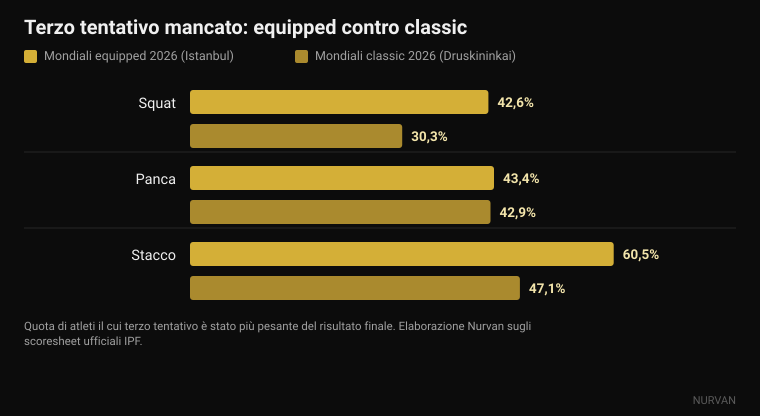
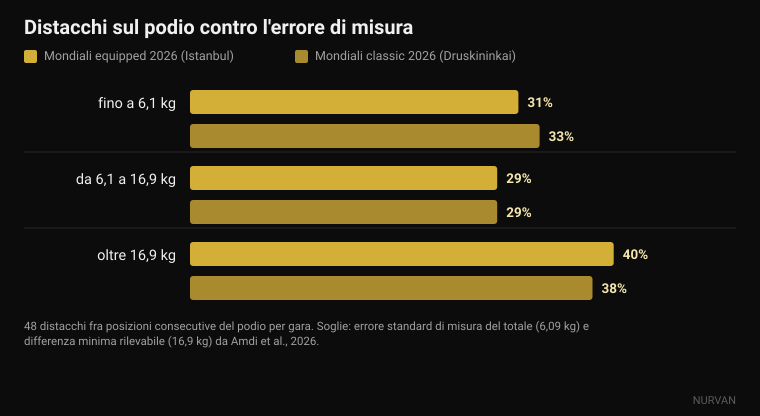

# Mondiali equipped 2026: risultati e terzo tentativo

Di [Giammaria Loi](/autore/giammaria-loi) · aggiornato il 16 novembre 2026

Domenica 15 novembre si sono chiusi a Istanbul i Mondiali IPF Open Equipped e l'IPF ha pubblicato gli scoresheet ufficiali. Ho scaricato i due documenti completi — uomini e donne — e li ho confrontati con quelli dei Mondiali classic di giugno. Oltre ai podi è venuto fuori un numero che in palestra vale più di tutti i record: quante volte il terzo tentativo finisce a terra.

## In breve

- **Ucraina e Canada escono con i titoli a squadre.** Fra gli uomini vince l'Ucraina con 51 punti davanti a Taipei (42) e Giappone (38); fra le donne il Canada con 43 punti davanti a Taipei (42) e Brasile (34).
- **32 record del mondo omologati in sette giorni**: 17 maschili e 15 femminili, distribuiti fra Open (9), Master 1 (9), Master 2 (9) e Junior (5).
- **L'Italia porta a casa un bronzo**: Giovanni Mancinelli, terzo nella 120 kg con 972,5 kg di totale. Sei azzurri in gara, nona la squadra maschile.
- **Il terzo stacco è l'alzata più sbagliata della gara**: a Istanbul il **60,5%** degli atleti ha caricato sul terzo tentativo un peso più alto del risultato che ha poi portato a casa. Nel classic la stessa quota è del 47,1%.
- **Un podio su tre si decide dentro l'errore di misura**: il 31% dei distacchi fra posizioni consecutive del podio sta sotto i 6,09 kg, cioè l'errore standard con cui si misura un totale di powerlifting (Amdi et al., 2026).

## Chi ha vinto a Istanbul

I Mondiali Open Equipped si sono tenuti a Istanbul, in Turchia, **dal 9 al 15 novembre 2026**. Gli scoresheet ufficiali IPF, pubblicati il 15 novembre, contano **179 atleti al via da 34 nazioni**, divisi nelle otto categorie maschili e nelle otto femminili.

Il miglior punteggio assoluto è dell'ucraino **Kostiantyn Musiienko**: nella 93 kg ha chiuso con **1064,5 kg** di totale e 115,44 punti IPF GL, con record del mondo Open in panca (352,0 kg) e nel totale. Dietro di lui, sempre nella 93 kg, il connazionale Volodymyr Rysiiev con 1025 kg.

Fra le donne il miglior punteggio è di **Kelsey McCarthy** (Stati Uniti), 69 kg: **655,0 kg** di totale, 113,88 punti IPF GL e record del mondo Open. Un anno fa, a Cluj-Napoca, aveva vinto la stessa categoria con 652,5 kg: ha ritoccato il proprio risultato di 2,5 kg, ed è bastato per il primato mondiale.

Nelle classifiche a squadre l'**Ucraina** conferma il titolo maschile (51 punti, davanti a Taipei con 42 e al Giappone con 38, terzo sui punti dei migliori cinque davanti alla Norvegia). Fra le donne il titolo passa al **Canada** (43 punti), con Taipei seconda a 42 e il Brasile terzo a 34.

Il risultato che mi ha colpito di più però è nella 74 kg maschile: ha vinto **Jarosław Olech**, polacco, classe **1974**. Cinquantadue anni, categoria Open — quindi contro atleti che potrebbero essere suoi figli — e 865 kg di totale, con tre record del mondo Master 2 (squat 360 kg, panca 205 kg, totale 865 kg). Alle sue spalle Lawson Lillo, statunitense del 2006: vent'anni, 852,5 kg e record del mondo Junior nel totale. Trentadue anni di differenza d'età e 12,5 kg di differenza sul totale. Se il tema ti interessa, ne ho scritto in modo più esteso parlando dei [Mondiali master di Reno](/blog/mondiali-master-powerlifting-2026-forza-eta).

## L'Italia a Istanbul: un bronzo e sei atleti

Sei azzurri in pedana, quattro uomini e due donne.

| Atleta | Categoria | Posto | Totale |
| --- | --- | --- | --- |
| Giovanni Mancinelli | 120 kg | 3° | 972,5 kg |
| Stefano Caneo | 66 kg | 5° | 652,5 kg |
| Davide Cecchetti | 93 kg | 8° | 852,5 kg |
| Diego Milani | 74 kg | 9° | 760,0 kg |
| Caterina Caravaggio | 69 kg | 5ª | 552,5 kg |
| Silvia Marostica | 76 kg | 10ª | 530,0 kg |

La medaglia è di **Giovanni Mancinelli**, terzo nella 120 kg con 410 kg di squat, 257,5 di panca e 305 di stacco. La squadra maschile chiude nona con 19 punti, quella femminile diciannovesima con 7.

## Il dato che gli highlight non mostrano: il terzo tentativo

In gara hai tre tentativi per alzata. Il terzo è quello che decide la gara, ed è anche quello che si vede meno nei video: i reel mostrano gli alzate valide, non i bilancieri che restano a terra.

Negli scoresheet, invece, c'è tutto. Se il peso dichiarato al terzo tentativo è più alto del risultato finale di quell'atleta, quel tentativo è stato mancato: è una cosa che si può contare riga per riga. L'ho fatto su entrambi i Mondiali 2026 — l'equipped di Istanbul e il [classic di Druskininkai](/blog/mondiali-equipped-istanbul-2026-attrezzatura) di giugno.

*Elaborazione Nurvan sugli scoresheet ufficiali IPF dei Mondiali Open Equipped 2026 (Istanbul) e Open Classic 2026 (Druskininkai).*

Tre cose saltano fuori.

**Lo stacco è l'alzata che si sbaglia di più, e nell'equipped molto di più.** A Istanbul il 60,5% dei terzi stacchi (92 su 152) era più pesante del risultato finale; nel classic il 47,1% (162 su 344). Ha senso: lo stacco è l'ultima alzata della giornata, quella in cui si gioca la medaglia, ed è anche l'alzata in cui l'attrezzatura aiuta meno.

**Nella panca non cambia niente.** 43,4% a Istanbul, 42,9% a Druskininkai: la maglia da panca permette carichi più alti, ma la quota di terzi tentativi falliti resta identica. Gli atleti si spingono al limite di ciò che possono fare, qualunque sia quel limite.

**Nello squat l'equipped sbaglia di più**: 42,6% contro 30,3%. Con muta e fasce il margine fra "profondità valida" e "tentativo nullo" è più stretto, e un terzo squat sbagliato all'inizio della gara pesa su tutto il resto.

C'è un quarto numero, più duro: a Istanbul **24 atleti su 179 (il 13,4%) hanno chiuso senza un totale valido**. Ai Mondiali classic di giugno erano 5 su 351, cioè l'1,4%. Nell'equipped un errore di scelta costa l'intera gara quasi dieci volte più spesso.

## Il podio si decide dentro l'errore di misura

Qui entra in gioco uno studio uscito poche settimane fa. Amdi e colleghi (2026) hanno misurato quanto varia la forza massimale di powerlifter di livello regionale e nazionale da una settimana all'altra, e hanno trovato un errore standard di misura di **4,16 kg nello squat, 2,60 kg in panca, 4,07 kg nello stacco e 6,09 kg sul totale**. Poi hanno analizzato quindici anni di gare IPF per capire quanti chili servono per guadagnare una posizione: fra i 14,3 e i 44,2 kg sul totale, a seconda del livello e del piazzamento. La conclusione degli autori è che **nella maggior parte dei contesti competitivi la differenza fra due piazzamenti consecutivi è dentro l'errore di misura**, e che questo vale soprattutto ai Mondiali.

Ho verificato quella frase sui dati di Istanbul. Per ciascuna delle 16 categorie ho preso i distacchi fra posizioni consecutive del podio (1°-2°, 2°-3°, 3°-4°): 48 distacchi in tutto.

*Elaborazione Nurvan sugli scoresheet ufficiali IPF. Soglie di riferimento da Amdi et al., 2026: errore standard di misura del totale 6,09 kg, differenza minima rilevabile circa 16,9 kg.*

Il **31% dei distacchi sul podio è di 6,09 kg o meno**, il 60% sta sotto i 16,9 kg, e la mediana è 12,5 kg. Ai Mondiali classic di giugno i numeri sono quasi identici (33% e 62%): non è una stranezza dell'equipped, è come funziona il powerlifting ad alto livello.

In sei casi il distacco è stato esattamente **zero**. Nella 76 kg femminile tre atlete hanno chiuso tutte a 610,0 kg e sono state separate solo dal peso corporeo. Nella 47 kg Wei-Ling Chen e Frankmary Duno hanno totalizzato 480,0 kg entrambe: oro alla prima perché pesava 450 grammi in meno. Nella 105 kg maschile Ian Bell e Nicki Lentz-Nielsen hanno chiuso entrambi a 1050,0 kg.

Tradotto: a quel livello non vince chi è più forte di 20 kg. Vince chi, nella stessa giornata, sbaglia un tentativo in meno.

## Cosa dice davvero la ricerca

**"Nell'equipped il terzo tentativo è quasi gratis, tanto l'attrezzatura regge" — Smentito.** Il 60,5% dei terzi stacchi e il 42,6% dei terzi squat di Istanbul sono finiti nulli, e il 13,4% degli atleti ha chiuso senza totale contro l'1,4% del classic. L'attrezzatura alza il tetto, non il margine d'errore.

**"Ai Mondiali vince semplicemente il più forte" — Da precisare.** Nel 31% dei casi il distacco sul podio è più piccolo dell'errore con cui si misura un totale (6,09 kg secondo Amdi et al., 2026), e in sei casi è stato zero.

**"Per diventare forti bisogna allenarsi sempre a cedimento" — Smentito.** Nella meta-regressione di Robinson e colleghi (2024), i guadagni di forza sono risultati simili su un ampio intervallo di ripetizioni in riserva: è l'ipertrofia a migliorare avvicinandosi al cedimento, non la forza massimale. Una review sulla panca piana arriva allo stesso consiglio pratico: meglio usare RPE/RIR, velocità del bilanciere e autoregolazione che le serie a cedimento (Motlagh e Lipps, 2024).

**"Il RIR è troppo impreciso per scegliere i carichi" — Da precisare.** Odgers e colleghi (2021) hanno misurato l'errore di stima in atleti allenati: a RPE 9, cioè vicino al limite, l'errore medio era di 0,09-0,25 ripetizioni; a RPE 6 saliva a 0,71-1,19. Il RIR è impreciso lontano dal cedimento e diventa affidabile vicino: esattamente il contrario di come viene usato di solito. Ne ho parlato nel dettaglio in [quanto è preciso il RIR](/blog/quanto-e-preciso-il-rir).

**"Dopo i 50 anni la categoria Open non è più il tuo posto" — Smentito.** Jarosław Olech, nato nel 1974, ha vinto la 74 kg Open con 865 kg.

## Come applicarlo, anche se non gareggi

Il terzo tentativo di gara è la stessa cosa del tuo top set del lunedì: un'alzata singola vicino al limite, dove un errore di 5 kg cambia il risultato. Cosa portarsi a casa.

1. **Scegli il carico dal secondo, non dal programma.** Se il secondo tentativo (o la tua prima serie pesante) è uscito lento e sporco, il salto successivo si riduce. Gli atleti che a Istanbul hanno chiuso senza totale non erano deboli: avevano dichiarato un peso deciso prima di sapere come stava andando la giornata.
2. **Tieni i salti piccoli quando sei vicino al massimale.** Sopra il 90% l'errore di misura naturale vale già 4-6 kg (Amdi et al., 2026): un salto di 15 kg su un massimale di 160 è una scommessa, non una progressione.
3. **Non cercare il cedimento in allenamento.** Per la forza non serve (Robinson et al., 2024) e aumenta il rischio di sovraccarico (Motlagh e Lipps, 2024). Fermati a 1-2 ripetizioni dal limite e tieni quelle vicine al limite per la gara o per i test.
4. **Fidati del RIR solo dove è affidabile.** Vicino al cedimento la stima è precisa; a 4-5 ripetizioni dal limite sbagli di più di una ripetizione (Odgers et al., 2021). Per i carichi leggeri usa percentuali o velocità, non sensazioni.
5. **Scalda con criterio.** Le serie di avvicinamento non servono solo a non farsi male: servono a capire, prima del carico vero, se oggi è giornata.

> ### Scegli il carico con i dati, non a sensazione
> Nurvan registra carico, ripetizioni e RIR di ogni serie, ti propone in automatico le serie di riscaldamento sul massimale del giorno e ti mostra se la progressione sta reggendo o se stai solo aggiungendo chili. È lo stesso ragionamento del terzo tentativo, applicato a ogni allenamento. [Prova Nurvan](https://nurvan.app)

## Domande frequenti

**Quando sono stati i Mondiali equipped 2026 e chi ha vinto?**
Si sono tenuti a Istanbul, in Turchia, dal 9 al 15 novembre 2026. I titoli a squadre sono andati all'Ucraina fra gli uomini e al Canada fra le donne; i migliori punteggi assoluti sono di Kostiantyn Musiienko (1064,5 kg nella 93 kg) e Kelsey McCarthy (655,0 kg nella 69 kg).

**Quanti record del mondo sono stati stabiliti?**
Trentadue in totale secondo gli scoresheet ufficiali IPF: 17 nelle gare maschili e 15 in quelle femminili, distribuiti fra categoria Open, Junior, Master 1 e Master 2.

**Che differenza c'è fra powerlifting equipped e classic?**
Nell'equipped sono ammesse muta da squat e stacco, maglia da panca e fasce per le ginocchia; nel classic si gareggia con cintura, ginocchiere e fasce da polso. Quanto cambiano davvero i numeri l'ho misurato in [quanto aggiunge l'attrezzatura](/blog/mondiali-equipped-istanbul-2026-attrezzatura).

**Quanto deve migliorare un atleta per guadagnare una posizione?**
Secondo Amdi e colleghi (2026), fra 14,3 e 44,2 kg sul totale a seconda del sesso, del livello di gara e del piazzamento. A livello mondiale molte di quelle differenze sono però dentro l'errore di misura.

## Leggi anche

- [Mondiali equipped 2026: quanto aggiunge l'attrezzatura](/blog/mondiali-equipped-istanbul-2026-attrezzatura) — il confronto categoria per categoria fra equipped e classic.
- [Mondiali master 2026: cosa succede alla forza con l'età](/blog/mondiali-master-powerlifting-2026-forza-eta) — 443 atleti da 40 a 82 anni, analizzati sui dati ufficiali.
- [Quanto è preciso il tuo RIR? Cosa dicono gli studi](/blog/quanto-e-preciso-il-rir) — dove la stima funziona e dove no.

## Fonti

1. International Powerlifting Federation, 2026. Men's Results — 2026 IPF World Open Equipped Powerlifting Championships, Istanbul, 09-15/11/2026. [Scoresheet ufficiale PDF](https://www.powerlifting.sport/fileadmin/ipf/data/results/2026/equipped/Men_Results_2026_IPF_World_Open_Equipped_Powerlifting_Championships_2026-11-15.pdf)
2. International Powerlifting Federation, 2026. Women's Results — 2026 IPF World Open Equipped Powerlifting Championships, Istanbul. [Scoresheet ufficiale PDF](https://www.powerlifting.sport/fileadmin/ipf/data/results/2026/equipped/Women_Results_2026_IPF_World_Open_Equipped_Powerlifting_Championships_2026-11-15.pdf)
3. International Powerlifting Federation, 2026. Men's e Women's Team Points — 2026 IPF World Open Equipped Powerlifting Championships. [Pagina risultati ufficiale](https://www.powerlifting.sport/championships/results/2026/world-open-equipped-powerlifting-championships-2026)
4. International Powerlifting Federation, 2026. Results — 2026 IPF World Classic Powerlifting Championships, Druskininkai, 13-21/06/2026. [Pagina risultati ufficiale](https://www.powerlifting.sport/championships/results/2026/world-open-classic-powerlifting-championships-2026)
5. Amdi CH, Korakakis PA, Zourdos MC, Helms ER, Spence AJ, Robinson ZP, 2026. Reliability of Maximal Strength in Powerlifters and Performance Differences Required to Improve Competition Placing. Journal of Strength and Conditioning Research. PMID 42862018 — [doi:10.1519/JSC.0000000000005591](https://doi.org/10.1519/JSC.0000000000005591)
6. Robinson ZP, Pelland JC, Remmert JF, Refalo MC, Jukic I, Steele J, Zourdos MC, 2024. Exploring the Dose-Response Relationship Between Estimated Resistance Training Proximity to Failure, Strength Gain, and Muscle Hypertrophy: A Series of Meta-Regressions. Sports Medicine. PMID 38970765 — [doi:10.1007/s40279-024-02069-2](https://doi.org/10.1007/s40279-024-02069-2)
7. Odgers JB, Zourdos MC, Helms ER, Candow DG, Dahlstrom B, Bruno P, Sousa CA, 2021. Rating of Perceived Exertion and Velocity Relationships Among Trained Males and Females in the Front Squat and Hexagonal Bar Deadlift. Journal of Strength and Conditioning Research. PMID 33629974 — [doi:10.1519/JSC.0000000000003905](https://doi.org/10.1519/JSC.0000000000003905)
8. Motlagh JG, Lipps DB, 2024. The Contribution of Muscular Fatigue and Shoulder Biomechanics to Shoulder Injury Incidence During the Bench Press Exercise: A Narrative Review. Journal of Strength and Conditioning Research. PMID 39808810 — [doi:10.1519/JSC.0000000000004973](https://doi.org/10.1519/JSC.0000000000004973)

Le fonti 5-8 sono state recuperate tramite PubMed. Le elaborazioni sui terzi tentativi, sui totali nulli e sui distacchi di podio sono originali Nurvan, calcolate sugli scoresheet ufficiali IPF citati ai punti 1-4.

Giammaria Loi è il fondatore di Nurvan. Si allena con i pesi dal 2012, lavora come personal trainer e coach certificato FIPE dal 2013 e gareggia nel powerlifting a livello nazionale dal 2018. Ogni articolo che firma parte dagli studi scientifici e arriva a ciò che funziona davvero in palestra.

> Nota: contenuto informativo, non sostituisce il parere di un medico o professionista.
