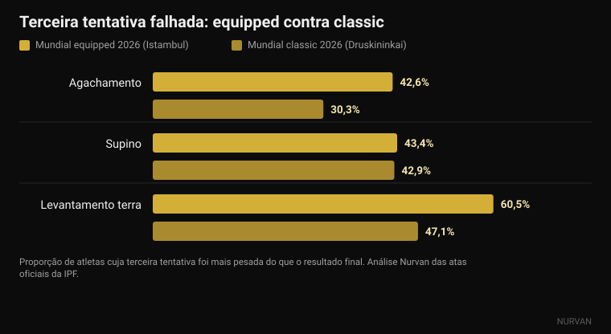
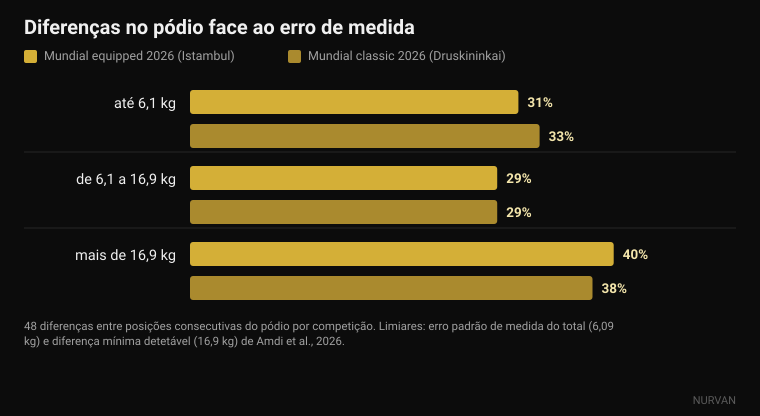

# Mundial equipped 2026: resultados e 3.ª tentativa

Por [Giammaria Loi](/autore/giammaria-loi) · atualizado a 16 de novembro de 2026

No domingo, 15 de novembro, fechou em Istambul o Mundial IPF Open Equipped, e a IPF publicou as atas oficiais no mesmo dia. Descarreguei os dois documentos completos — masculino e feminino — e coloquei-os ao lado dos do Mundial classic de junho. Para além dos pódios, saiu um número que no ginásio vale mais do que qualquer recorde: quantas vezes a terceira tentativa fica no chão.

## Em resumo

- **Ucrânia e Canadá levam os títulos por equipas.** Nos homens vence a Ucrânia com 51 pontos à frente de Taipé Chinesa (42) e do Japão (38); nas mulheres, o Canadá com 43 pontos à frente de Taipé Chinesa (42) e do Brasil (34).
- **32 recordes do mundo em sete dias**: 17 masculinos e 15 femininos, repartidos por Open (9), Master 1 (9), Master 2 (9) e Junior (5).
- **O levantamento terra é o movimento mais falhado.** Em Istambul, **60,5%** dos atletas carregaram uma terceira tentativa mais pesada do que o resultado que acabaram por manter. No classic foram 47,1%.
- **Uma em cada três diferenças de pódio cabe dentro do erro de medida**: 31% das diferenças entre posições consecutivas foram de 6,09 kg ou menos, o erro padrão de medida de um total (Amdi et al., 2026).
- **O equipped castiga muito mais um mau cálculo**: 13,4% dos inscritos em Istambul terminaram sem total válido, contra 1,4% no Mundial classic.

## Quem ganhou em Istambul

O Mundial Open Equipped disputou-se em Istambul, na Turquia, **de 9 a 15 de novembro de 2026**. As atas oficiais da IPF registam **179 atletas de 34 países**, nas oito categorias masculinas e nas oito femininas.

A melhor marca absoluta é do ucraniano **Kostiantyn Musiienko**: **1064,5 kg** nos 93 kg e 115,44 pontos IPF GL, com recordes do mundo Open em supino (352,0 kg) e no total. Atrás dele, na mesma categoria, o compatriota Volodymyr Rysiiev com 1025 kg.

Nas mulheres, a melhor pontuação é de **Kelsey McCarthy** (Estados Unidos), 69 kg: **655,0 kg** e 113,88 pontos IPF GL, recorde do mundo Open. Um ano antes, em Cluj-Napoca, tinha ganho a mesma categoria com 652,5 kg: somou 2,5 kg e chegou para o recorde.

Por equipas, a **Ucrânia** revalida o título masculino (51 pontos, à frente de Taipé com 42 e do Japão com 38, terceiro pelos pontos dos cinco melhores à frente da Noruega). O título feminino passa para o **Canadá** (43 pontos), com Taipé em segundo com 42 e o Brasil em terceiro com 34.

O resultado que mais me ficou está nos 74 kg masculinos: ganhou **Jarosław Olech**, polaco nascido em **1974**. Cinquenta e dois anos, categoria Open — portanto contra atletas que podiam ser seus filhos — e 865 kg de total, com três recordes do mundo Master 2 (agachamento 360 kg, supino 205 kg, total 865 kg). Atrás dele, Lawson Lillo, norte-americano de 2006: vinte anos, 852,5 kg e recorde do mundo Junior no total. Trinta e dois anos de diferença de idade e 12,5 kg de diferença no total. Desenvolvi o tema ao falar do [Mundial master de Reno](/pt/blog/mundial-master-powerlifting-2026-forca-idade).

## A Itália em Istambul: um bronze e seis atletas

| Atleta | Categoria | Lugar | Total |
| --- | --- | --- | --- |
| Giovanni Mancinelli | 120 kg | 3.º | 972,5 kg |
| Stefano Caneo | 66 kg | 5.º | 652,5 kg |
| Davide Cecchetti | 93 kg | 8.º | 852,5 kg |
| Diego Milani | 74 kg | 9.º | 760,0 kg |
| Caterina Caravaggio | 69 kg | 5.ª | 552,5 kg |
| Silvia Marostica | 76 kg | 10.ª | 530,0 kg |

A medalha é de **Giovanni Mancinelli**, terceiro nos 120 kg com 410 kg de agachamento, 257,5 de supino e 305 de levantamento terra. A equipa masculina ficou em nono com 19 pontos e a feminina em décimo nono com 7.

## O dado que os resumos não mostram: a terceira tentativa

Em competição há três tentativas por movimento. A terceira decide o dia, e é a que menos se vê: os vídeos mostram levantamentos válidos, não barras que ficam paradas.

Nas atas, pelo contrário, está tudo. Se o peso declarado na terceira tentativa é superior ao resultado final desse atleta, essa tentativa foi nula — e isso conta-se linha a linha. Fi-lo nos dois Mundiais de 2026: o equipped de Istambul e o [classic de Druskininkai](/pt/blog/mundial-equipped-2026-quanto-soma-equipamento) de junho.

*Análise Nurvan sobre as atas oficiais da IPF do Mundial Open Equipped 2026 (Istambul) e do Mundial Open Classic 2026 (Druskininkai).*

Saem três coisas.

**O levantamento terra é o mais falhado, e muito mais no equipped.** Em Istambul, 60,5% das terceiras tentativas de terra (92 em 152) eram mais pesadas do que o resultado final; no classic, 47,1% (162 em 344). Faz sentido: o terra fecha o dia, é onde se joga a medalha e é o movimento em que o equipamento ajuda menos.

**No supino não muda nada.** 43,4% em Istambul, 42,9% em Druskininkai: a camisola de supino permite mais quilos, mas a proporção de terceiras tentativas nulas é idêntica. Os atletas vão ao limite do que conseguem, seja qual for esse limite.

**No agachamento o equipped falha mais**: 42,6% contra 30,3%. Com fato e ligaduras de joelho a margem entre profundidade válida e tentativa nula é mais estreita, e um terceiro agachamento falhado no início pesa em todo o resto.

Há um quarto número, mais duro: em Istambul **24 atletas em 179 (13,4%) terminaram sem total válido**. No Mundial classic de junho foram 5 em 351, ou seja 1,4%. No equipped, um erro de escolha custa a competição inteira quase dez vezes mais vezes.

## O pódio decide-se dentro do erro de medida

É aqui que entra um estudo publicado há poucas semanas. Amdi e colegas (2026) mediram quanto varia a força máxima de powerlifters de nível regional e nacional de uma semana para a outra e encontraram um erro padrão de medida de **4,16 kg no agachamento, 2,60 kg no supino, 4,07 kg no terra e 6,09 kg no total**. Depois analisaram quinze anos de competições da IPF para perceber quantos quilos são precisos para ganhar uma posição: entre 14,3 e 44,2 kg no total, consoante o nível e a classificação. A conclusão dos autores é que **na maioria dos contextos competitivos a diferença entre duas posições consecutivas cai dentro do erro de medida**, e que isso vale sobretudo ao nível mundial.

Verifiquei essa frase nos dados de Istambul. Em cada uma das 16 categorias retirei as diferenças entre posições consecutivas do pódio (1.º-2.º, 2.º-3.º, 3.º-4.º): 48 diferenças no total.

*Análise Nurvan sobre as atas oficiais da IPF. Limiares de referência de Amdi et al., 2026: erro padrão de medida do total 6,09 kg, diferença mínima detetável cerca de 16,9 kg.*

**31% das diferenças de pódio foram de 6,09 kg ou menos**, 60% ficaram abaixo de 16,9 kg e a mediana foi de 12,5 kg. O Mundial classic de junho dá quase a mesma imagem (33% e 62%): não é uma estranheza do equipped, é como funciona o powerlifting de alto nível.

Em seis casos a diferença foi exatamente **zero**. Nos 76 kg femininos três atletas totalizaram 610,0 kg e só o peso corporal as separou. Nos 47 kg, Wei-Ling Chen e Frankmary Duno fizeram 480,0 kg ambas: ouro para Chen porque pesava menos 450 gramas. Nos 105 kg masculinos, Ian Bell e Nicki Lentz-Nielsen fecharam ambos em 1050,0 kg.

Traduzido: a esse nível ninguém ganha por 20 kg. Ganha quem, nesse dia, falha uma tentativa a menos.

## O que diz realmente a investigação

**"No equipped a terceira tentativa é quase de graça, o equipamento aguenta" — Desmentido.** 60,5% das terceiras tentativas de terra e 42,6% dos terceiros agachamentos de Istambul foram nulos, e 13,4% dos atletas acabou sem total contra 1,4% no classic. O equipamento sobe o teto, não a margem de erro.

**"No Mundial ganha simplesmente o mais forte" — A precisar.** Em 31% dos casos a diferença no pódio foi menor do que o erro com que se mede um total (6,09 kg segundo Amdi et al., 2026), e em seis casos foi zero.

**"Para ganhar força é preciso treinar sempre até à falha" — Desmentido.** Nas metarregressões de Robinson e colegas (2024), os ganhos de força foram semelhantes num intervalo amplo de repetições em reserva: é a hipertrofia que melhora à medida que se aproxima da falha, não a força máxima. Uma revisão sobre o supino chega ao mesmo conselho prático: privilegiar RPE/RIR, velocidade da barra e autorregulação em vez de séries até à falha (Motlagh e Lipps, 2024).

**"O RIR é demasiado impreciso para escolher cargas" — A precisar.** Odgers e colegas (2021) mediram o erro de estimativa em atletas treinados: a RPE 9, perto do limite, o erro médio foi de 0,09-0,25 repetições; a RPE 6 subia para 0,71-1,19. O RIR é impreciso longe da falha e fiável perto dela — exatamente o contrário do uso habitual. Desenvolvi isso em [a precisão do RIR](/pt/blog/rir-precisao-repeticoes-em-reserva).

**"Depois dos 50 a categoria Open já não é o teu lugar" — Desmentido.** Jarosław Olech, nascido em 1974, ganhou os 74 kg Open com 865 kg.

## Como aplicar isto, mesmo sem competir

Uma terceira tentativa é a mesma coisa que a tua série pesada de segunda-feira: uma repetição perto do limite em que falhar por 5 kg muda o resultado. O que levar daqui.

1. **Escolhe a carga a partir da série anterior, não da folha de cálculo.** Se a segunda tentativa — ou a tua primeira série pesada — saiu lenta e suja, reduz o salto. Os atletas que ficaram sem total em Istambul não eram fracos: tinham decidido o número antes de saber como corria o dia.
2. **Dá saltos pequenos perto do máximo.** Acima dos 90%, o erro de medida natural já vale 4-6 kg (Amdi et al., 2026): um salto de 15 kg num máximo de 160 é uma aposta, não uma progressão.
3. **Não procures a falha no treino.** Para a força não é preciso (Robinson et al., 2024) e aumenta o risco de sobrecarga (Motlagh e Lipps, 2024). Para a 1-2 repetições do limite e guarda o resto para a competição ou para os testes.
4. **Confia no RIR só onde funciona.** Perto da falha a estimativa é precisa; a 4-5 repetições do limite vais errar mais de uma repetição (Odgers et al., 2021). Para cargas leves usa percentagens ou velocidade, não sensações.
5. **Aquece como quem recolhe informação.** As séries de aproximação não são só seguro contra lesões: dizem-te, antes da carga de trabalho, se hoje é o dia.

> ### Escolhe a carga com dados, não com sensações
> A Nurvan regista carga, repetições e RIR de cada série, propõe automaticamente as séries de aquecimento a partir do peso do dia e mostra-te se a progressão está a aguentar ou se só estás a acrescentar discos. É a decisão da terceira tentativa aplicada a cada treino. [Experimenta a Nurvan](https://nurvan.app)

## Perguntas frequentes

**Quando foi o Mundial equipped 2026 e quem ganhou?**
Disputou-se em Istambul, na Turquia, de 9 a 15 de novembro de 2026. Os títulos por equipas foram para a Ucrânia nos homens e para o Canadá nas mulheres; as melhores marcas individuais foram de Kostiantyn Musiienko (1064,5 kg nos 93 kg) e Kelsey McCarthy (655,0 kg nos 69 kg).

**Quantos recordes do mundo foram batidos?**
Trinta e dois segundo as atas oficiais da IPF: 17 nas provas masculinas e 15 nas femininas, repartidos por Open, Junior, Master 1 e Master 2.

**Qual é a diferença entre powerlifting equipped e classic?**
No equipped são permitidos fato de agachamento e terra, camisola de supino e ligaduras de joelho; no classic compete-se com cinto, joelheiras e punhos. Quanto mudam realmente os números medi-o em [quanto soma o equipamento](/pt/blog/mundial-equipped-2026-quanto-soma-equipamento).

**Quanto tem de melhorar um atleta para subir um lugar?**
Entre 14,3 e 44,2 kg no total consoante o sexo, o nível de competição e a classificação (Amdi et al., 2026). Ao nível mundial, muitas dessas diferenças caem dentro do erro de medida.

## Lê também

- [Mundial equipped 2026: quanto soma o equipamento](/pt/blog/mundial-equipped-2026-quanto-soma-equipamento) — a comparação categoria a categoria entre equipped e classic.
- [Mundial master 2026: o que acontece à força com a idade](/pt/blog/mundial-master-powerlifting-2026-forca-idade) — 443 atletas dos 40 aos 82 anos, analisados com dados oficiais.
- [Qual é a precisão do teu RIR? O que dizem os estudos](/pt/blog/rir-precisao-repeticoes-em-reserva) — onde a estimativa funciona e onde não.

## Fontes

1. International Powerlifting Federation, 2026. Men's Results — 2026 IPF World Open Equipped Powerlifting Championships, Istambul, 09-15/11/2026. [Ata oficial PDF](https://www.powerlifting.sport/fileadmin/ipf/data/results/2026/equipped/Men_Results_2026_IPF_World_Open_Equipped_Powerlifting_Championships_2026-11-15.pdf)
2. International Powerlifting Federation, 2026. Women's Results — 2026 IPF World Open Equipped Powerlifting Championships, Istambul. [Ata oficial PDF](https://www.powerlifting.sport/fileadmin/ipf/data/results/2026/equipped/Women_Results_2026_IPF_World_Open_Equipped_Powerlifting_Championships_2026-11-15.pdf)
3. International Powerlifting Federation, 2026. Men's e Women's Team Points — 2026 IPF World Open Equipped Powerlifting Championships. [Página oficial de resultados](https://www.powerlifting.sport/championships/results/2026/world-open-equipped-powerlifting-championships-2026)
4. International Powerlifting Federation, 2026. Results — 2026 IPF World Classic Powerlifting Championships, Druskininkai, 13-21/06/2026. [Página oficial de resultados](https://www.powerlifting.sport/championships/results/2026/world-open-classic-powerlifting-championships-2026)
5. Amdi CH, Korakakis PA, Zourdos MC, Helms ER, Spence AJ, Robinson ZP, 2026. Reliability of Maximal Strength in Powerlifters and Performance Differences Required to Improve Competition Placing. Journal of Strength and Conditioning Research. PMID 42862018 — [doi:10.1519/JSC.0000000000005591](https://doi.org/10.1519/JSC.0000000000005591)
6. Robinson ZP, Pelland JC, Remmert JF, Refalo MC, Jukic I, Steele J, Zourdos MC, 2024. Exploring the Dose-Response Relationship Between Estimated Resistance Training Proximity to Failure, Strength Gain, and Muscle Hypertrophy: A Series of Meta-Regressions. Sports Medicine. PMID 38970765 — [doi:10.1007/s40279-024-02069-2](https://doi.org/10.1007/s40279-024-02069-2)
7. Odgers JB, Zourdos MC, Helms ER, Candow DG, Dahlstrom B, Bruno P, Sousa CA, 2021. Rating of Perceived Exertion and Velocity Relationships Among Trained Males and Females in the Front Squat and Hexagonal Bar Deadlift. Journal of Strength and Conditioning Research. PMID 33629974 — [doi:10.1519/JSC.0000000000003905](https://doi.org/10.1519/JSC.0000000000003905)
8. Motlagh JG, Lipps DB, 2024. The Contribution of Muscular Fatigue and Shoulder Biomechanics to Shoulder Injury Incidence During the Bench Press Exercise: A Narrative Review. Journal of Strength and Conditioning Research. PMID 39808810 — [doi:10.1519/JSC.0000000000004973](https://doi.org/10.1519/JSC.0000000000004973)

As fontes 5-8 foram recuperadas através da PubMed. As análises das terceiras tentativas, dos totais nulos e das diferenças de pódio são elaboração original da Nurvan a partir das atas oficiais da IPF citadas nos pontos 1-4.

Giammaria Loi é o fundador da Nurvan. Treina com pesos desde 2012, trabalha como personal trainer e coach certificado FIPE desde 2013 e compete em powerlifting a nível nacional desde 2018. Cada artigo que assina parte dos estudos científicos e chega ao que funciona mesmo no ginásio.

> Nota: conteúdo informativo, não substitui a opinião de um médico ou profissional.
