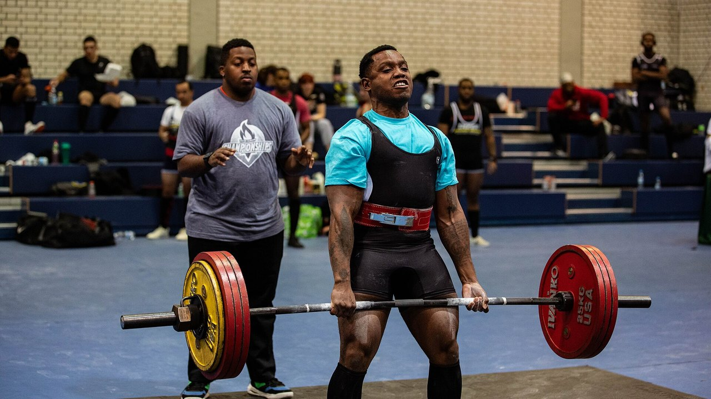
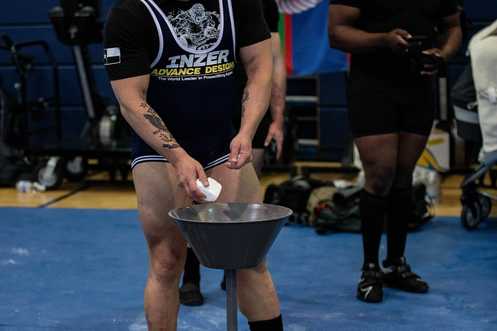
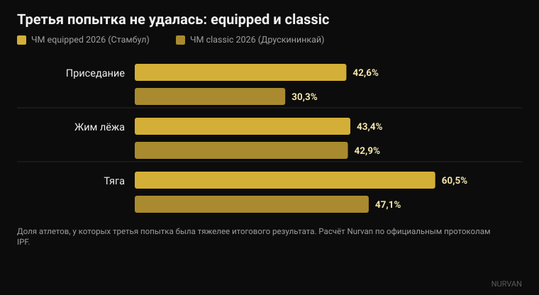
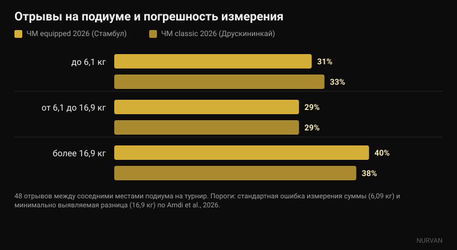

# ЧМ equipped 2026: результаты и третья попытка

Автор: [Giammaria Loi](/autore/giammaria-loi) · обновлено 16 ноября 2026

В воскресенье 15 ноября в Стамбуле завершился чемпионат мира IPF Open Equipped, и в тот же день IPF опубликовала официальные протоколы. Я выгрузил оба полных документа — мужской и женский — и положил рядом протоколы июньского чемпионата мира без экипировки. Помимо подиумов из них вышла цифра, которая в зале значит больше любого рекорда: как часто третья попытка остаётся на помосте.

## Коротко

- **Украина и Канада забирают командные титулы.** У мужчин побеждает Украина с 51 очком, опередив Китайский Тайбэй (42) и Японию (38); у женщин — Канада с 43 очками впереди Китайского Тайбэя (42) и Бразилии (34).
- **32 мировых рекорда за семь дней**: 17 у мужчин и 15 у женщин, в дивизионах Open (9), Master 1 (9), Master 2 (9) и Junior (5).
- **Тяга — движение, которое чаще всего не получается.** В Стамбуле **60,5%** спортсменов заказали на третью тягу вес выше того, с которым в итоге закончили. На классическом чемпионате — 47,1%.
- **Каждый третий отрыв на подиуме укладывается в погрешность измерения**: 31% отрывов между соседними местами составил 6,09 кг или меньше — это стандартная ошибка измерения суммы (Amdi et al., 2026).
- **Экипировка куда жёстче наказывает за просчёт**: 13,4% заявленных в Стамбуле закончили без зачётной суммы против 1,4% на классическом чемпионате.

## Кто победил в Стамбуле

Чемпионат мира Open Equipped прошёл в Стамбуле, Турция, **с 9 по 15 ноября 2026 года**. В официальных протоколах IPF — **179 спортсменов из 34 стран**, в восьми мужских и восьми женских весовых категориях.

Лучший результат турнира у украинца **Костянтина Мусиенко**: **1064,5 кг** в категории 93 кг и 115,44 очка IPF GL, с мировыми рекордами Open в жиме (352,0 кг) и в сумме. За ним, в той же категории, соотечественник Володимир Рысиев с 1025 кг.

У женщин лучшая оценка — у **Келси Маккарти** (США), 69 кг: **655,0 кг** и 113,88 очка IPF GL, мировой рекорд Open. Годом ранее в Клуж-Напоке она выиграла ту же категорию с 652,5 кг: прибавила 2,5 кг, и этого хватило на рекорд.

В командном зачёте **Украина** подтверждает мужской титул (51 очко, впереди Тайбэя с 42 и Японии с 38, третьей по очкам пяти лучших впереди Норвегии). Женский титул переходит к **Канаде** (43 очка), Тайбэй второй с 42, Бразилия третья с 34.

Больше всего меня зацепил результат в мужской категории 74 кг: победил **Ярослав Олех**, поляк **1974** года рождения. Пятьдесят два года, дивизион Open — то есть против спортсменов, годящихся ему в сыновья — и 865 кг в сумме, с тремя мировыми рекордами Master 2 (присед 360 кг, жим 205 кг, сумма 865 кг). Следом Лоусон Лилло из США, 2006 года рождения: двадцать лет, 852,5 кг и юниорский мировой рекорд в сумме. Тридцать два года разницы в возрасте и 12,5 кг разницы в сумме. Подробнее о возрасте и силе я писал в тексте о [чемпионате мира среди мастеров в Рино](/ru/blog/chempionat-mastersov-2026-sila-i-vozrast).

## Италия в Стамбуле: бронза и шесть спортсменов

| Спортсмен | Категория | Место | Сумма |
| --- | --- | --- | --- |
| Джованни Манчинелли | 120 кг | 3-е | 972,5 кг |
| Стефано Канео | 66 кг | 5-е | 652,5 кг |
| Давиде Чеккетти | 93 кг | 8-е | 852,5 кг |
| Диего Милани | 74 кг | 9-е | 760,0 кг |
| Катерина Караваджо | 69 кг | 5-е | 552,5 кг |
| Сильвия Маростика | 76 кг | 10-е | 530,0 кг |

Медаль — у **Джованни Манчинелли**, третьего в категории 120 кг с приседом 410 кг, жимом 257,5 и тягой 305. Мужская команда девятая с 19 очками, женская — девятнадцатая с 7.

## Цифра, которой нет в нарезках: третья попытка

На помосте у вас три попытки в каждом движении. Третья решает турнир — и её видно меньше всего: в роликах показывают засчитанные подходы, а не штанги, которые остались лежать.

В протоколах есть всё. Если вес, заявленный на третью попытку, больше итогового результата спортсмена, попытка не засчитана — и это можно пересчитать построчно. Я сделал это по обоим чемпионатам мира 2026 года: экипировочному в Стамбуле и [классическому в Друскининкае](/ru/blog/chempionat-equipped-2026-chto-daet-ekipirovka) в июне.

*Расчёт Nurvan по официальным протоколам IPF чемпионатов мира Open Equipped 2026 (Стамбул) и Open Classic 2026 (Друскининкай).*

Видно три вещи.

**Тяга проваливается чаще всего, и в экипировке заметно чаще.** В Стамбуле 60,5% третьих тяг (92 из 152) были тяжелее итогового результата; в классике — 47,1% (162 из 344). Логично: тяга закрывает день, в ней разыгрывается медаль, и именно в ней экипировка помогает меньше всего.

**В жиме не меняется ничего.** 43,4% в Стамбуле, 42,9% в Друскининкае: жимовая майка позволяет брать больше, но доля неудачных третьих попыток идентична. Спортсмены выходят на край своих возможностей, где бы этот край ни находился.

**В приседе в экипировке ошибаются чаще**: 42,6% против 30,3%. В комбинезоне и бинтах зазор между зачётной глубиной и незачётом уже, а провалённый третий присед в начале дня тянет за собой всё остальное.

Есть и четвёртая, более жёсткая цифра: в Стамбуле **24 спортсмена из 179 (13,4%) закончили без зачётной суммы**. На июньском классическом чемпионате — 5 из 351, то есть 1,4%. В экипировке ошибка в выборе веса стоит всего турнира почти в десять раз чаще.

## Подиум решается внутри погрешности измерения

Здесь в дело вступает исследование, вышедшее несколько недель назад. Amdi и коллеги (2026) измерили, насколько максимальная сила пауэрлифтеров регионального и национального уровня меняется от недели к неделе, и получили стандартную ошибку измерения: **4,16 кг в приседе, 2,60 кг в жиме, 4,07 кг в тяге и 6,09 кг в сумме**. Затем они разобрали пятнадцать лет турниров IPF, чтобы понять, сколько килограммов нужно, чтобы подняться на одно место: от 14,3 до 44,2 кг в сумме, в зависимости от уровня и места. Их вывод: **в большинстве соревновательных ситуаций разница между соседними местами лежит внутри погрешности измерения**, и особенно это заметно на чемпионатах мира.

Я проверил эту фразу на данных Стамбула. В каждой из 16 категорий я взял отрывы между соседними местами подиума (1-2, 2-3, 3-4): всего 48 отрывов.

*Расчёт Nurvan по официальным протоколам IPF. Пороговые значения по Amdi et al., 2026: стандартная ошибка измерения суммы 6,09 кг, минимально выявляемая разница около 16,9 кг.*

**31% отрывов на подиуме — 6,09 кг или меньше**, 60% уложились в 16,9 кг, медиана — 12,5 кг. Июньский классический чемпионат даёт почти ту же картину (33% и 62%): это не особенность экипировки, это устройство пауэрлифтинга высокого уровня.

В шести случаях отрыв оказался ровно **нулевым**. В женской категории 76 кг три спортсменки набрали по 610,0 кг, и их развёл только собственный вес. В категории 47 кг Вэй-Лин Чэнь и Франкмари Дуно показали по 480,0 кг: золото у Чэнь, потому что она была легче на 450 граммов. В мужской категории 105 кг Иэн Белл и Ники Ленц-Нильсен закончили с одинаковыми 1050,0 кг.

Проще говоря: на этом уровне никто не выигрывает с запасом в 20 кг. Выигрывает тот, кто в этот день промахнулся на одну попытку меньше.

## Что на самом деле говорят исследования

**«В экипировке третья попытка почти бесплатная, снаряжение вытащит» — Опровергнуто.** 60,5% третьих тяг и 42,6% третьих приседов в Стамбуле не были засчитаны, а 13,4% спортсменов остались без суммы против 1,4% в классике. Экипировка поднимает потолок, а не запас прочности.

**«На чемпионате мира выигрывает просто сильнейший» — Нужно уточнить.** В 31% случаев отрыв на подиуме был меньше погрешности, с которой измеряется сумма (6,09 кг по Amdi et al., 2026), а в шести случаях равнялся нулю.

**«Чтобы стать сильным, надо всегда работать до отказа» — Опровергнуто.** В мета-регрессиях Robinson и коллег (2024) прирост силы был схожим в широком диапазоне повторений в запасе: ближе к отказу улучшается гипертрофия, а не максимальная сила. Обзор по жиму лёжа приходит к тому же практическому совету: RPE/RIR, скорость штанги и авторегуляция вместо подходов до отказа (Motlagh и Lipps, 2024).

**«RIR слишком неточен, чтобы выбирать по нему веса» — Нужно уточнить.** Odgers и коллеги (2021) измерили ошибку оценки у тренированных спортсменов: при RPE 9, у предела, средняя ошибка составила 0,09-0,25 повторения; при RPE 6 она росла до 0,71-1,19. RIR неточен вдали от отказа и надёжен рядом с ним — ровно наоборот тому, как его обычно используют. Подробнее в тексте [насколько точен RIR](/ru/blog/naskolko-tochen-rir).

**«После 50 дивизион Open уже не для вас» — Опровергнуто.** Ярослав Олех, 1974 года рождения, выиграл категорию 74 кг Open с суммой 865 кг.

## Как применить это, даже если вы не выступаете

Третья попытка на помосте — то же самое, что ваш тяжёлый подход в понедельник: единичное повторение у предела, где ошибка в 5 кг меняет результат. Что забрать с собой.

1. **Выбирайте вес по предыдущему подходу, а не по таблице.** Если вторая попытка — или первый тяжёлый подход — вышла медленной и грязной, уменьшите шаг. Те, кто остался без суммы в Стамбуле, не были слабыми: они назвали число до того, как узнали, какой сегодня день.
2. **Держите маленькие шаги рядом с максимумом.** Выше 90% естественная погрешность уже стоит 4-6 кг (Amdi et al., 2026): прибавка 15 кг к максимуму в 160 — это ставка, а не прогрессия.
3. **Не гоняйтесь за отказом на тренировке.** Для силы он не нужен (Robinson et al., 2024) и повышает риск перегрузки (Motlagh и Lipps, 2024). Останавливайтесь за 1-2 повторения до предела, а остальное оставьте турниру или тесту.
4. **Доверяйте RIR там, где он работает.** Рядом с отказом оценка точна; за 4-5 повторений до предела вы промахнётесь больше чем на повторение (Odgers et al., 2021). Для лёгких весов используйте проценты или скорость, а не ощущения.
5. **Разминайтесь как будто собираете информацию.** Подводящие подходы — не только страховка от травм: они говорят вам до рабочего веса, ваш ли сегодня день.

> ### Выбирайте вес по данным, а не по ощущениям
> Nurvan записывает вес, повторения и RIR каждого подхода, сам строит разминочные подходы от рабочего веса дня и показывает, держится ли прогрессия или вы просто добавляете блины. Это решение о третьей попытке, применённое к каждой тренировке. [Попробовать Nurvan](https://nurvan.app)

## Частые вопросы

**Когда прошёл ЧМ equipped 2026 и кто победил?**
В Стамбуле, Турция, с 9 по 15 ноября 2026 года. Командные титулы достались Украине у мужчин и Канаде у женщин; лучшие личные результаты — у Костянтина Мусиенко (1064,5 кг в категории 93 кг) и Келси Маккарти (655,0 кг в категории 69 кг).

**Сколько установлено мировых рекордов?**
Тридцать два по официальным протоколам IPF: 17 у мужчин и 15 у женщин, в дивизионах Open, Junior, Master 1 и Master 2.

**Чем пауэрлифтинг в экипировке отличается от классического?**
В экипировке разрешены комбинезон для приседа и тяги, жимовая майка и бинты на колени; в классике выступают с поясом, наколенниками и кистевыми бинтами. Насколько при этом меняются цифры, я измерил в тексте [что даёт экипировка](/ru/blog/chempionat-equipped-2026-chto-daet-ekipirovka).

**Насколько надо прибавить, чтобы подняться на одно место?**
От 14,3 до 44,2 кг в сумме в зависимости от пола, уровня турнира и места (Amdi et al., 2026). На мировом уровне многие из этих разниц лежат внутри погрешности измерения.

## Читайте также

- [ЧМ equipped 2026: что на самом деле даёт экипировка](/ru/blog/chempionat-equipped-2026-chto-daet-ekipirovka) — сравнение по категориям между экипировкой и классикой.
- [ЧМ среди мастеров 2026: что возраст делает с силой](/ru/blog/chempionat-mastersov-2026-sila-i-vozrast) — 443 спортсмена от 40 до 82 лет, разбор по официальным данным.
- [Насколько точен ваш RIR? Что говорят исследования](/ru/blog/naskolko-tochen-rir) — где оценка работает, а где нет.

## Источники

1. International Powerlifting Federation, 2026. Men's Results — 2026 IPF World Open Equipped Powerlifting Championships, Стамбул, 09-15.11.2026. [Официальный протокол PDF](https://www.powerlifting.sport/fileadmin/ipf/data/results/2026/equipped/Men_Results_2026_IPF_World_Open_Equipped_Powerlifting_Championships_2026-11-15.pdf)
2. International Powerlifting Federation, 2026. Women's Results — 2026 IPF World Open Equipped Powerlifting Championships, Стамбул. [Официальный протокол PDF](https://www.powerlifting.sport/fileadmin/ipf/data/results/2026/equipped/Women_Results_2026_IPF_World_Open_Equipped_Powerlifting_Championships_2026-11-15.pdf)
3. International Powerlifting Federation, 2026. Men's и Women's Team Points — 2026 IPF World Open Equipped Powerlifting Championships. [Официальная страница результатов](https://www.powerlifting.sport/championships/results/2026/world-open-equipped-powerlifting-championships-2026)
4. International Powerlifting Federation, 2026. Results — 2026 IPF World Classic Powerlifting Championships, Друскининкай, 13-21.06.2026. [Официальная страница результатов](https://www.powerlifting.sport/championships/results/2026/world-open-classic-powerlifting-championships-2026)
5. Amdi CH, Korakakis PA, Zourdos MC, Helms ER, Spence AJ, Robinson ZP, 2026. Reliability of Maximal Strength in Powerlifters and Performance Differences Required to Improve Competition Placing. Journal of Strength and Conditioning Research. PMID 42862018 — [doi:10.1519/JSC.0000000000005591](https://doi.org/10.1519/JSC.0000000000005591)
6. Robinson ZP, Pelland JC, Remmert JF, Refalo MC, Jukic I, Steele J, Zourdos MC, 2024. Exploring the Dose-Response Relationship Between Estimated Resistance Training Proximity to Failure, Strength Gain, and Muscle Hypertrophy: A Series of Meta-Regressions. Sports Medicine. PMID 38970765 — [doi:10.1007/s40279-024-02069-2](https://doi.org/10.1007/s40279-024-02069-2)
7. Odgers JB, Zourdos MC, Helms ER, Candow DG, Dahlstrom B, Bruno P, Sousa CA, 2021. Rating of Perceived Exertion and Velocity Relationships Among Trained Males and Females in the Front Squat and Hexagonal Bar Deadlift. Journal of Strength and Conditioning Research. PMID 33629974 — [doi:10.1519/JSC.0000000000003905](https://doi.org/10.1519/JSC.0000000000003905)
8. Motlagh JG, Lipps DB, 2024. The Contribution of Muscular Fatigue and Shoulder Biomechanics to Shoulder Injury Incidence During the Bench Press Exercise: A Narrative Review. Journal of Strength and Conditioning Research. PMID 39808810 — [doi:10.1519/JSC.0000000000004973](https://doi.org/10.1519/JSC.0000000000004973)

Источники 5-8 найдены через PubMed. Расчёты по третьим попыткам, незачётным суммам и отрывам на подиуме — оригинальная работа Nurvan по официальным протоколам IPF, указанным в пунктах 1-4.

Джаммария Лои — основатель Nurvan. Тренируется с отягощениями с 2012 года, работает персональным тренером и коучем с сертификатом FIPE с 2013 года и выступает в пауэрлифтинге на национальном уровне с 2018 года. Каждая его статья начинается с научных исследований и заканчивается тем, что действительно работает в зале.

> Примечание: информационный материал, он не заменяет консультацию врача или профильного специалиста.
