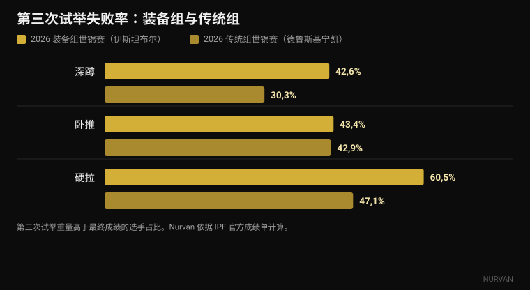
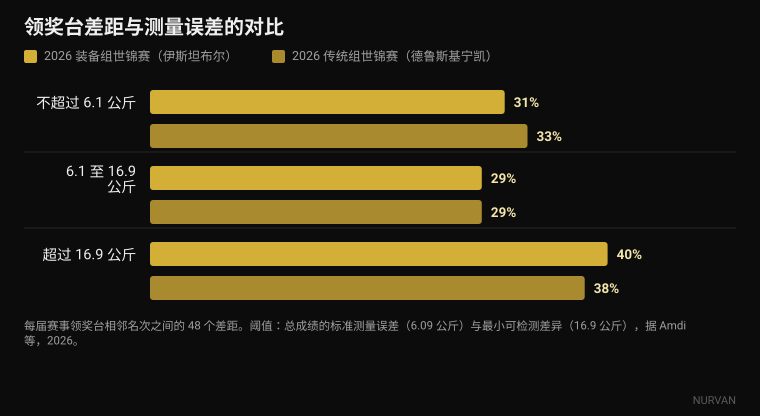

# 2026装备组世锦赛：成绩与第三次试举

作者 [Giammaria Loi](/autore/giammaria-loi) · 更新于 2026 年 11 月 16 日

11 月 15 日星期日，IPF 装备组公开级世锦赛在伊斯坦布尔落幕，IPF 当天就公布了官方成绩单。我把男、女两份完整文件都下载下来，和六月传统组世锦赛的成绩单放在一起比对。除了领奖台名单之外，还跑出一个在健身房里比任何纪录都更有用的数字：第三次试举有多少次留在了地上。

## 要点速览

- **乌克兰和加拿大拿下团体冠军。** 男子组乌克兰以 51 分夺冠，领先中华台北（42 分）和日本（38 分）；女子组加拿大以 43 分夺冠，领先中华台北（42 分）和巴西（34 分）。
- **七天内 32 项世界纪录**：男子 17 项、女子 15 项，分布在公开级（9）、大师 1 组（9）、大师 2 组（9）和青年组（5）。
- **硬拉是最容易判断失误的项目。** 在伊斯坦布尔，**60.5%** 的选手第三次硬拉所报重量高于最终成绩。传统组世锦赛这一比例为 47.1%。
- **三分之一的领奖台差距落在测量误差之内**：31% 的相邻名次差距不超过 6.09 公斤，而这正是总成绩的标准测量误差（Amdi 等，2026）。
- **装备组对判断失误的惩罚重得多**：伊斯坦布尔有 13.4% 的参赛者没有拿到有效总成绩，传统组世锦赛只有 1.4%。

## 谁在伊斯坦布尔夺冠

装备组公开级世锦赛于 **2026 年 11 月 9 日至 15 日**在土耳其伊斯坦布尔举行。IPF 官方成绩单记录了 **来自 34 个国家和地区的 179 名选手**，分布在男子八个级别和女子八个级别。

全场最高分属于乌克兰选手 **Kostiantyn Musiienko**：93 公斤级 **1064.5 公斤**总成绩，115.44 IPF GL 分，并在卧推（352.0 公斤）和总成绩上创造公开级世界纪录。同级别第二名是他的队友 Volodymyr Rysiiev，1025 公斤。

女子组最高分来自美国的 **Kelsey McCarthy**，69 公斤级：**655.0 公斤**，113.88 IPF GL 分，公开级世界纪录。一年前在克卢日-纳波卡，她以 652.5 公斤赢得同一级别——这次只多了 2.5 公斤，就足以刷新纪录。

团体方面，**乌克兰**卫冕男子冠军（51 分，领先中华台北 42 分和日本 38 分，日本凭最佳五人积分力压挪威排名第三）。女子冠军易主，由**加拿大**获得（43 分），中华台北 42 分第二，巴西 34 分第三。

最让我在意的成绩出现在男子 74 公斤级：冠军是波兰的 **Jarosław Olech**，**1974 年**出生。五十二岁，参加的是公开级——对手都可能是他的孩子辈——总成绩 865 公斤，并创造三项大师 2 组世界纪录（深蹲 360 公斤、卧推 205 公斤、总成绩 865 公斤）。他身后是 2006 年出生的美国选手 Lawson Lillo：二十岁，852.5 公斤，青年组总成绩世界纪录。年龄相差三十二岁，总成绩只差 12.5 公斤。关于年龄与力量，我在[里诺大师组世锦赛](/zh/blog/2026-dashi-shijinsai-liliang-nianling)那篇里写得更详细。

## 意大利队在伊斯坦布尔：一枚铜牌，六名选手

| 选手 | 级别 | 名次 | 总成绩 |
| --- | --- | --- | --- |
| Giovanni Mancinelli | 120 公斤 | 第 3 | 972.5 公斤 |
| Stefano Caneo | 66 公斤 | 第 5 | 652.5 公斤 |
| Davide Cecchetti | 93 公斤 | 第 8 | 852.5 公斤 |
| Diego Milani | 74 公斤 | 第 9 | 760.0 公斤 |
| Caterina Caravaggio | 69 公斤 | 第 5 | 552.5 公斤 |
| Silvia Marostica | 76 公斤 | 第 10 | 530.0 公斤 |

奖牌来自 **Giovanni Mancinelli**，120 公斤级第三名，深蹲 410 公斤、卧推 257.5 公斤、硬拉 305 公斤。男队团体第九（19 分），女队第十九（7 分）。

## 集锦里看不到的数字：第三次试举

比赛中每个动作有三次试举。第三次决定胜负，却是最不容易看到的那一次：短视频只播成功的试举，不播没有动过的杠铃。

成绩单上则什么都有。如果第三次试举所报的重量高于该选手的最终成绩，那次试举就是失败的——这一点可以逐行统计。我把 2026 年两届世锦赛都算了一遍：伊斯坦布尔的装备组，和六月[德鲁斯基宁凯的传统组](/zh/blog/2026-zhuangbei-shijinsai-jiashao-duoshao)。

*Nurvan 依据 2026 年装备组公开级世锦赛（伊斯坦布尔）与传统组公开级世锦赛（德鲁斯基宁凯）的 IPF 官方成绩单计算。*

有三点很清楚。

**硬拉失败最多，装备组尤其明显。** 伊斯坦布尔 60.5% 的第三次硬拉（152 人中的 92 人）重量高于最终成绩；传统组为 47.1%（344 人中的 162 人）。这说得通：硬拉是一天的最后一项，奖牌在这里分出，而且它恰恰是装备帮助最小的动作。

**卧推几乎没有差别。** 伊斯坦布尔 43.4%，德鲁斯基宁凯 42.9%：卧推衣让杠铃上的重量更大，但第三次试举失败的比例完全一致。选手总是逼近自己能力的边界，无论这个边界在哪里。

**深蹲在装备组失败更多**：42.6% 对 30.3%。穿深蹲服、缠护膝带时，有效深度和失败之间的余地更窄，而一天开局就丢掉第三次深蹲，会影响后面的一切。

还有第四个更残酷的数字：伊斯坦布尔 **179 名选手中有 24 人（13.4%）没有拿到有效总成绩**。六月的传统组世锦赛是 351 人中的 5 人，即 1.4%。在装备组，一次选择失误让整场比赛报废的概率高出将近十倍。

## 领奖台在测量误差之内分出高下

这里要引入几周前发表的一项研究。Amdi 等人（2026）测量了地区级和国家级力量举运动员最大力量逐周的波动，得到的标准测量误差为：**深蹲 4.16 公斤、卧推 2.60 公斤、硬拉 4.07 公斤、总成绩 6.09 公斤**。随后他们分析了十五年的 IPF 比赛数据，推算提升一个名次需要多少公斤：总成绩上需要 14.3 到 44.2 公斤，视水平和名次而定。作者的结论是，**在多数比赛情境中，相邻两个名次之间的差距都落在测量误差之内**，在世锦赛层面尤其如此。

我用伊斯坦布尔的数据验证了这句话。在 16 个级别中，我分别取了领奖台相邻名次之间的差距（第 1-2 名、第 2-3 名、第 3-4 名），一共 48 个差距。

*Nurvan 依据 IPF 官方成绩单计算。参考阈值来自 Amdi 等，2026：总成绩标准测量误差 6.09 公斤，最小可检测差异约 16.9 公斤。*

**31% 的领奖台差距不超过 6.09 公斤**，60% 在 16.9 公斤以内，中位数为 12.5 公斤。六月的传统组世锦赛几乎是同一幅图景（33% 和 62%）：这不是装备组的特例，而是高水平力量举的常态。

有六次差距恰好为**零**。女子 76 公斤级三名选手总成绩都是 610.0 公斤，只能靠体重区分。47 公斤级 Wei-Ling Chen 和 Frankmary Duno 都是 480.0 公斤：金牌归 Chen，因为她轻了 450 克。男子 105 公斤级 Ian Bell 与 Nicki Lentz-Nielsen 同为 1050.0 公斤。

换句话说：在那个水平上，没有人靠领先 20 公斤取胜。赢的人只是当天少失败了一次试举。

## 研究到底怎么说

**「装备组第三次试举几乎没有代价，装备会撑住」——不成立。** 伊斯坦布尔 60.5% 的第三次硬拉和 42.6% 的第三次深蹲被判无效，13.4% 的选手没有总成绩，而传统组只有 1.4%。装备抬高的是天花板，不是容错空间。

**「世锦赛就是最强的人赢」——需要补充。** 31% 的情况下，领奖台差距小于总成绩的测量误差（6.09 公斤，Amdi 等，2026），其中六次为零。

**「想变强就必须一直练到力竭」——不成立。** 在 Robinson 等人（2024）的元回归中，在很宽的储备次数范围内力量增长相似：越接近力竭改善的是肌肥大，而不是最大力量。一篇关于卧推的综述给出同样的实践建议：优先使用 RPE/RIR、杠铃速度和自我调节，而不是力竭组（Motlagh 与 Lipps，2024）。

**「RIR 太不准，不能用来选重量」——需要补充。** Odgers 等人（2021）测量了训练者的估计误差：在 RPE 9（接近极限）时平均误差为 0.09-0.25 次；在 RPE 6 时升至 0.71-1.19 次。RIR 在远离力竭时不准，在接近力竭时可靠——和大多数人的用法正好相反。详见 [RIR 估计准吗](/zh/blog/rir-guji-zhunque-ma)。

**「过了 50 岁公开级就不属于你了」——不成立。** 1974 年出生的 Jarosław Olech 以 865 公斤赢得公开级 74 公斤冠军。

## 不比赛的人该怎么用

一次第三次试举，和你周一的那组大重量是同一件事：一次接近极限的单次动作，差 5 公斤就会改变结果。可以带走这几点。

1. **按上一组来定重量，而不是按表格。** 如果第二次试举——或者你的第一组大重量——又慢又乱，就缩小加重幅度。在伊斯坦布尔吃鸭蛋的选手并不弱：他们在知道今天状态如何之前就把数字定死了。
2. **接近极限时加重幅度要小。** 超过 90% 之后，自然的测量误差本身就值 4-6 公斤（Amdi 等，2026）：在 160 公斤的最大重量上一次加 15 公斤是赌博，不是进步。
3. **训练中别追求力竭。** 对力量没必要（Robinson 等，2024），还会增加过度负荷的风险（Motlagh 与 Lipps，2024）。停在距离极限 1-2 次的位置，把真正接近极限的留给比赛或测试。
4. **只在 RIR 可靠的地方信它。** 接近力竭时估计很准；距离极限还有 4-5 次时，你会差出一次以上（Odgers 等，2021）。轻重量请用百分比或速度，而不是感觉。
5. **把热身当作信息来做。** 递增组不只是防伤：它会在正式重量之前告诉你，今天是不是那一天。

> ### 用数据选重量，而不是凭感觉
> Nurvan 记录每一组的重量、次数和 RIR，根据当天的训练重量自动安排热身组，并告诉你进步是真的在发生，还是你只是在不停加片。这就是把「第三次试举」的判断用到每一次训练里。[试用 Nurvan](https://nurvan.app)

## 常见问题

**2026 装备组世锦赛什么时候举行，谁夺冠？**
2026 年 11 月 9 日至 15 日在土耳其伊斯坦布尔举行。团体冠军男子组为乌克兰、女子组为加拿大；个人最高分是 Kostiantyn Musiienko（93 公斤级 1064.5 公斤）和 Kelsey McCarthy（69 公斤级 655.0 公斤）。

**一共创造了多少项世界纪录？**
按 IPF 官方成绩单共 32 项：男子 17 项、女子 15 项，分布在公开级、青年组、大师 1 组和大师 2 组。

**装备组和传统组有什么区别？**
装备组允许使用深蹲／硬拉连体服、卧推衣和护膝带；传统组只能使用腰带、护膝套和护腕。两者数字上的真实差距，我在[装备到底加多少](/zh/blog/2026-zhuangbei-shijinsai-jiashao-duoshao)里做过测算。

**提升一个名次需要进步多少？**
总成绩上 14.3 到 44.2 公斤，取决于性别、比赛级别和名次（Amdi 等，2026）。在世界级别，许多这样的差距都落在测量误差之内。

## 延伸阅读

- [2026 装备组世锦赛：装备到底加多少](/zh/blog/2026-zhuangbei-shijinsai-jiashao-duoshao) — 逐级别比较装备组与传统组。
- [2026 大师组世锦赛：年龄对力量做了什么](/zh/blog/2026-dashi-shijinsai-liliang-nianling) — 443 名 40 至 82 岁选手的官方数据分析。
- [你的 RIR 有多准？研究怎么说](/zh/blog/rir-guji-zhunque-ma) — 估计在哪里有效，在哪里无效。

## 参考来源

1. International Powerlifting Federation, 2026. Men's Results — 2026 IPF World Open Equipped Powerlifting Championships，伊斯坦布尔，2026-11-09 至 11-15。[官方成绩单 PDF](https://www.powerlifting.sport/fileadmin/ipf/data/results/2026/equipped/Men_Results_2026_IPF_World_Open_Equipped_Powerlifting_Championships_2026-11-15.pdf)
2. International Powerlifting Federation, 2026. Women's Results — 2026 IPF World Open Equipped Powerlifting Championships，伊斯坦布尔。[官方成绩单 PDF](https://www.powerlifting.sport/fileadmin/ipf/data/results/2026/equipped/Women_Results_2026_IPF_World_Open_Equipped_Powerlifting_Championships_2026-11-15.pdf)
3. International Powerlifting Federation, 2026. Men's 与 Women's Team Points — 2026 IPF World Open Equipped Powerlifting Championships。[官方成绩页面](https://www.powerlifting.sport/championships/results/2026/world-open-equipped-powerlifting-championships-2026)
4. International Powerlifting Federation, 2026. Results — 2026 IPF World Classic Powerlifting Championships，德鲁斯基宁凯，2026-06-13 至 06-21。[官方成绩页面](https://www.powerlifting.sport/championships/results/2026/world-open-classic-powerlifting-championships-2026)
5. Amdi CH, Korakakis PA, Zourdos MC, Helms ER, Spence AJ, Robinson ZP, 2026. Reliability of Maximal Strength in Powerlifters and Performance Differences Required to Improve Competition Placing. Journal of Strength and Conditioning Research. PMID 42862018 — [doi:10.1519/JSC.0000000000005591](https://doi.org/10.1519/JSC.0000000000005591)
6. Robinson ZP, Pelland JC, Remmert JF, Refalo MC, Jukic I, Steele J, Zourdos MC, 2024. Exploring the Dose-Response Relationship Between Estimated Resistance Training Proximity to Failure, Strength Gain, and Muscle Hypertrophy: A Series of Meta-Regressions. Sports Medicine. PMID 38970765 — [doi:10.1007/s40279-024-02069-2](https://doi.org/10.1007/s40279-024-02069-2)
7. Odgers JB, Zourdos MC, Helms ER, Candow DG, Dahlstrom B, Bruno P, Sousa CA, 2021. Rating of Perceived Exertion and Velocity Relationships Among Trained Males and Females in the Front Squat and Hexagonal Bar Deadlift. Journal of Strength and Conditioning Research. PMID 33629974 — [doi:10.1519/JSC.0000000000003905](https://doi.org/10.1519/JSC.0000000000003905)
8. Motlagh JG, Lipps DB, 2024. The Contribution of Muscular Fatigue and Shoulder Biomechanics to Shoulder Injury Incidence During the Bench Press Exercise: A Narrative Review. Journal of Strength and Conditioning Research. PMID 39808810 — [doi:10.1519/JSC.0000000000004973](https://doi.org/10.1519/JSC.0000000000004973)

来源 5-8 通过 PubMed 检索。关于第三次试举、无效总成绩和领奖台差距的分析为 Nurvan 原创，依据第 1-4 项所引 IPF 官方成绩单计算。

Giammaria Loi 是 Nurvan 的创始人。他自 2012 年起进行力量训练，自 2013 年起担任 FIPE 认证私人教练，自 2018 年起在全国级别的力量举比赛中参赛。他署名的每篇文章都从科学研究出发，落到健身房里真正有效的做法。

> 提示：本文为科普内容，不能替代医生或专业人士的意见。
