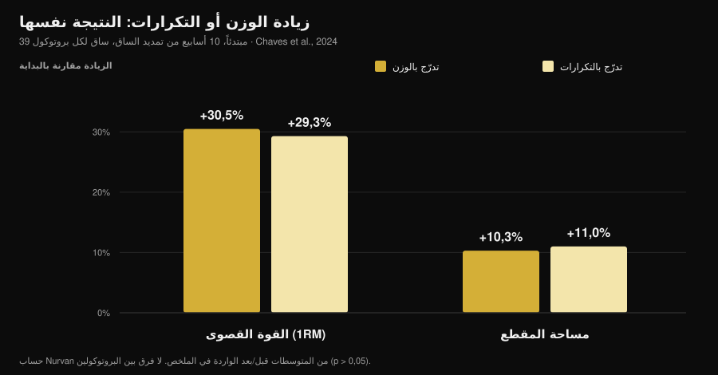
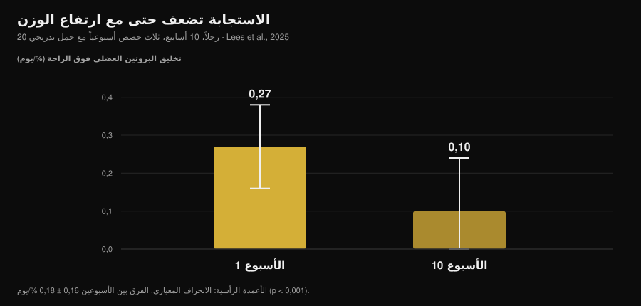

# الحمل التدريجي: هل يجب زيادة الوزن؟

بقلم [Giammaria Loi](/autore/giammaria-loi) · حُدّث في 17 نوفمبر 2026

«إذا لم يصبح البار أثقل فلن تنمو.» هذه أكثر قاعدة تتكرّر في الصالة، وهي تنطلق من مبدأ صحيح: لكي يستمر التكيّف، يجب أن يرتفع الطلب المفروض على الجسم. القفزة كلها في كلمة *أثقل*. ثلاث دراسات مضبوطة قارنت الطريقين مباشرة — وزن أكبر أو تكرارات أكثر — والنتيجة تغيّر طريقة كتابة البرنامج.

## باختصار

- **إضافة التكرارات تعمل مثل إضافة الوزن.** خلال 10 أسابيع عند المبتدئين ارتفعت القوة القصوى 30,5% بالتدرج بالوزن و29,3% بالتدرج بالتكرارات؛ ومساحة المقطع العضلي 10,3% و11,0%.
- **الأمر نفسه عند المتمرّسين.** بعد 8 أسابيع كانت الفروق بين المجموعتين 2,8 ملم في العضلة المستقيمة الفخذية (لصالح التكرارات) و2,0 كجم في أقصى وزن للقرفصاء (لصالح الوزن): وكلا فترتي الثقة تعبران الصفر.
- **الوزن الخارجي لا يحدّد التضخّم.** عند تساوي الجهد أعطت 8-12 تكراراً بنسبة 70-80% من الأقصى و20-25 تكراراً بنسبة 30-40% النمو نفسه لدى الشخص نفسه.
- **الحمل التدريجي لا يجعل التقدّم خطياً.** في الدراسة نفسها انخفض تخليق البروتين فوق الراحة من 0,27 إلى 0,10 %/يوم بين الأسبوع الأول والعاشر بينما كانت الأوزان ترتفع.
- **ما يجب أن ينمو هو الطلب، لا الرقم على البار.** التكرارات والمجموعات والاقتراب من الإنهاك وجودة الأداء كلها روافع مشروعة، وللقوة القصوى يبقى الوزن أكثرها تخصصاً.

*رسم Nurvan استناداً إلى Chaves et al., 2024 (39 مبتدئاً، تصميم داخل الفرد: كل ساق وُزّعت عشوائياً على التدرج بالوزن أو بالتكرارات). القيم محسوبة من متوسطات قبل/بعد في الملخص: القوة القصوى 52,90 ← 69,05 كجم و51,67 ← 66,82 كجم؛ مساحة المقطع للعضلة المتسعة الوحشية 21,34 ← 23,53 سم² و21,08 ← 23,39 سم². لم تُقرأ أي قيمة من رسم بياني.*

## ما الذي يطلبه المبدأ فعلاً

يقول الحمل التدريجي شيئاً واحداً: لكي يستمر التكيّف، يجب أن يرتفع الطلب على العضلة مع الوقت. وهو لا يحدّد *كيف*. الروافع المتاحة خمس على الأقل: الوزن، والتكرارات في المجموعة، وعدد المجموعات، والاقتراب من الإنهاك، ومدى الحركة أو التحكّم بها.

عملياً ابتلعت الرافعة الأولى بقية الروافع لسبب بسيط: الوزن وحده يُقرأ على البار. إذا كان البرنامج 4×8 وكان الأسبوع الماضي 60 كجم، تبدو 62,5 كجم اليوم تقدّماً، بينما تبدو 60 كجم في 10 تكرارات وكأن «شيئاً لم يتغيّر». هذا وهم محاسبي: في الحالة الثانية ارتفع العمل أكثر.

السؤال المفيد ليس فلسفياً. ثلاث دراسات وضعت الطريقين وجهاً لوجه، بعدد مجموعات وتواتر متطابقين، وقاست القوة والعضلة معاً.

## الدراسات الثلاث التي قارنت الطريقين

| الدراسة | المشاركون | المدة | المقارنة | النتيجة |
|---|---|---|---|---|
| Plotkin et al., 2022 | 43 شخصاً بخبرة سنة على الأقل | 8 أسابيع | وزن ↑ مقابل تكرارات ↑ | فروق ضئيلة وفترات تشمل الصفر |
| Chaves et al., 2024 | 39 مبتدئاً، ساق لكل بروتوكول | 10 أسابيع | وزن ↑ مقابل تكرارات ↑ | لا فرق في القوة ولا في حجم العضلة |
| Lees et al., 2025 | 20 شاباً، طرف لكل وزن | 10 أسابيع | وزن ثقيل مقابل خفيف عند تساوي الجهد | التضخّم مستقل عن الوزن |

*جدول Nurvan مبني على الدراسات الثلاث المذكورة في المصادر.*

### المتمرّسون: الفروق أصغر من عدم اليقين

في عمل Plotkin وزملائه أدّى 43 شخصاً لديهم سنة تدريب على الأقل للجزء السفلي 4 مجموعات في 4 تمارين، مرتين أسبوعياً، على مدى 8 أسابيع. رفعت مجموعة الوزن مع ثبات التكرارات، ورفعت الأخرى التكرارات مع ثبات الوزن.

بلغت الفروق **بين المجموعتين**، بعد التعديل حسب القيم الأولية والجنس، 2,8 ملم في مجموع مواضع العضلة المستقيمة الفخذية لصالح التكرارات (فترة ثقة 95% من -0,5 إلى 5,8)، و2,0 كجم في أقصى وزن للقرفصاء على جهاز سميث لصالح الوزن (من -2,4 إلى 7,8). كلتا الفترتين تحتويان الصفر: بهذه الأرقام لا يمكن القول إن طريقة تفوّقت على الأخرى. أما بقية المؤشرات فكانت الفروق فيها أصغر: سماكات عضلية دون المليمتر، وتحمّل عضلي دون 1%، وقفز عمودي 0,1 سم.

### المبتدئون: الشخص نفسه، ساقان، بروتوكولان

استخدم Chaves وزملاؤه تصميماً أنظف: 39 مبتدئاً، كل ساق وُزّعت عشوائياً على التدرج بالوزن أو بالتكرارات، 10 أسابيع من تمديد الساق. هكذا يصبح كل مشارك شاهداً على نفسه، وتختفي مشكلة المقارنة بين أشخاص تختلف استجاباتهم.

ارتفعت القوة القصوى من 52,90 إلى 69,05 كجم مع التدرج بالوزن، ومن 51,67 إلى 66,82 كجم مع التدرج بالتكرارات؛ ومساحة مقطع العضلة المتسعة الوحشية من 21,34 إلى 23,53 سم² ومن 21,08 إلى 23,39 سم². ولا فرق إحصائي بين البروتوكولين.

### الوزن لا يقود النمو، الجهد يقوده

تأتي القطعة الأحدث من *Journal of Physiology*: 20 شاباً، 10 أسابيع، تمارين عضلة ذات رأسين وتمديد ركبة أحادية الجانب، طرف بوزن ثقيل (8-12 تكراراً، 70-80% من الأقصى) والطرف المقابل بوزن خفيف (20-25 تكراراً، 30-40%)، وكل المجموعات حتى الإنهاك الإرادي.

لم يتأثر التضخّم بالوزن، وحافظ على ثباته **داخل** الفرد نفسه: من نما جيداً في الذراع نما جيداً في الساق أياً كان الوزن. التباين المهم بين الأشخاص لا بين الأوزان. وتفصيل آخر يستحق التذكّر عند مقارنة أرقامك بأرقام غيرك: في الدراسة نفسها كان التباين المشترك بين زيادة الحجم وزيادة القوة ضئيلاً. النمو والقوة ليسا القياس نفسه.

## لماذا يتباطأ التقدّم على أي حال

هنا يأتي الجزء الذي لم يَعِد به المبدأ. في دراسة *Journal of Physiology* قيس تخليق البروتين العضلي — سرعة بناء العضلة للبروتين الانقباضي — بالماء المُدَوْتَر في الأسبوع الأول والأسبوع العاشر.

*رسم Nurvan استناداً إلى Lees et al., 2025 (20 رجلاً، 10 أسابيع، ثلاث حصص أسبوعياً). القيم كما وردت في الملخص كزيادة فوق الراحة: 0,27 ± 0,11 %/يوم في الأسبوع الأول (p < 0,0001) و0,10 ± 0,14 %/يوم في الأسبوع العاشر (p = 0,009)؛ والفرق بينهما 0,16 ± 0,18 %/يوم (p < 0,001). لم تُقرأ أي قيمة من رسم بياني.*

فوق مستوى الراحة كان التخليق 0,27 %/يوم في البداية و0,10 %/يوم في الأسبوع العاشر: ضعفت الاستجابة نحو الثلثين **بينما كان البرنامج يطبّق حملاً تدريجياً**. هذا ليس خطأ في البرمجة بل هو طبيعة التكيّف: المنبّه نفسه، إذا تكرّر، تقلّ قيمته. إضافة الوزن لا تلغي هذا المنحنى، وتوقّع تقدّم خطي لأشهر يعني قياس التدريب بمسطرة خاطئة. وعن وتيرة مراجعة البرنامج، انظر [كل كم مرة تغيّر برنامج التدريب](/ar/blog/kam-marra-tughayir-barnamij-altadrib).

## ماذا تقول الأبحاث فعلاً

| ادعاء شائع | الحكم | المصدر |
|---|---|---|
| «إن لم يرتفع الوزن فلن تنمو» | **مُفنَّد** | Plotkin et al., 2022؛ Chaves et al., 2024 — التدرج بالتكرارات مع وزن ثابت أعطى النمو العضلي نفسه |
| «وزن خارجي أكبر يعني تضخّماً أكبر» | **مُفنَّد** | Lees et al., 2025 — عند تساوي الجهد أعطت 70-80% و30-40% من الأقصى التضخّم نفسه لدى الشخص نفسه |
| «الوزن والتكرارات متبادلان لأي هدف» | **يحتاج تفصيلاً** | Plotkin et al., 2022 — في القوة القصوى يميل التقدير إلى الوزن (+2,0 كجم) لكن الفترة تعبر الصفر؛ ومبدأ التخصص يبقى قائماً |
| «مع الحمل التدريجي يبقى التقدّم خطياً» | **مُفنَّد** | Lees et al., 2025 — تخليق البروتين فوق الراحة من 0,27 إلى 0,10 %/يوم بين الأسبوع الأول والعاشر |
| «لا تقدّم من دون الوصول إلى الإنهاك» | **يحتاج تفصيلاً** | Robinson et al., 2024 — التضخّم يتحسّن بالاقتراب من الإنهاك والقوة لا؛ Ruple et al., 2023 — عند تساوي الحجم أعطى 0-1 و4-6 RIR النتائج نفسها في 5 أسابيع |
| «يجب كتابة التدرج والالتزام به حرفياً» | **يحتاج تفصيلاً** | Larsen et al., 2021 — في 14 دراسة و356 مشاركاً رفعت كل البروتوكولات ذاتية التنظيم القوة القصوى |

## كيف تطبّقه

1. **اختر رافعة واحدة وثبّت البقية.** في كل تمرين قرّر إن كانت هذه المرحلة ترفع الوزن أم التكرارات. تحريك كل شيء معاً يجعل معرفة ما نجح مستحيلة.
2. **استخدم التدرج المزدوج.** حدّد مدى (مثلاً 8-12 تكراراً): أضف تكرارات حتى تبلغ الحد الأعلى في كل المجموعات، ثم ارفع الوزن وعُد إلى الحد الأدنى. إنها أبسط طريقة للجمع بين الطريقين دون اختيار.
3. **للقوة القصوى قدّم الوزن.** إن كنت تنافس أو تريد رفع رقمك الأقصى فالتخصص مهم: المجموعات الثقيلة يجب أن تكون ثقيلة فعلاً. أما بقية الحصة فتكفيها التكرارات.
4. **للتضخّم العملة هي الجهد.** يتحسّن النمو حين تنتهي المجموعات قريباً من الإنهاك، وهذا متاح بأي وزن. وعن عدد التكرارات والراحة حول هذا الجهد، انظر [كم تكراراً للكتلة العضلية](/ar/blog/kam-takrar-lilkutla-aladalia).
5. **سجّل الوزن والتكرارات والجهد معاً.** سطر فيه الوزن وحده لا يقول إن كان الطلب قد ارتفع. ثلاثة أرقام تقول ذلك. وعن دقّتنا في تقدير الجهد، انظر [ما مدى دقة الـ RIR لديك](/ar/blog/ma-mada-diqat-rir).
6. **إذا توقّف الوزن ثلاثة أسابيع فلا تُجبره.** زد التكرارات، أو أضف مجموعة، أو اخفض الحجم أسبوعاً ثم أعد المحاولة. تقول البيانات إن الطريق الثاني يصل إلى المكان نفسه؛ أما الثالث فيصلح حين ينقص التعافي لا المنبّه.

### إذا كنت تدرّب آخرين عن بُعد

التدرّج بالوزن أسهل ما يُكتب وأسهل ما يُطبَّق خطأً. عادتان تغيّران جودة ما يصلك:

- **اكتب المدى لا الوزن.** «8-12 تكراراً؛ ارفع الوزن حين تبلغ 12 في كل المجموعات» قاعدة يطبّقها المتدرّب وحده حتى في أسبوع نومه سيئ. أما الوزن الثابت فينكسر عند أول طارئ.
- **اقرأ التدرّج كعمل إجمالي لا كرقم أقصى.** من انتقل من 60×8 إلى 60×11 تحسّن أكثر ممن انتقل من 60×8 إلى 62,5×8. وإذا نظرت إلى عمود الوزن وحده بدا الأول متوقّفاً.

> **Nurvan: تحقّق إن كان الطلب قد ارتفع فعلاً**
>
> في Nurvan تحمل كل مجموعة الوزن والتكرارات وقيمة الـ RIR، ويصفّ سجلّ التمرين الحصص جنباً إلى جنب: في ثانيتين ترى إن كنت تتقدّم في الوزن أم في التكرارات أم لا تتقدّم. هذه هي البيانات التي تُختار على أساسها الرافعة التالية، لك أو للمدرّب الذي يكتب برنامجك. [جرّب Nurvan](https://nurvan.app)

## أسئلة شائعة

**هل يجب زيادة الوزن كل أسبوع؟**
لا، ولم تُثبت أي دراسة ضرورة ذلك. في الأعمال الثلاثة التي قارنت الطريقين مباشرة أعطت زيادة التكرارات مع وزن ثابت النمو العضلي نفسه وزيادة قوة شبه متطابقة (30,5% مقابل 29,3% في القوة القصوى خلال 10 أسابيع). ما يجب أن يرتفع مع الوقت هو الطلب الإجمالي.

**أيهما أفضل: زيادة الوزن أم التكرارات؟**
يعتمد على الهدف. للتضخّم الرافعتان متكافئتان في البيانات المتاحة. وللقوة القصوى يميل التقدير قليلاً إلى الوزن (فرق 2,0 كجم بين المجموعتين، بفترة من -2,4 إلى 7,8)، ويشير مبدأ التخصص إلى إبقاء المجموعات الثقيلة ثقيلة إن كان الهدف رقماً أقصى أعلى. والتدرج المزدوج يستعمل الاثنين.

**ما هو التدرج المزدوج؟**
هو القاعدة التي ترفع التكرارات أولاً ثم الوزن. اختر مدى، مثلاً 8-12: تبقى على الوزن نفسه حتى تُكمل 12 تكراراً في كل المجموعات المقرّرة، ثم تضيف أصغر زيادة متاحة وتعود إلى 8. لا يحتاج حسابات على الرقم الأقصى ويستوعب الأيام السيئة.

**لماذا توقّف تقدّمي رغم زيادة الوزن؟**
لأن التكيّف يتباطأ من تلقاء نفسه: في دراسة الماء المُدَوْتَر انتقل تخليق البروتين فوق الراحة من 0,27 إلى 0,10 %/يوم خلال عشرة أسابيع بينما كانت الأوزان ترتفع. وحين يتوقّف الوزن تكون المشكلة غالباً في التعافي أو الحجم الكلي لا في الوزن نفسه. وإذا استمر الركود أسابيع وصاحبته أعراض جسدية فمن الأفضل استشارة طبيب بدل الإصرار.

## اقرأ أيضاً

- [كم تكراراً للكتلة العضلية: خرافة 8-12](/ar/blog/kam-takrar-lilkutla-aladalia) — أين تضع الجهد الذي تحاول تنميته.
- [ما مدى دقة الـ RIR لديك؟ ما تقوله الدراسات](/ar/blog/ma-mada-diqat-rir) — رافعة الجهد لا تنفع إلا إذا عرفت قياسها.
- [كل كم مرة تغيّر برنامج التدريب؟](/ar/blog/kam-marra-tughayir-barnamij-altadrib) — كم تُبقي البرنامج ثابتاً قبل الحكم عليه.

## المصادر

1. Plotkin D, Coleman M, Van Every D, Maldonado J, Oberlin D, Israetel M, Feather J, Alto A, Vigotsky AD, Schoenfeld BJ, 2022. Progressive overload without progressing load? The effects of load or repetition progression on muscular adaptations. *PeerJ* 10:e14142. [PMID 36199287](https://pubmed.ncbi.nlm.nih.gov/36199287/) · [DOI 10.7717/peerj.14142](https://doi.org/10.7717/peerj.14142)
2. Chaves TS, Scarpelli MC, Bergamasco JGA, et al., 2024. Effects of Resistance Training Overload Progression Protocols on Strength and Muscle Mass. *Int J Sports Med* 45(7):504-510. [PMID 38286426](https://pubmed.ncbi.nlm.nih.gov/38286426/) · [DOI 10.1055/a-2256-5857](https://doi.org/10.1055/a-2256-5857)
3. Lees MJ, Mcleod JC, Morton RW, et al., 2025. Resistance training load does not determine resistance training-induced hypertrophy across upper and lower limbs in healthy young males. *J Physiol*. [PMID 41474371](https://pubmed.ncbi.nlm.nih.gov/41474371/) · [DOI 10.1113/JP289684](https://doi.org/10.1113/JP289684)
4. Robinson ZP, Pelland JC, Remmert JF, Refalo MC, Jukic I, Steele J, Zourdos MC, 2024. Exploring the Dose-Response Relationship Between Estimated Resistance Training Proximity to Failure, Strength Gain, and Muscle Hypertrophy: A Series of Meta-Regressions. *Sports Med* 54(9):2209-2231. [PMID 38970765](https://pubmed.ncbi.nlm.nih.gov/38970765/) · [DOI 10.1007/s40279-024-02069-2](https://doi.org/10.1007/s40279-024-02069-2)
5. Ruple BA, Plotkin DL, Smith MA, et al., 2023. The effects of resistance training to near failure on strength, hypertrophy, and motor unit adaptations in previously trained adults. *Physiol Rep* 11(9):e15679. [PMID 37144554](https://pubmed.ncbi.nlm.nih.gov/37144554/) · [DOI 10.14814/phy2.15679](https://doi.org/10.14814/phy2.15679)
6. Larsen S, Kristiansen E, van den Tillaar R, 2021. Effects of subjective and objective autoregulation methods for intensity and volume on enhancing maximal strength during resistance-training interventions: a systematic review. *PeerJ* 9:e10663. [PMID 33520457](https://pubmed.ncbi.nlm.nih.gov/33520457/) · [DOI 10.7717/peerj.10663](https://doi.org/10.7717/peerj.10663)

اختير الموضوع من إشارات الاتجاه في نوفمبر 2026 حول تدرّج الحمل، حيث تقدّم المحتويات المنافسة زيادة الوزن الأسبوعية كالشكل الوحيد للحمل التدريجي. المصادر العلمية عبر PubMed.

**Giammaria Loi** مؤسس Nurvan. يتدرّب بالأثقال منذ 2012، ويعمل مدرّباً شخصياً ومدرّباً معتمداً من FIPE منذ 2013، وينافس في رفع الأثقال القوة على المستوى الوطني منذ 2018. كل مقال يوقّعه يبدأ من الدراسات العلمية وينتهي عند ما ينفع فعلاً في الصالة. [صفحة الكاتب](/autore/giammaria-loi)

> ملاحظة: محتوى تثقيفي، لا يحلّ محل رأي طبيب أو مختص مؤهّل.
