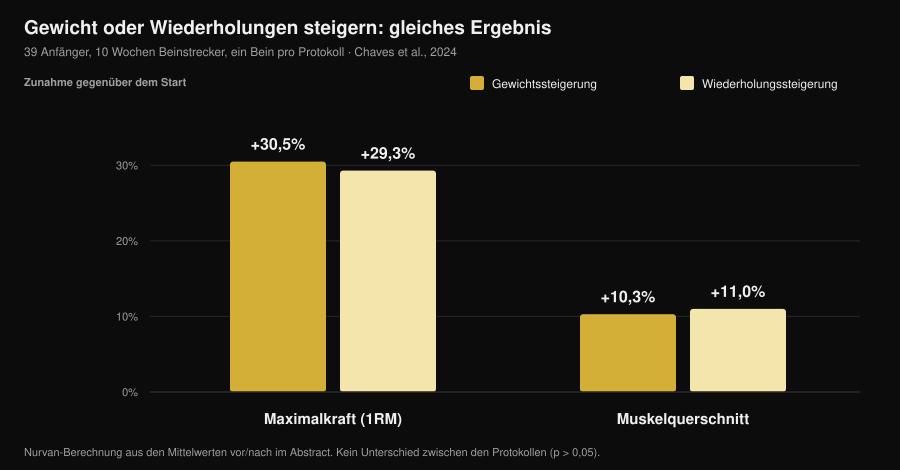
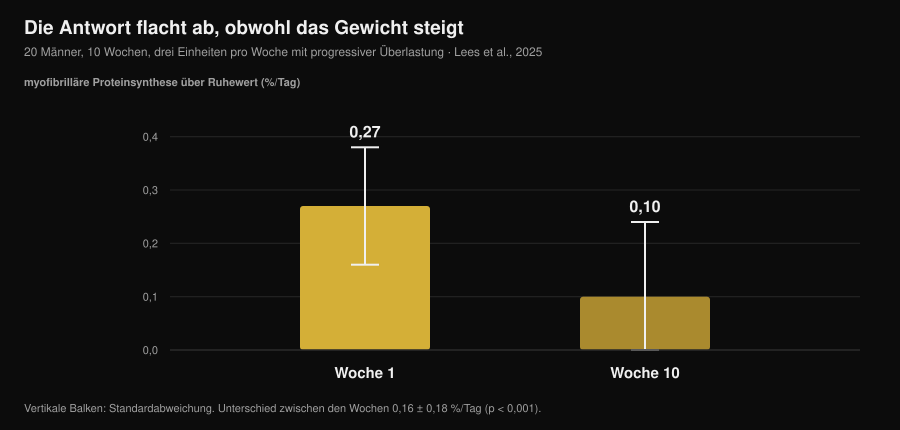

# Progressive Overload: muss das Gewicht steigen?

Von [Giammaria Loi](/autore/giammaria-loi) · aktualisiert am 17. November 2026

"Wird die Stange nicht schwerer, wächst du nicht." Das ist die meistwiederholte Regel im Studio, und sie beginnt mit einem richtigen Prinzip: Anpassung braucht eine Anforderung, die steigt. Der Sprung steckt im Wort *schwerer*. Drei kontrollierte Studien haben die beiden Wege direkt verglichen — mehr Last oder mehr Wiederholungen — und das Ergebnis verändert, wie man einen Plan schreibt.

## Kurz gefasst

- **Mehr Wiederholungen wirken wie mehr Gewicht.** In 10 Wochen stieg die Maximalkraft bei Anfängern um 30,5 % mit Gewichtssteigerung und um 29,3 % mit Wiederholungssteigerung; der Muskelquerschnitt um 10,3 % und 11,0 %.
- **Bei Trainierten gilt dasselbe.** Nach 8 Wochen lagen die Gruppenunterschiede bei 2,8 mm am Rectus femoris (zugunsten der Wiederholungen) und 2,0 kg in der Kniebeuge-Maximalkraft (zugunsten der Last): beide Konfidenzintervalle überschreiten die Null.
- **Die äußere Last entscheidet nicht über Hypertrophie.** Bei gleicher Anstrengung brachten 8-12 Wiederholungen mit 70-80 % des Maximums und 20-25 mit 30-40 % im selben Menschen gleich viel Wachstum.
- **Progressive Überlastung macht den Fortschritt nicht linear.** In derselben Studie fiel die Proteinsynthese über Ruhewert von 0,27 auf 0,10 %/Tag zwischen Woche 1 und Woche 10, während die Lasten stiegen.
- **Wachsen muss die Anforderung, nicht die Zahl auf der Stange.** Wiederholungen, Sätze, Nähe zum Muskelversagen und Bewegungsqualität sind legitime Hebel — für Maximalkraft bleibt die Last der spezifischste.

*Nurvan-Grafik nach Chaves et al., 2024 (39 Anfänger, Within-Subject-Design: jedes Bein zufällig der Gewichts- oder Wiederholungssteigerung zugeteilt). Werte berechnet aus den Mittelwerten vor/nach im Abstract: Maximalkraft 52,90 → 69,05 kg und 51,67 → 66,82 kg; Querschnitt des Vastus lateralis 21,34 → 23,53 cm² und 21,08 → 23,39 cm². Kein Wert aus einer Abbildung abgelesen.*

## Was das Prinzip wirklich verlangt

Progressive Überlastung sagt nur eines: Damit die Anpassung weitergeht, muss die Anforderung an den Muskel mit der Zeit steigen. Sie sagt nicht *wie*. Es gibt mindestens fünf Hebel: die Last, die Wiederholungen pro Satz, die Anzahl der Sätze, die Nähe zum Muskelversagen und die Bewegungsamplitude oder -kontrolle.

In der Praxis hat der erste Hebel die anderen verdrängt, aus einem banalen Grund: Nur die Last lässt sich an der Stange ablesen. Steht im Plan 4×8 und letzte Woche waren es 60 kg, dann sehen 62,5 kg heute nach Fortschritt aus, während 60 kg für 10 Wiederholungen wirken, als hätte sich "nichts geändert". Eine Buchhaltungsillusion: Im zweiten Fall ist die Arbeit stärker gestiegen.

Die nützliche Frage ist nicht philosophisch. Drei Studien haben die beiden Wege gegeneinandergestellt, mit gleicher Satzzahl und Frequenz, und Kraft wie Muskel gemessen.

## Die drei Studien, die beide Wege verglichen haben

| Studie | Wer | Dauer | Vergleich | Ergebnis |
|---|---|---|---|---|
| Plotkin et al., 2022 | 43 Personen mit mindestens 1 Jahr Training | 8 Wochen | Last ↑ vs Wiederholungen ↑ | vernachlässigbare Unterschiede, Intervalle schließen die Null ein |
| Chaves et al., 2024 | 39 Anfänger, ein Bein pro Protokoll | 10 Wochen | Last ↑ vs Wiederholungen ↑ | kein Unterschied bei Kraft und Muskelgröße |
| Lees et al., 2025 | 20 junge Männer, eine Extremität pro Last | 10 Wochen | schwere vs leichte Last bei gleicher Anstrengung | Hypertrophie unabhängig von der Last |

*Nurvan-Tabelle aus den drei in den Quellen genannten Studien.*

### Trainierte: die Unterschiede sind kleiner als die Unsicherheit

Bei Plotkin und Kollegen absolvierten 43 Personen mit mindestens einem Jahr Unterkörpertraining 4 Sätze in 4 Übungen, zweimal pro Woche, über 8 Wochen. Eine Gruppe steigerte die Last bei konstanten Wiederholungen, die andere die Wiederholungen bei konstanter Last.

Die Unterschiede **zwischen den Gruppen**, bereinigt um Ausgangswerte und Geschlecht, betrugen 2,8 mm in der Summe der Rectus-femoris-Messstellen zugunsten der Wiederholungen (95-%-Konfidenzintervall -0,5 bis 5,8) und 2,0 kg in der Kniebeuge an der Multipresse zugunsten der Last (-2,4 bis 7,8). Beide Intervalle enthalten die Null: Mit diesen Zahlen lässt sich kein Sieger benennen. Alles andere lag noch näher beieinander: Muskeldicken unter einem Millimeter, Kraftausdauer unter 1 %, Sprunghöhe 0,1 cm.

### Anfänger: dieselbe Person, zwei Beine, zwei Protokolle

Chaves und Kollegen wählten ein saubereres Design: 39 Untrainierte, jedes Bein zufällig der Gewichts- oder Wiederholungssteigerung zugeteilt, 10 Wochen Beinstrecker. So ist jede Person ihre eigene Kontrolle, und das Problem unterschiedlich reagierender Menschen entfällt.

Die Maximalkraft stieg von 52,90 auf 69,05 kg mit Gewichtssteigerung und von 51,67 auf 66,82 kg mit Wiederholungssteigerung; der Querschnitt des Vastus lateralis von 21,34 auf 23,53 cm² und von 21,08 auf 23,39 cm². Kein statistischer Unterschied zwischen den Protokollen.

### Nicht die Last steuert das Wachstum, sondern die Anstrengung

Das neueste Puzzleteil kommt aus dem *Journal of Physiology*: 20 junge Männer, 10 Wochen, einarmige Curls und einbeinige Kniestreckungen, eine Extremität mit schwerer Last (8-12 Wiederholungen, 70-80 % des Maximums) und die andere mit leichter Last (20-25 Wiederholungen, 30-40 %), alle Sätze bis zur willkürlichen Erschöpfung.

Die Hypertrophie wurde von der Last nicht beeinflusst und blieb **innerhalb** der Person erhalten: Wer am Arm gut wuchs, wuchs auch am Bein gut, unabhängig vom Gewicht. Die relevante Variabilität liegt zwischen Menschen, nicht zwischen Lasten. Ein Detail, das beim Vergleich mit anderen hilft: In derselben Studie war die geteilte Varianz zwischen Größen- und Kraftzuwachs vernachlässigbar. Wachsen und stark werden sind nicht dasselbe Maß.

## Warum der Fortschritt trotzdem langsamer wird

Hier kommt der Teil, den das Prinzip nie versprochen hat. In der Studie im *Journal of Physiology* wurde die myofibrilläre Proteinsynthese — wie schnell der Muskel kontraktiles Eiweiß aufbaut — mit deuteriertem Wasser in Woche 1 und Woche 10 gemessen.

*Nurvan-Grafik nach Lees et al., 2025 (20 Männer, 10 Wochen, drei Einheiten pro Woche). Werte aus dem Abstract als Anstieg über den Ruhewert: 0,27 ± 0,11 %/Tag in Woche 1 (p < 0,0001) und 0,10 ± 0,14 %/Tag in Woche 10 (p = 0,009); Unterschied zwischen beiden 0,16 ± 0,18 %/Tag (p < 0,001). Kein Wert aus einer Abbildung abgelesen.*

Über dem Ruhewert lag die Synthese zu Beginn bei 0,27 %/Tag und in Woche 10 bei 0,10 %/Tag: Die Antwort flachte um rund zwei Drittel ab, **während das Programm progressive Überlastung anwendete**. Das ist kein Planungsfehler, sondern wie Anpassung funktioniert: Derselbe Reiz ist bei jeder Wiederholung weniger wert. Mehr Gewicht hebt diese Kurve nicht auf, und monatelang linearen Fortschritt zu erwarten heißt, das eigene Training mit dem falschen Maßstab zu messen. Zum Rhythmus, in dem man einen Plan überarbeitet: [wie oft den Trainingsplan wechseln](/de/blog/wie-oft-trainingsplan-wechseln).

## Was die Forschung wirklich sagt

| Verbreitete Behauptung | Urteil | Quelle |
|---|---|---|
| „Steigt das Gewicht nicht, wächst du nicht" | **Widerlegt** | Plotkin et al., 2022; Chaves et al., 2024 — Wiederholungssteigerung bei fixer Last brachte denselben Muskelaufbau |
| „Mehr äußere Last heißt mehr Hypertrophie" | **Widerlegt** | Lees et al., 2025 — bei gleicher Anstrengung bauten 70-80 % und 30-40 % des Maximums im selben Menschen gleich viel Muskel auf |
| „Last und Wiederholungen sind für jedes Ziel austauschbar" | **Mit Einschränkung** | Plotkin et al., 2022 — bei der Maximalkraft begünstigt die Schätzung die Last (+2,0 kg), das Intervall überschreitet aber die Null; das Spezifitätsprinzip gilt weiter |
| „Mit progressiver Überlastung bleibt der Fortschritt linear" | **Widerlegt** | Lees et al., 2025 — Proteinsynthese über Ruhewert von 0,27 auf 0,10 %/Tag zwischen Woche 1 und Woche 10 |
| „Für Fortschritt muss man bis zum Muskelversagen gehen" | **Mit Einschränkung** | Robinson et al., 2024 — Hypertrophie verbessert sich näher am Versagen, Kraft nicht; Ruple et al., 2023 — bei gleichem Volumen brachten 0-1 und 4-6 RIR in 5 Wochen dieselben Ergebnisse |
| „Die Progression muss schriftlich festgelegt und exakt befolgt werden" | **Mit Einschränkung** | Larsen et al., 2021 — in 14 Studien mit 356 Teilnehmenden steigerte jedes autoregulierte Protokoll die Maximalkraft |

## So wendest du es an

1. **Wähle einen Hebel und lass die anderen ruhen.** Entscheide pro Übung, ob dieser Block die Last oder die Wiederholungen steigert. Alles gleichzeitig zu bewegen macht es unmöglich zu erkennen, was gewirkt hat.
2. **Nutze die doppelte Progression.** Lege eine Spanne fest (zum Beispiel 8-12 Wiederholungen): Füge Wiederholungen hinzu, bis du in allen Sätzen die Obergrenze erreichst, dann erhöhe die Last und beginne wieder unten. Der einfachste Weg, beide Routen zu nutzen, ohne zu wählen.
3. **Für Maximalkraft bevorzuge die Last.** Wer antritt oder ein höheres Maximum will, braucht Spezifität: Schwere Sätze müssen schwer sein. Im Rest der Einheit reichen Wiederholungen.
4. **Für Hypertrophie zählt die Anstrengung.** Wachstum verbessert sich, wenn Sätze nahe am Versagen enden — und das geht mit jeder Last. Zu Wiederholungen und Pausen rund um diese Anstrengung: [wie viele Wiederholungen für Muskelaufbau](/de/blog/wie-viele-wiederholungen-muskelaufbau).
5. **Notiere Last, Wiederholungen und Anstrengung zusammen.** Eine Zeile mit nur dem Gewicht sagt nicht, ob die Anforderung gestiegen ist. Drei Zahlen schon. Dazu, wie genau wir diese Anstrengung schätzen: [wie genau dein RIR ist](/de/blog/rir-wie-genau-wiederholungen-in-reserve).
6. **Wenn die Last drei Wochen stillsteht, erzwinge sie nicht.** Erhöhe die Wiederholungen, füge einen Satz hinzu oder senke das Volumen für eine Woche und versuche es erneut. Die Daten sagen, dass der zweite Weg zum selben Ziel führt; der dritte hilft, wenn Erholung fehlt, nicht Reiz.

### Wenn du andere aus der Ferne betreust

Die Lastprogression ist am leichtesten zu verordnen und am leichtesten falsch umzusetzen. Zwei Gewohnheiten, die die Qualität der Rückmeldung verändern:

- **Verordne die Spanne, nicht das Gewicht.** „8-12 Wiederholungen; erhöhe die Last, sobald du in allen Sätzen 12 schaffst" ist eine Regel, die ein Kunde allein anwenden kann, auch in einer Woche mit schlechtem Schlaf. Ein fixes Gewicht bricht beim ersten Zwischenfall.
- **Lies die Progression als Gesamtarbeit, nicht als Maximum.** Wer von 60×8 auf 60×11 geht, hat sich stärker verbessert als jemand, der von 60×8 auf 62,5×8 geht. Schaust du nur auf die Lastspalte, wirkt der Erste wie festgefahren.

> **Nurvan: sieh nach, ob die Anforderung wirklich gestiegen ist**
>
> In Nurvan trägt jeder Satz Last, Wiederholungen und RIR, und der Übungsverlauf stellt die Einheiten nebeneinander: In zwei Sekunden siehst du, ob du im Gewicht, in den Wiederholungen oder gar nicht vorankommst. Das ist die Grundlage für den nächsten Hebel — für dich oder für den Coach, der deinen Plan schreibt. [Nurvan testen](https://nurvan.app)

## Häufige Fragen

**Muss ich jede Woche mehr Gewicht nehmen?**
Nein, und keine Studie hat das als notwendig gezeigt. In den drei Arbeiten, die beide Wege direkt verglichen haben, brachte das Steigern der Wiederholungen bei fixer Last denselben Muskelaufbau und einen fast identischen Kraftzuwachs (30,5 % gegenüber 29,3 % in der Maximalkraft über 10 Wochen). Steigen muss die Gesamtanforderung.

**Besser mehr Gewicht oder mehr Wiederholungen?**
Das hängt vom Ziel ab. Für Hypertrophie sind beide Hebel in den vorliegenden Daten gleichwertig. Für Maximalkraft begünstigt die Schätzung leicht die Last (2,0 kg Gruppenunterschied, Intervall -2,4 bis 7,8), und Spezifität spricht dafür, schwere Sätze schwer zu halten, wenn ein höheres Maximum das Ziel ist. Die doppelte Progression nutzt beides.

**Was ist die doppelte Progression?**
Die Regel, die zuerst die Wiederholungen und dann die Last erhöht. Wähle eine Spanne, etwa 8-12: Du bleibst bei dem Gewicht, bis du in allen vorgesehenen Sätzen 12 Wiederholungen schaffst, dann erhöhst du um den kleinsten verfügbaren Schritt und startest wieder bei 8. Kein Rechnen mit dem Maximum, und schlechte Tage werden abgefedert.

**Warum komme ich nicht voran, obwohl ich das Gewicht erhöhe?**
Weil die Anpassung von selbst langsamer wird: In der Studie mit deuteriertem Wasser fiel die Proteinsynthese über Ruhewert in zehn Wochen von 0,27 auf 0,10 %/Tag, während die Lasten stiegen. Wenn die Last stockt, liegt es meist an Erholung oder Gesamtvolumen, nicht am Gewicht selbst. Hält die Stagnation Wochen an und kommen körperliche Beschwerden dazu, ist ein Arztbesuch sinnvoller als Weitermachen.

## Weiterlesen

- [Wie viele Wiederholungen für Muskelaufbau: der 8-12-Mythos](/de/blog/wie-viele-wiederholungen-muskelaufbau) — wo die Anstrengung hingehört, die du steigern willst.
- [Wie genau ist dein RIR? Was die Studien sagen](/de/blog/rir-wie-genau-wiederholungen-in-reserve) — der Anstrengungshebel funktioniert nur, wenn du ihn messen kannst.
- [Wie oft sollte man den Trainingsplan wechseln?](/de/blog/wie-oft-trainingsplan-wechseln) — wie lange ein Plan stehen bleiben sollte, bevor man ihn beurteilt.

## Quellen

1. Plotkin D, Coleman M, Van Every D, Maldonado J, Oberlin D, Israetel M, Feather J, Alto A, Vigotsky AD, Schoenfeld BJ, 2022. Progressive overload without progressing load? The effects of load or repetition progression on muscular adaptations. *PeerJ* 10:e14142. [PMID 36199287](https://pubmed.ncbi.nlm.nih.gov/36199287/) · [DOI 10.7717/peerj.14142](https://doi.org/10.7717/peerj.14142)
2. Chaves TS, Scarpelli MC, Bergamasco JGA, et al., 2024. Effects of Resistance Training Overload Progression Protocols on Strength and Muscle Mass. *Int J Sports Med* 45(7):504-510. [PMID 38286426](https://pubmed.ncbi.nlm.nih.gov/38286426/) · [DOI 10.1055/a-2256-5857](https://doi.org/10.1055/a-2256-5857)
3. Lees MJ, Mcleod JC, Morton RW, et al., 2025. Resistance training load does not determine resistance training-induced hypertrophy across upper and lower limbs in healthy young males. *J Physiol*. [PMID 41474371](https://pubmed.ncbi.nlm.nih.gov/41474371/) · [DOI 10.1113/JP289684](https://doi.org/10.1113/JP289684)
4. Robinson ZP, Pelland JC, Remmert JF, Refalo MC, Jukic I, Steele J, Zourdos MC, 2024. Exploring the Dose-Response Relationship Between Estimated Resistance Training Proximity to Failure, Strength Gain, and Muscle Hypertrophy: A Series of Meta-Regressions. *Sports Med* 54(9):2209-2231. [PMID 38970765](https://pubmed.ncbi.nlm.nih.gov/38970765/) · [DOI 10.1007/s40279-024-02069-2](https://doi.org/10.1007/s40279-024-02069-2)
5. Ruple BA, Plotkin DL, Smith MA, et al., 2023. The effects of resistance training to near failure on strength, hypertrophy, and motor unit adaptations in previously trained adults. *Physiol Rep* 11(9):e15679. [PMID 37144554](https://pubmed.ncbi.nlm.nih.gov/37144554/) · [DOI 10.14814/phy2.15679](https://doi.org/10.14814/phy2.15679)
6. Larsen S, Kristiansen E, van den Tillaar R, 2021. Effects of subjective and objective autoregulation methods for intensity and volume on enhancing maximal strength during resistance-training interventions: a systematic review. *PeerJ* 9:e10663. [PMID 33520457](https://pubmed.ncbi.nlm.nih.gov/33520457/) · [DOI 10.7717/peerj.10663](https://doi.org/10.7717/peerj.10663)

Thema aus Trendsignalen vom November 2026 zur Lastprogression gewählt, da konkurrierende Inhalte die wöchentliche Gewichtssteigerung als einzige Form progressiver Überlastung darstellen. Wissenschaftliche Quellen über PubMed recherchiert.

**Giammaria Loi** ist der Gründer von Nurvan. Er trainiert seit 2012 mit Gewichten, arbeitet seit 2013 als FIPE-zertifizierter Personal Trainer und Coach und startet seit 2018 national im Powerlifting. Jeder Artikel, den er zeichnet, beginnt bei der Studienlage und endet bei dem, was im Studio wirklich funktioniert. [Autorenseite](/autore/giammaria-loi)

> Hinweis: informativer Inhalt, er ersetzt nicht die Einschätzung einer Ärztin, eines Arztes oder einer qualifizierten Fachperson.
