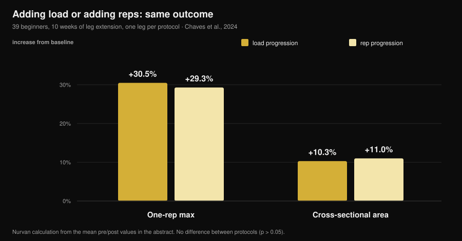
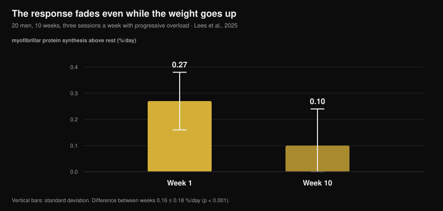

# Progressive overload: do you need more weight?

By [Giammaria Loi](/autore/giammaria-loi) · updated 17 November 2026

"If the bar doesn't get heavier, you don't grow." It is the most repeated rule in the gym, and it starts from a correct principle: adaptation needs a demand that keeps rising. The leap is in the word *heavier*. Three controlled trials have compared the two routes head to head — more load or more reps — and the answer changes how you should write a program.

## The short version

- **Adding reps works like adding weight.** Over 10 weeks in beginners, one-rep max rose 30.5% with load progression and 29.3% with rep progression; muscle cross-section rose 10.3% and 11.0%.
- **The same holds in trained lifters.** After 8 weeks the between-group differences were 2.8 mm in the rectus femoris (favouring reps) and 2.0 kg on the squat max (favouring load) — both confidence intervals cross zero.
- **External load does not decide hypertrophy.** With effort matched, 8-12 reps at 70-80% of max and 20-25 reps at 30-40% produced the same growth in the same person.
- **Progressive overload does not make progress linear.** In that same trial, protein synthesis above rest fell from 0.27 to 0.10 %/day between week 1 and week 10 while the loads kept climbing.
- **What has to grow is the demand, not the number on the bar.** Reps, sets, proximity to failure and movement quality are all legitimate levers — and for maximal strength, load stays the most specific one.

*Nurvan chart from Chaves et al., 2024 (39 beginners, within-subject design: each leg randomised to load or rep progression). Values calculated from the mean pre/post figures in the abstract: one-rep max 52.90 → 69.05 kg and 51.67 → 66.82 kg; vastus lateralis cross-section 21.34 → 23.53 cm² and 21.08 → 23.39 cm². No value read off a figure.*

## What the principle actually asks for

Progressive overload says one thing: for adaptation to continue, the demand you place on the muscle has to rise over time. It does not say *how*. You have at least five levers: load, reps per set, number of sets, proximity to failure, and range or control of the movement.

In practice the first lever swallowed the rest, for a mundane reason: load is the only one you can read off the bar. If the plan says 4×8 and last week was 60 kg, then 62.5 kg today looks like progress, while 60 kg for 10 reps feels like "nothing changed". That is an accounting illusion — the second option raised total work by more.

The useful question is not philosophical. Three trials put the two routes against each other, with matched sets and frequency, and measured both strength and muscle.

## The three trials that compared the two routes

| Study | Who | Length | Comparison | Result |
|---|---|---|---|---|
| Plotkin et al., 2022 | 43 lifters with ≥1 year of training | 8 weeks | load ↑ vs reps ↑ | trivial differences, intervals including zero |
| Chaves et al., 2024 | 39 beginners, one leg per protocol | 10 weeks | load ↑ vs reps ↑ | no difference in strength or muscle size |
| Lees et al., 2025 | 20 young men, one limb per load | 10 weeks | heavy vs light load, effort matched | hypertrophy independent of load |

*Nurvan table built from the three studies listed in the sources below.*

### Trained lifters: the differences are smaller than the uncertainty

Plotkin and colleagues had 43 people with at least a year of lower-body training do 4 sets of 4 exercises, twice a week, for 8 weeks. One group raised the load and held reps constant; the other raised reps and held the load constant.

The **between-group** differences, adjusted for baseline and sex, were 2.8 mm on the summed rectus femoris sites in favour of reps (95% confidence interval -0.5 to 5.8) and 2.0 kg on the Smith machine squat max in favour of load (-2.4 to 7.8). Both intervals contain zero: with these numbers you cannot say one method beat the other. Everything else was even closer — muscle thicknesses under a millimetre, endurance under 1%, jump height 0.1 cm.

### Beginners: one person, two legs, two protocols

Chaves and colleagues used a cleaner design: 39 untrained men and women, each leg randomised to load or rep progression, 10 weeks of leg extension. Every participant acts as their own control, which removes the problem of comparing people who respond differently.

One-rep max went from 52.90 to 69.05 kg with load progression and from 51.67 to 66.82 kg with rep progression; vastus lateralis cross-section from 21.34 to 23.53 cm² and from 21.08 to 23.39 cm². No statistical difference between protocols.

### Load does not drive growth — effort does

The newest piece comes from the *Journal of Physiology*: 20 young men, 10 weeks, unilateral curls and knee extensions with one limb heavy (8-12 reps, 70-80% of max) and the other light (20-25 reps, 30-40%), every set taken to volitional fatigue.

Hypertrophy was unaffected by load, and it was conserved **within** each individual: someone who grew well in the arm also grew well in the leg, whatever the weight. The variability that matters is between people, not between loads. One more detail worth keeping if you compare your numbers with anyone else's: in the same study, shared variance between size gains and strength gains was negligible. Growing and getting strong are not the same measurement.

## Why progress slows down anyway

Here is the part the principle never promised. In the *Journal of Physiology* study, researchers used deuterated water to measure myofibrillar protein synthesis — how fast the muscle builds contractile protein — in week 1 and week 10.

*Nurvan chart from Lees et al., 2025 (20 men, 10 weeks, three sessions a week). Values reported in the abstract as the increase above rest: 0.27 ± 0.11 %/day in week 1 (p < 0.0001) and 0.10 ± 0.14 %/day in week 10 (p = 0.009); difference between them 0.16 ± 0.18 %/day (p < 0.001). No value read off a figure.*

Above resting level, synthesis ran at 0.27 %/day at the start and 0.10 %/day by week 10: the response faded by roughly two thirds **while the programme was applying progressive overload**. That is not a programming mistake, it is how adaptation works — the same stimulus, repeated, is worth less each time. Adding weight does not cancel the curve, and expecting linear progress for months means judging your training with the wrong ruler. On how long to leave a programme alone before changing it, see [how often to change your workout program](/en/blog/how-often-change-workout-program).

## What the research actually says

| Common claim | Verdict | Source |
|---|---|---|
| "If the weight doesn't go up, you don't grow" | **Busted** | Plotkin et al., 2022; Chaves et al., 2024 — progressing reps at a fixed load produced the same muscle growth |
| "More external load means more hypertrophy" | **Busted** | Lees et al., 2025 — with effort matched, 70-80% and 30-40% of max grew the same muscle in the same person |
| "Load and reps are interchangeable for any goal" | **Needs nuance** | Plotkin et al., 2022 — the estimate favours load on the one-rep max (+2.0 kg) but the interval crosses zero; specificity still applies |
| "With progressive overload, progress stays linear" | **Busted** | Lees et al., 2025 — protein synthesis above rest fell from 0.27 to 0.10 %/day between weeks 1 and 10 |
| "You have to train to failure to progress" | **Needs nuance** | Robinson et al., 2024 — hypertrophy improves closer to failure, strength does not; Ruple et al., 2023 — with volume matched, 0-1 and 4-6 RIR gave the same results over 5 weeks |
| "The progression has to be written down and followed exactly" | **Needs nuance** | Larsen et al., 2021 — across 14 studies and 356 participants, every autoregulated protocol increased the one-rep max |

## How to apply it

1. **Pick one lever and hold the others still.** For each exercise, decide whether this block raises load or raises reps. Moving everything at once makes it impossible to know what worked.
2. **Use double progression.** Set a range (say 8-12 reps): add reps until you hit the top of the range on every set, then add load and drop back to the bottom. It is the simplest way to get both routes without choosing.
3. **For maximal strength, favour load.** If you compete or want a bigger one-rep max, specificity matters: heavy sets need to be heavy. On the rest of the session, reps will do.
4. **For hypertrophy, effort is the currency.** Growth improves when sets end close to failure, and that is available at any load. On how many reps and how much rest to build around that effort, see [how many reps build muscle](/en/blog/how-many-reps-build-muscle).
5. **Log load, reps and effort together.** A line with only the weight cannot tell you whether demand went up. Three numbers can. On how well we estimate that effort, see [how accurate your RIR is](/en/blog/how-accurate-is-rir).
6. **When the load stalls for three weeks, don't force it.** Add reps, add a set, or cut volume for a week and try again. The data say the second route leads to the same place; the third is for when it is fatigue, not stimulus, that is missing.

### If you coach people remotely

Load progression is the easiest thing to prescribe and the easiest for a client to get wrong. Two habits that change the quality of what you get back:

- **Prescribe the range, not the weight.** "8-12 reps; go up in load once you hit 12 on every set" is a rule a client can run alone, even in a week of bad sleep. A fixed weight is a rule that breaks at the first disruption.
- **Read progression as total work, not as a max.** A client going from 60×8 to 60×11 has improved more than one going from 60×8 to 62.5×8. Look only at the load column and the first one looks stuck.

> **Nurvan: see whether the demand actually went up**
>
> In Nurvan every set carries load, reps and RIR, and the exercise history lines your sessions up side by side — so you can tell in two seconds whether you are progressing in weight, in reps, or not at all. That is the data you pick your next lever from, for yourself or for the coach who programmes for you. [Try Nurvan](https://nurvan.app)

## FAQ

**Do I have to add weight every week?**
No, and no study has shown it is necessary. In the three trials that compared the routes directly, adding reps at a fixed load produced the same muscle growth and almost identical strength gains (30.5% versus 29.3% on the one-rep max over 10 weeks). What has to rise over time is the overall demand.

**Is it better to add load or add reps?**
It depends on the goal. For hypertrophy the two levers are equivalent in the available data. For maximal strength the estimate slightly favours load (a 2.0 kg between-group difference, interval -2.4 to 7.8), and specificity argues for keeping heavy sets heavy if a bigger max is the point. Double progression uses both.

**What is double progression?**
It is the rule that raises reps first and load second. Pick a range, say 8-12: stay at that weight until you complete 12 reps on every prescribed set, then add the smallest increment available and start again at 8. It needs no maths on your one-rep max and it absorbs bad days.

**Why have I stopped progressing even though I keep adding weight?**
Because adaptation slows on its own: in the deuterated-water study, protein synthesis above rest went from 0.27 to 0.10 %/day over ten weeks while loads rose. When the load stalls, the problem is usually recovery or total volume rather than the weight itself. If the plateau lasts weeks and comes with physical symptoms, it is worth talking to a doctor rather than pushing through.

## Read next

- [How many reps build muscle? The 8-12 myth](/en/blog/how-many-reps-build-muscle) — where to place the effort you are trying to grow.
- [How accurate is your RIR? What the studies say](/en/blog/how-accurate-is-rir) — the effort lever only works if you can measure it.
- [How often should you change your workout program?](/en/blog/how-often-change-workout-program) — how long to leave a programme alone before judging it.

## Sources

1. Plotkin D, Coleman M, Van Every D, Maldonado J, Oberlin D, Israetel M, Feather J, Alto A, Vigotsky AD, Schoenfeld BJ, 2022. Progressive overload without progressing load? The effects of load or repetition progression on muscular adaptations. *PeerJ* 10:e14142. [PMID 36199287](https://pubmed.ncbi.nlm.nih.gov/36199287/) · [DOI 10.7717/peerj.14142](https://doi.org/10.7717/peerj.14142)
2. Chaves TS, Scarpelli MC, Bergamasco JGA, et al., 2024. Effects of Resistance Training Overload Progression Protocols on Strength and Muscle Mass. *Int J Sports Med* 45(7):504-510. [PMID 38286426](https://pubmed.ncbi.nlm.nih.gov/38286426/) · [DOI 10.1055/a-2256-5857](https://doi.org/10.1055/a-2256-5857)
3. Lees MJ, Mcleod JC, Morton RW, et al., 2025. Resistance training load does not determine resistance training-induced hypertrophy across upper and lower limbs in healthy young males. *J Physiol*. [PMID 41474371](https://pubmed.ncbi.nlm.nih.gov/41474371/) · [DOI 10.1113/JP289684](https://doi.org/10.1113/JP289684)
4. Robinson ZP, Pelland JC, Remmert JF, Refalo MC, Jukic I, Steele J, Zourdos MC, 2024. Exploring the Dose-Response Relationship Between Estimated Resistance Training Proximity to Failure, Strength Gain, and Muscle Hypertrophy: A Series of Meta-Regressions. *Sports Med* 54(9):2209-2231. [PMID 38970765](https://pubmed.ncbi.nlm.nih.gov/38970765/) · [DOI 10.1007/s40279-024-02069-2](https://doi.org/10.1007/s40279-024-02069-2)
5. Ruple BA, Plotkin DL, Smith MA, et al., 2023. The effects of resistance training to near failure on strength, hypertrophy, and motor unit adaptations in previously trained adults. *Physiol Rep* 11(9):e15679. [PMID 37144554](https://pubmed.ncbi.nlm.nih.gov/37144554/) · [DOI 10.14814/phy2.15679](https://doi.org/10.14814/phy2.15679)
6. Larsen S, Kristiansen E, van den Tillaar R, 2021. Effects of subjective and objective autoregulation methods for intensity and volume on enhancing maximal strength during resistance-training interventions: a systematic review. *PeerJ* 9:e10663. [PMID 33520457](https://pubmed.ncbi.nlm.nih.gov/33520457/) · [DOI 10.7717/peerj.10663](https://doi.org/10.7717/peerj.10663)

Topic chosen from November 2026 trend signals on load progression, where competing content presents a weekly weight increase as the only form of progressive overload. Scientific sources retrieved through PubMed.

**Giammaria Loi** is the founder of Nurvan. He has been lifting since 2012, has worked as a FIPE-certified personal trainer and coach since 2013, and has competed in powerlifting at national level since 2018. Every article he writes starts from the research and ends with what actually works in the gym. [Author page](/autore/giammaria-loi)

> Note: educational content. It does not replace advice from a doctor or qualified professional.
