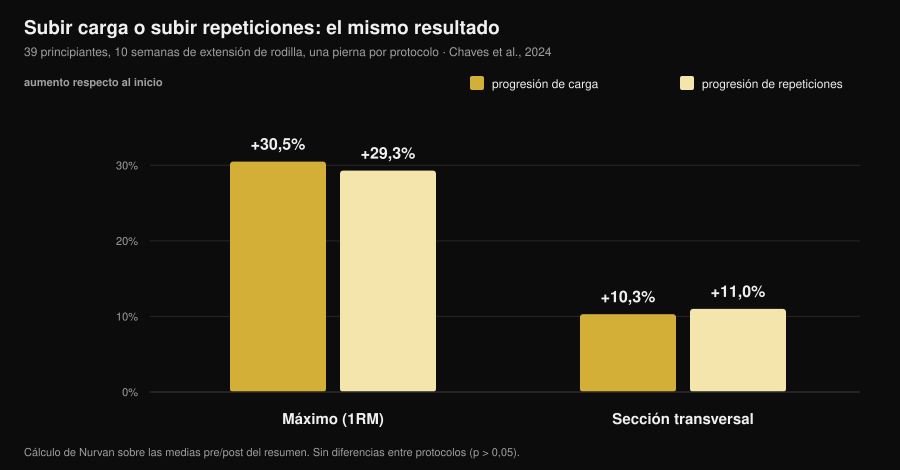
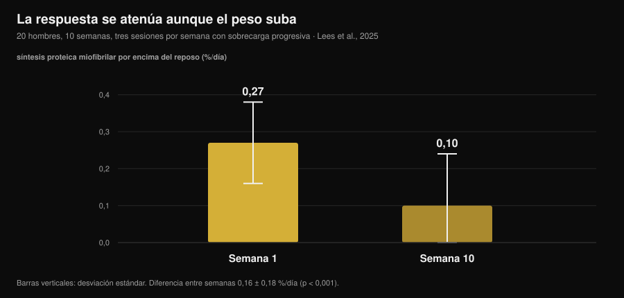

# Sobrecarga progresiva: ¿hay que subir el peso?

Por [Giammaria Loi](/autore/giammaria-loi) · actualizado el 17 de noviembre de 2026

"Si no subes el peso, no creces." Es la regla más repetida del gimnasio y parte de un principio correcto: para adaptarse, el cuerpo necesita una demanda que aumente. El salto está en la palabra *peso*. Tres estudios controlados han comparado las dos vías — más carga o más repeticiones — y el resultado cambia la forma de escribir una rutina.

## En resumen

- **Añadir repeticiones funciona como añadir peso.** En 10 semanas con principiantes el máximo subió un 30,5% progresando en carga y un 29,3% progresando en repeticiones; la sección del músculo, un 10,3% y un 11,0%.
- **Lo mismo ocurre en gente ya entrenada.** Tras 8 semanas las diferencias entre grupos fueron de 2,8 mm en el recto femoral (a favor de las repeticiones) y 2,0 kg en el máximo de sentadilla (a favor de la carga): ambos intervalos de confianza cruzan el cero.
- **La carga externa no decide la hipertrofia.** Con el esfuerzo igualado, 8-12 repeticiones al 70-80% del máximo y 20-25 al 30-40% produjeron el mismo crecimiento en la misma persona.
- **La sobrecarga progresiva no hace lineal el progreso.** En ese mismo estudio la síntesis proteica por encima del reposo bajó de 0,27 a 0,10 %/día entre la semana 1 y la 10 mientras las cargas subían.
- **Lo que debe crecer es la demanda, no el número de la barra.** Repeticiones, series, cercanía al fallo y calidad técnica son palancas legítimas, y para la fuerza máxima la carga sigue siendo la más específica.

*Gráfico de Nurvan con datos de Chaves et al., 2024 (39 principiantes, diseño intrasujeto: cada pierna asignada al azar a progresión de carga o de repeticiones). Valores calculados a partir de las medias pre/post del resumen: máximo 52,90 → 69,05 kg y 51,67 → 66,82 kg; sección del vasto lateral 21,34 → 23,53 cm² y 21,08 → 23,39 cm². Ningún valor leído de una figura.*

## Qué pide realmente el principio

La sobrecarga progresiva dice una sola cosa: para que la adaptación continúe, la demanda sobre el músculo tiene que aumentar con el tiempo. No dice *cómo*. Hay al menos cinco palancas: la carga, las repeticiones por serie, el número de series, la cercanía al fallo y el rango o el control del movimiento.

En la práctica la primera se comió a las demás por un motivo trivial: la carga es la única que se lee en la barra. Si la rutina pone 4×8 y la semana pasada hiciste 60 kg, hoy 62,5 kg parece un avance, mientras que 60 kg por 10 repeticiones parece "no haber cambiado nada". Es una ilusión contable: en el segundo caso el trabajo subió más.

La pregunta útil no es filosófica. Tres estudios enfrentaron las dos vías con el mismo número de series y la misma frecuencia, y midieron fuerza y músculo.

## Los tres estudios que compararon las dos vías

| Estudio | Quién | Duración | Comparación | Resultado |
|---|---|---|---|---|
| Plotkin et al., 2022 | 43 personas con al menos 1 año de entrenamiento | 8 semanas | carga ↑ vs repeticiones ↑ | diferencias triviales, intervalos que incluyen el cero |
| Chaves et al., 2024 | 39 principiantes, una pierna por protocolo | 10 semanas | carga ↑ vs repeticiones ↑ | sin diferencias en fuerza ni en tamaño muscular |
| Lees et al., 2025 | 20 hombres jóvenes, un miembro por carga | 10 semanas | carga alta vs baja con el esfuerzo igualado | hipertrofia independiente de la carga |

*Tabla de Nurvan construida con los tres estudios citados en las fuentes.*

### Gente entrenada: las diferencias son menores que la incertidumbre

En el trabajo de Plotkin y colaboradores, 43 personas con al menos un año de entrenamiento de tren inferior hicieron 4 series de 4 ejercicios, dos veces por semana, durante 8 semanas. Un grupo subía la carga manteniendo las repeticiones; el otro subía las repeticiones manteniendo la carga.

Las diferencias **entre grupos**, ajustadas por el valor inicial y el sexo, fueron de 2,8 mm en la suma de puntos del recto femoral a favor de las repeticiones (intervalo de confianza del 95% de -0,5 a 5,8) y de 2,0 kg en el máximo de sentadilla en multipower a favor de la carga (de -2,4 a 7,8). Ambos intervalos contienen el cero: con estos números no se puede decir que un método ganara. En el resto las diferencias eran aún menores: grosores musculares por debajo del milímetro, resistencia por debajo del 1%, salto vertical 0,1 cm.

### Principiantes: la misma persona, dos piernas, dos protocolos

Chaves y colaboradores usaron un diseño más limpio: 39 principiantes, cada pierna asignada al azar a progresión de carga o de repeticiones, 10 semanas de extensión de rodilla. Así cada participante es su propio control y desaparece el problema de comparar personas que responden distinto.

El máximo pasó de 52,90 a 69,05 kg con progresión de carga y de 51,67 a 66,82 kg con progresión de repeticiones; la sección del vasto lateral, de 21,34 a 23,53 cm² y de 21,08 a 23,39 cm². Sin diferencia estadística entre protocolos.

### La carga no manda sobre el crecimiento, el esfuerzo sí

La pieza más reciente viene del *Journal of Physiology*: 20 hombres jóvenes, 10 semanas, curl y extensión de rodilla unilaterales con un miembro a carga alta (8-12 repeticiones, 70-80% del máximo) y el contrario a carga baja (20-25 repeticiones, 30-40%), todas las series hasta la fatiga voluntaria.

La hipertrofia no se vio afectada por la carga y se conservó **dentro** del individuo: quien crecía bien en el brazo crecía bien en la pierna, con el peso que fuera. La variabilidad que importa está entre personas, no entre cargas. Un detalle más, útil si comparas tus números con los de otro: en el mismo estudio la varianza compartida entre ganancia de tamaño y ganancia de fuerza fue insignificante. Crecer y ponerse fuerte no son la misma medida.

## Por qué el progreso se frena igualmente

Aquí llega la parte que el principio nunca prometió. En el estudio del *Journal of Physiology* se midió con agua deuterada la síntesis proteica miofibrilar — la velocidad a la que el músculo fabrica proteína contráctil — en la semana 1 y en la semana 10.

*Gráfico de Nurvan con datos de Lees et al., 2025 (20 hombres, 10 semanas, tres sesiones por semana). Valores del resumen como incremento sobre el reposo: 0,27 ± 0,11 %/día en la semana 1 (p < 0,0001) y 0,10 ± 0,14 %/día en la semana 10 (p = 0,009); diferencia entre ambas 0,16 ± 0,18 %/día (p < 0,001). Ningún valor leído de una figura.*

Por encima del reposo, la síntesis fue de 0,27 %/día al principio y de 0,10 %/día en la semana 10: la respuesta se atenuó unos dos tercios **mientras el programa aplicaba sobrecarga progresiva**. No es un error de programación, es cómo funciona la adaptación: el mismo estímulo, repetido, vale cada vez menos. Añadir peso no anula esa curva, y esperar progresos lineales durante meses es medir el entrenamiento con una regla equivocada. Sobre cuánto conviene mantener un programa antes de tocarlo, [cada cuánto cambiar la rutina](/es/blog/cada-cuanto-cambiar-la-rutina).

## Qué dice realmente la investigación

| Afirmación habitual | Veredicto | Fuente |
|---|---|---|
| "Si no subes el peso, no creces" | **Desmentido** | Plotkin et al., 2022; Chaves et al., 2024 — progresar en repeticiones con carga fija dio el mismo crecimiento muscular |
| "Más carga externa significa más hipertrofia" | **Desmentido** | Lees et al., 2025 — con el esfuerzo igualado, 70-80% y 30-40% del máximo produjeron la misma hipertrofia en la misma persona |
| "Carga y repeticiones son intercambiables para cualquier objetivo" | **Hay matices** | Plotkin et al., 2022 — en el máximo la estimación favorece a la carga (+2,0 kg), pero el intervalo cruza el cero; el principio de especificidad sigue vigente |
| "Con sobrecarga progresiva el progreso se mantiene lineal" | **Desmentido** | Lees et al., 2025 — síntesis proteica de 0,27 a 0,10 %/día sobre el reposo entre la semana 1 y la 10 |
| "Para progresar hay que llegar al fallo" | **Hay matices** | Robinson et al., 2024 — la hipertrofia mejora cerca del fallo, la fuerza no; Ruple et al., 2023 — con el volumen igualado, 0-1 y 4-6 RIR dieron los mismos resultados en 5 semanas |
| "La progresión hay que escribirla y seguirla al pie de la letra" | **Hay matices** | Larsen et al., 2021 — en 14 estudios y 356 participantes todos los protocolos autorregulados aumentaron el máximo |

## Cómo aplicarlo

1. **Elige una palanca y deja quietas las demás.** En cada ejercicio decide si en este bloque subes carga o repeticiones. Mover todo a la vez hace imposible saber qué funcionó.
2. **Usa la doble progresión.** Fija un rango (por ejemplo 8-12 repeticiones): añade repeticiones hasta llegar al tope en todas las series, luego sube la carga y vuelve al mínimo. Es la forma más simple de usar las dos vías sin elegir.
3. **Para la fuerza máxima, prioriza la carga.** Si compites o quieres subir un máximo, la especificidad cuenta: las series pesadas tienen que ser pesadas. En el resto de la sesión bastan las repeticiones.
4. **Para la hipertrofia, la moneda es el esfuerzo.** El crecimiento mejora cuando las series acaban cerca del fallo, y eso se consigue con cualquier carga. Sobre cuántas repeticiones y cuánto descanso poner alrededor, [cuántas repeticiones para la masa muscular](/es/blog/cuantas-repeticiones-masa-muscular).
5. **Registra carga, repeticiones y esfuerzo juntos.** Una línea con solo el peso no dice si la demanda subió. Tres números sí. Sobre lo precisos que somos estimando ese esfuerzo, [qué precisión tiene tu RIR](/es/blog/rir-precision-repeticiones-en-reserva).
6. **Si la carga no sube en tres semanas, no la fuerces.** Añade repeticiones, añade una serie, o baja el volumen una semana y vuelve a probar. Los datos dicen que la segunda vía llega al mismo sitio; la tercera sirve cuando falta recuperación, no estímulo.

### Si entrenas a otras personas a distancia

La progresión de carga es la más fácil de prescribir y la más fácil de que el cliente ejecute mal. Dos hábitos que cambian la calidad de lo que recibes:

- **Prescribe el rango, no el peso.** "8-12 repeticiones; sube de carga cuando llegues a 12 en todas las series" es una regla que el cliente puede aplicar solo incluso en una semana de mal sueño. Un peso fijo se rompe al primer imprevisto.
- **Lee la progresión como trabajo total, no como un máximo.** Un cliente que pasa de 60×8 a 60×11 ha mejorado más que otro que pasa de 60×8 a 62,5×8. Si miras solo la columna de la carga, el primero parece parado.

> **Nurvan: comprueba si la demanda ha subido de verdad**
>
> En Nurvan cada serie lleva carga, repeticiones y RIR, y el histórico del ejercicio pone las sesiones una al lado de la otra: en dos segundos ves si progresas en peso, en repeticiones o en nada. Ese es el dato con el que eliges la siguiente palanca, para ti o para el entrenador que te programa. [Prueba Nurvan](https://nurvan.app)

## Preguntas frecuentes

**¿Hay que subir el peso cada semana?**
No, y ningún estudio ha demostrado que sea necesario. En los tres trabajos que compararon las dos vías, añadir repeticiones con la carga fija produjo el mismo crecimiento muscular y una ganancia de fuerza casi idéntica (30,5% frente a 29,3% en el máximo en 10 semanas). Lo que debe aumentar con el tiempo es la demanda global.

**¿Es mejor subir carga o subir repeticiones?**
Depende del objetivo. Para la hipertrofia las dos palancas son equivalentes con los datos disponibles. Para la fuerza máxima la estimación favorece ligeramente a la carga (2,0 kg de diferencia entre grupos, intervalo de -2,4 a 7,8), y la especificidad aconseja mantener series pesadas si quieres subir un máximo. La doble progresión usa las dos.

**¿Qué es la doble progresión?**
Es la regla que sube primero las repeticiones y después la carga. Eliges un rango, por ejemplo 8-12: trabajas con ese peso hasta completar 12 repeticiones en todas las series previstas, luego subes el incremento más pequeño disponible y vuelves a empezar en 8. No requiere cálculos sobre el máximo y absorbe los días malos.

**¿Por qué ya no progreso aunque siga subiendo el peso?**
Porque la adaptación se frena sola: en el estudio con agua deuterada la síntesis proteica sobre el reposo pasó de 0,27 a 0,10 %/día en diez semanas mientras las cargas subían. Cuando la carga se atasca, el problema suele estar en la recuperación o en el volumen total, no en el peso en sí. Si el estancamiento dura semanas y va con síntomas físicos, conviene hablarlo con un médico en lugar de insistir.

## Sigue leyendo

- [Cuántas repeticiones para la masa muscular: el mito del 8-12](/es/blog/cuantas-repeticiones-masa-muscular) — dónde colocar el esfuerzo que intentas hacer crecer.
- [¿Qué precisión tiene tu RIR? Lo que dicen los estudios](/es/blog/rir-precision-repeticiones-en-reserva) — la palanca del esfuerzo solo sirve si sabes medirla.
- [¿Cada cuánto cambiar la rutina de entrenamiento?](/es/blog/cada-cuanto-cambiar-la-rutina) — cuánto mantener un programa antes de juzgarlo.

## Fuentes

1. Plotkin D, Coleman M, Van Every D, Maldonado J, Oberlin D, Israetel M, Feather J, Alto A, Vigotsky AD, Schoenfeld BJ, 2022. Progressive overload without progressing load? The effects of load or repetition progression on muscular adaptations. *PeerJ* 10:e14142. [PMID 36199287](https://pubmed.ncbi.nlm.nih.gov/36199287/) · [DOI 10.7717/peerj.14142](https://doi.org/10.7717/peerj.14142)
2. Chaves TS, Scarpelli MC, Bergamasco JGA, et al., 2024. Effects of Resistance Training Overload Progression Protocols on Strength and Muscle Mass. *Int J Sports Med* 45(7):504-510. [PMID 38286426](https://pubmed.ncbi.nlm.nih.gov/38286426/) · [DOI 10.1055/a-2256-5857](https://doi.org/10.1055/a-2256-5857)
3. Lees MJ, Mcleod JC, Morton RW, et al., 2025. Resistance training load does not determine resistance training-induced hypertrophy across upper and lower limbs in healthy young males. *J Physiol*. [PMID 41474371](https://pubmed.ncbi.nlm.nih.gov/41474371/) · [DOI 10.1113/JP289684](https://doi.org/10.1113/JP289684)
4. Robinson ZP, Pelland JC, Remmert JF, Refalo MC, Jukic I, Steele J, Zourdos MC, 2024. Exploring the Dose-Response Relationship Between Estimated Resistance Training Proximity to Failure, Strength Gain, and Muscle Hypertrophy: A Series of Meta-Regressions. *Sports Med* 54(9):2209-2231. [PMID 38970765](https://pubmed.ncbi.nlm.nih.gov/38970765/) · [DOI 10.1007/s40279-024-02069-2](https://doi.org/10.1007/s40279-024-02069-2)
5. Ruple BA, Plotkin DL, Smith MA, et al., 2023. The effects of resistance training to near failure on strength, hypertrophy, and motor unit adaptations in previously trained adults. *Physiol Rep* 11(9):e15679. [PMID 37144554](https://pubmed.ncbi.nlm.nih.gov/37144554/) · [DOI 10.14814/phy2.15679](https://doi.org/10.14814/phy2.15679)
6. Larsen S, Kristiansen E, van den Tillaar R, 2021. Effects of subjective and objective autoregulation methods for intensity and volume on enhancing maximal strength during resistance-training interventions: a systematic review. *PeerJ* 9:e10663. [PMID 33520457](https://pubmed.ncbi.nlm.nih.gov/33520457/) · [DOI 10.7717/peerj.10663](https://doi.org/10.7717/peerj.10663)

Tema elegido a partir de señales de tendencia de noviembre de 2026 sobre la progresión de carga, con contenidos competidores que presentan el aumento semanal de peso como única forma de sobrecarga progresiva. Fuentes científicas consultadas a través de PubMed.

**Giammaria Loi** es el fundador de Nurvan. Entrena con pesas desde 2012, trabaja como entrenador personal y coach certificado FIPE desde 2013 y compite en powerlifting a nivel nacional desde 2018. Cada artículo que firma parte de los estudios científicos y llega a lo que funciona de verdad en el gimnasio. [Página del autor](/autore/giammaria-loi)

> Nota: contenido informativo, no sustituye la opinión de un médico ni de un profesional cualificado.
