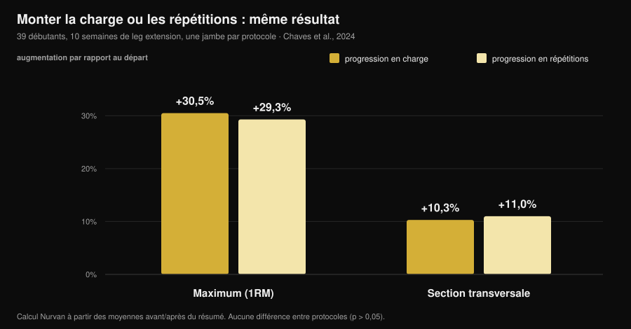
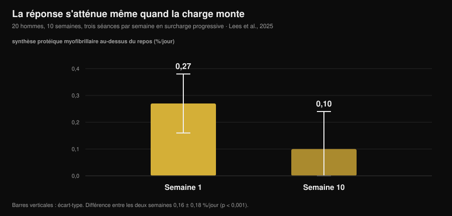

# Surcharge progressive : faut-il augmenter la charge ?

Par [Giammaria Loi](/autore/giammaria-loi) · mis à jour le 17 novembre 2026

« Si la barre ne devient pas plus lourde, tu ne grossis pas. » C'est la règle la plus répétée en salle, et elle part d'un principe juste : pour s'adapter, le corps a besoin d'une demande qui augmente. Le glissement tient au mot *lourde*. Trois essais contrôlés ont comparé les deux voies — plus de charge ou plus de répétitions — et le résultat change la façon d'écrire un programme.

## L'essentiel

- **Ajouter des répétitions vaut ajouter du poids.** En 10 semaines chez des débutants, le maximum a progressé de 30,5 % en montant la charge et de 29,3 % en montant les répétitions ; la section du muscle de 10,3 % et de 11,0 %.
- **C'est aussi vrai chez les pratiquants entraînés.** Après 8 semaines, les écarts entre groupes étaient de 2,8 mm sur le droit fémoral (en faveur des répétitions) et de 2,0 kg sur le maximum au squat (en faveur de la charge) : les deux intervalles de confiance franchissent le zéro.
- **La charge externe ne décide pas de l'hypertrophie.** À effort égal, 8-12 répétitions à 70-80 % du maximum et 20-25 à 30-40 % ont produit la même croissance chez la même personne.
- **La surcharge progressive ne rend pas les progrès linéaires.** Dans ce même essai, la synthèse protéique au-dessus du repos est passée de 0,27 à 0,10 %/jour entre la semaine 1 et la semaine 10 alors que les charges montaient.
- **Ce qui doit croître, c'est la demande, pas le chiffre sur la barre.** Répétitions, séries, proximité de l'échec et qualité d'exécution sont des leviers légitimes, et pour la force maximale la charge reste le plus spécifique.

*Graphique Nurvan d'après Chaves et al., 2024 (39 débutants, protocole intra-sujet : chaque jambe tirée au sort pour la progression en charge ou en répétitions). Valeurs calculées à partir des moyennes avant/après du résumé : maximum 52,90 → 69,05 kg et 51,67 → 66,82 kg ; section du vaste latéral 21,34 → 23,53 cm² et 21,08 → 23,39 cm². Aucune valeur lue sur une figure.*

## Ce que le principe demande vraiment

La surcharge progressive dit une seule chose : pour que l'adaptation continue, la demande imposée au muscle doit augmenter avec le temps. Elle ne dit pas *comment*. Il existe au moins cinq leviers : la charge, les répétitions par série, le nombre de séries, la proximité de l'échec, l'amplitude ou le contrôle du mouvement.

En pratique, le premier a mangé les autres pour une raison banale : la charge est le seul levier qui se lit sur la barre. Si le programme indique 4×8 et que la semaine dernière c'était 60 kg, 62,5 kg aujourd'hui ressemble à un progrès, alors que 60 kg pour 10 répétitions donne l'impression que « rien n'a changé ». C'est une illusion comptable : dans le second cas le travail a davantage augmenté.

La question utile n'est pas philosophique. Trois essais ont opposé les deux voies, à séries et fréquence identiques, en mesurant force et muscle.

## Les trois essais qui ont comparé les deux voies

| Étude | Qui | Durée | Comparaison | Résultat |
|---|---|---|---|---|
| Plotkin et al., 2022 | 43 pratiquants avec au moins 1 an d'entraînement | 8 semaines | charge ↑ vs répétitions ↑ | écarts négligeables, intervalles incluant le zéro |
| Chaves et al., 2024 | 39 débutants, une jambe par protocole | 10 semaines | charge ↑ vs répétitions ↑ | aucune différence sur la force ni sur la taille du muscle |
| Lees et al., 2025 | 20 hommes jeunes, un membre par charge | 10 semaines | charge lourde vs légère à effort égal | hypertrophie indépendante de la charge |

*Tableau Nurvan construit à partir des trois études citées en sources.*

### Pratiquants entraînés : les écarts sont plus petits que l'incertitude

Dans le travail de Plotkin et ses collègues, 43 personnes ayant au moins un an d'entraînement du bas du corps ont réalisé 4 séries sur 4 exercices, deux fois par semaine, pendant 8 semaines. Un groupe augmentait la charge à répétitions constantes, l'autre augmentait les répétitions à charge constante.

Les différences **entre groupes**, ajustées sur les valeurs de départ et le sexe, étaient de 2,8 mm sur la somme des sites du droit fémoral en faveur des répétitions (intervalle de confiance à 95 % de -0,5 à 5,8) et de 2,0 kg sur le maximum au squat guidé en faveur de la charge (de -2,4 à 7,8). Les deux intervalles contiennent le zéro : avec ces chiffres on ne peut pas dire qu'une méthode l'emporte. Sur le reste, les écarts étaient encore plus faibles : épaisseurs musculaires sous le millimètre, endurance sous 1 %, détente verticale 0,1 cm.

### Débutants : la même personne, deux jambes, deux protocoles

Chaves et ses collègues ont utilisé un protocole plus propre : 39 débutants, chaque jambe tirée au sort pour la progression en charge ou en répétitions, 10 semaines de leg extension. Chaque participant devient son propre témoin, ce qui supprime le problème de comparer des personnes qui répondent différemment.

Le maximum est passé de 52,90 à 69,05 kg avec la progression en charge et de 51,67 à 66,82 kg avec celle en répétitions ; la section du vaste latéral de 21,34 à 23,53 cm² et de 21,08 à 23,39 cm². Aucune différence statistique entre les protocoles.

### La charge ne décide pas de la croissance, l'effort si

La pièce la plus récente vient du *Journal of Physiology* : 20 hommes jeunes, 10 semaines, curls et extensions de genou unilatéraux avec un membre en charge lourde (8-12 répétitions, 70-80 % du maximum) et le membre opposé en charge légère (20-25 répétitions, 30-40 %), toutes les séries menées jusqu'à la fatigue volontaire.

L'hypertrophie n'a pas été influencée par la charge, et elle s'est conservée **à l'intérieur** de l'individu : celui qui progressait bien au bras progressait bien à la jambe, quel que soit le poids. La variabilité qui compte est entre les personnes, pas entre les charges. Un détail à garder si vous comparez vos chiffres à ceux d'un autre : dans la même étude, la variance partagée entre gain de taille et gain de force était négligeable. Grossir et devenir fort ne sont pas la même mesure.

## Pourquoi les progrès ralentissent quand même

Voici la part que le principe n'a jamais promise. Dans l'étude du *Journal of Physiology*, la synthèse protéique myofibrillaire — la vitesse à laquelle le muscle fabrique de la protéine contractile — a été mesurée à l'eau deutérée en semaine 1 et en semaine 10.

*Graphique Nurvan d'après Lees et al., 2025 (20 hommes, 10 semaines, trois séances par semaine). Valeurs du résumé, en hausse par rapport au repos : 0,27 ± 0,11 %/jour en semaine 1 (p < 0,0001) et 0,10 ± 0,14 %/jour en semaine 10 (p = 0,009) ; différence entre les deux 0,16 ± 0,18 %/jour (p < 0,001). Aucune valeur lue sur une figure.*

Au-dessus du niveau de repos, la synthèse était de 0,27 %/jour au départ et de 0,10 %/jour en semaine 10 : la réponse s'est atténuée d'environ deux tiers **alors que le programme appliquait une surcharge progressive**. Ce n'est pas une erreur de programmation, c'est le fonctionnement de l'adaptation : le même stimulus, répété, vaut de moins en moins. Ajouter de la charge n'annule pas cette courbe, et attendre des progrès linéaires pendant des mois revient à mesurer son entraînement avec la mauvaise règle. Sur le rythme auquel revoir son programme, [à quelle fréquence changer son programme](/fr/blog/a-quelle-frequence-changer-son-programme).

## Ce que dit vraiment la recherche

| Affirmation courante | Verdict | Source |
|---|---|---|
| « Si la charge n'augmente pas, tu ne progresses pas » | **Démenti** | Plotkin et al., 2022 ; Chaves et al., 2024 — progresser en répétitions à charge fixe a donné la même croissance musculaire |
| « Plus de charge externe veut dire plus d'hypertrophie » | **Démenti** | Lees et al., 2025 — à effort égal, 70-80 % et 30-40 % du maximum ont fait pousser le même muscle chez la même personne |
| « Charge et répétitions sont interchangeables pour tout objectif » | **À nuancer** | Plotkin et al., 2022 — sur le maximum l'estimation favorise la charge (+2,0 kg), mais l'intervalle franchit le zéro ; la spécificité reste valable |
| « Avec la surcharge progressive, les progrès restent linéaires » | **Démenti** | Lees et al., 2025 — synthèse protéique de 0,27 à 0,10 %/jour au-dessus du repos entre la semaine 1 et la semaine 10 |
| « Il faut aller à l'échec pour progresser » | **À nuancer** | Robinson et al., 2024 — l'hypertrophie s'améliore près de l'échec, la force non ; Ruple et al., 2023 — à volume égal, 0-1 et 4-6 RIR ont donné les mêmes résultats en 5 semaines |
| « La progression doit être écrite et suivie à la lettre » | **À nuancer** | Larsen et al., 2021 — sur 14 études et 356 participants, tous les protocoles autorégulés ont augmenté le maximum |

## Comment l'appliquer

1. **Choisissez un levier et laissez les autres tranquilles.** Sur chaque exercice, décidez si ce bloc monte la charge ou les répétitions. Tout bouger en même temps rend impossible de savoir ce qui a marché.
2. **Utilisez la double progression.** Fixez une fourchette (par exemple 8-12 répétitions) : ajoutez des répétitions jusqu'au haut de la fourchette sur toutes les séries, puis montez la charge et repartez du bas. C'est la façon la plus simple d'avoir les deux voies sans choisir.
3. **Pour la force maximale, privilégiez la charge.** Si vous compétez ou visez un maximum plus élevé, la spécificité compte : les séries lourdes doivent être lourdes. Sur le reste de la séance, les répétitions suffisent.
4. **Pour l'hypertrophie, la monnaie est l'effort.** La croissance s'améliore quand les séries finissent près de l'échec, et c'est accessible à n'importe quelle charge. Sur le nombre de répétitions et le repos à mettre autour, [combien de répétitions pour la masse](/fr/blog/combien-de-repetitions-masse-musculaire).
5. **Notez charge, répétitions et effort ensemble.** Une ligne avec le seul poids ne dit pas si la demande a augmenté. Trois chiffres, oui. Sur notre précision à estimer cet effort, [la précision du RIR](/fr/blog/rir-precision-repetitions-en-reserve).
6. **Si la charge stagne trois semaines, ne forcez pas.** Ajoutez des répétitions, une série, ou baissez le volume une semaine et réessayez. Les données disent que la deuxième voie mène au même endroit ; la troisième sert quand c'est la récupération, pas le stimulus, qui manque.

### Si vous coachez à distance

La progression en charge est la plus simple à prescrire et la plus facile à mal appliquer pour un client. Deux réflexes qui changent la qualité de ce qui remonte :

- **Prescrivez la fourchette, pas le poids.** « 8-12 répétitions ; montez la charge quand vous atteignez 12 sur toutes les séries » est une règle que le client applique seul, même une semaine où il dort mal. Un poids fixe casse au premier imprévu.
- **Lisez la progression comme un travail total, pas comme un maximum.** Un client qui passe de 60×8 à 60×11 a plus progressé qu'un autre qui passe de 60×8 à 62,5×8. En ne regardant que la colonne de la charge, le premier semble à l'arrêt.

> **Nurvan : vérifiez si la demande a vraiment augmenté**
>
> Dans Nurvan, chaque série porte la charge, les répétitions et le RIR, et l'historique de l'exercice aligne les séances : en deux secondes vous voyez si vous progressez en poids, en répétitions ou pas du tout. C'est la donnée sur laquelle choisir le prochain levier, pour vous ou pour le coach qui vous programme. [Essayer Nurvan](https://nurvan.app)

## Questions fréquentes

**Faut-il augmenter la charge chaque semaine ?**
Non, et aucune étude ne l'a montré nécessaire. Dans les trois essais qui ont comparé les deux voies, ajouter des répétitions à charge fixe a produit la même croissance musculaire et un gain de force quasi identique (30,5 % contre 29,3 % sur le maximum en 10 semaines). Ce qui doit augmenter avec le temps, c'est la demande globale.

**Vaut-il mieux monter la charge ou les répétitions ?**
Cela dépend de l'objectif. Pour l'hypertrophie, les deux leviers sont équivalents dans les données disponibles. Pour la force maximale, l'estimation favorise légèrement la charge (2,0 kg d'écart entre groupes, intervalle de -2,4 à 7,8), et la spécificité invite à garder des séries lourdes si le but est un maximum plus élevé. La double progression utilise les deux.

**Qu'est-ce que la double progression ?**
C'est la règle qui fait monter d'abord les répétitions puis la charge. Choisissez une fourchette, par exemple 8-12 : vous restez à ce poids jusqu'à boucler 12 répétitions sur toutes les séries prévues, puis vous ajoutez le plus petit incrément disponible et repartez à 8. Aucun calcul sur le maximum, et les mauvais jours sont absorbés.

**Pourquoi je ne progresse plus alors que j'augmente la charge ?**
Parce que l'adaptation ralentit d'elle-même : dans l'étude à l'eau deutérée, la synthèse protéique au-dessus du repos est passée de 0,27 à 0,10 %/jour en dix semaines pendant que les charges montaient. Quand la charge bloque, le problème vient le plus souvent de la récupération ou du volume total, pas du poids lui-même. Si la stagnation dure des semaines et s'accompagne de symptômes physiques, mieux vaut en parler à un médecin que d'insister.

## À lire ensuite

- [Combien de répétitions pour la masse : le mythe du 8-12](/fr/blog/combien-de-repetitions-masse-musculaire) — où placer l'effort que vous cherchez à faire croître.
- [Quelle est la précision de votre RIR ? Ce que disent les études](/fr/blog/rir-precision-repetitions-en-reserve) — le levier de l'effort ne sert que si vous savez le mesurer.
- [À quelle fréquence changer son programme d'entraînement ?](/fr/blog/a-quelle-frequence-changer-son-programme) — combien de temps laisser un programme avant de le juger.

## Sources

1. Plotkin D, Coleman M, Van Every D, Maldonado J, Oberlin D, Israetel M, Feather J, Alto A, Vigotsky AD, Schoenfeld BJ, 2022. Progressive overload without progressing load? The effects of load or repetition progression on muscular adaptations. *PeerJ* 10:e14142. [PMID 36199287](https://pubmed.ncbi.nlm.nih.gov/36199287/) · [DOI 10.7717/peerj.14142](https://doi.org/10.7717/peerj.14142)
2. Chaves TS, Scarpelli MC, Bergamasco JGA, et al., 2024. Effects of Resistance Training Overload Progression Protocols on Strength and Muscle Mass. *Int J Sports Med* 45(7):504-510. [PMID 38286426](https://pubmed.ncbi.nlm.nih.gov/38286426/) · [DOI 10.1055/a-2256-5857](https://doi.org/10.1055/a-2256-5857)
3. Lees MJ, Mcleod JC, Morton RW, et al., 2025. Resistance training load does not determine resistance training-induced hypertrophy across upper and lower limbs in healthy young males. *J Physiol*. [PMID 41474371](https://pubmed.ncbi.nlm.nih.gov/41474371/) · [DOI 10.1113/JP289684](https://doi.org/10.1113/JP289684)
4. Robinson ZP, Pelland JC, Remmert JF, Refalo MC, Jukic I, Steele J, Zourdos MC, 2024. Exploring the Dose-Response Relationship Between Estimated Resistance Training Proximity to Failure, Strength Gain, and Muscle Hypertrophy: A Series of Meta-Regressions. *Sports Med* 54(9):2209-2231. [PMID 38970765](https://pubmed.ncbi.nlm.nih.gov/38970765/) · [DOI 10.1007/s40279-024-02069-2](https://doi.org/10.1007/s40279-024-02069-2)
5. Ruple BA, Plotkin DL, Smith MA, et al., 2023. The effects of resistance training to near failure on strength, hypertrophy, and motor unit adaptations in previously trained adults. *Physiol Rep* 11(9):e15679. [PMID 37144554](https://pubmed.ncbi.nlm.nih.gov/37144554/) · [DOI 10.14814/phy2.15679](https://doi.org/10.14814/phy2.15679)
6. Larsen S, Kristiansen E, van den Tillaar R, 2021. Effects of subjective and objective autoregulation methods for intensity and volume on enhancing maximal strength during resistance-training interventions: a systematic review. *PeerJ* 9:e10663. [PMID 33520457](https://pubmed.ncbi.nlm.nih.gov/33520457/) · [DOI 10.7717/peerj.10663](https://doi.org/10.7717/peerj.10663)

Sujet choisi à partir de signaux de tendance de novembre 2026 sur la progression de la charge, face à des contenus concurrents qui présentent l'augmentation hebdomadaire du poids comme la seule forme de surcharge progressive. Sources scientifiques consultées via PubMed.

**Giammaria Loi** est le fondateur de Nurvan. Il s'entraîne avec des poids depuis 2012, travaille comme coach et préparateur certifié FIPE depuis 2013 et compète en powerlifting au niveau national depuis 2018. Chaque article qu'il signe part des études scientifiques et arrive à ce qui marche vraiment en salle. [Page auteur](/autore/giammaria-loi)

> Note : contenu informatif, il ne remplace pas l'avis d'un médecin ou d'un professionnel qualifié.
