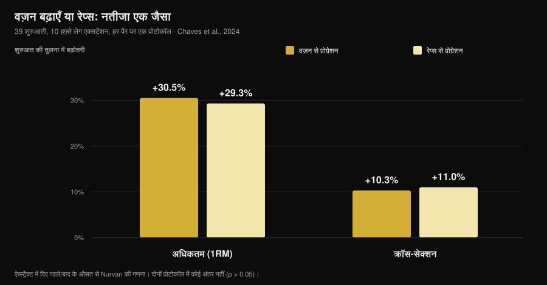
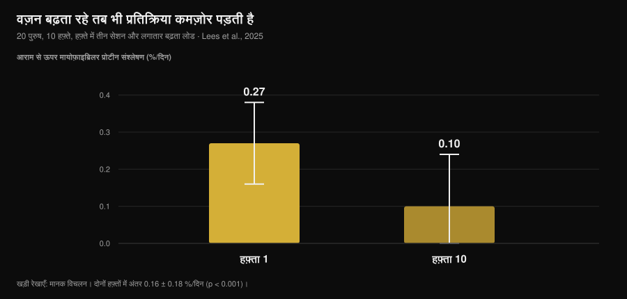

# प्रोग्रेसिव ओवरलोड: वज़न बढ़ाना ज़रूरी है?

लेखक: [Giammaria Loi](/autore/giammaria-loi) · 17 नवंबर 2026 को अपडेट

"बार भारी नहीं होगा तो मसल नहीं बढ़ेगी।" जिम में सबसे ज़्यादा दोहराया जाने वाला यही नियम है, और इसकी शुरुआत एक सही सिद्धांत से होती है: अनुकूलन जारी रखने के लिए शरीर पर पड़ने वाली माँग बढ़नी चाहिए। गड़बड़ी *भारी* शब्द में है। तीन नियंत्रित अध्ययनों ने दोनों रास्तों की सीधी तुलना की — ज़्यादा वज़न या ज़्यादा रेप्स — और नतीजा आपका प्लान लिखने का तरीक़ा बदल देता है।

## संक्षेप में

- **रेप्स बढ़ाना वज़न बढ़ाने जितना ही काम करता है।** शुरुआती लोगों में 10 हफ़्तों में अधिकतम ताक़त वज़न बढ़ाकर 30.5% और रेप्स बढ़ाकर 29.3% बढ़ी; मांसपेशी का क्रॉस-सेक्शन 10.3% और 11.0%।
- **ट्रेंड लोगों में भी यही बात है।** 8 हफ़्तों बाद दोनों समूहों का अंतर रेक्टस फ़ेमोरिस में 2.8 मिमी (रेप्स के पक्ष में) और स्क्वाट मैक्स में 2.0 किग्रा (वज़न के पक्ष में) था: दोनों विश्वास अंतराल शून्य को पार करते हैं।
- **बाहरी वज़न हाइपरट्रॉफी तय नहीं करता।** मेहनत बराबर होने पर मैक्स के 70-80% पर 8-12 रेप्स और 30-40% पर 20-25 रेप्स ने एक ही व्यक्ति में बराबर ग्रोथ दी।
- **प्रोग्रेसिव ओवरलोड प्रगति को रैखिक नहीं बनाता।** उसी अध्ययन में आराम से ऊपर प्रोटीन संश्लेषण पहले से दसवें हफ़्ते के बीच 0.27 से घटकर 0.10 %/दिन रह गया, जबकि वज़न बढ़ता रहा।
- **बढ़नी चाहिए माँग, बार पर लिखा नंबर नहीं।** रेप्स, सेट, फ़ेलियर से दूरी और मूवमेंट क्वालिटी — सभी वैध लीवर हैं; अधिकतम ताक़त के लिए वज़न सबसे विशिष्ट लीवर बना रहता है।

*Chaves et al., 2024 के आँकड़ों पर Nurvan का चार्ट (39 शुरुआती, विदिन-सब्जेक्ट डिज़ाइन: हर पैर को बेतरतीब ढंग से वज़न या रेप्स प्रोग्रेशन दिया गया)। मान ऐब्स्ट्रैक्ट के पहले/बाद के औसत से निकाले गए: अधिकतम 52.90 → 69.05 किग्रा और 51.67 → 66.82 किग्रा; वास्टस लेटरालिस का क्रॉस-सेक्शन 21.34 → 23.53 वर्ग सेमी और 21.08 → 23.39 वर्ग सेमी। कोई भी मान ग्राफ़ से नहीं पढ़ा गया।*

## यह सिद्धांत असल में माँगता क्या है

प्रोग्रेसिव ओवरलोड सिर्फ़ एक बात कहता है: अनुकूलन जारी रहे, इसके लिए मांसपेशी पर पड़ने वाली माँग समय के साथ बढ़नी चाहिए। वह यह नहीं कहता कि *कैसे*। लीवर कम से कम पाँच हैं: वज़न, प्रति सेट रेप्स, सेट की संख्या, फ़ेलियर से दूरी, और मूवमेंट की रेंज या नियंत्रण।

व्यवहार में पहला लीवर बाक़ी सबको निगल गया, वजह मामूली है: बार पर सिर्फ़ वज़न पढ़ा जा सकता है। प्लान में 4×8 लिखा है और पिछले हफ़्ते 60 किग्रा था, तो आज 62.5 किग्रा प्रगति जैसा दिखता है, जबकि 60 किग्रा पर 10 रेप्स लगता है जैसे "कुछ बदला ही नहीं"। यह हिसाब-किताब का भ्रम है: दूसरे मामले में कुल काम ज़्यादा बढ़ा।

काम का सवाल दार्शनिक नहीं है। तीन अध्ययनों ने बराबर सेट और बराबर फ़्रीक्वेंसी पर दोनों रास्तों को आमने-सामने रखा और ताक़त तथा मांसपेशी दोनों नापीं।

## वे तीन अध्ययन जिन्होंने दोनों रास्तों की तुलना की

| अध्ययन | कौन | अवधि | तुलना | नतीजा |
|---|---|---|---|---|
| Plotkin et al., 2022 | कम से कम 1 साल के अनुभव वाले 43 लोग | 8 हफ़्ते | वज़न ↑ बनाम रेप्स ↑ | अंतर नगण्य, अंतराल शून्य को शामिल करते हैं |
| Chaves et al., 2024 | 39 शुरुआती, हर पैर पर एक प्रोटोकॉल | 10 हफ़्ते | वज़न ↑ बनाम रेप्स ↑ | ताक़त और मांसपेशी के आकार में कोई अंतर नहीं |
| Lees et al., 2025 | 20 युवा पुरुष, हर अंग पर एक लोड | 10 हफ़्ते | बराबर मेहनत पर भारी बनाम हल्का लोड | हाइपरट्रॉफी लोड से स्वतंत्र |

*स्रोतों में दिए तीन अध्ययनों से बनी Nurvan की तालिका।*

### ट्रेंड लोग: अंतर अनिश्चितता से भी छोटा है

Plotkin और साथियों के अध्ययन में कम से कम एक साल से निचले शरीर की ट्रेनिंग कर रहे 43 लोगों ने 8 हफ़्तों तक, हफ़्ते में दो बार, 4 एक्सरसाइज़ में 4-4 सेट किए। एक समूह रेप्स स्थिर रखकर वज़न बढ़ाता था, दूसरा वज़न स्थिर रखकर रेप्स।

शुरुआती मान और लिंग के हिसाब से समायोजित **समूहों के बीच** अंतर रेक्टस फ़ेमोरिस के सभी बिंदुओं के योग में 2.8 मिमी था, रेप्स के पक्ष में (95% विश्वास अंतराल -0.5 से 5.8), और स्मिथ मशीन स्क्वाट मैक्स में 2.0 किग्रा, वज़न के पक्ष में (-2.4 से 7.8)। दोनों अंतराल शून्य को समेटे हैं: इन आँकड़ों से यह नहीं कहा जा सकता कि कोई एक तरीक़ा जीता। बाक़ी सब में अंतर और भी छोटे थे: मांसपेशी की मोटाई एक मिमी से कम, एंड्योरेंस 1% से कम, वर्टिकल जंप 0.1 सेमी।

### शुरुआती: एक ही व्यक्ति, दो पैर, दो प्रोटोकॉल

Chaves और साथियों ने साफ़-सुथरा डिज़ाइन चुना: 39 शुरुआती, हर पैर बेतरतीब ढंग से वज़न या रेप्स प्रोग्रेशन पर, 10 हफ़्ते लेग एक्सटेंशन। इस तरह हर प्रतिभागी अपना ही नियंत्रण बनता है और अलग-अलग प्रतिक्रिया देने वाले लोगों की तुलना की समस्या ख़त्म हो जाती है।

अधिकतम ताक़त वज़न प्रोग्रेशन से 52.90 से 69.05 किग्रा और रेप्स प्रोग्रेशन से 51.67 से 66.82 किग्रा पहुँची; वास्टस लेटरालिस का क्रॉस-सेक्शन 21.34 से 23.53 वर्ग सेमी और 21.08 से 23.39 वर्ग सेमी। दोनों प्रोटोकॉल में कोई सांख्यिकीय अंतर नहीं।

### ग्रोथ वज़न से नहीं, मेहनत से तय होती है

सबसे नया हिस्सा *Journal of Physiology* से आता है: 20 युवा पुरुष, 10 हफ़्ते, एकतरफ़ा कर्ल और नी एक्सटेंशन — एक अंग पर भारी लोड (8-12 रेप्स, मैक्स का 70-80%) और दूसरे पर हल्का (20-25 रेप्स, 30-40%), हर सेट स्वैच्छिक थकान तक।

लोड का हाइपरट्रॉफी पर असर नहीं पड़ा, और वह **एक ही व्यक्ति के भीतर** एक जैसी रही: जिसकी बाँह अच्छी बढ़ी उसकी टाँग भी अच्छी बढ़ी, वज़न चाहे जो हो। जो भिन्नता मायने रखती है वह लोगों के बीच है, लोड के बीच नहीं। एक और बात, जो अपने आँकड़े किसी और से मिलाते समय काम आती है: उसी अध्ययन में आकार की बढ़त और ताक़त की बढ़त के बीच साझा विचरण नगण्य निकला। बढ़ना और ताक़तवर होना एक ही माप नहीं हैं।

## फिर भी प्रगति धीमी क्यों पड़ती है

अब वह हिस्सा जिसका वादा सिद्धांत ने कभी नहीं किया। *Journal of Physiology* के अध्ययन में भारी जल (ड्यूटेरेटेड वॉटर) से पहले और दसवें हफ़्ते में मायोफ़ाइब्रिलर प्रोटीन संश्लेषण नापा गया — यानी मांसपेशी कितनी तेज़ी से संकुचनशील प्रोटीन बनाती है।

*Lees et al., 2025 के आँकड़ों पर Nurvan का चार्ट (20 पुरुष, 10 हफ़्ते, हफ़्ते में तीन सेशन)। ऐब्स्ट्रैक्ट में मान आराम से ऊपर की बढ़त के रूप में दिए गए हैं: हफ़्ता 1 में 0.27 ± 0.11 %/दिन (p < 0.0001) और हफ़्ता 10 में 0.10 ± 0.14 %/दिन (p = 0.009); दोनों का अंतर 0.16 ± 0.18 %/दिन (p < 0.001)। कोई मान ग्राफ़ से नहीं पढ़ा गया।*

आराम के स्तर से ऊपर संश्लेषण शुरुआत में 0.27 %/दिन और दसवें हफ़्ते में 0.10 %/दिन था: **जब प्रोग्राम लगातार लोड बढ़ा रहा था, तभी** प्रतिक्रिया क़रीब दो-तिहाई कमज़ोर पड़ गई। यह प्लानिंग की ग़लती नहीं, अनुकूलन का स्वभाव है: वही उत्तेजना बार-बार मिलने पर कम क़ीमती होती जाती है। वज़न बढ़ाने से यह वक्र ख़त्म नहीं होता, और महीनों तक रैखिक प्रगति की उम्मीद रखना अपनी ट्रेनिंग को ग़लत पैमाने से नापना है। प्लान कितने समय बाद बदलें, इस पर [वर्कआउट प्लान कितने समय में बदलें](/hi/blog/workout-plan-kitne-samay-mein-badlein)।

## रिसर्च असल में क्या कहती है

| आम दावा | नतीजा | स्रोत |
|---|---|---|
| "वज़न नहीं बढ़ा तो मसल नहीं बढ़ेगी" | **ग़लत** | Plotkin et al., 2022; Chaves et al., 2024 — स्थिर वज़न पर रेप्स बढ़ाने से उतनी ही मसल ग्रोथ मिली |
| "बाहरी वज़न जितना ज़्यादा, हाइपरट्रॉफी उतनी ज़्यादा" | **ग़लत** | Lees et al., 2025 — बराबर मेहनत पर मैक्स के 70-80% और 30-40% ने एक ही व्यक्ति में बराबर ग्रोथ दी |
| "हर लक्ष्य के लिए वज़न और रेप्स आपस में बदले जा सकते हैं" | **थोड़ा सुधार चाहिए** | Plotkin et al., 2022 — अधिकतम ताक़त में अनुमान वज़न के पक्ष में है (+2.0 किग्रा), पर अंतराल शून्य को पार करता है; विशिष्टता का सिद्धांत बना रहता है |
| "प्रोग्रेसिव ओवरलोड से प्रगति रैखिक बनी रहती है" | **ग़लत** | Lees et al., 2025 — आराम से ऊपर प्रोटीन संश्लेषण हफ़्ता 1 से 10 के बीच 0.27 से 0.10 %/दिन |
| "प्रगति के लिए फ़ेलियर तक जाना ज़रूरी है" | **थोड़ा सुधार चाहिए** | Robinson et al., 2024 — फ़ेलियर के पास हाइपरट्रॉफी बेहतर होती है, ताक़त नहीं; Ruple et al., 2023 — वॉल्यूम बराबर होने पर 0-1 और 4-6 RIR ने 5 हफ़्तों में एक जैसे नतीजे दिए |
| "प्रोग्रेशन लिखकर अक्षरशः निभाना चाहिए" | **थोड़ा सुधार चाहिए** | Larsen et al., 2021 — 14 अध्ययनों और 356 प्रतिभागियों में हर स्व-नियमित प्रोटोकॉल ने अधिकतम ताक़त बढ़ाई |

## इसे कैसे लागू करें

1. **एक लीवर चुनें, बाक़ी स्थिर रखें।** हर एक्सरसाइज़ में तय करें कि इस ब्लॉक में वज़न बढ़ेगा या रेप्स। सब कुछ एक साथ बदलने पर पता ही नहीं चलेगा कि काम किसने किया।
2. **डबल प्रोग्रेशन अपनाएँ।** एक रेंज तय करें (जैसे 8-12 रेप्स): हर सेट में ऊपरी सीमा तक रेप्स बढ़ाएँ, फिर वज़न बढ़ाकर निचली सीमा पर लौटें। बिना चुने दोनों रास्ते पाने का यह सबसे सरल तरीक़ा है।
3. **अधिकतम ताक़त के लिए वज़न को प्राथमिकता दें।** अगर आप प्रतियोगिता करते हैं या मैक्स बढ़ाना चाहते हैं तो विशिष्टता मायने रखती है: भारी सेट सचमुच भारी होने चाहिए। बाक़ी सेशन में रेप्स काफ़ी हैं।
4. **हाइपरट्रॉफी के लिए मुद्रा मेहनत है।** जब सेट फ़ेलियर के पास ख़त्म होते हैं तो ग्रोथ बेहतर होती है, और यह किसी भी वज़न पर संभव है। उस मेहनत के आसपास कितने रेप्स और कितना आराम रखें, इस पर [मसल के लिए कितने रेप्स](/hi/blog/kitne-reps-muscle-ke-liye)।
5. **वज़न, रेप्स और मेहनत साथ-साथ लिखें।** सिर्फ़ वज़न वाली लाइन यह नहीं बताती कि माँग बढ़ी या नहीं। तीन नंबर बताते हैं। हम मेहनत का अंदाज़ा कितना सही लगाते हैं, इस पर [आपका RIR कितना सही होता है](/hi/blog/rir-kitna-sahi-hota-hai)।
6. **तीन हफ़्ते वज़न न बढ़े तो ज़ोर न डालें।** रेप्स बढ़ाएँ, एक सेट जोड़ें, या एक हफ़्ते वॉल्यूम घटाकर दोबारा कोशिश करें। आँकड़े कहते हैं कि दूसरा रास्ता भी वहीं पहुँचाता है; तीसरा तब काम आता है जब कमी रिकवरी की हो, उत्तेजना की नहीं।

### अगर आप ऑनलाइन क्लाइंट ट्रेन करते हैं

वज़न वाली प्रोग्रेशन लिखना सबसे आसान है और क्लाइंट के हाथों ग़लत होना भी सबसे आसान। दो आदतें जो आपको मिलने वाली जानकारी की गुणवत्ता बदल देती हैं:

- **रेंज दें, वज़न नहीं।** "8-12 रेप्स; हर सेट में 12 पूरे होने पर वज़न बढ़ाएँ" — यह नियम क्लाइंट ख़राब नींद वाले हफ़्ते में भी ख़ुद लागू कर सकता है। तय वज़न पहली ही अड़चन पर टूट जाता है।
- **प्रोग्रेशन को कुल काम की तरह पढ़ें, मैक्स की तरह नहीं।** 60×8 से 60×11 पर पहुँचा क्लाइंट उससे ज़्यादा सुधरा है जो 60×8 से 62.5×8 पर पहुँचा। सिर्फ़ वज़न वाला कॉलम देखेंगे तो पहला रुका हुआ लगेगा।

> **Nurvan: देखिए कि माँग सचमुच बढ़ी या नहीं**
>
> Nurvan में हर सेट के साथ वज़न, रेप्स और RIR दर्ज होते हैं, और एक्सरसाइज़ का इतिहास सेशनों को एक क़तार में रखता है: दो सेकंड में दिख जाता है कि आप वज़न में बढ़ रहे हैं, रेप्स में, या कहीं नहीं। अगला लीवर इसी आँकड़े से चुना जाता है — अपने लिए या उस कोच के लिए जो आपका प्लान बनाता है। [Nurvan आज़माएँ](https://nurvan.app)

## अक्सर पूछे जाने वाले सवाल

**क्या हर हफ़्ते वज़न बढ़ाना ज़रूरी है?**
नहीं, और किसी अध्ययन ने इसे ज़रूरी नहीं दिखाया। दोनों रास्तों की सीधी तुलना करने वाले तीनों अध्ययनों में स्थिर वज़न पर रेप्स बढ़ाने से उतनी ही मसल ग्रोथ और लगभग बराबर ताक़त मिली (10 हफ़्तों में अधिकतम ताक़त में 30.5% बनाम 29.3%)। समय के साथ बढ़नी चाहिए कुल माँग।

**वज़न बढ़ाना बेहतर है या रेप्स?**
लक्ष्य पर निर्भर है। हाइपरट्रॉफी के लिए उपलब्ध आँकड़ों में दोनों लीवर बराबर हैं। अधिकतम ताक़त के लिए अनुमान थोड़ा वज़न के पक्ष में है (समूहों के बीच 2.0 किग्रा का अंतर, अंतराल -2.4 से 7.8), और विशिष्टता कहती है कि अगर मैक्स बढ़ाना है तो भारी सेट भारी ही रखें। डबल प्रोग्रेशन दोनों का उपयोग करती है।

**डबल प्रोग्रेशन क्या है?**
यह वह नियम है जिसमें पहले रेप्स बढ़ते हैं और फिर वज़न। एक रेंज चुनें, जैसे 8-12: उसी वज़न पर तब तक रहें जब तक सभी निर्धारित सेटों में 12 रेप्स पूरे न हो जाएँ, फिर उपलब्ध सबसे छोटी बढ़त जोड़कर 8 से दोबारा शुरू करें। इसमें मैक्स पर कोई गणित नहीं करनी पड़ती और ख़राब दिन भी सँभल जाते हैं।

**वज़न बढ़ाने के बावजूद प्रगति क्यों रुक गई?**
क्योंकि अनुकूलन अपने आप धीमा पड़ता है: भारी जल वाले अध्ययन में आराम से ऊपर प्रोटीन संश्लेषण दस हफ़्तों में 0.27 से 0.10 %/दिन रह गया, जबकि वज़न बढ़ रहा था। जब वज़न अटक जाए तो दिक़्क़त आमतौर पर रिकवरी या कुल वॉल्यूम में होती है, वज़न में नहीं। अगर ठहराव हफ़्तों चले और शारीरिक लक्षण भी हों तो ज़ोर लगाते रहने के बजाय डॉक्टर से बात करना बेहतर है।

## यह भी पढ़ें

- [मसल के लिए कितने रेप्स: 8-12 का मिथक](/hi/blog/kitne-reps-muscle-ke-liye) — जिस मेहनत को बढ़ाना है उसे कहाँ रखें।
- [आपका RIR कितना सही होता है? अध्ययन क्या कहते हैं](/hi/blog/rir-kitna-sahi-hota-hai) — मेहनत वाला लीवर तभी काम का है जब उसे नापना आता हो।
- [वर्कआउट प्लान कितने समय में बदलें?](/hi/blog/workout-plan-kitne-samay-mein-badlein) — किसी प्लान को परखने से पहले कितना चलाना चाहिए।

## स्रोत

1. Plotkin D, Coleman M, Van Every D, Maldonado J, Oberlin D, Israetel M, Feather J, Alto A, Vigotsky AD, Schoenfeld BJ, 2022. Progressive overload without progressing load? The effects of load or repetition progression on muscular adaptations. *PeerJ* 10:e14142. [PMID 36199287](https://pubmed.ncbi.nlm.nih.gov/36199287/) · [DOI 10.7717/peerj.14142](https://doi.org/10.7717/peerj.14142)
2. Chaves TS, Scarpelli MC, Bergamasco JGA, et al., 2024. Effects of Resistance Training Overload Progression Protocols on Strength and Muscle Mass. *Int J Sports Med* 45(7):504-510. [PMID 38286426](https://pubmed.ncbi.nlm.nih.gov/38286426/) · [DOI 10.1055/a-2256-5857](https://doi.org/10.1055/a-2256-5857)
3. Lees MJ, Mcleod JC, Morton RW, et al., 2025. Resistance training load does not determine resistance training-induced hypertrophy across upper and lower limbs in healthy young males. *J Physiol*. [PMID 41474371](https://pubmed.ncbi.nlm.nih.gov/41474371/) · [DOI 10.1113/JP289684](https://doi.org/10.1113/JP289684)
4. Robinson ZP, Pelland JC, Remmert JF, Refalo MC, Jukic I, Steele J, Zourdos MC, 2024. Exploring the Dose-Response Relationship Between Estimated Resistance Training Proximity to Failure, Strength Gain, and Muscle Hypertrophy: A Series of Meta-Regressions. *Sports Med* 54(9):2209-2231. [PMID 38970765](https://pubmed.ncbi.nlm.nih.gov/38970765/) · [DOI 10.1007/s40279-024-02069-2](https://doi.org/10.1007/s40279-024-02069-2)
5. Ruple BA, Plotkin DL, Smith MA, et al., 2023. The effects of resistance training to near failure on strength, hypertrophy, and motor unit adaptations in previously trained adults. *Physiol Rep* 11(9):e15679. [PMID 37144554](https://pubmed.ncbi.nlm.nih.gov/37144554/) · [DOI 10.14814/phy2.15679](https://doi.org/10.14814/phy2.15679)
6. Larsen S, Kristiansen E, van den Tillaar R, 2021. Effects of subjective and objective autoregulation methods for intensity and volume on enhancing maximal strength during resistance-training interventions: a systematic review. *PeerJ* 9:e10663. [PMID 33520457](https://pubmed.ncbi.nlm.nih.gov/33520457/) · [DOI 10.7717/peerj.10663](https://doi.org/10.7717/peerj.10663)

विषय नवंबर 2026 के ट्रेंड संकेतों से चुना गया, जहाँ प्रतिस्पर्धी सामग्री हर हफ़्ते वज़न बढ़ाने को ही प्रोग्रेसिव ओवरलोड का एकमात्र रूप बताती है। वैज्ञानिक स्रोत PubMed से लिए गए।

**Giammaria Loi** Nurvan के संस्थापक हैं। वे 2012 से वेट ट्रेनिंग कर रहे हैं, 2013 से FIPE प्रमाणित पर्सनल ट्रेनर और कोच के रूप में काम करते हैं और 2018 से राष्ट्रीय स्तर पर पावरलिफ़्टिंग में भाग लेते हैं। उनके हर लेख की शुरुआत वैज्ञानिक अध्ययनों से होती है और अंत उस बात पर, जो जिम में सचमुच काम करती है। [लेखक पृष्ठ](/autore/giammaria-loi)

> नोट: यह जानकारी शिक्षा के लिए है, यह डॉक्टर या योग्य पेशेवर की सलाह का विकल्प नहीं है।
