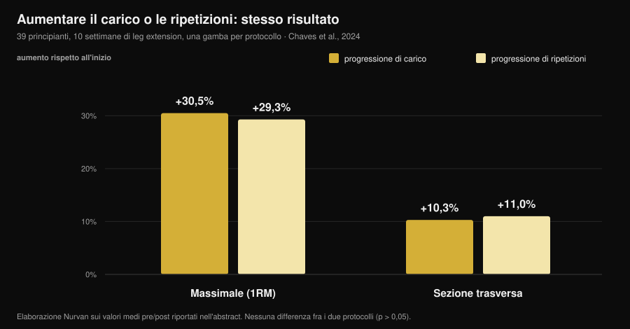
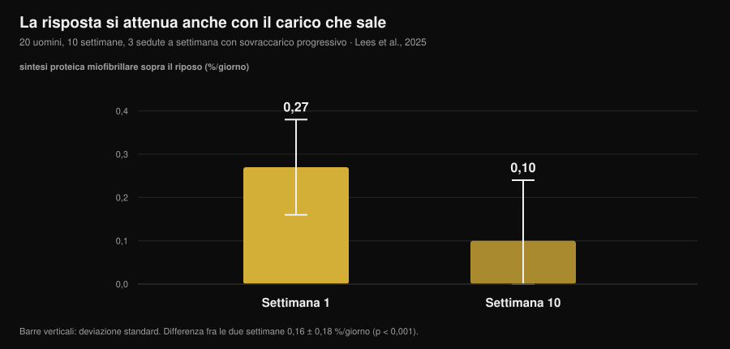

# Sovraccarico progressivo: devi aumentare il carico?

Di [Giammaria Loi](/autore/giammaria-loi) · aggiornato il 17 novembre 2026

"Se non aggiungi peso, non crescerai." È la regola più ripetuta in palestra, e nasce da un principio corretto: per adattarsi, il corpo ha bisogno di una richiesta che aumenta. Il salto logico è tutto nella parola *peso*. Tre studi controllati hanno confrontato direttamente le due strade — più carico o più ripetizioni — e il risultato cambia il modo in cui conviene scrivere una scheda.

## In breve

- **Aggiungere ripetizioni funziona come aggiungere peso.** In 10 settimane su principianti il massimale è salito del 30,5% progredendo di carico e del 29,3% progredendo di ripetizioni; la sezione del muscolo del 10,3% e dell'11,0%.
- **Lo stesso vale su chi è già allenato.** Dopo 8 settimane le differenze fra i due gruppi erano di 2,8 mm sul retto femorale (a favore delle ripetizioni) e 2,0 kg sul massimale (a favore del carico): entrambi gli intervalli di confidenza attraversano lo zero.
- **Il carico esterno non decide l'ipertrofia.** Con lo sforzo pari, 8-12 ripetizioni al 70-80% del massimale e 20-25 al 30-40% hanno prodotto la stessa crescita sullo stesso soggetto.
- **Il sovraccarico progressivo non rende i progressi lineari.** Nello stesso studio la sintesi proteica è passata da 0,27 a 0,10 %/giorno sopra il riposo fra la prima e la decima settimana, mentre i carichi salivano.
- **Quello che deve crescere è la richiesta, non il numero sul bilanciere.** Ripetizioni, serie, prossimità al cedimento e qualità tecnica sono tutte leve legittime, e per la forza massimale il carico resta la più specifica.

*Grafico Nurvan sui dati di Chaves et al., 2024 (39 principianti, disegno entro-soggetto: le due gambe assegnate a caso a progressione di carico o di ripetizioni). Valori calcolati dalle medie pre/post riportate nell'abstract: massimale 52,90 → 69,05 kg e 51,67 → 66,82 kg; sezione trasversa del vasto laterale 21,34 → 23,53 cm² e 21,08 → 23,39 cm². Nessun valore letto da una figura.*

## Che cosa chiede davvero il principio

Il sovraccarico progressivo dice una cosa sola: perché l'adattamento continui, la richiesta che fai al muscolo deve aumentare nel tempo. Non specifica *come*. Le leve a disposizione sono almeno cinque: il carico, le ripetizioni per serie, il numero di serie, la vicinanza al cedimento e l'ampiezza o il controllo del movimento.

Nella pratica la prima si è mangiata le altre, per un motivo banale: il carico è l'unica leva che si legge sul bilanciere. Se la scheda dice 4×8 e la settimana scorsa facevi 60 kg, oggi 62,5 kg è un progresso visibile; 60 kg per 10 ripetizioni sembra "non aver cambiato niente". È un'illusione contabile: nel secondo caso il lavoro è salito di più.

La domanda interessante non è filosofica. Tre studi hanno messo le due strade una contro l'altra, con lo stesso numero di serie e la stessa frequenza, e misurato forza e muscolo.

## I tre studi che hanno confrontato le due strade

| Studio | Chi | Durata | Confronto | Risultato |
|---|---|---|---|---|
| Plotkin et al., 2022 | 43 persone con almeno 1 anno di allenamento | 8 settimane | carico ↑ vs ripetizioni ↑ | differenze trascurabili, intervalli che includono lo zero |
| Chaves et al., 2024 | 39 principianti, una gamba per protocollo | 10 settimane | carico ↑ vs ripetizioni ↑ | nessuna differenza su forza e sezione del muscolo |
| Lees et al., 2025 | 20 uomini giovani, un arto per carico | 10 settimane | carico alto vs carico basso a sforzo pari | ipertrofia indipendente dal carico |

*Tabella Nurvan sui dati dei tre studi citati in fondo all'articolo.*

### Chi è già allenato: le differenze sono più piccole dell'incertezza

Nel lavoro di Plotkin e colleghi 43 persone con almeno un anno di allenamento sulla parte bassa del corpo hanno fatto 4 serie di 4 esercizi, due volte a settimana, per 8 settimane. Un gruppo aumentava il carico tenendo le ripetizioni costanti; l'altro aumentava le ripetizioni tenendo il carico costante.

Le differenze **fra i due gruppi**, aggiustate per i valori di partenza e per il sesso, sono state di 2,8 mm sulla somma dei siti del retto femorale a favore delle ripetizioni (intervallo di confidenza al 95% da -0,5 a 5,8) e di 2,0 kg sul massimale allo squat alla Smith machine a favore del carico (da -2,4 a 7,8). Entrambi gli intervalli contengono lo zero: con questi numeri non si può dire che un metodo abbia battuto l'altro. Su tutto il resto le differenze erano ancora più piccole: spessori muscolari sotto il millimetro, resistenza sotto l'1%, salto verticale 0,1 cm.

### Chi parte da zero: la stessa persona, due gambe, due protocolli

Chaves e colleghi hanno usato un disegno più pulito: 39 principianti, le due gambe assegnate a caso a progressione di carico o di ripetizioni, 10 settimane di leg extension. Così ogni partecipante fa da controllo a sé stesso, e sparisce il problema di confrontare persone che rispondono in modo diverso.

Risultato: massimale da 52,90 a 69,05 kg con la progressione di carico e da 51,67 a 66,82 kg con quella di ripetizioni; sezione trasversa del vasto laterale da 21,34 a 23,53 cm² e da 21,08 a 23,39 cm². Nessuna differenza statistica fra i due protocolli.

### Il carico non decide la crescita, lo sforzo sì

Il tassello più recente arriva dal *Journal of Physiology*: 20 uomini giovani, 10 settimane, curl e leg extension monolaterali con un arto a carico alto (8-12 ripetizioni, 70-80% del massimale) e l'arto opposto a carico basso (20-25 ripetizioni, 30-40%), tutte le serie portate fino all'affaticamento volontario.

L'ipertrofia non è stata influenzata dal carico, e soprattutto si è conservata **dentro** l'individuo: chi cresceva bene sul braccio cresceva bene anche sulla gamba, indipendentemente dal peso usato. La variabilità che conta è fra persone diverse, non fra carichi diversi. Un dettaglio che vale per chiunque confronti i propri numeri con quelli di qualcun altro: nello stesso studio la varianza condivisa fra aumento di dimensione e aumento di forza è risultata trascurabile. Crescere e diventare forte non sono la stessa misura.

## Perché i progressi rallentano comunque

Qui arriva la parte che il principio non promette e che spesso viene raccontata male. Nello studio sul *Journal of Physiology* i ricercatori hanno misurato la sintesi proteica miofibrillare — la velocità con cui il muscolo costruisce proteine contrattili — nella prima e nella decima settimana, con acqua deuterata.

*Grafico Nurvan sui dati di Lees et al., 2025 (20 uomini, 10 settimane, 3 sedute a settimana). Valori riportati nell'abstract come incremento rispetto al riposo: 0,27 ± 0,11 %/giorno alla settimana 1 (p < 0,0001) e 0,10 ± 0,14 %/giorno alla settimana 10 (p = 0,009); differenza fra le due 0,16 ± 0,18 %/giorno (p < 0,001). Nessun valore letto da una figura.*

Sopra il livello di riposo la sintesi era di 0,27 %/giorno all'inizio e di 0,10 %/giorno alla decima settimana: la risposta si è attenuata di circa due terzi **mentre il programma applicava sovraccarico progressivo**. Non è un errore di programmazione, è come funziona l'adattamento: lo stesso stimolo, ripetuto, vale sempre meno. Aggiungere carico non annulla questa curva, e aspettarsi progressi lineari per mesi significa misurare il proprio allenamento con un metro sbagliato. Sul ritmo con cui conviene rivedere il programma ne abbiamo parlato in [ogni quanto cambiare la scheda](/blog/ogni-quanto-cambiare-scheda-allenamento).

## Cosa dice davvero la ricerca

| Affermazione diffusa | Verdetto | Fonte |
|---|---|---|
| "Se non aumenti il carico non cresci" | **Smentito** | Plotkin et al., 2022; Chaves et al., 2024 — progredire di ripetizioni a carico costante ha dato la stessa crescita muscolare |
| "Più carico esterno significa più ipertrofia" | **Smentito** | Lees et al., 2025 — a sforzo pari, 70-80% e 30-40% del massimale hanno prodotto la stessa ipertrofia nello stesso soggetto |
| "Carico e ripetizioni sono interscambiabili per qualsiasi obiettivo" | **Da precisare** | Plotkin et al., 2022 — sul massimale la stima favorisce il carico (+2,0 kg), ma l'intervallo attraversa lo zero; il principio di specificità resta |
| "Con il sovraccarico progressivo i progressi restano lineari" | **Smentito** | Lees et al., 2025 — sintesi proteica da 0,27 a 0,10 %/giorno sopra il riposo fra settimana 1 e settimana 10 |
| "Per progredire serve arrivare a cedimento" | **Da precisare** | Robinson et al., 2024 — l'ipertrofia migliora avvicinandosi al cedimento, la forza no; Ruple et al., 2023 — a volume pari, 0-1 e 4-6 RIR hanno dato gli stessi risultati in 5 settimane |
| "La progressione va scritta e seguita alla lettera" | **Da precisare** | Larsen et al., 2021 — in 14 studi e 356 partecipanti tutti i protocolli autoregolati hanno aumentato il massimale |

## Come applicarlo

1. **Scegli la leva, poi tienila ferma.** Su un esercizio decidi se in questo blocco sali di carico o di ripetizioni. Muovere tutto insieme rende impossibile capire cosa ha funzionato.
2. **Usa la doppia progressione.** Fissa una fascia (per esempio 8-12 ripetizioni): aggiungi ripetizioni fino al limite superiore in tutte le serie, poi aumenta il carico e torna al limite inferiore. È il modo più semplice per avere entrambe le strade senza scegliere.
3. **Per la forza massimale, privilegia il carico.** Se gareggi o vuoi alzare un massimale, la specificità conta: le serie pesanti vanno fatte pesanti. Sul resto della seduta le ripetizioni bastano.
4. **Per l'ipertrofia, conta lo sforzo.** La crescita migliora quando le serie finiscono vicino al cedimento, e questo è ottenibile a qualsiasi carico. Su quante ripetizioni e quanto recupero mettere intorno a quello sforzo, [quante ripetizioni per la massa](/blog/ripetizioni-serie-recupero-ipertrofia).
5. **Registra carico, ripetizioni e sforzo insieme.** Una riga con solo il peso non dice se la richiesta è aumentata. Tre numeri sì. Sul quanto siamo precisi a stimare lo sforzo, [quanto è preciso il tuo RIR](/blog/quanto-e-preciso-il-rir).
6. **Quando il carico non sale per tre settimane, non forzarlo.** Aumenta le ripetizioni, aggiungi una serie, o riduci il volume per una settimana e riprova. I dati dicono che la seconda strada porta allo stesso posto; la terza serve quando è la fatica, non lo stimolo, a mancare.

### Se alleni altre persone a distanza

La progressione di carico è la più facile da prescrivere e la più facile da sbagliare per il cliente. Due accortezze che cambiano la qualità del lavoro:

- **Prescrivi la fascia, non il peso.** "8-12 ripetizioni, sali di carico quando arrivi a 12 su tutte le serie" è una regola che il cliente può applicare da solo anche nelle settimane in cui dorme male. Un peso fisso è una regola che si rompe al primo imprevisto.
- **Leggi la progressione sul lavoro totale, non sul massimale.** Un cliente che passa da 60×8 a 60×11 è migliorato più di uno che passa da 60×8 a 62,5×8. Se guardi solo la colonna del carico, il primo ti sembra fermo.

> **Nurvan: vedi se la richiesta è davvero aumentata**
>
> In Nurvan ogni serie porta con sé carico, ripetizioni e RIR, e lo storico dell'esercizio mette in fila le sedute: così capisci in due secondi se stai progredendo di peso, di ripetizioni o per niente. È il dato su cui decidere la leva da muovere, per te o per il coach che ti segue. [Prova Nurvan](https://nurvan.app)

## Domande frequenti

**Devo aumentare il carico ogni settimana?**
No, e nessuno studio lo ha mai dimostrato necessario. Nei tre lavori che hanno confrontato le due strade, aumentare le ripetizioni a carico costante ha prodotto la stessa crescita muscolare e un aumento di forza quasi identico (30,5% contro 29,3% sul massimale in 10 settimane). Quello che deve aumentare nel tempo è la richiesta complessiva.

**Meglio aumentare il carico o le ripetizioni?**
Dipende dall'obiettivo. Per l'ipertrofia le due leve sono equivalenti nei dati disponibili. Per la forza massimale la stima favorisce leggermente il carico (+2,0 kg di differenza fra i gruppi, con intervallo da -2,4 a 7,8), e il principio di specificità suggerisce di tenere serie pesanti se vuoi alzare un massimale. La doppia progressione usa entrambe.

**Che cos'è la doppia progressione?**
È la regola che fa salire prima le ripetizioni e poi il carico. Scegli una fascia, per esempio 8-12: lavori a quel peso finché non chiudi 12 ripetizioni in tutte le serie previste, poi aumenti il carico del minimo incremento disponibile e riparti da 8. Non richiede calcoli sul massimale e si adatta ai giorni peggiori.

**Perché non progredisco più anche se aumento il carico?**
Perché l'adattamento rallenta da solo: nello studio con acqua deuterata la sintesi proteica sopra il riposo è passata da 0,27 a 0,10 %/giorno in dieci settimane con il carico che saliva. Quando il carico si blocca, in genere il problema è il recupero o il volume complessivo, non il peso in sé. Se la stasi dura settimane e si accompagna a sintomi fisici, vale la pena parlarne con un medico invece di insistere.

## Leggi anche

- [Quante ripetizioni per la massa: il mito dell'8-12](/blog/ripetizioni-serie-recupero-ipertrofia) — dove mettere lo sforzo che stai cercando di far crescere.
- [Quanto è preciso il tuo RIR? Cosa dicono gli studi](/blog/quanto-e-preciso-il-rir) — la leva dello sforzo funziona solo se sai misurarla.
- [Ogni quanto cambiare la scheda di allenamento?](/blog/ogni-quanto-cambiare-scheda-allenamento) — quanto tenere stabile un programma per capire se funziona.

## Fonti

1. Plotkin D, Coleman M, Van Every D, Maldonado J, Oberlin D, Israetel M, Feather J, Alto A, Vigotsky AD, Schoenfeld BJ, 2022. Progressive overload without progressing load? The effects of load or repetition progression on muscular adaptations. *PeerJ* 10:e14142. [PMID 36199287](https://pubmed.ncbi.nlm.nih.gov/36199287/) · [DOI 10.7717/peerj.14142](https://doi.org/10.7717/peerj.14142)
2. Chaves TS, Scarpelli MC, Bergamasco JGA, et al., 2024. Effects of Resistance Training Overload Progression Protocols on Strength and Muscle Mass. *Int J Sports Med* 45(7):504-510. [PMID 38286426](https://pubmed.ncbi.nlm.nih.gov/38286426/) · [DOI 10.1055/a-2256-5857](https://doi.org/10.1055/a-2256-5857)
3. Lees MJ, Mcleod JC, Morton RW, et al., 2025. Resistance training load does not determine resistance training-induced hypertrophy across upper and lower limbs in healthy young males. *J Physiol*. [PMID 41474371](https://pubmed.ncbi.nlm.nih.gov/41474371/) · [DOI 10.1113/JP289684](https://doi.org/10.1113/JP289684)
4. Robinson ZP, Pelland JC, Remmert JF, Refalo MC, Jukic I, Steele J, Zourdos MC, 2024. Exploring the Dose-Response Relationship Between Estimated Resistance Training Proximity to Failure, Strength Gain, and Muscle Hypertrophy: A Series of Meta-Regressions. *Sports Med* 54(9):2209-2231. [PMID 38970765](https://pubmed.ncbi.nlm.nih.gov/38970765/) · [DOI 10.1007/s40279-024-02069-2](https://doi.org/10.1007/s40279-024-02069-2)
5. Ruple BA, Plotkin DL, Smith MA, et al., 2023. The effects of resistance training to near failure on strength, hypertrophy, and motor unit adaptations in previously trained adults. *Physiol Rep* 11(9):e15679. [PMID 37144554](https://pubmed.ncbi.nlm.nih.gov/37144554/) · [DOI 10.14814/phy2.15679](https://doi.org/10.14814/phy2.15679)
6. Larsen S, Kristiansen E, van den Tillaar R, 2021. Effects of subjective and objective autoregulation methods for intensity and volume on enhancing maximal strength during resistance-training interventions: a systematic review. *PeerJ* 9:e10663. [PMID 33520457](https://pubmed.ncbi.nlm.nih.gov/33520457/) · [DOI 10.7717/peerj.10663](https://doi.org/10.7717/peerj.10663)

Tema scelto da segnali di tendenza di novembre 2026 sulla progressione del carico, con contenuti concorrenti che presentano l'aumento settimanale di peso come unica forma di sovraccarico progressivo. Fonti scientifiche consultate tramite PubMed.

**Giammaria Loi** è il fondatore di Nurvan. Si allena con i pesi dal 2012, lavora come personal trainer e coach certificato FIPE dal 2013 e gareggia nel powerlifting a livello nazionale dal 2018. Ogni articolo che firma parte dagli studi scientifici e arriva a ciò che funziona davvero in palestra. [Pagina autore](/autore/giammaria-loi)

> Nota: contenuto informativo, non sostituisce il parere di un medico o di un professionista qualificato.
