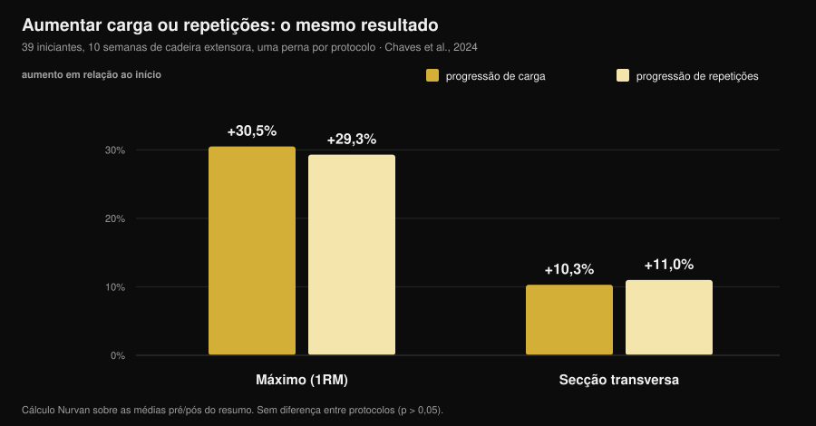
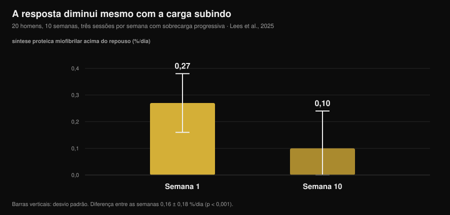

# Sobrecarga progressiva: precisa aumentar a carga?

Por [Giammaria Loi](/autore/giammaria-loi) · atualizado em 17 de novembro de 2026

"Se a barra não fica mais pesada, você não cresce." É a regra mais repetida na academia e parte de um princípio correto: para se adaptar, o corpo precisa de uma demanda que aumente. O salto está na palavra *pesada*. Três estudos controlados compararam as duas vias — mais carga ou mais repetições — e o resultado muda a forma de escrever um treino.

## Em resumo

- **Aumentar repetições funciona como aumentar peso.** Em 10 semanas com iniciantes, o máximo subiu 30,5% progredindo em carga e 29,3% progredindo em repetições; a secção do músculo, 10,3% e 11,0%.
- **O mesmo vale para quem já treina.** Depois de 8 semanas, as diferenças entre grupos foram de 2,8 mm no reto femoral (a favor das repetições) e 2,0 kg no máximo do agachamento (a favor da carga): os dois intervalos de confiança cruzam o zero.
- **A carga externa não decide a hipertrofia.** Com o esforço igualado, 8-12 repetições a 70-80% do máximo e 20-25 a 30-40% produziram o mesmo crescimento na mesma pessoa.
- **A sobrecarga progressiva não torna o progresso linear.** No mesmo estudo, a síntese proteica acima do repouso caiu de 0,27 para 0,10 %/dia entre a semana 1 e a 10 enquanto as cargas subiam.
- **O que precisa crescer é a demanda, não o número na barra.** Repetições, séries, proximidade da falha e qualidade de execução são alavancas legítimas, e para a força máxima a carga continua sendo a mais específica.

*Gráfico Nurvan com dados de Chaves et al., 2024 (39 iniciantes, desenho intrassujeito: cada perna sorteada para progressão de carga ou de repetições). Valores calculados a partir das médias pré/pós do resumo: máximo 52,90 → 69,05 kg e 51,67 → 66,82 kg; secção do vasto lateral 21,34 → 23,53 cm² e 21,08 → 23,39 cm². Nenhum valor lido de uma figura.*

## O que o princípio realmente exige

A sobrecarga progressiva diz uma coisa só: para a adaptação continuar, a demanda imposta ao músculo precisa aumentar ao longo do tempo. Ela não diz *como*. Existem pelo menos cinco alavancas: a carga, as repetições por série, o número de séries, a proximidade da falha e a amplitude ou o controle do movimento.

Na prática, a primeira engoliu as outras por um motivo banal: a carga é a única que se lê na barra. Se o treino pede 4×8 e na semana passada foram 60 kg, hoje 62,5 kg parece progresso, enquanto 60 kg por 10 repetições parece "não ter mudado nada". É uma ilusão contábil: no segundo caso o trabalho subiu mais.

A pergunta útil não é filosófica. Três estudos colocaram as duas vias frente a frente, com o mesmo número de séries e a mesma frequência, e mediram força e músculo.

## Os três estudos que compararam as duas vias

| Estudo | Quem | Duração | Comparação | Resultado |
|---|---|---|---|---|
| Plotkin et al., 2022 | 43 pessoas com pelo menos 1 ano de treino | 8 semanas | carga ↑ vs repetições ↑ | diferenças triviais, intervalos que incluem o zero |
| Chaves et al., 2024 | 39 iniciantes, uma perna por protocolo | 10 semanas | carga ↑ vs repetições ↑ | sem diferença em força nem em tamanho do músculo |
| Lees et al., 2025 | 20 homens jovens, um membro por carga | 10 semanas | carga alta vs baixa com esforço igualado | hipertrofia independente da carga |

*Tabela Nurvan construída com os três estudos listados nas fontes.*

### Quem já treina: as diferenças são menores que a incerteza

No trabalho de Plotkin e colegas, 43 pessoas com pelo menos um ano de treino de membros inferiores fizeram 4 séries de 4 exercícios, duas vezes por semana, durante 8 semanas. Um grupo aumentava a carga mantendo as repetições; o outro aumentava as repetições mantendo a carga.

As diferenças **entre grupos**, ajustadas pelos valores iniciais e pelo sexo, foram de 2,8 mm na soma dos pontos do reto femoral a favor das repetições (intervalo de confiança de 95% de -0,5 a 5,8) e de 2,0 kg no máximo do agachamento no Smith a favor da carga (de -2,4 a 7,8). Os dois intervalos contêm o zero: com esses números não dá para dizer que um método venceu. No resto, as diferenças eram ainda menores: espessuras musculares abaixo de um milímetro, resistência abaixo de 1%, salto vertical 0,1 cm.

### Iniciantes: a mesma pessoa, duas pernas, dois protocolos

Chaves e colegas usaram um desenho mais limpo: 39 iniciantes, cada perna sorteada para progressão de carga ou de repetições, 10 semanas de cadeira extensora. Assim cada participante é o próprio controle e some o problema de comparar pessoas que respondem de forma diferente.

O máximo foi de 52,90 para 69,05 kg com progressão de carga e de 51,67 para 66,82 kg com progressão de repetições; a secção do vasto lateral, de 21,34 para 23,53 cm² e de 21,08 para 23,39 cm². Sem diferença estatística entre os protocolos.

### A carga não comanda o crescimento, o esforço sim

A peça mais recente vem do *Journal of Physiology*: 20 homens jovens, 10 semanas, rosca e extensão de joelho unilaterais com um membro em carga alta (8-12 repetições, 70-80% do máximo) e o oposto em carga baixa (20-25 repetições, 30-40%), todas as séries até a fadiga voluntária.

A hipertrofia não foi influenciada pela carga e se conservou **dentro** do indivíduo: quem crescia bem no braço crescia bem na perna, com qualquer peso. A variabilidade que importa está entre pessoas, não entre cargas. Mais um detalhe útil se você compara seus números com os de outra pessoa: no mesmo estudo, a variância compartilhada entre ganho de tamanho e ganho de força foi desprezível. Crescer e ficar forte não são a mesma medida.

## Por que o progresso desacelera mesmo assim

Aqui vem a parte que o princípio nunca prometeu. No estudo do *Journal of Physiology*, a síntese proteica miofibrilar — a velocidade com que o músculo constrói proteína contrátil — foi medida com água deuterada na semana 1 e na semana 10.

*Gráfico Nurvan com dados de Lees et al., 2025 (20 homens, 10 semanas, três sessões por semana). Valores do resumo como aumento sobre o repouso: 0,27 ± 0,11 %/dia na semana 1 (p < 0,0001) e 0,10 ± 0,14 %/dia na semana 10 (p = 0,009); diferença entre as duas 0,16 ± 0,18 %/dia (p < 0,001). Nenhum valor lido de uma figura.*

Acima do nível de repouso, a síntese era de 0,27 %/dia no início e de 0,10 %/dia na semana 10: a resposta caiu cerca de dois terços **enquanto o programa aplicava sobrecarga progressiva**. Não é erro de programação, é como a adaptação funciona: o mesmo estímulo, repetido, vale cada vez menos. Aumentar a carga não anula essa curva, e esperar progresso linear por meses é medir o treino com a régua errada. Sobre o ritmo para revisar o programa, [de quanto em quanto tempo mudar o treino](/pt/blog/de-quanto-em-quanto-tempo-mudar-o-treino).

## O que a pesquisa realmente diz

| Afirmação comum | Veredito | Fonte |
|---|---|---|
| "Se o peso não sobe, você não cresce" | **Desmentido** | Plotkin et al., 2022; Chaves et al., 2024 — progredir em repetições com carga fixa deu o mesmo crescimento muscular |
| "Mais carga externa significa mais hipertrofia" | **Desmentido** | Lees et al., 2025 — com esforço igualado, 70-80% e 30-40% do máximo geraram a mesma hipertrofia na mesma pessoa |
| "Carga e repetições são intercambiáveis para qualquer objetivo" | **Precisa de nuance** | Plotkin et al., 2022 — no máximo a estimativa favorece a carga (+2,0 kg), mas o intervalo cruza o zero; a especificidade continua valendo |
| "Com sobrecarga progressiva o progresso continua linear" | **Desmentido** | Lees et al., 2025 — síntese proteica de 0,27 para 0,10 %/dia acima do repouso entre as semanas 1 e 10 |
| "Para progredir é preciso chegar à falha" | **Precisa de nuance** | Robinson et al., 2024 — a hipertrofia melhora perto da falha, a força não; Ruple et al., 2023 — com volume igualado, 0-1 e 4-6 RIR deram os mesmos resultados em 5 semanas |
| "A progressão precisa ser escrita e seguida à risca" | **Precisa de nuance** | Larsen et al., 2021 — em 14 estudos e 356 participantes todos os protocolos autorregulados aumentaram o máximo |

## Como aplicar

1. **Escolha uma alavanca e segure as outras.** Em cada exercício, decida se neste bloco sobe a carga ou as repetições. Mexer em tudo ao mesmo tempo impede saber o que funcionou.
2. **Use a progressão dupla.** Defina uma faixa (por exemplo 8-12 repetições): acrescente repetições até o topo da faixa em todas as séries, depois aumente a carga e volte ao piso. É o jeito mais simples de usar as duas vias sem escolher.
3. **Para força máxima, priorize a carga.** Se você compete ou quer subir um máximo, a especificidade conta: as séries pesadas precisam ser pesadas. No resto da sessão, as repetições bastam.
4. **Para hipertrofia, a moeda é o esforço.** O crescimento melhora quando as séries terminam perto da falha, e isso é possível com qualquer carga. Sobre quantas repetições e quanto descanso colocar em volta, [quantas repetições para a massa muscular](/pt/blog/quantas-repeticoes-massa-muscular).
5. **Registre carga, repetições e esforço juntos.** Uma linha só com o peso não diz se a demanda subiu. Três números dizem. Sobre o quanto acertamos ao estimar esse esforço, [a precisão do seu RIR](/pt/blog/rir-precisao-repeticoes-em-reserva).
6. **Se a carga não sobe por três semanas, não force.** Aumente as repetições, acrescente uma série ou reduza o volume por uma semana e tente de novo. Os dados dizem que a segunda via chega ao mesmo lugar; a terceira serve quando falta recuperação, não estímulo.

### Se você treina outras pessoas a distância

A progressão de carga é a mais fácil de prescrever e a mais fácil de o aluno aplicar errado. Dois hábitos que mudam a qualidade do que volta para você:

- **Prescreva a faixa, não o peso.** "8-12 repetições; suba a carga quando chegar a 12 em todas as séries" é uma regra que o aluno aplica sozinho até numa semana de sono ruim. Um peso fixo quebra no primeiro imprevisto.
- **Leia a progressão como trabalho total, não como máximo.** Um aluno que vai de 60×8 para 60×11 melhorou mais do que outro que vai de 60×8 para 62,5×8. Olhando só a coluna da carga, o primeiro parece parado.

> **Nurvan: veja se a demanda realmente aumentou**
>
> No Nurvan cada série carrega carga, repetições e RIR, e o histórico do exercício alinha as sessões: em dois segundos você vê se está progredindo em peso, em repetições ou em nada. É o dado com que se escolhe a próxima alavanca, para você ou para o coach que monta o seu treino. [Experimente o Nurvan](https://nurvan.app)

## Perguntas frequentes

**Preciso aumentar a carga toda semana?**
Não, e nenhum estudo mostrou que isso seja necessário. Nos três trabalhos que compararam as duas vias, aumentar repetições com a carga fixa produziu o mesmo crescimento muscular e um ganho de força quase idêntico (30,5% contra 29,3% no máximo em 10 semanas). O que precisa aumentar ao longo do tempo é a demanda total.

**É melhor aumentar carga ou repetições?**
Depende do objetivo. Para hipertrofia as duas alavancas são equivalentes nos dados disponíveis. Para força máxima a estimativa favorece levemente a carga (2,0 kg de diferença entre grupos, intervalo de -2,4 a 7,8), e a especificidade recomenda manter séries pesadas se o alvo é um máximo maior. A progressão dupla usa as duas.

**O que é progressão dupla?**
É a regra que sobe primeiro as repetições e depois a carga. Escolha uma faixa, por exemplo 8-12: fica naquele peso até completar 12 repetições em todas as séries previstas, depois aumenta o menor incremento disponível e recomeça em 8. Não exige cálculo sobre o máximo e absorve os dias ruins.

**Por que parei de progredir mesmo aumentando o peso?**
Porque a adaptação desacelera sozinha: no estudo com água deuterada, a síntese proteica acima do repouso foi de 0,27 para 0,10 %/dia em dez semanas enquanto as cargas subiam. Quando a carga trava, o problema costuma estar na recuperação ou no volume total, não no peso em si. Se a estagnação dura semanas e vem com sintomas físicos, vale conversar com um médico em vez de insistir.

## Leia também

- [Quantas repetições para a massa muscular: o mito do 8-12](/pt/blog/quantas-repeticoes-massa-muscular) — onde colocar o esforço que você quer fazer crescer.
- [Qual a precisão do seu RIR? O que dizem os estudos](/pt/blog/rir-precisao-repeticoes-em-reserva) — a alavanca do esforço só serve se você souber medi-la.
- [De quanto em quanto tempo mudar o treino?](/pt/blog/de-quanto-em-quanto-tempo-mudar-o-treino) — quanto manter um programa antes de julgá-lo.

## Fontes

1. Plotkin D, Coleman M, Van Every D, Maldonado J, Oberlin D, Israetel M, Feather J, Alto A, Vigotsky AD, Schoenfeld BJ, 2022. Progressive overload without progressing load? The effects of load or repetition progression on muscular adaptations. *PeerJ* 10:e14142. [PMID 36199287](https://pubmed.ncbi.nlm.nih.gov/36199287/) · [DOI 10.7717/peerj.14142](https://doi.org/10.7717/peerj.14142)
2. Chaves TS, Scarpelli MC, Bergamasco JGA, et al., 2024. Effects of Resistance Training Overload Progression Protocols on Strength and Muscle Mass. *Int J Sports Med* 45(7):504-510. [PMID 38286426](https://pubmed.ncbi.nlm.nih.gov/38286426/) · [DOI 10.1055/a-2256-5857](https://doi.org/10.1055/a-2256-5857)
3. Lees MJ, Mcleod JC, Morton RW, et al., 2025. Resistance training load does not determine resistance training-induced hypertrophy across upper and lower limbs in healthy young males. *J Physiol*. [PMID 41474371](https://pubmed.ncbi.nlm.nih.gov/41474371/) · [DOI 10.1113/JP289684](https://doi.org/10.1113/JP289684)
4. Robinson ZP, Pelland JC, Remmert JF, Refalo MC, Jukic I, Steele J, Zourdos MC, 2024. Exploring the Dose-Response Relationship Between Estimated Resistance Training Proximity to Failure, Strength Gain, and Muscle Hypertrophy: A Series of Meta-Regressions. *Sports Med* 54(9):2209-2231. [PMID 38970765](https://pubmed.ncbi.nlm.nih.gov/38970765/) · [DOI 10.1007/s40279-024-02069-2](https://doi.org/10.1007/s40279-024-02069-2)
5. Ruple BA, Plotkin DL, Smith MA, et al., 2023. The effects of resistance training to near failure on strength, hypertrophy, and motor unit adaptations in previously trained adults. *Physiol Rep* 11(9):e15679. [PMID 37144554](https://pubmed.ncbi.nlm.nih.gov/37144554/) · [DOI 10.14814/phy2.15679](https://doi.org/10.14814/phy2.15679)
6. Larsen S, Kristiansen E, van den Tillaar R, 2021. Effects of subjective and objective autoregulation methods for intensity and volume on enhancing maximal strength during resistance-training interventions: a systematic review. *PeerJ* 9:e10663. [PMID 33520457](https://pubmed.ncbi.nlm.nih.gov/33520457/) · [DOI 10.7717/peerj.10663](https://doi.org/10.7717/peerj.10663)

Tema escolhido a partir de sinais de tendência de novembro de 2026 sobre progressão de carga, com conteúdos concorrentes que apresentam o aumento semanal de peso como única forma de sobrecarga progressiva. Fontes científicas consultadas pelo PubMed.

**Giammaria Loi** é o fundador do Nurvan. Treina com pesos desde 2012, trabalha como personal trainer e coach certificado FIPE desde 2013 e compete em powerlifting em nível nacional desde 2018. Cada artigo que assina parte dos estudos científicos e chega ao que funciona de verdade na academia. [Página do autor](/autore/giammaria-loi)

> Nota: conteúdo informativo, não substitui a opinião de um médico ou de um profissional qualificado.
