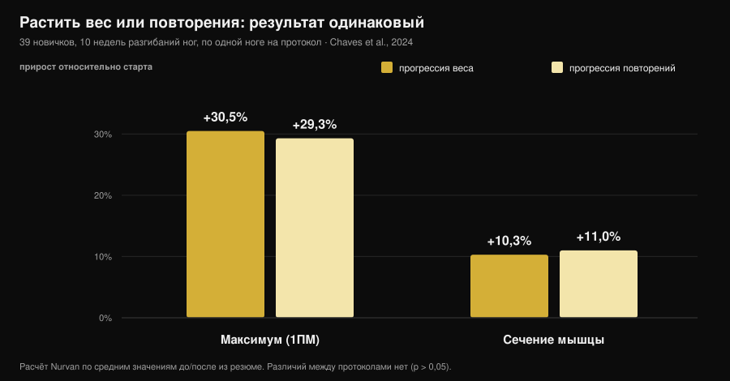
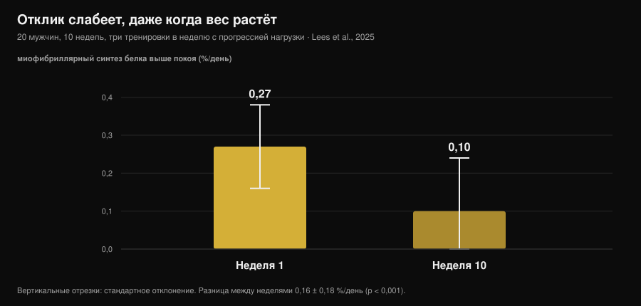

# Прогрессия нагрузки: нужно ли увеличивать вес?

Автор: [Giammaria Loi](/autore/giammaria-loi) · обновлено 17 ноября 2026

«Не растёт вес на штанге — не растут мышцы.» Это самое повторяемое правило в зале, и начинается оно с верного принципа: чтобы адаптация продолжалась, требование к телу должно расти. Подмена происходит в слове *вес*. Три контролируемых исследования сравнили два пути — больше веса или больше повторений — и результат меняет то, как стоит писать программу.

## Коротко

- **Добавлять повторения работает как добавлять вес.** За 10 недель у новичков максимум вырос на 30,5% при прогрессии веса и на 29,3% при прогрессии повторений; сечение мышцы — на 10,3% и 11,0%.
- **У тренированных то же самое.** Через 8 недель различия между группами составили 2,8 мм по прямой мышце бедра (в пользу повторений) и 2,0 кг в максимуме приседа (в пользу веса): оба доверительных интервала пересекают ноль.
- **Внешний вес не определяет гипертрофию.** При равном усилии 8-12 повторений с 70-80% от максимума и 20-25 с 30-40% дали одинаковый рост у одного и того же человека.
- **Прогрессия нагрузки не делает прогресс линейным.** В том же исследовании синтез белка выше покоя упал с 0,27 до 0,10 %/день между 1-й и 10-й неделей, пока веса росли.
- **Расти должно требование, а не цифра на штанге.** Повторения, подходы, близость к отказу и качество движения — законные рычаги, а для максимальной силы вес остаётся самым специфичным.

*График Nurvan по данным Chaves et al., 2024 (39 новичков, внутрисубъектный дизайн: каждая нога случайно отнесена к прогрессии веса или повторений). Значения рассчитаны по средним до/после из резюме: максимум 52,90 → 69,05 кг и 51,67 → 66,82 кг; сечение латеральной широкой мышцы 21,34 → 23,53 см² и 21,08 → 23,39 см². Ни одно значение не считано с рисунка.*

## Чего на самом деле требует принцип

Прогрессия нагрузки говорит одно: чтобы адаптация продолжалась, требование к мышце должно расти со временем. Она не говорит *как*. Рычагов как минимум пять: вес, повторения в подходе, число подходов, близость к отказу и амплитуда или контроль движения.

На практике первый рычаг вытеснил остальные по банальной причине: только вес виден на штанге. Если в программе 4×8, а на прошлой неделе было 60 кг, то сегодняшние 62,5 кг выглядят прогрессом, а 60 кг на 10 повторений — как будто «ничего не изменилось». Это бухгалтерская иллюзия: во втором случае работа выросла сильнее.

Полезный вопрос не философский. Три исследования столкнули два пути при одинаковом числе подходов и одинаковой частоте и измерили силу и мышцу.

## Три исследования, которые сравнили оба пути

| Исследование | Кто | Длительность | Сравнение | Результат |
|---|---|---|---|---|
| Plotkin et al., 2022 | 43 человека со стажем не менее 1 года | 8 недель | вес ↑ vs повторения ↑ | различия незначительны, интервалы включают ноль |
| Chaves et al., 2024 | 39 новичков, по ноге на протокол | 10 недель | вес ↑ vs повторения ↑ | нет различий ни в силе, ни в размере мышцы |
| Lees et al., 2025 | 20 молодых мужчин, по конечности на вес | 10 недель | большой вес vs малый при равном усилии | гипертрофия не зависит от веса |

*Таблица Nurvan по трём исследованиям из списка источников.*

### Тренированные: различия меньше, чем неопределённость

В работе Плоткина с коллегами 43 человека со стажем не менее года тренировок низа тела выполняли 4 подхода в 4 упражнениях дважды в неделю на протяжении 8 недель. Одна группа повышала вес при постоянных повторениях, другая — повторения при постоянном весе.

Различия **между группами**, скорректированные по исходным значениям и полу, составили 2,8 мм по сумме точек прямой мышцы бедра в пользу повторений (95% доверительный интервал от -0,5 до 5,8) и 2,0 кг в максимуме приседа в машине Смита в пользу веса (от -2,4 до 7,8). Оба интервала содержат ноль: с такими числами нельзя сказать, что один метод победил. Во всём остальном различия были ещё меньше: толщина мышц — доли миллиметра, выносливость — меньше 1%, прыжок — 0,1 см.

### Новички: один человек, две ноги, два протокола

Чавес с коллегами выбрали более чистый дизайн: 39 новичков, каждая нога случайно отнесена к прогрессии веса или повторений, 10 недель разгибаний ног. Так каждый участник служит контролем самому себе, и исчезает проблема сравнения людей с разной отзывчивостью.

Максимум вырос с 52,90 до 69,05 кг при прогрессии веса и с 51,67 до 66,82 кг при прогрессии повторений; сечение латеральной широкой мышцы — с 21,34 до 23,53 см² и с 21,08 до 23,39 см². Статистических различий между протоколами нет.

### Рост определяет не вес, а усилие

Самый свежий фрагмент — из *Journal of Physiology*: 20 молодых мужчин, 10 недель, односторонние сгибания на бицепс и разгибания ног, одна конечность с большим весом (8-12 повторений, 70-80% от максимума), другая с малым (20-25 повторений, 30-40%), все подходы до произвольного утомления.

Вес не повлиял на гипертрофию, и она сохранялась **внутри** человека: кто хорошо рос рукой, хорошо рос и ногой, независимо от веса. Значимая изменчивость — между людьми, а не между весами. Ещё одна деталь, полезная при сравнении своих цифр с чужими: в том же исследовании общая дисперсия прироста размера и прироста силы оказалась ничтожной. Расти и становиться сильнее — разные измерения.

## Почему прогресс всё равно замедляется

Вот часть, которую принцип никогда не обещал. В исследовании *Journal of Physiology* миофибриллярный синтез белка — скорость, с которой мышца строит сократительный белок — измеряли дейтерированной водой на 1-й и на 10-й неделе.

*График Nurvan по данным Lees et al., 2025 (20 мужчин, 10 недель, три тренировки в неделю). Значения из резюме как прирост над покоем: 0,27 ± 0,11 %/день на 1-й неделе (p < 0,0001) и 0,10 ± 0,14 %/день на 10-й (p = 0,009); разница между ними 0,16 ± 0,18 %/день (p < 0,001). Ни одно значение не считано с рисунка.*

Над уровнем покоя синтез составлял 0,27 %/день в начале и 0,10 %/день на 10-й неделе: отклик ослаб примерно на две трети, **пока программа применяла прогрессию нагрузки**. Это не ошибка планирования, а то, как устроена адаптация: один и тот же стимул с каждым повтором стоит меньше. Добавление веса не отменяет эту кривую, а ждать линейного прогресса месяцами — значит мерить тренировки не той линейкой. О том, как часто пересматривать программу, — [как часто менять программу тренировок](/ru/blog/kak-chasto-menyat-programmu-trenirovok).

## Что на самом деле говорит наука

| Распространённое утверждение | Вердикт | Источник |
|---|---|---|
| «Не растёт вес — не растут мышцы» | **Опровергнуто** | Plotkin et al., 2022; Chaves et al., 2024 — прогрессия повторений при фиксированном весе дала такой же рост мышц |
| «Больше внешний вес — больше гипертрофия» | **Опровергнуто** | Lees et al., 2025 — при равном усилии 70-80% и 30-40% от максимума дали одинаковый рост у одного человека |
| «Вес и повторения взаимозаменяемы для любой цели» | **Требует уточнения** | Plotkin et al., 2022 — в максимуме оценка в пользу веса (+2,0 кг), но интервал пересекает ноль; принцип специфичности сохраняется |
| «С прогрессией нагрузки прогресс остаётся линейным» | **Опровергнуто** | Lees et al., 2025 — синтез белка над покоем с 0,27 до 0,10 %/день между 1-й и 10-й неделей |
| «Чтобы прогрессировать, нужно доходить до отказа» | **Требует уточнения** | Robinson et al., 2024 — гипертрофия растёт ближе к отказу, сила нет; Ruple et al., 2023 — при равном объёме 0-1 и 4-6 RIR дали одинаковый результат за 5 недель |
| «Прогрессию нужно расписать и соблюдать дословно» | **Требует уточнения** | Larsen et al., 2021 — в 14 исследованиях и у 356 участников все саморегулируемые протоколы повысили максимум |

## Как это применять

1. **Выберите один рычаг и не трогайте остальные.** Для каждого упражнения решите, что растёт в этом блоке: вес или повторения. Двигать всё сразу — значит не понять, что сработало.
2. **Используйте двойную прогрессию.** Задайте диапазон (например, 8-12 повторений): добавляйте повторения, пока не закроете верх диапазона во всех подходах, затем поднимите вес и вернитесь к низу. Самый простой способ получить оба пути, не выбирая.
3. **Для максимальной силы приоритет у веса.** Если вы выступаете или хотите поднять максимум, специфичность важна: тяжёлые подходы должны быть тяжёлыми. На остальной части тренировки хватит повторений.
4. **Для гипертрофии валюта — усилие.** Рост лучше, когда подходы заканчиваются близко к отказу, и это достижимо с любым весом. О том, сколько повторений и отдыха ставить вокруг этого усилия, — [сколько повторений для массы](/ru/blog/skolko-povtoreniy-dlya-massy).
5. **Записывайте вес, повторения и усилие вместе.** Строка с одним весом не скажет, выросло ли требование. Три числа — скажут. О том, насколько точно мы оцениваем усилие, — [насколько точен ваш RIR](/ru/blog/naskolko-tochen-rir).
6. **Если вес стоит три недели, не продавливайте.** Добавьте повторения, добавьте подход или снизьте объём на неделю и попробуйте снова. Данные говорят, что второй путь приводит туда же; третий нужен, когда не хватает восстановления, а не стимула.

### Если вы тренируете людей онлайн

Прогрессия веса проще всего прописывается и проще всего ломается у клиента. Две привычки, которые меняют качество обратной связи:

- **Прописывайте диапазон, а не вес.** «8-12 повторений; поднимайте вес, когда сделаете 12 во всех подходах» — правило, которое клиент применит сам даже в неделю с плохим сном. Фиксированный вес ломается на первой же помехе.
- **Читайте прогресс как общую работу, а не как максимум.** Клиент, перешедший с 60×8 на 60×11, прибавил больше, чем тот, кто перешёл с 60×8 на 62,5×8. Если смотреть только на колонку веса, первый кажется стоящим на месте.

> **Nurvan: проверьте, выросло ли требование на самом деле**
>
> В Nurvan каждый подход хранит вес, повторения и RIR, а история упражнения выстраивает тренировки в ряд: за две секунды видно, растёте вы в весе, в повторениях или нигде. Это и есть данные, по которым выбирают следующий рычаг — для себя или для тренера, который пишет вам программу. [Попробовать Nurvan](https://nurvan.app)

## Частые вопросы

**Нужно ли каждую неделю увеличивать вес?**
Нет, и ни одно исследование не показало такой необходимости. В трёх работах, где пути сравнивали напрямую, рост повторений при фиксированном весе дал такой же рост мышц и почти идентичную прибавку силы (30,5% против 29,3% в максимуме за 10 недель). Со временем расти должно общее требование.

**Что лучше — поднимать вес или повторения?**
Зависит от цели. Для гипертрофии в имеющихся данных оба рычага равноценны. Для максимальной силы оценка чуть в пользу веса (разница между группами 2,0 кг, интервал от -2,4 до 7,8), и специфичность советует держать тяжёлые подходы тяжёлыми, если цель — больший максимум. Двойная прогрессия использует оба.

**Что такое двойная прогрессия?**
Это правило, по которому сначала растут повторения, а потом вес. Выберите диапазон, например 8-12: работаете с этим весом, пока не закроете 12 повторений во всех запланированных подходах, затем прибавляете минимальный доступный шаг и начинаете с 8. Не требует расчётов по максимуму и переносит плохие дни.

**Почему я перестал прогрессировать, хотя добавляю вес?**
Потому что адаптация замедляется сама: в исследовании с дейтерированной водой синтез белка над покоем упал с 0,27 до 0,10 %/день за десять недель, пока веса росли. Когда вес встаёт, причина обычно в восстановлении или общем объёме, а не в самом весе. Если застой длится неделями и сопровождается физическими симптомами, разумнее обсудить это с врачом, чем продавливать дальше.

## Читайте также

- [Сколько повторений для массы: миф о 8-12](/ru/blog/skolko-povtoreniy-dlya-massy) — куда помещать усилие, которое вы пытаетесь нарастить.
- [Насколько точен ваш RIR? Что говорят исследования](/ru/blog/naskolko-tochen-rir) — рычаг усилия работает, только если вы умеете его измерять.
- [Как часто менять программу тренировок?](/ru/blog/kak-chasto-menyat-programmu-trenirovok) — сколько держать программу, прежде чем судить о ней.

## Источники

1. Plotkin D, Coleman M, Van Every D, Maldonado J, Oberlin D, Israetel M, Feather J, Alto A, Vigotsky AD, Schoenfeld BJ, 2022. Progressive overload without progressing load? The effects of load or repetition progression on muscular adaptations. *PeerJ* 10:e14142. [PMID 36199287](https://pubmed.ncbi.nlm.nih.gov/36199287/) · [DOI 10.7717/peerj.14142](https://doi.org/10.7717/peerj.14142)
2. Chaves TS, Scarpelli MC, Bergamasco JGA, et al., 2024. Effects of Resistance Training Overload Progression Protocols on Strength and Muscle Mass. *Int J Sports Med* 45(7):504-510. [PMID 38286426](https://pubmed.ncbi.nlm.nih.gov/38286426/) · [DOI 10.1055/a-2256-5857](https://doi.org/10.1055/a-2256-5857)
3. Lees MJ, Mcleod JC, Morton RW, et al., 2025. Resistance training load does not determine resistance training-induced hypertrophy across upper and lower limbs in healthy young males. *J Physiol*. [PMID 41474371](https://pubmed.ncbi.nlm.nih.gov/41474371/) · [DOI 10.1113/JP289684](https://doi.org/10.1113/JP289684)
4. Robinson ZP, Pelland JC, Remmert JF, Refalo MC, Jukic I, Steele J, Zourdos MC, 2024. Exploring the Dose-Response Relationship Between Estimated Resistance Training Proximity to Failure, Strength Gain, and Muscle Hypertrophy: A Series of Meta-Regressions. *Sports Med* 54(9):2209-2231. [PMID 38970765](https://pubmed.ncbi.nlm.nih.gov/38970765/) · [DOI 10.1007/s40279-024-02069-2](https://doi.org/10.1007/s40279-024-02069-2)
5. Ruple BA, Plotkin DL, Smith MA, et al., 2023. The effects of resistance training to near failure on strength, hypertrophy, and motor unit adaptations in previously trained adults. *Physiol Rep* 11(9):e15679. [PMID 37144554](https://pubmed.ncbi.nlm.nih.gov/37144554/) · [DOI 10.14814/phy2.15679](https://doi.org/10.14814/phy2.15679)
6. Larsen S, Kristiansen E, van den Tillaar R, 2021. Effects of subjective and objective autoregulation methods for intensity and volume on enhancing maximal strength during resistance-training interventions: a systematic review. *PeerJ* 9:e10663. [PMID 33520457](https://pubmed.ncbi.nlm.nih.gov/33520457/) · [DOI 10.7717/peerj.10663](https://doi.org/10.7717/peerj.10663)

Тема выбрана по трендовым сигналам ноября 2026 года о прогрессии нагрузки: конкурирующие материалы подают еженедельную прибавку веса как единственную форму прогрессии. Научные источники найдены через PubMed.

**Giammaria Loi** — основатель Nurvan. Тренируется с отягощениями с 2012 года, работает персональным тренером и коучем с сертификатом FIPE с 2013 года и выступает в пауэрлифтинге на национальном уровне с 2018 года. Каждая его статья начинается с научных работ и заканчивается тем, что действительно работает в зале. [Страница автора](/autore/giammaria-loi)

> Примечание: информационный материал, он не заменяет консультацию врача или квалифицированного специалиста.
