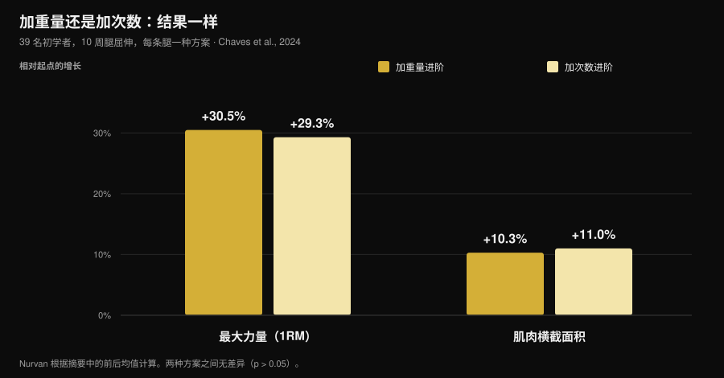
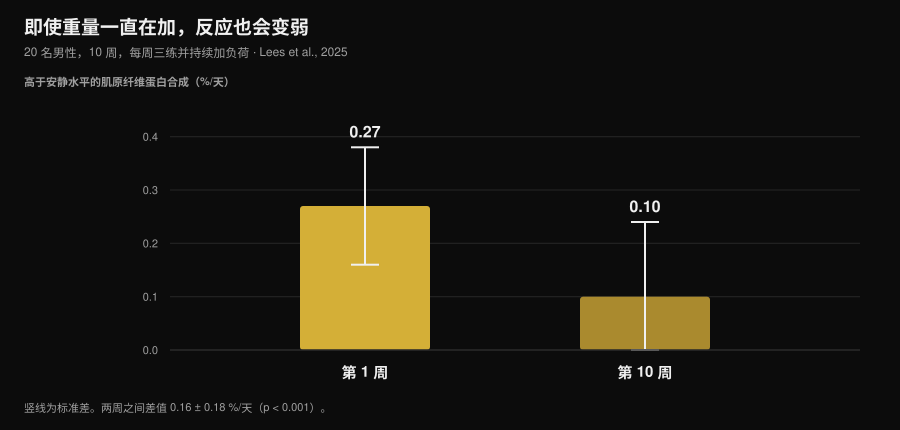

# 渐进超负荷：一定要加重量吗？

作者：[Giammaria Loi](/autore/giammaria-loi) · 更新于 2026 年 11 月 17 日

“杠铃不变重，肌肉就不会长。”这是健身房里被重复最多的一句话，它的出发点没错：要继续适应，身体承受的要求必须上升。问题出在“重”这个字上。三项对照研究把两条路直接放在一起比较——加重量还是加次数——结果会改变你写训练计划的方式。

## 一句话要点

- **加次数和加重量效果相当。** 初学者 10 周后，加重量组最大力量提升 30.5%，加次数组提升 29.3%；肌肉横截面积分别提升 10.3% 和 11.0%。
- **有训练基础的人同样如此。** 8 周后两组差异为股直肌 2.8 毫米（偏向加次数）和深蹲最大力量 2.0 公斤（偏向加重量），两个置信区间都跨过零。
- **外部负荷不决定增肌。** 努力程度一致时，最大力量 70-80% 做 8-12 次与 30-40% 做 20-25 次，在同一个人身上带来相同的增长。
- **渐进超负荷不会让进步保持线性。** 同一研究中，高于安静水平的蛋白合成从第 1 周的 0.27 %/天降到第 10 周的 0.10 %/天，而负荷一直在增加。
- **要增长的是“要求”，不是杠铃上的数字。** 次数、组数、距离力竭的远近和动作质量都是合理的杠杆；若目标是最大力量，重量仍是最专项的那一个。

*Nurvan 图表，数据来自 Chaves et al., 2024（39 名初学者，受试者内设计：两条腿随机分配到加重量或加次数）。数值由摘要中的前后均值计算：最大力量 52.90 → 69.05 公斤与 51.67 → 66.82 公斤；股外侧肌横截面积 21.34 → 23.53 平方厘米与 21.08 → 23.39 平方厘米。没有任何数值取自图形。*

## 这个原则真正要求的是什么

渐进超负荷只说了一件事：要让适应继续，施加在肌肉上的要求必须随时间上升。它没有说*怎么*上升。可用的杠杆至少有五个：重量、每组次数、组数、距离力竭的远近，以及动作幅度或控制。

实际操作中第一个杠杆吞掉了其他几个，原因很简单：只有重量能直接从杠铃上读出来。如果计划写着 4×8，上周是 60 公斤，今天 62.5 公斤看起来就是进步，而 60 公斤做 10 次像是“什么都没变”。这是一种记账错觉：后者的总工作量上升得更多。

有用的问题不是哲学问题。三项研究在组数和频率一致的条件下，把两条路正面比较，并测量了力量和肌肉。

## 比较两条路的三项研究

| 研究 | 对象 | 时长 | 比较 | 结果 |
|---|---|---|---|---|
| Plotkin et al., 2022 | 43 名至少有 1 年训练经验者 | 8 周 | 重量 ↑ vs 次数 ↑ | 差异极小，区间包含零 |
| Chaves et al., 2024 | 39 名初学者，每条腿一种方案 | 10 周 | 重量 ↑ vs 次数 ↑ | 力量与肌肉大小均无差异 |
| Lees et al., 2025 | 20 名年轻男性，每侧肢体一种负荷 | 10 周 | 努力一致下的大重量 vs 小重量 | 增肌与负荷无关 |

*Nurvan 表格，根据文末列出的三项研究整理。*

### 有基础的人：差异小于不确定度

在 Plotkin 等人的研究中，43 名至少有一年下肢训练经验的人每周两次、连续 8 周完成 4 个动作各 4 组。一组保持次数不变、增加重量；另一组保持重量不变、增加次数。

经基线和性别校正后的**组间**差异为：股直肌各测量点之和相差 2.8 毫米，偏向加次数（95% 置信区间 -0.5 至 5.8）；史密斯深蹲最大力量相差 2.0 公斤，偏向加重量（-2.4 至 7.8）。两个区间都包含零：凭这些数字无法说哪种方法胜出。其余指标差距更小：肌肉厚度不到 1 毫米，肌耐力不到 1%，纵跳 0.1 厘米。

### 初学者：同一个人，两条腿，两种方案

Chaves 等人采用了更干净的设计：39 名初学者，两条腿随机分配到加重量或加次数，10 周腿屈伸。这样每位受试者都是自己的对照，也就不存在“不同人反应不同”的干扰。

最大力量从 52.90 公斤升到 69.05 公斤（加重量）和从 51.67 公斤升到 66.82 公斤（加次数）；股外侧肌横截面积从 21.34 升到 23.53 平方厘米，以及从 21.08 升到 23.39 平方厘米。两种方案之间没有统计学差异。

### 决定增长的不是重量，而是努力

最新的一块拼图来自 *Journal of Physiology*：20 名年轻男性，10 周，单侧弯举和单侧腿屈伸，一侧用大重量（8-12 次，最大力量的 70-80%），另一侧用小重量（20-25 次，30-40%），所有组都做到主观力竭。

增肌不受负荷影响，而且在**同一个人身上**保持一致：手臂长得好的人，腿也长得好，与用多重的重量无关。真正重要的变异在人与人之间，而不在不同负荷之间。还有一个值得记住的细节：同一研究中，围度增长与力量增长之间的共同方差可以忽略。长肌肉和变强不是同一把尺子。

## 为什么进步还是会变慢

接下来是这个原则从未承诺过的部分。在 *Journal of Physiology* 的研究中，研究者用重水测量了第 1 周和第 10 周的肌原纤维蛋白合成速率，也就是肌肉制造收缩蛋白的速度。

*Nurvan 图表，数据来自 Lees et al., 2025（20 名男性，10 周，每周三练）。摘要中报告的是高于安静水平的增幅：第 1 周 0.27 ± 0.11 %/天（p < 0.0001），第 10 周 0.10 ± 0.14 %/天（p = 0.009）；两者差值 0.16 ± 0.18 %/天（p < 0.001）。没有任何数值取自图形。*

高于安静水平的合成速率在开始时为 0.27 %/天，到第 10 周为 0.10 %/天：**在计划持续加负荷的同时**，反应减弱了约三分之二。这不是计划写错了，而是适应本身的规律：同样的刺激重复下去，价值越来越低。加重量不能抵消这条曲线，而期待几个月的线性进步，等于用错了尺子衡量训练。关于多久调整一次计划，见[多久更换一次训练计划](/zh/blog/duojiu-genghuan-xunlian-jihua)。

## 研究到底怎么说

| 常见说法 | 结论 | 来源 |
|---|---|---|
| “重量不涨就不会长肌肉” | **已被推翻** | Plotkin et al., 2022；Chaves et al., 2024 — 在重量不变的情况下增加次数带来了相同的肌肉增长 |
| “外部负荷越大，增肌越多” | **已被推翻** | Lees et al., 2025 — 努力一致时，最大力量的 70-80% 与 30-40% 在同一个人身上带来相同的增长 |
| “任何目标下重量和次数都可以互换” | **需要补充** | Plotkin et al., 2022 — 最大力量上的估计偏向重量（+2.0 公斤），但区间跨过零；专项性原则仍然成立 |
| “有渐进超负荷，进步就会保持线性” | **已被推翻** | Lees et al., 2025 — 高于安静水平的蛋白合成在第 1 周到第 10 周之间从 0.27 降到 0.10 %/天 |
| “必须练到力竭才能进步” | **需要补充** | Robinson et al., 2024 — 越接近力竭增肌越好，力量则不然；Ruple et al., 2023 — 容量一致时，0-1 与 4-6 RIR 在 5 周内结果相同 |
| “进阶必须写死并严格执行” | **需要补充** | Larsen et al., 2021 — 14 项研究、356 名参与者中，所有自我调节方案都提高了最大力量 |

## 怎么用

1. **选一个杠杆，其余保持不动。** 每个动作先决定这一阶段是加重量还是加次数。同时改动所有变量，就无法知道是什么起了作用。
2. **使用双重进阶。** 设定一个区间（例如 8-12 次）：先把每一组都做到区间上限，再加重量并回到下限。这是同时用上两条路而不必取舍的最简单办法。
3. **追求最大力量时优先加重量。** 如果你要比赛或想提高最大重量，专项性很重要：大重量组必须真的重。训练课的其余部分用次数进阶就够了。
4. **追求增肌时，货币是努力。** 组做到接近力竭时增长更好，而这在任何重量下都能做到。关于围绕这份努力安排多少次数和休息，见[增肌该做多少次数](/zh/blog/duoshao-cishu-zengji)。
5. **把重量、次数和努力一起记录。** 只有重量的一行记录说明不了要求是否上升，三个数字可以。关于我们估计努力的准确度，见[你的 RIR 有多准](/zh/blog/rir-guji-zhunque-ma)。
6. **重量连续三周不涨时不要硬上。** 增加次数、加一组，或者减一周容量再试。数据表明第二条路通向同一个地方；第三条适用于缺的是恢复而不是刺激的情况。

### 如果你在线上带学员

加重量是最容易布置、也最容易被执行错的一种进阶。两个习惯能改变你收到的信息质量：

- **给区间，而不是给重量。** “8-12 次；每组都做到 12 次就加重量”，这条规则学员在睡眠很差的一周也能自己执行。固定重量会在第一次意外时就失效。
- **把进阶读成总工作量，而不是最大重量。** 从 60×8 进步到 60×11 的学员，比从 60×8 到 62.5×8 的学员进步更多。只看重量那一列，前者看起来像停滞。

> **Nurvan：看清“要求”是否真的上升了**
>
> 在 Nurvan 里，每一组都带着重量、次数和 RIR，动作历史把各次训练并排列出：两秒钟就能看出你是在重量上进步、在次数上进步，还是原地踏步。这正是选择下一个杠杆所需要的数据——无论是给你自己，还是给替你写计划的教练。 [试用 Nurvan](https://nurvan.app)

## 常见问题

**每周都必须加重量吗？**
不必，也没有研究证明这是必要的。在三项直接比较两条路的研究中，保持重量不变、增加次数带来了相同的肌肉增长和几乎相同的力量提升（10 周内最大力量 30.5% 对 29.3%）。随时间上升的应该是整体要求。

**加重量和加次数哪个更好？**
取决于目标。就增肌而言，现有数据表明两者等效。就最大力量而言，估计值略偏向重量（组间差 2.0 公斤，区间 -2.4 至 7.8），而专项性原则建议：如果目标是更高的最大重量，就保留真正的大重量组。双重进阶同时用到两者。

**什么是双重进阶？**
就是先加次数、后加重量的规则。选一个区间，比如 8-12：用这个重量一直练到所有计划组都能做满 12 次，然后加上可用的最小增量，从 8 次重新开始。它不需要围绕最大重量做计算，也能吸收状态差的日子。

**为什么我一直在加重量却不再进步？**
因为适应本身会放慢：在重水研究中，高于安静水平的蛋白合成在十周内从 0.27 降到 0.10 %/天，而负荷一直在涨。重量卡住时，问题通常出在恢复或总容量，而不是重量本身。如果停滞持续数周并伴有身体不适，比起硬扛，更值得去咨询医生。

## 延伸阅读

- [增肌该做多少次数：8-12 的迷思](/zh/blog/duoshao-cishu-zengji) — 把你想增长的那份努力放在哪里。
- [你的 RIR 有多准？研究怎么说](/zh/blog/rir-guji-zhunque-ma) — 努力这个杠杆，只有能测量才有用。
- [多久更换一次训练计划？](/zh/blog/duojiu-genghuan-xunlian-jihua) — 一个计划要坚持多久才值得评判。

## 参考文献

1. Plotkin D, Coleman M, Van Every D, Maldonado J, Oberlin D, Israetel M, Feather J, Alto A, Vigotsky AD, Schoenfeld BJ, 2022. Progressive overload without progressing load? The effects of load or repetition progression on muscular adaptations. *PeerJ* 10:e14142. [PMID 36199287](https://pubmed.ncbi.nlm.nih.gov/36199287/) · [DOI 10.7717/peerj.14142](https://doi.org/10.7717/peerj.14142)
2. Chaves TS, Scarpelli MC, Bergamasco JGA, et al., 2024. Effects of Resistance Training Overload Progression Protocols on Strength and Muscle Mass. *Int J Sports Med* 45(7):504-510. [PMID 38286426](https://pubmed.ncbi.nlm.nih.gov/38286426/) · [DOI 10.1055/a-2256-5857](https://doi.org/10.1055/a-2256-5857)
3. Lees MJ, Mcleod JC, Morton RW, et al., 2025. Resistance training load does not determine resistance training-induced hypertrophy across upper and lower limbs in healthy young males. *J Physiol*. [PMID 41474371](https://pubmed.ncbi.nlm.nih.gov/41474371/) · [DOI 10.1113/JP289684](https://doi.org/10.1113/JP289684)
4. Robinson ZP, Pelland JC, Remmert JF, Refalo MC, Jukic I, Steele J, Zourdos MC, 2024. Exploring the Dose-Response Relationship Between Estimated Resistance Training Proximity to Failure, Strength Gain, and Muscle Hypertrophy: A Series of Meta-Regressions. *Sports Med* 54(9):2209-2231. [PMID 38970765](https://pubmed.ncbi.nlm.nih.gov/38970765/) · [DOI 10.1007/s40279-024-02069-2](https://doi.org/10.1007/s40279-024-02069-2)
5. Ruple BA, Plotkin DL, Smith MA, et al., 2023. The effects of resistance training to near failure on strength, hypertrophy, and motor unit adaptations in previously trained adults. *Physiol Rep* 11(9):e15679. [PMID 37144554](https://pubmed.ncbi.nlm.nih.gov/37144554/) · [DOI 10.14814/phy2.15679](https://doi.org/10.14814/phy2.15679)
6. Larsen S, Kristiansen E, van den Tillaar R, 2021. Effects of subjective and objective autoregulation methods for intensity and volume on enhancing maximal strength during resistance-training interventions: a systematic review. *PeerJ* 9:e10663. [PMID 33520457](https://pubmed.ncbi.nlm.nih.gov/33520457/) · [DOI 10.7717/peerj.10663](https://doi.org/10.7717/peerj.10663)

选题来自 2026 年 11 月关于负荷进阶的趋势信号：同类内容普遍把每周加重量当作渐进超负荷的唯一形式。科学文献通过 PubMed 检索。

**Giammaria Loi** 是 Nurvan 的创始人。他从 2012 年开始进行力量训练，自 2013 年起担任 FIPE 认证私人教练，并从 2018 年起在国家级力量举比赛中参赛。他署名的每一篇文章都从科学研究出发，落到健身房里真正有效的做法。[作者页面](/autore/giammaria-loi)

> 提示：本文为科普内容，不能替代医生或合格专业人士的意见。
