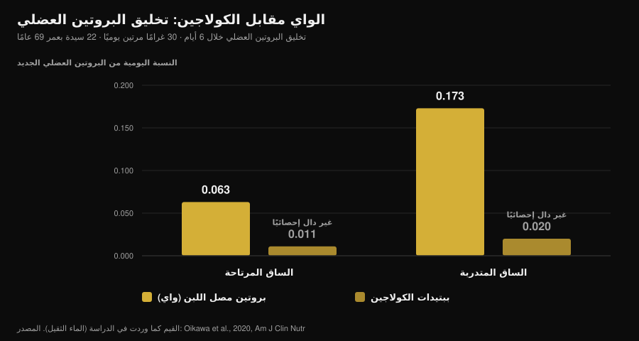
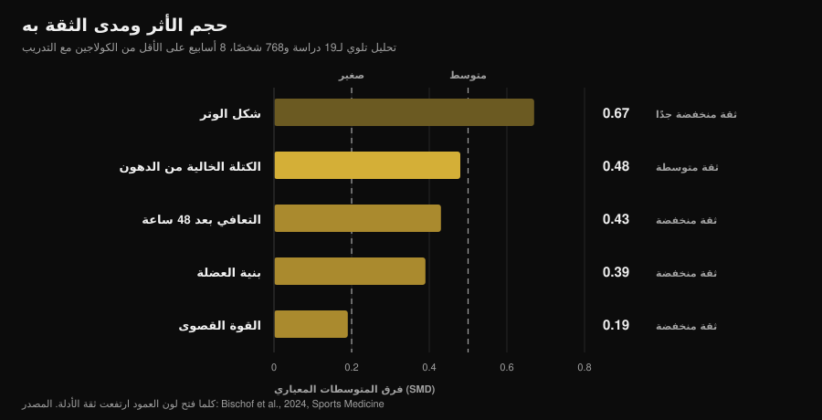

# مسحوق الكولاجين: هل ينفع العضلات والأوتار؟

بقلم [Giammaria Loi](/autore/giammaria-loi) · حُدّث في 18 نوفمبر 2026

انتهى الكولاجين إلى رف البروتينات، بجوار الواي، وتحت التسمية نفسها: «بروتين بودرة». هذا خطأ تصنيف يكلّف مالاً. على مستوى العضلة لا يصمد الكولاجين في المقارنة، وهذا ليس رأياً: جرى قياسه بالتتبّع النظيري، غراماً مقابل غرام. لكن هناك نسيجاً يبدو أن شيئاً يحدث فيه فعلاً — وليس هو ما يُسوَّق على واجهة العلبة.

## باختصار

- **كبروتين للعضلة هو أسوأ خيار على الرف.** في دراسة بالتتبّع النظيري، رفع 30 غراماً من الواي مرتين يومياً تخليق البروتين العضلي؛ أما 30 غراماً من الكولاجين بالجرعة نفسها **فلم ترفعه فوق خط البداية**، لا في الراحة ولا بعد التمرين.
- **في الأوتار، أكبر أثر هو أيضاً الأضعف سنداً.** يجد أوسع تحليل تلوي أقوى أثر في شكل الوتر (SMD 0.67)، لكنه يصنّف ثقة الأدلة فيه بأنها **منخفضة جداً**. النتيجة الوحيدة ذات الثقة المتوسطة هي الكتلة الخالية من الدهون (SMD 0.48).
- **على القوة القصوى الأثر شبه معدوم** (SMD 0.19): إن كنت تبحث عن كيلوغرامات على البار، فالكولاجين ليس الرافعة.
- **التوقيت أهم من العلامة التجارية.** في دراسات الأوتار يُؤخذ الجيلاتين أو الكولاجين مع فيتامين C **قبل نحو ساعة** من العمل الذي يحمّل الوتر: 15 غراماً قبل ساعة ضاعفت مؤشراً لتخليق الكولاجين.
- **في الركبة المؤلمة تتناقض النتائج.** خفّضت 5 غرامات يومياً الألم لدى 139 رياضياً شاباً؛ ولم تتفوّق 10 غرامات يومياً على الدواء الوهمي لدى 167 شخصاً نشطاً بعمر 63 عاماً تقريباً.

*رسم من إعداد Nurvan اعتماداً على القيم المنشورة في Oikawa et al., 2020 (Am J Clin Nutr): 22 سيدة بعمر 69 عاماً، 30 غراماً من البروتين مرتين يومياً لستة أيام، بقياس الماء الثقيل. لم تُقرأ أي قيمة من رسم.*

## ما هو، ولماذا ليس بروتيناً كغيره

الكولاجين هو البروتين البنيوي للأوتار والأربطة والجلد والعظم. يُباع بودرة باسم **ببتيدات الكولاجين** أو الكولاجين المحلل: بروتين مقطّع إلى شُدف قصيرة تذوب في الماء وتُمتص بسرعة. والجيلاتين هو البروتين نفسه، بتقطيع أقل.

النقطة الحرجة هي تركيبه من الأحماض الأمينية. نحو ثلث الكولاجين غليسين، ونسبة الليوسين فيه ضئيلة جداً — والليوسين هو الحمض الأميني الذي يشعل بناء بروتين عضلي جديد. ويخلو تماماً من التريبتوفان، أحد الأحماض الأمينية الأساسية. لذلك يُعدّ الكولاجين في علم التغذية بروتيناً **ناقصاً**: لا يذكر ذلك أي ملصق، لكن الكيمياء الحيوية لا تُساوَم. وعن كمية البروتين الحقيقي التي تحتاجها وكيف توزّعها كتبنا هنا: [كم بروتين في الوجبة الواحدة](/ar/blog/kam-brotin-fi-alwajba-alwahida).

## أقسى اختبار: الكولاجين ضد الواي على العضلة

في 2020 أجرى فريق ستيوارت فيليبس في جامعة ماكماستر المقارنة المباشرة. اثنتان وعشرون سيدة سليمة بعمر 69 عاماً، في مجموعتين، تناولن **30 غراماً من الواي أو 30 غراماً من ببتيدات الكولاجين مرتين يومياً لستة أيام**، مع حصتي تدريب على ساق واحدة فقط: بهذا تُقارَن الساق المتدربة بالساق المرتاحة داخل الشخص نفسه.

النتيجة، مقيسة بالماء الثقيل على مدى الأسبوع كاملاً: مع الواي ارتفع تخليق البروتين العضلي إلى **0.063% يومياً** في الساق المرتاحة وإلى **0.173%** في المتدربة. ومع الكولاجين بقيت القيم عند 0.011% و0.020%، أي **دون فرق دال عن نقطة البداية**. ولم يكفِ التدريب نفسه ليجعل الكولاجين يعمل كبروتين.

هذا الرقم يحسم سؤال «هل أستبدل الواي بالكولاجين بعد التمرين؟». لا.

## وماذا لو أضفته إلى الواي؟

هنا تصبح الأبحاث الحديثة أكثر إثارة وأكثر صدقاً. حين تتناول 30 غراماً من الواي بعد التمرين **ينخفض** الغليسين في الدم: الواي يحوي القليل منه، والجسم يستهلكه. والغليسين هو الحمض الأميني الذي يحتاجه النسيج الضام أكثر من غيره.

قاس فريق من ماستريخت ذلك لدى 14 رجلاً: مع الواي وحده كانت إتاحة الغليسين خلال الساعات الست التالية للتمرين سالبة (−8.9 مليمول·360 دقيقة/لتر)، بينما **تكفي 5 غرامات من الكولاجين** مضافة إلى 25 غراماً من الواي لإعادتها فوق الصفر (+9.2). وإضافة 10 أو 15 غراماً لا تضيف شيئاً لهذا الغرض بل تخفض الليوسين المتاح: المزيد من الكولاجين ليس أفضل.

ثم اختبر الفريق نفسه خليط 25 غراماً واي + 5 غرامات كولاجين مقابل دواء وهمي خالٍ من السعرات: ارتفع تخليق البروتين العضلي الليفي — أي العضلة — في الراحة وبعد التمرين معاً، وارتفع تخليق بروتين النسيج الضام في الراحة لكن ليس بدلالة إحصائية في الساق المتدربة. وانتبه للقراءة: كانت المقارنة **مع الدواء الوهمي، لا مع الواي وحده**. هذا يثبت أن الخليط يعمل، لا أنه يتفوّق على الواي.

## حيث يحدث شيء فعلاً: الوتر

في 2024 نشرت *Sports Medicine* أوسع مراجعة منهجية في الموضوع: 19 تجربة عشوائية، 768 شخصاً، 8 أسابيع على الأقل من ببتيدات الكولاجين مع التدريب. الآثار الإيجابية موجودة، لكن المهم قراءتها مع **ثقة الأدلة** المقيَّمة بمنهج GRADE.

*رسم من إعداد Nurvan اعتماداً على القيم المنشورة في Bischof et al., 2024 (Sports Medicine). SMD هو فرق المتوسطات المعياري: اصطلاحاً 0.2 أثر صغير و0.5 أثر متوسط. ويشير لون العمود إلى ثقة GRADE التي أعلنها المؤلفون. لم تُقرأ أي قيمة من رسم.*

يقول الرسم ما لا تقوله أي صفحة منتج: **أكبر أثر هو ذاك الذي نحن أقل يقيناً بشأنه.** شكل الوتر يكسب أكثر (SMD 0.67) لكن على أدلة ثقتها منخفضة جداً؛ والكتلة الخالية من الدهون تكسب أقل (SMD 0.48) بأعلى ثقة في المجموعة؛ والقوة القصوى تكاد لا تتحرك (SMD 0.19).

تُظهر تجربة محكومة واحدة معنى ذلك عملياً. خمسون رجلاً متوسطي التدريب أدّوا 14 أسبوعاً من تمديد الركبة بحمل 70–85% من أقصى تكرار واحد، ثلاث مرات أسبوعياً، مع 5 غرامات من ببتيدات الكولاجين أو دواء وهمي. زادت في مجموعة الكولاجين **مساحة المقطع العرضي لوتر الرضفة** أكثر، لكن في صلابة الوتر ومقطع العضلة والقوة **لم يكن هناك فرق بين المجموعتين**. صار الوتر أثخن؛ ولم يثبت أنه صار أقوى.

## نافذة الساعة الواحدة، وفيتامين C

تقوم دراسات الوتر على تفصيل يضيع غالباً عند إعادة الرواية: التوقيت. تروية الوتر الدموية ضعيفة، وتخليق الكولاجين فيه يرتفع حين يُحمَّل.

في الدراسة التي فتحت هذا الباب، تناول ثمانية رجال 5 أو 15 غراماً من جيلاتين مدعّم بفيتامين C **قبل ساعة** من ست دقائق من نطّ الحبل، ثلاث مرات يومياً لثلاثة أيام. ومع 15 غراماً **تضاعف** مؤشر تخليق الكولاجين في الدم؛ والمصل المسحوب بعد الجرعة، حين وُضع على أربطة مهندَسة في المختبر، رفع محتواها من الكولاجين وحسّن خواصها الميكانيكية.

هؤلاء ثمانية أشخاص ومؤشرات، لا إصابات تم تفاديها. لكنها تفسّر لماذا «وقتما تذكّرت» و«قبل ساعة من عمل الوتر» ليستا الجرعة نفسها. وتصل مراجعة صدرت في 2026 عن التغذية في إعادة التأهيل إلى الخلاصة العملية ذاتها: الكولاجين أو الجيلاتين مع فيتامين C **قبل** عمل التحميل، دعماً لبرنامج إعادة التأهيل، لا بديلاً عن التحميل التدريجي أبداً. وعن الطعام خلال فترة التوقف بسبب الإصابة لدينا مقال مخصّص: [ماذا تأكل عند الإصابة](/ar/blog/madha-takul-eind-alisaba).

## الركبة: دراستان، جوابان

أكثر الادعاءات مبيعاً هو «يزيل ألم المفاصل». هنا تنقسم الأبحاث، ويستحق الأمر معرفة أين.

في 2017 تناول 139 شخصاً رياضياً يعانون ألماً وظيفياً في الركبة 5 غرامات من ببتيدات الكولاجين أو دواءً وهمياً لمدة 12 أسبوعاً: تحسّن الألم أثناء النشاط أكثر في مجموعة الكولاجين (−19.5 مقابل −13.9 نقطة على مقياس بصري، p = 0.046)، وأكّد ذلك تقييم الأطباء.

وفي 2020 تناول 167 شخصاً نشطاً يشكون ألماً في الركبة، بعمر وسيط 63 عاماً، 10 غرامات يومياً أو دواءً وهمياً لمدة 12 أسبوعاً: انخفض الألم **بالقدر نفسه** في المجموعتين (−1.6 مقابل −1.9 نقطة)، ولم يتحرك أي مؤشر التهابي أو غضروفي أو عظمي.

تجربتان، والجرعة مضاعفة في الثانية، ونتيجة معاكسة. العمر ونوع الألم والفئة المدروسة مختلفة: ليس تعادلاً يُحسم باختيار الدراسة التي تعجبك. لذلك الجواب الأمين عن هذا الادعاء هو «ربما، عند بعض الناس»، لا «نعم».

## ماذا يقول البحث فعلاً

| ادعاء شائع | الحكم | المصدر |
|---|---|---|
| «إنه بروتين، يصلح بعد التمرين» | **مفنَّد**: 30 غراماً من الكولاجين لا ترفع تخليق البروتين العضلي؛ و30 غراماً من الواي ترفعه | Oikawa et al., 2020 |
| «يبني العضلات» | **يحتاج تدقيقاً**: يجد التحليل التلوي زيادة في الكتلة الخالية من الدهون (SMD 0.48، ثقة متوسطة)، لكن بيانات الآلية لا تفسّرها بالكولاجين كمصدر بروتيني | Bischof et al., 2024؛ Oikawa et al., 2020 |
| «يقوّي الأوتار» | **يحتاج تدقيقاً**: يثخن الوتر، لكن الصلابة والقوة لا تتغيران مقارنة بالتدريب وحده، وثقة الأدلة منخفضة جداً | Jerger et al., 2023؛ Bischof et al., 2024 |
| «يزيل ألم الركبة» | **يحتاج تدقيقاً**: نعم عند رياضيين شباب بـ5 غرامات لمدة 12 أسبوعاً، ولا عند أشخاص نشطين أكبر سناً بـ10 غرامات | Zdzieblik et al., 2017؛ Bongers et al., 2020 |
| «يؤخذ مع فيتامين C قبل ساعة» | **مؤكَّد على مستوى المؤشرات**: 15 غراماً من الجيلاتين مع فيتامين C قبل ساعة من التحميل تضاعف مؤشر تخليق الكولاجين | Shaw et al., 2017 |
| «إضافته إلى الواي تفسد البروتين» | **مفنَّد**: 5 غرامات كولاجين على 25 غراماً واي تعيد الغليسين إلى الموجب دون أن تكلّف ليوسيناً | Aussieker et al., 2024 |
| «كلما زاد كان أفضل» | **مفنَّد**: فوق 5 غرامات مضافة إلى الواي ينخفض الليوسين المتاح، والدراسات الفعّالة استخدمت 5–15 غراماً لا أكثر | Aussieker et al., 2024؛ Shaw et al., 2017 |
| «يجعلك ترفع أثقل» | **مفنَّد**: أثره على القوة القصوى SMD 0.19 بثقة منخفضة | Bischof et al., 2024 |

## كيف تطبّقه

1. **لا تستبدل البروتين بالكولاجين.** غطِّ احتياجك أولاً بمصادر كاملة: لحوم وأسماك وبيض وألبان وبقوليات وصويا، أو واي. الكولاجين إضافة لا بديل.
2. **إن استخدمته للوتر فاستخدم الساعة.** 10–15 غراماً من ببتيدات الكولاجين أو الجيلاتين مع فيتامين C، **قبل نحو ساعة** من الحصة التي تحمّل ذلك الوتر. خارج هذه النافذة لا تقول الدراسات شيئاً.
3. **مع الواي تكفي 5 غرامات.** هي الجرعة التي تعيد الغليسين إلى الموجب بعد التمرين دون خفض الليوسين.
4. **امنحه وقتاً وقِس شيئاً واحداً.** تمتد التجارب من 8 إلى 14 أسبوعاً. اختر مؤشراً قبل البدء — ألماً في حركة بعينها، أو حملاً محتملاً في تمرين — وانظر إليه عند الأسبوع 12، لا بعد 10 أيام.
5. **لا تتوقع كيلوغرامات على البار.** متوسط الأثر على القوة القصوى قريب من الصفر: إن كان هذا هدفك فالكولاجين ليس مكان الإنفاق.
6. **ألم مفصلي يستمر أو يزداد أو يعيق الحركة: راجع الطبيب.** المكمّل ليس تشخيصاً، ووتر يؤلم منذ شهور ليس مسألة مساحيق.

> **Nurvan: مكمّل بالساعة الصحيحة، لا بالجرعة الصحيحة فقط**
>
> الكولاجين من المكمّلات القليلة التي يهمّ فيها التوقيت فعلاً: قبل ساعة من عمل الوتر. في Nurvan تسجّل الجرعة والساعة في وحدة المكمّلات، ولأن التدريب في التطبيق نفسه ترى حصةً بعد حصة إن كنت قد تناولته داخل تلك النافذة فعلاً — وإن كان الحمل في ذلك التمرين يرتفع في الأثناء. [جرّب Nurvan](https://nurvan.app)

## أسئلة شائعة

**هل يبني مسحوق الكولاجين العضلات؟**
ليس كمصدر بروتيني. في مقارنة مباشرة بالتتبّع النظيري لم ترفع 30 غراماً من ببتيدات الكولاجين مرتين يومياً تخليق البروتين العضلي فوق خط البداية، بينما رفعته الجرعة نفسها من الواي. ويجد التحليل التلوي لعام 2024 زيادة في الكتلة الخالية من الدهون (SMD 0.48)، لكن عبر آلية لا يفسّرها الكولاجين كبروتين: وهذا ليس سبباً لاستبدال بروتين الوجبة.

**الكولاجين أم الواي؟**
للعضلة: الواي، بلا نقاش. أما الكولاجين فله معنى كإضافة موجّهة للنسيج الضام بجرعة 5–15 غراماً، و5 غرامات تكفي إن أخذته مع الواي بعد التمرين.

**كم كولاجين في اليوم؟**
الدراسات التي وجدت أثراً استخدمت 5 إلى 15 غراماً يومياً: 5 غرامات في أعمال ألم الركبة ووتر الرضفة، و15 غراماً من الجيلاتين في بروتوكولات ما قبل التمرين. ولم تُظهر الجرعات الأعلى أي ميزة، وهي تخفض الليوسين المتاح عند خلطها بالواي.

**متى يُؤخذ الكولاجين؟**
إن كان الهدف الوتر فقبل نحو ساعة من الحصة التي تحمّله، مع فيتامين C: هذا هو الترتيب المستخدم في الدراسات ذات النتائج الإيجابية على المؤشرات. وإن استخدمته إضافةً لبروتين ما بعد التمرين فتناوله مع الواي.

**هل فيتامين C ضروري فعلاً؟**
في الدراسات كان الجيلاتين مدعّماً بفيتامين C، لأن فيتامين C عامل مساعد ضروري لتخليق الكولاجين. أما فصلهما فلم يُختبر: إن اتبعت ذلك البروتوكول فاتبع هذا التفصيل أيضاً.

## اقرأ أيضاً

- [تصنيف مكملات القوة: ماذا يقول البحث العلمي](/ar/blog/tasnif-mukammilat-alquwa) — أين يقع الكولاجين مقارنةً بمكمّلات أدلتها أمتن.
- [بروتين اللحم البقري: هل يضاهي بروتين الواي؟](/ar/blog/brotin-allahm-albaqari-am-alway) — المسحوق الآخر الذي يُباع كبروتين كامل، مقيساً بالمسطرة نفسها.
- [ماذا تأكل عند الإصابة: التغذية خلال التوقف](/ar/blog/madha-takul-eind-alisaba) — غذاء الأسابيع التي يحتاج فيها النسيج الضام إلى إعادة بناء.

## المصادر

1. Oikawa SY, Kamal MJ, Webb EK, McGlory C, Baker SK, Phillips SM, 2020. Whey protein but not collagen peptides stimulate acute and longer-term muscle protein synthesis with and without resistance exercise in healthy older women: a randomized controlled trial. *Am J Clin Nutr* 111(3):708-718. [PMID 31919527](https://pubmed.ncbi.nlm.nih.gov/31919527/) · [DOI 10.1093/ajcn/nqz332](https://doi.org/10.1093/ajcn/nqz332)
2. Bischof K, Moitzi AM, Stafilidis S, König D, 2024. Impact of Collagen Peptide Supplementation in Combination with Long-Term Physical Training on Strength, Musculotendinous Remodeling, Functional Recovery, and Body Composition in Healthy Adults: A Systematic Review with Meta-analysis. *Sports Med* 54(11):2865-2888. [PMID 39060741](https://pubmed.ncbi.nlm.nih.gov/39060741/) · [DOI 10.1007/s40279-024-02079-0](https://doi.org/10.1007/s40279-024-02079-0)
3. Jerger S, Centner C, Lauber B, Seynnes O, Friedrich T, Lolli D, Gollhofer A, König D, 2023. Specific collagen peptides increase adaptions of patellar tendon morphology following 14-weeks of high-load resistance training: A randomized-controlled trial. *Eur J Sport Sci* 23(12):2329-2339. [PMID 37424319](https://pubmed.ncbi.nlm.nih.gov/37424319/) · [DOI 10.1080/17461391.2023.2232758](https://doi.org/10.1080/17461391.2023.2232758)
4. Shaw G, Lee-Barthel A, Ross ML, Wang B, Baar K, 2017. Vitamin C-enriched gelatin supplementation before intermittent activity augments collagen synthesis. *Am J Clin Nutr* 105(1):136-143. [PMID 27852613](https://pubmed.ncbi.nlm.nih.gov/27852613/) · [DOI 10.3945/ajcn.116.138594](https://doi.org/10.3945/ajcn.116.138594)
5. Aussieker T, Janssen TAH, Hermans WJH, Holwerda AM, Senden JM, van Kranenburg JMX, Goessens JPB, Snijders T, van Loon LJC, 2024. Coingestion of Collagen With Whey Protein Prevents Postexercise Decline in Plasma Glycine Availability in Recreationally Active Men. *Int J Sport Nutr Exerc Metab* 34(4):189-198. [PMID 38604602](https://pubmed.ncbi.nlm.nih.gov/38604602/) · [DOI 10.1123/ijsnem.2023-0264](https://doi.org/10.1123/ijsnem.2023-0264)
6. Aussieker T, Kaiser J, Hermans WJH, Hendriks FK, Holwerda AM, Senden JM, van Kranenburg JMX, Goessens JPB, Braun U, Baar K, Snijders T, van Loon LJC, 2024. Ingestion of a Whey Plus Collagen Protein Blend Increases Myofibrillar and Muscle Connective Protein Synthesis Rates. *Med Sci Sports Exerc* 57(3):544-554. [PMID 39501478](https://pubmed.ncbi.nlm.nih.gov/39501478/) · [DOI 10.1249/MSS.0000000000003596](https://doi.org/10.1249/MSS.0000000000003596)
7. Zdzieblik D, Oesser S, Gollhofer A, König D, 2017. Improvement of activity-related knee joint discomfort following supplementation of specific collagen peptides. *Appl Physiol Nutr Metab* 42(6):588-595. [PMID 28177710](https://pubmed.ncbi.nlm.nih.gov/28177710/) · [DOI 10.1139/apnm-2016-0390](https://doi.org/10.1139/apnm-2016-0390)
8. Bongers CCWG, Ten Haaf DSM, Catoire M, Kersten B, Wouters JA, Eijsvogels TMH, Hopman MTE, 2020. Effectiveness of collagen supplementation on pain scores in healthy individuals with self-reported knee pain: a randomized controlled trial. *Appl Physiol Nutr Metab* 45(7):793-800. [PMID 31990581](https://pubmed.ncbi.nlm.nih.gov/31990581/) · [DOI 10.1139/apnm-2019-0654](https://doi.org/10.1139/apnm-2019-0654)

إرشاد عملي بشأن الكولاجين والجيلاتين قبل عمل التحميل في إعادة التأهيل: Lee EJ, Kim J, et al., 2026. Rehabilitation Nutrition for Tendon and Ligament Injuries: From Collagen Remodeling to Return-to-Activity and Sport. *Healthcare (Basel)* 14(14). [PMID 42512652](https://pubmed.ncbi.nlm.nih.gov/42512652/) · [DOI 10.3390/healthcare14142136](https://doi.org/10.3390/healthcare14142136). اختير الموضوع من إشارات اتجاه نوفمبر 2026: دخل مسحوق الكولاجين قوائم النمو في 15-16 نوفمبر 2026 (collagen powder 74,000 بحث شهرياً، +31%؛ collagen protein powder 22,200 بحث شهرياً، +242%)، والمحتوى المنافس يكاد يكون كله صفحات منتجات. المصادر العلمية عبر PubMed.

**Giammaria Loi** هو مؤسس Nurvan. يتدرب بالأثقال منذ 2012، ويعمل مدرباً شخصياً ومدرّباً معتمداً من FIPE منذ 2013، ويشارك في منافسات رفع القوة على المستوى الوطني منذ 2018. كل مقال يوقّعه ينطلق من الدراسات العلمية وينتهي عند ما ينفع فعلاً في الصالة. [صفحة الكاتب](/autore/giammaria-loi)

> ملاحظة: محتوى تثقيفي، ولا يغني عن رأي الطبيب أو المختص المؤهل.
