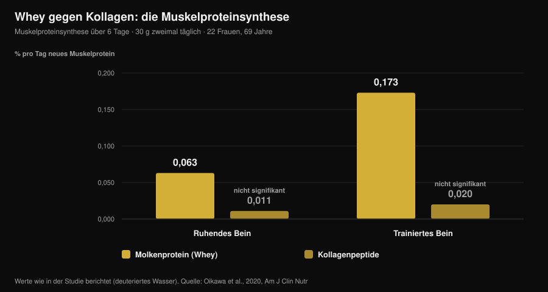
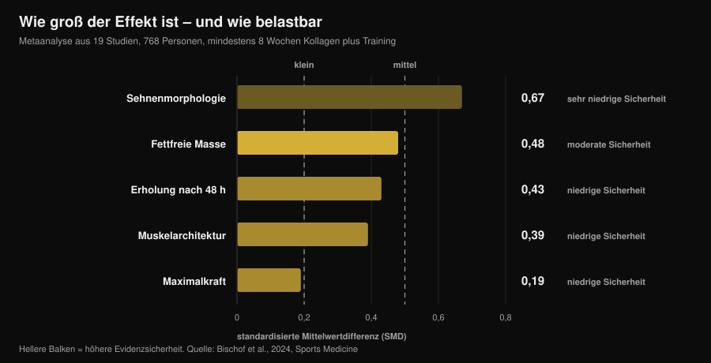

# Kollagenpulver: bringt es Muskeln und Sehnen etwas?

Von [Giammaria Loi](/autore/giammaria-loi) · aktualisiert am 18. November 2026

Kollagen ist im Proteinregal gelandet, neben dem Whey, mit demselben Etikett: „Proteinpulver". Das ist ein Kategorienfehler, der Geld kostet. Beim Muskel hält Kollagen dem Vergleich nicht stand – und das ist keine Meinung, es wurde mit Tracer gemessen, Gramm für Gramm. Aber es gibt ein Gewebe, bei dem tatsächlich etwas passiert, und es ist nicht das, mit dem auf der Dose geworben wird.

## Kurz gefasst

- **Als Protein für den Muskel ist es die schlechteste Wahl im Regal.** In einer Tracer-Studie erhöhten 30 g Whey zweimal täglich die Muskelproteinsynthese; 30 g Kollagen in derselben Dosis **hoben sie nicht über den Ausgangswert**, weder in Ruhe noch nach dem Training.
- **Bei den Sehnen ist der größte Effekt zugleich der unsicherste.** Die größte Metaanalyse findet ihren stärksten Effekt bei der Sehnenmorphologie (SMD 0,67), stuft die Sicherheit dieser Evidenz aber als **sehr niedrig** ein. Der einzige Endpunkt mit moderater Sicherheit ist die fettfreie Masse (SMD 0,48).
- **Auf die Maximalkraft wirkt es praktisch nicht** (SMD 0,19): Wer Kilos auf der Stange sucht, findet im Kollagen nicht den Hebel.
- **Der Zeitpunkt zählt mehr als die Marke.** In den Sehnenstudien wird Gelatine oder Kollagen mit Vitamin C **etwa eine Stunde vor** der Belastung eingenommen, die die Sehne fordert: 15 g eine Stunde vorher verdoppelten einen Marker der Kollagensynthese.
- **Beim schmerzenden Knie widersprechen sich die Ergebnisse.** 5 g täglich senkten den Schmerz bei 139 jungen Sportlern; 10 g täglich waren bei 167 aktiven Menschen um 63 Jahre nicht besser als Placebo.

*Nurvan-Grafik auf Basis der von Oikawa et al., 2020 (Am J Clin Nutr) veröffentlichten Werte: 22 Frauen im Alter von 69 Jahren, 30 g Protein zweimal täglich über sechs Tage, Messung mit deuteriertem Wasser. Kein Wert aus einer Abbildung abgelesen.*

## Was es ist – und warum es kein Protein wie andere ist

Kollagen ist das Strukturprotein von Sehnen, Bändern, Haut und Knochen. Als Pulver kaufst du es als **Kollagenpeptide** oder hydrolysiertes Kollagen: in kurze Bruchstücke zerlegtes Protein, das sich in Wasser löst und schnell aufgenommen wird. Gelatine ist dasselbe Protein, weniger stark zerlegt.

Der kritische Punkt ist das Aminosäureprofil. Kollagen besteht zu rund einem Drittel aus Glycin und enthält sehr wenig Leucin – jene Aminosäure, die den Aufbau neuen Muskelproteins anstößt. Tryptophan, eine der essenziellen Aminosäuren, fehlt vollständig. Deshalb gilt Kollagen in der Ernährungswissenschaft als **unvollständiges** Protein: kein Etikett sagt das, aber Biochemie lässt nicht mit sich verhandeln. Wie viel echtes Protein du brauchst und wie du es verteilst, steht hier: [wie viel Protein pro Mahlzeit, der 30-g-Mythos](/de/blog/wie-viel-protein-pro-mahlzeit-grenze).

## Die härteste Prüfung: Kollagen gegen Whey am Muskel

2020 hat die Gruppe um Stuart Phillips an der McMaster University den direkten Vergleich gezogen. Zweiundzwanzig gesunde Frauen mit 69 Jahren, in zwei Gruppen, nahmen **30 g Whey oder 30 g Kollagenpeptide zweimal täglich über sechs Tage**, mit zwei Trainingseinheiten für nur ein Bein: So werden trainiertes und ruhendes Bein innerhalb derselben Person verglichen.

Das Ergebnis, mit deuteriertem Wasser über die ganze Woche gemessen: Mit Whey stieg die Muskelproteinsynthese auf **0,063 % pro Tag** im ruhenden und auf **0,173 %** im trainierten Bein. Mit Kollagen blieben die Werte bei 0,011 % und 0,020 %, also **nicht signifikant über dem Ausgangswert**. Nicht einmal das Training reichte, damit Kollagen als Protein funktioniert.

Diese Zahl beantwortet die Frage „Kann ich nach dem Training Kollagen statt Whey nehmen?". Nein.

## Und wenn ich es zum Whey dazugebe?

Hier wird die neuere Forschung interessanter – und ehrlicher. Wenn du nach dem Training 30 g Whey isst, **sinkt** das Glycin im Blut: Whey enthält wenig davon, der Körper verbraucht es. Glycin ist die Aminosäure, die Bindegewebe am dringendsten braucht.

Eine Gruppe in Maastricht hat das an 14 Männern gemessen: Mit Whey allein war die Glycin-Verfügbarkeit in den sechs Stunden nach dem Training negativ (−8,9 mmol·360 min/L), während **5 g Kollagen** zu 25 g Whey genügen, um sie wieder über null zu bringen (+9,2). 10 oder 15 g bringen für diesen Zweck nichts mehr und senken stattdessen das verfügbare Leucin: mehr Kollagen ist nicht besser.

Dieselbe Gruppe prüfte die Mischung aus 25 g Whey + 5 g Kollagen anschließend gegen ein kalorienfreies Placebo: Die myofibrilläre Proteinsynthese – der Muskel – stieg in Ruhe und nach der Belastung, die des Bindegewebes stieg in Ruhe, im trainierten Bein aber nicht signifikant. Wichtig beim Lesen: Verglichen wurde **gegen Placebo, nicht gegen Whey allein**. Das zeigt, dass die Mischung wirkt, nicht dass sie Whey schlägt.

## Wo wirklich etwas passiert: die Sehne

2024 erschien in *Sports Medicine* die bislang umfassendste systematische Übersicht: 19 randomisierte Studien, 768 Personen, mindestens 8 Wochen Kollagenpeptide neben dem Training. Die positiven Effekte gibt es, entscheidend ist aber, sie zusammen mit der **Sicherheit der Evidenz** nach GRADE zu lesen.

*Nurvan-Grafik auf Basis der von Bischof et al., 2024 (Sports Medicine) veröffentlichten Werte. SMD = standardisierte Mittelwertdifferenz: konventionell gilt 0,2 als kleiner und 0,5 als mittlerer Effekt. Die Balkenfarbe zeigt die von den Autoren angegebene GRADE-Sicherheit. Kein Wert aus einer Abbildung abgelesen.*

Die Grafik sagt etwas, das keine Produktseite sagt: **Der größte Effekt ist der, bei dem wir am unsichersten sind.** Die Sehnenmorphologie gewinnt am meisten (SMD 0,67) – auf Evidenz sehr niedriger Sicherheit; die fettfreie Masse gewinnt weniger (SMD 0,48), mit der höchsten Sicherheit der Reihe; die Maximalkraft bewegt sich kaum (SMD 0,19).

Eine einzelne kontrollierte Studie zeigt, was das praktisch heißt. Fünfzig mäßig trainierte Männer absolvierten 14 Wochen Beinstrecken mit 70–85 % des Maximums, dreimal pro Woche, mit 5 g Kollagenpeptiden oder Placebo. Die Kollagengruppe steigerte den **Querschnitt der Patellasehne** stärker, doch bei Sehnensteifigkeit, Muskelquerschnitt und Kraft gab es **keinen Unterschied zwischen den Gruppen**. Die Sehne wurde dicker; dass sie belastbarer wurde, ist nicht gezeigt.

## Das Zeitfenster von einer Stunde – und das Vitamin C

Die Sehnenstudien hängen an einem Detail, das beim Weitererzählen fast immer verloren geht: dem Zeitpunkt. Sehnen sind schlecht durchblutet, und ihre Kollagensynthese steigt, wenn sie belastet werden.

In der Studie, die dieses Feld eröffnet hat, nahmen acht Männer 5 oder 15 g mit Vitamin C angereicherte Gelatine **eine Stunde vor** sechs Minuten Seilspringen, dreimal täglich über drei Tage. Mit 15 g **verdoppelte** sich der Blutmarker der Kollagensynthese; Serum, das nach der Einnahme gewonnen und im Labor auf künstlich gezüchtete Bänder gegeben wurde, erhöhte deren Kollagengehalt und verbesserte ihre mechanischen Eigenschaften.

Das sind acht Personen und Marker, keine verhinderten Verletzungen. Aber es erklärt, warum „wann es gerade passt" und „eine Stunde vor der Sehnenbelastung" nicht dieselbe Dosis sind. Eine Übersichtsarbeit von 2026 zur Ernährung in der Rehabilitation kommt zum selben praktischen Schluss: Kollagen oder Gelatine mit Vitamin C **vor** der Belastungsarbeit, als Unterstützung des Reha-Programms, nie anstelle der progressiven Belastung. Zur Ernährung während einer Verletzungspause haben wir einen eigenen Artikel: [Ernährung bei Verletzung](/de/blog/ernaehrung-bei-verletzung).

## Das Knie: zwei Studien, zwei Antworten

Das meistverkaufte Versprechen lautet „es nimmt die Gelenkschmerzen". Hier teilt sich die Forschung, und es lohnt zu wissen, woran.

2017 nahmen 139 sportliche Personen mit funktionellen Knieschmerzen 12 Wochen lang 5 g Kollagenpeptide oder Placebo: Der Schmerz während der Aktivität besserte sich in der Kollagengruppe stärker (−19,5 gegenüber −13,9 Punkten auf einer visuellen Skala, p = 0,046), bestätigt durch die ärztliche Beurteilung.

2020 nahmen 167 aktive Personen mit selbstberichteten Knieschmerzen, Altersmedian 63 Jahre, 12 Wochen lang 10 g täglich oder Placebo: Der Schmerz sank in beiden Gruppen **gleich stark** (−1,6 gegenüber −1,9 Punkten), und kein Entzündungs-, Knorpel- oder Knochenmarker veränderte sich.

Zwei Studien, im zweiten Fall doppelte Dosis, entgegengesetztes Ergebnis. Alter, Schmerzart und Population unterscheiden sich: Das ist kein Unentschieden, das man löst, indem man sich die passende Studie aussucht. Deshalb lautet die ehrliche Antwort auf dieses Versprechen „vielleicht, bei manchen", nicht „ja".

## Was die Forschung wirklich sagt

| Verbreitete Behauptung | Urteil | Quelle |
|---|---|---|
| „Es ist Protein, passt nach dem Training" | **Widerlegt**: 30 g Kollagen heben die Muskelproteinsynthese nicht an; 30 g Whey schon | Oikawa et al., 2020 |
| „Es baut Muskeln auf" | **Zu präzisieren**: Die Metaanalyse findet mehr fettfreie Masse (SMD 0,48, moderate Sicherheit), die mechanistischen Daten erklären das aber nicht über Kollagen als Proteinquelle | Bischof et al., 2024; Oikawa et al., 2020 |
| „Es stärkt die Sehnen" | **Zu präzisieren**: Die Sehne wird dicker, aber Steifigkeit und Kraft ändern sich gegenüber Training allein nicht, und die Evidenzsicherheit ist sehr niedrig | Jerger et al., 2023; Bischof et al., 2024 |
| „Es nimmt die Knieschmerzen" | **Zu präzisieren**: ja bei jungen Sportlern mit 5 g über 12 Wochen, nein bei älteren Aktiven mit 10 g | Zdzieblik et al., 2017; Bongers et al., 2020 |
| „Mit Vitamin C eine Stunde vorher nehmen" | **Auf Markerebene bestätigt**: 15 g Gelatine mit Vitamin C eine Stunde vor der Belastung verdoppeln einen Marker der Kollagensynthese | Shaw et al., 2017 |
| „Ins Whey gemischt verdirbt es das Protein" | **Widerlegt**: 5 g Kollagen auf 25 g Whey bringen das Glycin ins Plus, ohne Leucin zu kosten | Aussieker et al., 2024 |
| „Mehr ist besser" | **Widerlegt**: Über 5 g im Whey sinkt das verfügbare Leucin, und die wirksamen Studien nutzten 5–15 g, nicht mehr | Aussieker et al., 2024; Shaw et al., 2017 |
| „Damit hebst du mehr" | **Widerlegt**: Auf die Maximalkraft liegt der Effekt bei SMD 0,19, bei niedriger Sicherheit | Bischof et al., 2024 |

## So setzt du es um

1. **Ersetze Protein nicht durch Kollagen.** Decke den Bedarf zuerst mit vollständigen Quellen: Fleisch, Fisch, Eier, Milchprodukte, Hülsenfrüchte und Soja oder Whey. Kollagen ist eine Ergänzung, kein Ersatz.
2. **Für die Sehne zählt die Uhr.** 10–15 g Kollagenpeptide oder Gelatine mit Vitamin C, **etwa eine Stunde vor** der Einheit, die diese Sehne belastet. Außerhalb dieses Fensters sagen die Studien nichts.
3. **Zusammen mit Whey genügen 5 g.** Das ist die Dosis, die das Glycin nach dem Training ins Plus bringt, ohne das Leucin zu senken.
4. **Gib ihm Zeit und miss eine einzige Sache.** Die Studien laufen 8 bis 14 Wochen. Lege vorher einen Indikator fest – Schmerz bei einer bestimmten Bewegung oder toleriertes Gewicht in einer Übung – und schau nach 12 Wochen hin, nicht nach 10 Tagen.
5. **Erwarte keine Kilos auf der Stange.** Bei der Maximalkraft liegt der mittlere Effekt nahe null: Wenn das dein Ziel ist, ist Kollagen nicht die richtige Ausgabe.
6. **Gelenkschmerz, der bleibt, zunimmt oder die Bewegung blockiert: zum Arzt.** Ein Supplement ist keine Diagnose, und eine seit Monaten schmerzende Sehne ist kein Pulverproblem.

> **Nurvan: ein Supplement mit der richtigen Uhrzeit, nicht nur der richtigen Dosis**
>
> Kollagen ist eines der wenigen Supplemente, bei denen der Zeitpunkt wirklich zählt: eine Stunde vor der Sehnenbelastung. In Nurvan trägst du Dosis und Uhrzeit im Supplement-Modul ein, und weil das Training in derselben App liegt, siehst du Einheit für Einheit, ob du es wirklich im Fenster genommen hast – und ob die Last in dieser Übung währenddessen steigt. [Nurvan testen](https://nurvan.app)

## Häufige Fragen

**Baut Kollagenpulver Muskeln auf?**
Nicht als Proteinquelle. Im direkten Tracer-Vergleich hoben 30 g Kollagenpeptide zweimal täglich die Muskelproteinsynthese nicht über den Ausgangswert, dieselbe Dosis Whey dagegen schon. Die Metaanalyse von 2024 findet zwar mehr fettfreie Masse (SMD 0,48), aber über einen Mechanismus, den Kollagen als Protein nicht erklärt: kein Grund, das Protein der Mahlzeit zu ersetzen.

**Kollagen oder Whey?**
Für den Muskel Whey, ohne Diskussion. Kollagen ergibt Sinn als gezielte Ergänzung für das Bindegewebe, mit 5–15 g, und 5 g genügen, wenn du es nach dem Training zum Whey gibst.

**Wie viel Kollagen pro Tag?**
Die Studien mit Effekten nutzten 5 bis 15 g täglich: 5 g in den Arbeiten zu Knieschmerz und Patellasehne, 15 g Gelatine in den Protokollen vor der Belastung. Höhere Dosen brachten keinen Vorteil und senken im Whey-Gemisch das verfügbare Leucin.

**Wann nimmt man Kollagen?**
Geht es um die Sehne, etwa eine Stunde vor der Einheit, die sie belastet, mit Vitamin C: So war es in den Studien mit positiven Markerergebnissen geregelt. Als Ergänzung zum Protein nach dem Training nimmst du es zusammen mit dem Whey.

**Braucht es wirklich Vitamin C?**
In den Studien war die Gelatine mit Vitamin C angereichert, weil Vitamin C ein notwendiger Kofaktor der Kollagensynthese ist. Beides zu trennen wurde nicht geprüft: Wer dem Protokoll folgt, folgt auch diesem Detail.

## Lies auch

- [Supplement-Tier-List für Kraft: was die Studien sagen](/de/blog/kraftsport-supplemente-tier-list) — wo Kollagen gegenüber Supplementen mit härterer Evidenz steht.
- [Beef Protein: Ist Rinderprotein so gut wie Whey?](/de/blog/beef-protein-rinderprotein-vs-whey) — das andere Pulver, das als vollständiges Protein verkauft wird, am selben Maßstab gemessen.
- [Ernährung bei Verletzung: was wirklich zählt](/de/blog/ernaehrung-bei-verletzung) — die Ernährung in den Wochen, in denen Bindegewebe sich neu aufbauen muss.

## Quellen

1. Oikawa SY, Kamal MJ, Webb EK, McGlory C, Baker SK, Phillips SM, 2020. Whey protein but not collagen peptides stimulate acute and longer-term muscle protein synthesis with and without resistance exercise in healthy older women: a randomized controlled trial. *Am J Clin Nutr* 111(3):708-718. [PMID 31919527](https://pubmed.ncbi.nlm.nih.gov/31919527/) · [DOI 10.1093/ajcn/nqz332](https://doi.org/10.1093/ajcn/nqz332)
2. Bischof K, Moitzi AM, Stafilidis S, König D, 2024. Impact of Collagen Peptide Supplementation in Combination with Long-Term Physical Training on Strength, Musculotendinous Remodeling, Functional Recovery, and Body Composition in Healthy Adults: A Systematic Review with Meta-analysis. *Sports Med* 54(11):2865-2888. [PMID 39060741](https://pubmed.ncbi.nlm.nih.gov/39060741/) · [DOI 10.1007/s40279-024-02079-0](https://doi.org/10.1007/s40279-024-02079-0)
3. Jerger S, Centner C, Lauber B, Seynnes O, Friedrich T, Lolli D, Gollhofer A, König D, 2023. Specific collagen peptides increase adaptions of patellar tendon morphology following 14-weeks of high-load resistance training: A randomized-controlled trial. *Eur J Sport Sci* 23(12):2329-2339. [PMID 37424319](https://pubmed.ncbi.nlm.nih.gov/37424319/) · [DOI 10.1080/17461391.2023.2232758](https://doi.org/10.1080/17461391.2023.2232758)
4. Shaw G, Lee-Barthel A, Ross ML, Wang B, Baar K, 2017. Vitamin C-enriched gelatin supplementation before intermittent activity augments collagen synthesis. *Am J Clin Nutr* 105(1):136-143. [PMID 27852613](https://pubmed.ncbi.nlm.nih.gov/27852613/) · [DOI 10.3945/ajcn.116.138594](https://doi.org/10.3945/ajcn.116.138594)
5. Aussieker T, Janssen TAH, Hermans WJH, Holwerda AM, Senden JM, van Kranenburg JMX, Goessens JPB, Snijders T, van Loon LJC, 2024. Coingestion of Collagen With Whey Protein Prevents Postexercise Decline in Plasma Glycine Availability in Recreationally Active Men. *Int J Sport Nutr Exerc Metab* 34(4):189-198. [PMID 38604602](https://pubmed.ncbi.nlm.nih.gov/38604602/) · [DOI 10.1123/ijsnem.2023-0264](https://doi.org/10.1123/ijsnem.2023-0264)
6. Aussieker T, Kaiser J, Hermans WJH, Hendriks FK, Holwerda AM, Senden JM, van Kranenburg JMX, Goessens JPB, Braun U, Baar K, Snijders T, van Loon LJC, 2024. Ingestion of a Whey Plus Collagen Protein Blend Increases Myofibrillar and Muscle Connective Protein Synthesis Rates. *Med Sci Sports Exerc* 57(3):544-554. [PMID 39501478](https://pubmed.ncbi.nlm.nih.gov/39501478/) · [DOI 10.1249/MSS.0000000000003596](https://doi.org/10.1249/MSS.0000000000003596)
7. Zdzieblik D, Oesser S, Gollhofer A, König D, 2017. Improvement of activity-related knee joint discomfort following supplementation of specific collagen peptides. *Appl Physiol Nutr Metab* 42(6):588-595. [PMID 28177710](https://pubmed.ncbi.nlm.nih.gov/28177710/) · [DOI 10.1139/apnm-2016-0390](https://doi.org/10.1139/apnm-2016-0390)
8. Bongers CCWG, Ten Haaf DSM, Catoire M, Kersten B, Wouters JA, Eijsvogels TMH, Hopman MTE, 2020. Effectiveness of collagen supplementation on pain scores in healthy individuals with self-reported knee pain: a randomized controlled trial. *Appl Physiol Nutr Metab* 45(7):793-800. [PMID 31990581](https://pubmed.ncbi.nlm.nih.gov/31990581/) · [DOI 10.1139/apnm-2019-0654](https://doi.org/10.1139/apnm-2019-0654)

Praktischer Hinweis zu Kollagen und Gelatine vor der Belastungsarbeit in der Rehabilitation: Lee EJ, Kim J, et al., 2026. Rehabilitation Nutrition for Tendon and Ligament Injuries: From Collagen Remodeling to Return-to-Activity and Sport. *Healthcare (Basel)* 14(14). [PMID 42512652](https://pubmed.ncbi.nlm.nih.gov/42512652/) · [DOI 10.3390/healthcare14142136](https://doi.org/10.3390/healthcare14142136). Thema gewählt nach Trendsignalen vom November 2026: Kollagenpulver kam am 15.-16. November 2026 in die Wachstumslisten (collagen powder 74.000 Suchanfragen im Monat, +31 %; collagen protein powder 22.200 Suchanfragen im Monat, +242 %), bei konkurrierenden Inhalten, die fast nur aus Produktseiten bestehen. Wissenschaftliche Quellen über PubMed recherchiert.

**Giammaria Loi** ist der Gründer von Nurvan. Er trainiert seit 2012 mit Gewichten, arbeitet seit 2013 als FIPE-zertifizierter Personal Trainer und Coach und startet seit 2018 auf nationaler Ebene im Powerlifting. Jeder Artikel von ihm beginnt bei den Studien und endet bei dem, was im Gym wirklich funktioniert. [Autorenseite](/autore/giammaria-loi)

> Hinweis: informativer Inhalt, er ersetzt nicht die Beratung durch eine Ärztin, einen Arzt oder eine qualifizierte Fachkraft.
