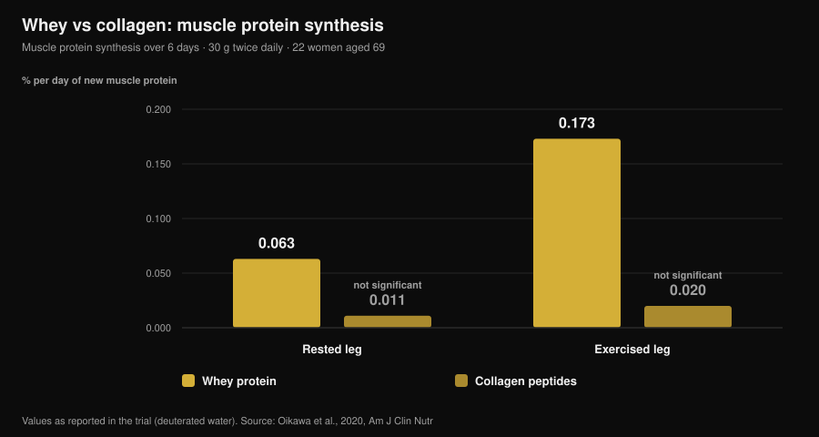
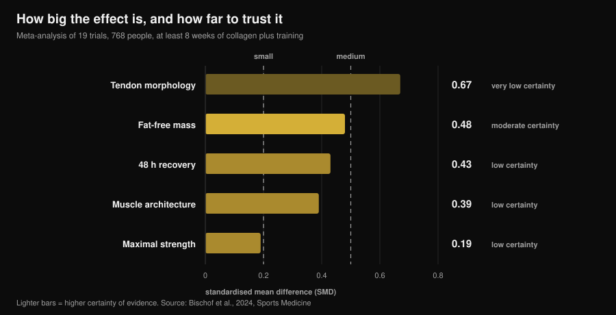

# Collagen Powder: Does It Help Muscle and Tendon?

By [Giammaria Loi](/autore/giammaria-loi) · updated 18 November 2026

Collagen ended up on the protein shelf, next to whey, under the same label: "protein powder". It is a category error that costs money. On muscle, collagen does not compete — and that is not an opinion, it was measured with a tracer, gram for gram. But there is one tissue where something does seem to happen, and it is not the one on the front of the tub.

## In short

- **As a protein for muscle it is the worst choice on the shelf.** In a tracer study, 30 g of whey twice a day raised muscle protein synthesis; 30 g of collagen at the same dose **did not raise it above baseline**, at rest or after training.
- **On tendons, the biggest effect is also the least reliable.** The largest meta-analysis finds its strongest effect on tendon morphology (SMD 0.67) but rates the certainty of that evidence **very low**. The only outcome with moderate certainty is fat-free mass (SMD 0.48).
- **On maximal strength the effect is near zero** (SMD 0.19): if you want kilos on the bar, collagen is not the lever.
- **Timing matters more than brand.** In the tendon trials, gelatin or collagen is taken with vitamin C **about an hour before** the work that loads the tendon: 15 g an hour before doubled a marker of collagen synthesis.
- **On the sore knee, the results contradict each other.** 5 g a day reduced pain in 139 young athletes; 10 g a day did no better than placebo in 167 active people around 63 years old.

*Nurvan chart built on values published by Oikawa et al., 2020 (Am J Clin Nutr): 22 women aged 69, 30 g of protein twice daily for six days, measured with deuterated water. No value read off a figure.*

## What it is, and why it is not a protein like the others

Collagen is the structural protein of tendons, ligaments, skin and bone. In powder form you buy it as **collagen peptides** or hydrolysed collagen: protein broken into short fragments that dissolve in water and absorb quickly. Gelatin is the same protein, less fragmented.

The catch is its amino acid profile. Collagen is roughly one third glycine and holds very little leucine — the amino acid that switches on the building of new muscle protein. It contains no tryptophan at all, one of the essential amino acids. That is why nutritionists call collagen an **incomplete** protein: no label says so, but the biochemistry is not negotiable. If you want to know how much real protein you need and how to spread it out, we covered that here: [how much protein per meal, is there a limit](/en/blog/how-much-protein-per-meal-limit).

## The hardest test: collagen against whey on muscle

In 2020 Stuart Phillips' group at McMaster ran the head-to-head. Twenty-two healthy women aged 69, split into two groups, took **30 g of whey or 30 g of collagen peptides twice a day for six days**, with two training sessions on one leg only — so the trained leg and the rested leg are compared within the same person.

The result, measured with deuterated water across the whole week: on whey, muscle protein synthesis rose to **0.063% per day** in the rested leg and **0.173%** in the trained one. On collagen the values stayed at 0.011% and 0.020%, which is **not significantly above baseline**. Not even training was enough to make collagen work as a protein.

That number settles the question "can I use collagen instead of whey after training?". No.

## What if I add it to whey?

Here the recent research gets more interesting, and more honest. When you eat 30 g of whey after training, blood glycine **falls**: whey carries little of it, and the body spends it. Glycine is the amino acid connective tissue needs most.

A group in Maastricht measured it in 14 men: with whey alone, glycine availability over the six hours after training was negative (−8.9 mmol·360 min/L), while **5 g of collagen** added to 25 g of whey is enough to bring it back above zero (+9.2). Adding 10 or 15 g does nothing extra for that purpose and lowers available leucine instead: more collagen is not better.

The same group then tested that 25 g whey + 5 g collagen blend against a non-caloric placebo: myofibrillar protein synthesis — the muscle — rose both at rest and after exercise, and connective protein synthesis rose at rest but not significantly in the exercised leg. Read it carefully: the comparison was **against placebo, not against whey alone**. It shows the blend works, not that it beats whey.

## Where something really happens: the tendon

In 2024 *Sports Medicine* published the largest systematic review on the topic: 19 randomised trials, 768 people, at least 8 weeks of collagen peptides alongside training. The positive effects are there, but the thing that matters is reading them together with the **certainty of the evidence** graded with GRADE.

*Nurvan chart built on values published by Bischof et al., 2024 (Sports Medicine). SMD = standardised mean difference: by convention 0.2 is a small effect and 0.5 a medium one. Bar colour shows the GRADE certainty stated by the authors. No value read off a figure.*

The chart says something no product page ever says: **the largest effect is the one we are least sure about**. Tendon morphology gains most (SMD 0.67) on evidence of very low certainty; fat-free mass gains less (SMD 0.48) with the highest certainty in the set; maximal strength barely moves (SMD 0.19).

One controlled trial shows what that looks like in practice. Fifty moderately active men did 14 weeks of knee extensions at 70–85% of their one-rep max, three times a week, with 5 g of collagen peptides or placebo. The collagen group gained more **patellar tendon cross-sectional area**, but on tendon stiffness, muscle cross-sectional area and strength there was **no difference between groups**. The tendon got thicker; it was not shown to get stronger.

## The one-hour window, and the vitamin C

The tendon studies hinge on a detail that almost always drops out of the retelling: timing. Tendons have little blood supply, and their collagen synthesis rises when they are loaded.

In the study that opened this line of work, eight men took 5 or 15 g of vitamin C-enriched gelatin **one hour before** six minutes of rope skipping, three times a day for three days. On 15 g, the blood marker of collagen synthesis **doubled**; serum drawn after the dose, applied to engineered ligaments in the lab, increased their collagen content and improved their mechanics.

That is eight people and a marker, not injuries prevented. But it explains why "whenever I remember" and "an hour before tendon work" are not the same dose. A 2026 review of rehabilitation nutrition reaches the same practical conclusion: collagen or gelatin with vitamin C **before** loading work, as support for the rehab programme, never instead of progressive loading. On what to eat while you are out injured, we have a dedicated piece: [what to eat when you're injured](/en/blog/what-to-eat-when-injured).

## The knee: two studies, two answers

The best-selling claim is "it takes joint pain away". Here the research splits, and it is worth knowing where.

In 2017, 139 athletic subjects with functional knee pain took 5 g of collagen peptides or placebo for 12 weeks: pain during activity improved more in the collagen group (−19.5 versus −13.9 points on a visual scale, p = 0.046), confirmed by the physicians' assessment.

In 2020, 167 active people with self-reported knee pain, median age 63, took 10 g a day or placebo for 12 weeks: pain fell **equally** in both groups (−1.6 versus −1.9 points), and no inflammatory, cartilage or bone marker moved.

Two trials, double the dose in the second, opposite results. Age, type of pain and population differ: this is not a tie you break by picking the study you prefer. It is why the honest answer on this claim is "maybe, in some people", not "yes".

## What the research actually says

| Common claim | Verdict | Source |
|---|---|---|
| "It's a protein, fine after training" | **Busted**: 30 g of collagen does not raise muscle protein synthesis; 30 g of whey does | Oikawa et al., 2020 |
| "It builds muscle" | **Needs qualifying**: the meta-analysis finds more fat-free mass (SMD 0.48, moderate certainty), but the mechanistic data do not explain it through collagen as a protein source | Bischof et al., 2024; Oikawa et al., 2020 |
| "It strengthens tendons" | **Needs qualifying**: the tendon gets thicker, but stiffness and strength do not change versus training alone, and certainty of evidence is very low | Jerger et al., 2023; Bischof et al., 2024 |
| "It fixes knee pain" | **Needs qualifying**: yes in young athletes on 5 g for 12 weeks, no in older active people on 10 g | Zdzieblik et al., 2017; Bongers et al., 2020 |
| "Take it with vitamin C an hour before" | **Confirmed on markers**: 15 g of gelatin with vitamin C an hour before loading doubles a marker of collagen synthesis | Shaw et al., 2017 |
| "Adding it to whey ruins the protein" | **Busted**: 5 g of collagen on 25 g of whey brings glycine back into positive without costing leucine | Aussieker et al., 2024 |
| "More is better" | **Busted**: beyond 5 g added to whey, available leucine falls, and the trials that worked used 5–15 g, not more | Aussieker et al., 2024; Shaw et al., 2017 |
| "It adds kilos to your lifts" | **Busted**: on maximal strength the effect is SMD 0.19, at low certainty | Bischof et al., 2024 |

## How to apply it

1. **Do not swap protein for collagen.** Cover your intake first with complete sources: meat, fish, eggs, dairy, legumes and soy, or whey. Collagen is an addition, not a replacement.
2. **If you use it for the tendon, use a clock.** 10–15 g of collagen peptides or gelatin with vitamin C, **about an hour before** the session that loads that tendon. Outside that window the studies tell you nothing.
3. **If you use it alongside whey, 5 g is enough.** That is the dose that brings glycine back into positive after training without lowering leucine.
4. **Give it time and track one thing.** The trials run 8 to 14 weeks. Pick one indicator before you start — pain during a specific movement, or load tolerated on one exercise — and look at it at 12 weeks, not at 10 days.
5. **Do not expect kilos on the bar.** On maximal strength the average effect is close to zero: if that is your goal, collagen is not where the money goes.
6. **Joint pain that persists, worsens or blocks movement: see a doctor.** A supplement is not a diagnosis, and a tendon that has hurt for months is not a powder problem.

> **Nurvan: a supplement with the right hour, not just the right dose**
>
> Collagen is one of the few supplements where timing genuinely counts: an hour before tendon work. In Nurvan you log dose and time in the supplement module, and because training lives in the same app you can see, session by session, whether you actually took it inside that window — and whether the load on that exercise is climbing meanwhile. [Try Nurvan](https://nurvan.app)

## FAQ

**Does collagen powder build muscle?**
Not as a protein source. In a direct tracer comparison, 30 g of collagen peptides twice a day did not raise muscle protein synthesis above baseline, while the same dose of whey did. The 2024 meta-analysis does find a gain in fat-free mass (SMD 0.48), but through a mechanism that collagen-as-protein does not explain: it is not a reason to replace the protein in your meals.

**Collagen or whey?**
For muscle, whey, no contest. Collagen makes sense as a targeted addition for connective tissue, at 5–15 g, and 5 g is enough if you put it alongside whey after training.

**How much collagen per day?**
The trials that found effects used 5 to 15 g a day: 5 g in the knee pain and patellar tendon work, 15 g of gelatin in the pre-exercise protocols. Higher doses showed no advantage and, blended with whey, lower available leucine.

**When should you take collagen?**
If the target is the tendon, about an hour before the session that loads it, with vitamin C: that is the schedule used in the studies with positive marker results. If you use it as an add-on to post-training protein, take it with the whey.

**Do you really need the vitamin C?**
In the studies the gelatin was enriched with vitamin C, because vitamin C is a required cofactor for collagen synthesis. Separating the two has not been tested: if you follow that protocol, follow that detail too.

## Read next

- [Strength supplement tier list: what research says](/en/blog/strength-supplements-tier-list-evidence) — where collagen sits against the supplements with harder evidence behind them.
- [Beef Protein Powder vs Whey: What Research Says](/en/blog/beef-protein-powder-vs-whey) — the other powder sold as a complete protein, measured on the same yardstick.
- [What to Eat When You're Injured](/en/blog/what-to-eat-when-injured) — the diet for the weeks when connective tissue has to rebuild.

## Sources

1. Oikawa SY, Kamal MJ, Webb EK, McGlory C, Baker SK, Phillips SM, 2020. Whey protein but not collagen peptides stimulate acute and longer-term muscle protein synthesis with and without resistance exercise in healthy older women: a randomized controlled trial. *Am J Clin Nutr* 111(3):708-718. [PMID 31919527](https://pubmed.ncbi.nlm.nih.gov/31919527/) · [DOI 10.1093/ajcn/nqz332](https://doi.org/10.1093/ajcn/nqz332)
2. Bischof K, Moitzi AM, Stafilidis S, König D, 2024. Impact of Collagen Peptide Supplementation in Combination with Long-Term Physical Training on Strength, Musculotendinous Remodeling, Functional Recovery, and Body Composition in Healthy Adults: A Systematic Review with Meta-analysis. *Sports Med* 54(11):2865-2888. [PMID 39060741](https://pubmed.ncbi.nlm.nih.gov/39060741/) · [DOI 10.1007/s40279-024-02079-0](https://doi.org/10.1007/s40279-024-02079-0)
3. Jerger S, Centner C, Lauber B, Seynnes O, Friedrich T, Lolli D, Gollhofer A, König D, 2023. Specific collagen peptides increase adaptions of patellar tendon morphology following 14-weeks of high-load resistance training: A randomized-controlled trial. *Eur J Sport Sci* 23(12):2329-2339. [PMID 37424319](https://pubmed.ncbi.nlm.nih.gov/37424319/) · [DOI 10.1080/17461391.2023.2232758](https://doi.org/10.1080/17461391.2023.2232758)
4. Shaw G, Lee-Barthel A, Ross ML, Wang B, Baar K, 2017. Vitamin C-enriched gelatin supplementation before intermittent activity augments collagen synthesis. *Am J Clin Nutr* 105(1):136-143. [PMID 27852613](https://pubmed.ncbi.nlm.nih.gov/27852613/) · [DOI 10.3945/ajcn.116.138594](https://doi.org/10.3945/ajcn.116.138594)
5. Aussieker T, Janssen TAH, Hermans WJH, Holwerda AM, Senden JM, van Kranenburg JMX, Goessens JPB, Snijders T, van Loon LJC, 2024. Coingestion of Collagen With Whey Protein Prevents Postexercise Decline in Plasma Glycine Availability in Recreationally Active Men. *Int J Sport Nutr Exerc Metab* 34(4):189-198. [PMID 38604602](https://pubmed.ncbi.nlm.nih.gov/38604602/) · [DOI 10.1123/ijsnem.2023-0264](https://doi.org/10.1123/ijsnem.2023-0264)
6. Aussieker T, Kaiser J, Hermans WJH, Hendriks FK, Holwerda AM, Senden JM, van Kranenburg JMX, Goessens JPB, Braun U, Baar K, Snijders T, van Loon LJC, 2024. Ingestion of a Whey Plus Collagen Protein Blend Increases Myofibrillar and Muscle Connective Protein Synthesis Rates. *Med Sci Sports Exerc* 57(3):544-554. [PMID 39501478](https://pubmed.ncbi.nlm.nih.gov/39501478/) · [DOI 10.1249/MSS.0000000000003596](https://doi.org/10.1249/MSS.0000000000003596)
7. Zdzieblik D, Oesser S, Gollhofer A, König D, 2017. Improvement of activity-related knee joint discomfort following supplementation of specific collagen peptides. *Appl Physiol Nutr Metab* 42(6):588-595. [PMID 28177710](https://pubmed.ncbi.nlm.nih.gov/28177710/) · [DOI 10.1139/apnm-2016-0390](https://doi.org/10.1139/apnm-2016-0390)
8. Bongers CCWG, Ten Haaf DSM, Catoire M, Kersten B, Wouters JA, Eijsvogels TMH, Hopman MTE, 2020. Effectiveness of collagen supplementation on pain scores in healthy individuals with self-reported knee pain: a randomized controlled trial. *Appl Physiol Nutr Metab* 45(7):793-800. [PMID 31990581](https://pubmed.ncbi.nlm.nih.gov/31990581/) · [DOI 10.1139/apnm-2019-0654](https://doi.org/10.1139/apnm-2019-0654)

Practical guidance on collagen and gelatin before loading work in rehabilitation: Lee EJ, Kim J, et al., 2026. Rehabilitation Nutrition for Tendon and Ligament Injuries: From Collagen Remodeling to Return-to-Activity and Sport. *Healthcare (Basel)* 14(14). [PMID 42512652](https://pubmed.ncbi.nlm.nih.gov/42512652/) · [DOI 10.3390/healthcare14142136](https://doi.org/10.3390/healthcare14142136). Topic chosen from November 2026 trend signals: collagen powder entered the growth charts on 15–16 November 2026 (collagen powder 74,000 monthly searches, +31%; collagen protein powder 22,200 monthly searches, +242%), with competing content made almost entirely of product pages. Scientific sources consulted through PubMed.

**Giammaria Loi** is the founder of Nurvan. He has been lifting since 2012, has worked as a FIPE-certified personal trainer and coach since 2013, and has competed in powerlifting at national level since 2018. Every article he writes starts from the research and ends with what actually works in the gym. [Author page](/autore/giammaria-loi)

> Note: educational content. It does not replace the advice of a doctor or qualified professional.
