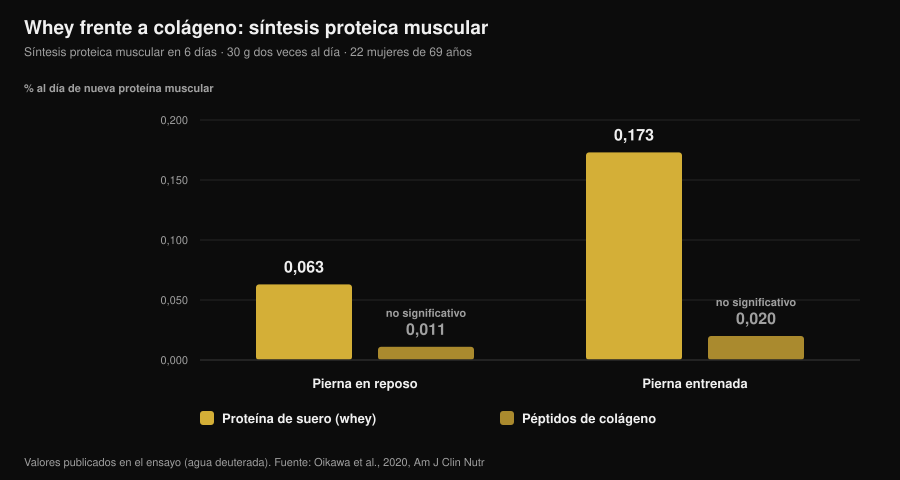
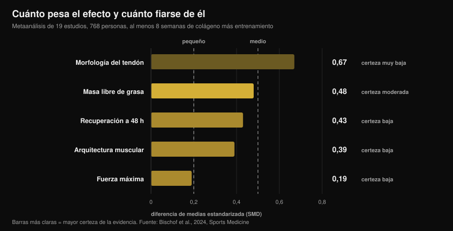

# Colágeno en polvo: ¿sirve para músculo y tendones?

Por [Giammaria Loi](/autore/giammaria-loi) · actualizado el 18 de noviembre de 2026

El colágeno acabó en el estante de las proteínas, al lado de la whey, con la misma etiqueta: "proteína en polvo". Es un error de categoría que cuesta dinero. Sobre el músculo el colágeno no aguanta la comparación, y no es una opinión: se midió con trazador, gramo a gramo. Pero hay un tejido en el que algo sí parece ocurrir, y no es el que te venden en la portada del bote.

## En breve

- **Como proteína para el músculo es la peor opción del estante.** En un estudio con trazador, 30 g de whey dos veces al día subieron la síntesis proteica muscular; 30 g de colágeno, a la misma dosis, **no la subieron por encima del punto de partida**, ni en reposo ni después de entrenar.
- **En los tendones, el efecto más grande es también el menos sólido.** El metaanálisis más amplio encuentra su mayor efecto en la morfología del tendón (SMD 0,67), pero le asigna una certeza de la evidencia **muy baja**. El único resultado con certeza moderada es la masa libre de grasa (SMD 0,48).
- **Sobre la fuerza máxima el efecto es casi nulo** (SMD 0,19): si buscas kilos en la barra, el colágeno no es la palanca.
- **El momento importa más que la marca.** En los estudios sobre tendón, la gelatina o el colágeno se toman con vitamina C **una hora antes** del trabajo que carga el tendón: 15 g una hora antes duplicaron un marcador de síntesis de colágeno.
- **En la rodilla dolorida los resultados se contradicen.** 5 g al día redujeron el dolor en 139 atletas jóvenes; 10 g al día no superaron al placebo en 167 personas activas de unos 63 años.

*Gráfico Nurvan sobre los valores publicados por Oikawa et al., 2020 (Am J Clin Nutr): 22 mujeres de 69 años, 30 g de proteína dos veces al día durante seis días, medición con agua deuterada. Ningún valor leído de una figura.*

## Qué es, y por qué no es una proteína como las demás

El colágeno es la proteína estructural de tendones, ligamentos, piel y hueso. En polvo se vende como **péptidos de colágeno** o colágeno hidrolizado: proteína partida en fragmentos cortos que se disuelven en agua y se absorben rápido. La gelatina es la misma proteína, menos fragmentada.

El punto crítico es su perfil de aminoácidos. El colágeno es aproximadamente un tercio glicina y tiene muy poca leucina, el aminoácido que enciende la construcción de proteína muscular nueva. Le falta por completo el triptófano, uno de los aminoácidos esenciales. Por eso en nutrición el colágeno se considera una proteína **incompleta**: ninguna etiqueta lo dice, pero la bioquímica no se negocia. Si quieres saber cuánta proteína real necesitas y cómo repartirla, lo contamos aquí: [cuánta proteína por comida, el mito de los 30 g](/es/blog/cuanta-proteina-por-comida-limite).

## La prueba más dura: colágeno contra whey en el músculo

En 2020 el grupo de Stuart Phillips, en McMaster, hizo la comparación directa. Veintidós mujeres sanas de 69 años, en dos grupos, tomaron **30 g de whey o 30 g de péptidos de colágeno dos veces al día durante seis días**, con dos sesiones de entrenamiento en una sola pierna: así la pierna entrenada y la que descansa se comparan dentro de la misma persona.

El resultado, medido con agua deuterada a lo largo de toda la semana: con whey la síntesis proteica muscular subió a **0,063% al día** en la pierna en reposo y a **0,173%** en la entrenada. Con colágeno los valores se quedaron en 0,011% y 0,020%, es decir, **sin diferencia significativa respecto al inicio**. Ni siquiera el entrenamiento bastó para que el colágeno funcionara como proteína.

Ese número cierra la pregunta "¿puedo usar colágeno en lugar de whey después de entrenar?". No.

## ¿Y si lo añado a la whey?

Aquí la investigación reciente es más interesante y más honesta. Cuando tomas 30 g de whey después de entrenar, la glicina en sangre **baja**: la whey tiene poca y el cuerpo la gasta. La glicina es el aminoácido que más necesita el tejido conectivo.

Un grupo de Maastricht lo midió en 14 hombres: con whey sola, la disponibilidad de glicina en las seis horas posteriores al entrenamiento fue negativa (−8,9 mmol·360 min/L), mientras que **bastan 5 g de colágeno** añadidos a 25 g de whey para devolverla por encima de cero (+9,2). Añadir 10 o 15 g no aporta nada más a ese objetivo y en cambio baja la leucina disponible: más colágeno no es mejor.

El mismo grupo probó después esa mezcla de 25 g de whey + 5 g de colágeno frente a un placebo sin calorías: la síntesis proteica miofibrilar —el músculo— subió tanto en reposo como después del ejercicio, y la del tejido conectivo subió en reposo pero no de forma significativa en la pierna entrenada. Ojo con la lectura: la comparación fue **contra placebo, no contra whey sola**. Demuestra que la mezcla funciona, no que sea mejor que la whey.

## Donde algo sí ocurre: el tendón

En 2024 *Sports Medicine* publicó la revisión sistemática más amplia sobre el tema: 19 ensayos aleatorizados, 768 personas, al menos 8 semanas de péptidos de colágeno junto al entrenamiento. Los efectos positivos existen, pero lo importante es leerlos junto a la **certeza de la evidencia** valorada con el método GRADE.

*Gráfico Nurvan sobre los valores publicados por Bischof et al., 2024 (Sports Medicine). SMD = diferencia de medias estandarizada: por convención 0,2 es un efecto pequeño y 0,5 medio. El color de la barra indica la certeza GRADE declarada por los autores. Ningún valor leído de una figura.*

El gráfico dice algo que ninguna ficha de producto dice: **el efecto más grande es aquel del que menos seguros estamos**. La morfología del tendón gana más (SMD 0,67) sobre evidencia de certeza muy baja; la masa libre de grasa gana menos (SMD 0,48) con la certeza más alta del conjunto; la fuerza máxima casi no se mueve (SMD 0,19).

Un ensayo controlado muestra qué significa en la práctica. Cincuenta hombres moderadamente activos hicieron 14 semanas de extensiones de rodilla al 70-85% de su máximo, tres veces por semana, con 5 g de péptidos de colágeno o placebo. El grupo de colágeno ganó más **sección transversal del tendón rotuliano**, pero en rigidez del tendón, sección del músculo y fuerza **no hubo diferencia entre grupos**. El tendón se hizo más grueso; no se demostró que se hiciera más fuerte.

## La ventana de una hora, y la vitamina C

Los estudios sobre tendón dependen de un detalle que casi siempre se pierde al contarlos: el momento. El tendón tiene poca sangre y su síntesis de colágeno sube cuando se le carga.

En el estudio que abrió esta línea, ocho hombres tomaron 5 o 15 g de gelatina enriquecida con vitamina C **una hora antes** de seis minutos de saltos a la comba, tres veces al día durante tres días. Con 15 g el marcador sanguíneo de síntesis de colágeno se **duplicó**; el suero extraído tras la dosis, aplicado sobre ligamentos de ingeniería tisular en laboratorio, aumentó su contenido de colágeno y mejoró sus propiedades mecánicas.

Son ocho personas y marcadores, no lesiones evitadas. Pero explican por qué "cuando me acuerdo" y "una hora antes del trabajo de tendón" no son la misma dosis. Una revisión de 2026 sobre nutrición en rehabilitación llega a la misma conclusión práctica: colágeno o gelatina con vitamina C **antes** del trabajo de carga, como apoyo al programa de rehabilitación, nunca en lugar de la carga progresiva. Sobre qué comer durante la pausa por lesión tenemos un artículo dedicado: [qué comer cuando estás lesionado](/es/blog/que-comer-cuando-estas-lesionado).

## La rodilla: dos estudios, dos respuestas

El reclamo que más vende es "quita el dolor articular". Aquí la investigación se divide, y conviene saber en qué.

En 2017, 139 sujetos deportistas con dolor funcional de rodilla tomaron 5 g de péptidos de colágeno o placebo durante 12 semanas: el dolor durante la actividad mejoró más en el grupo de colágeno (−19,5 frente a −13,9 puntos en escala visual, p = 0,046), con confirmación de la valoración médica.

En 2020, 167 personas activas con dolor de rodilla autorreferido, de 63 años de mediana, tomaron 10 g al día o placebo durante 12 semanas: el dolor bajó **igual** en ambos grupos (−1,6 frente a −1,9 puntos), y ningún marcador de inflamación, cartílago o hueso se movió.

Dos ensayos, el doble de dosis en el segundo, resultado opuesto. Edad, tipo de dolor y población son distintos: no es un empate que se resuelva eligiendo el estudio que gusta. Por eso la respuesta honesta a este reclamo es "quizá, en algunas personas", no "sí".

## Lo que dice de verdad la investigación

| Afirmación habitual | Veredicto | Fuente |
|---|---|---|
| "Es proteína, vale después de entrenar" | **Desmentido**: 30 g de colágeno no suben la síntesis proteica muscular; 30 g de whey sí | Oikawa et al., 2020 |
| "Hace crecer el músculo" | **Matizado**: el metaanálisis encuentra más masa libre de grasa (SMD 0,48, certeza moderada), pero los datos de mecanismo no lo explican por el colágeno como fuente proteica | Bischof et al., 2024; Oikawa et al., 2020 |
| "Refuerza los tendones" | **Matizado**: el tendón se engrosa, pero rigidez y fuerza no cambian frente al entrenamiento solo, y la certeza de la evidencia es muy baja | Jerger et al., 2023; Bischof et al., 2024 |
| "Quita el dolor de rodilla" | **Matizado**: sí en atletas jóvenes con 5 g durante 12 semanas, no en personas activas mayores con 10 g | Zdzieblik et al., 2017; Bongers et al., 2020 |
| "Hay que tomarlo con vitamina C una hora antes" | **Confirmado en marcadores**: 15 g de gelatina con vitamina C una hora antes de la carga duplican un marcador de síntesis de colágeno | Shaw et al., 2017 |
| "Añadirlo a la whey estropea la proteína" | **Desmentido**: 5 g de colágeno sobre 25 g de whey devuelven la glicina a positivo sin restar leucina | Aussieker et al., 2024 |
| "Cuanto más, mejor" | **Desmentido**: más allá de 5 g añadidos a la whey la leucina disponible baja, y los ensayos con efecto usaron 5-15 g, no más | Aussieker et al., 2024; Shaw et al., 2017 |
| "Te hace levantar más kilos" | **Desmentido**: en fuerza máxima el efecto es SMD 0,19, con certeza baja | Bischof et al., 2024 |

## Cómo aplicarlo

1. **No sustituyas proteína por colágeno.** Primero cubre tus necesidades con fuentes completas: carne, pescado, huevos, lácteos, legumbres y soja, o whey. El colágeno es un añadido, no un reemplazo.
2. **Si lo usas para el tendón, usa el reloj.** 10-15 g de péptidos de colágeno o gelatina con vitamina C, **una hora antes** de la sesión que carga ese tendón. Fuera de esa ventana los estudios no dicen nada.
3. **Si lo usas junto a la whey, bastan 5 g.** Es la dosis que devuelve la glicina a positivo después de entrenar sin bajar la leucina.
4. **Dale tiempo y mide una sola cosa.** Los ensayos duran de 8 a 14 semanas. Elige un indicador antes de empezar —dolor en un movimiento concreto, o carga tolerada en un ejercicio— y míralo a las 12 semanas, no a los 10 días.
5. **No esperes kilos en la barra.** En fuerza máxima el efecto medio ronda el cero: si ese es tu objetivo, el colágeno no es donde conviene gastar.
6. **Dolor articular que persiste, empeora o bloquea el movimiento: al médico.** Un suplemento no es un diagnóstico, y un tendón que duele desde hace meses no es un problema de polvos.

> **Nurvan: un suplemento con la hora correcta, no solo la dosis correcta**
>
> El colágeno es uno de los pocos suplementos en los que el momento cuenta de verdad: una hora antes del trabajo de tendón. En Nurvan registras dosis y hora en el módulo de suplementación, y como el entrenamiento está en la misma app ves sesión a sesión si lo tomaste dentro de esa ventana, y si la carga de ese ejercicio está subiendo mientras tanto. [Prueba Nurvan](https://nurvan.app)

## Preguntas frecuentes

**¿El colágeno en polvo hace crecer los músculos?**
No como fuente proteica. En una comparación directa con trazador, 30 g de péptidos de colágeno dos veces al día no subieron la síntesis proteica muscular por encima del inicio, mientras que la misma dosis de whey sí. El metaanálisis de 2024 encuentra un aumento de masa libre de grasa (SMD 0,48), pero por un mecanismo que el colágeno como proteína no explica: no es motivo para sustituir la proteína de las comidas.

**¿Mejor colágeno o whey?**
Para el músculo, whey, sin discusión. El colágeno tiene sentido como añadido dirigido al tejido conectivo, en dosis de 5-15 g, y 5 g bastan si lo juntas con la whey después de entrenar.

**¿Cuánto colágeno al día hace falta?**
Los ensayos que encontraron efectos usaron de 5 a 15 g al día: 5 g en los trabajos sobre dolor de rodilla y tendón rotuliano, 15 g de gelatina en los protocolos previos al ejercicio. Dosis mayores no mostraron ventaja y, mezcladas con whey, bajan la leucina disponible.

**¿Cuándo se toma el colágeno?**
Si el objetivo es el tendón, una hora antes de la sesión que lo carga, con vitamina C: es el esquema usado en los estudios con resultados positivos en marcadores. Si lo usas como añadido a la proteína de después de entrenar, va junto a la whey.

**¿Hace falta de verdad la vitamina C?**
En los estudios la gelatina estaba enriquecida con vitamina C, porque la vitamina C es un cofactor necesario para la síntesis de colágeno. Separar ambas cosas no se ha probado: si sigues ese protocolo, sigue también ese detalle.

## Lee también

- [Tier list de suplementos para la fuerza: la evidencia](/es/blog/clasificacion-suplementos-fuerza-tier-list) — dónde queda el colágeno frente a los suplementos con pruebas más sólidas.
- [Beef protein: ¿la proteína de carne vale como la whey?](/es/blog/beef-protein-proteina-de-carne-vs-whey) — el otro polvo vendido como proteína completa, medido con la misma vara.
- [Qué comer cuando estás lesionado](/es/blog/que-comer-cuando-estas-lesionado) — la dieta de las semanas en que el tejido conectivo tiene que reconstruirse.

## Fuentes

1. Oikawa SY, Kamal MJ, Webb EK, McGlory C, Baker SK, Phillips SM, 2020. Whey protein but not collagen peptides stimulate acute and longer-term muscle protein synthesis with and without resistance exercise in healthy older women: a randomized controlled trial. *Am J Clin Nutr* 111(3):708-718. [PMID 31919527](https://pubmed.ncbi.nlm.nih.gov/31919527/) · [DOI 10.1093/ajcn/nqz332](https://doi.org/10.1093/ajcn/nqz332)
2. Bischof K, Moitzi AM, Stafilidis S, König D, 2024. Impact of Collagen Peptide Supplementation in Combination with Long-Term Physical Training on Strength, Musculotendinous Remodeling, Functional Recovery, and Body Composition in Healthy Adults: A Systematic Review with Meta-analysis. *Sports Med* 54(11):2865-2888. [PMID 39060741](https://pubmed.ncbi.nlm.nih.gov/39060741/) · [DOI 10.1007/s40279-024-02079-0](https://doi.org/10.1007/s40279-024-02079-0)
3. Jerger S, Centner C, Lauber B, Seynnes O, Friedrich T, Lolli D, Gollhofer A, König D, 2023. Specific collagen peptides increase adaptions of patellar tendon morphology following 14-weeks of high-load resistance training: A randomized-controlled trial. *Eur J Sport Sci* 23(12):2329-2339. [PMID 37424319](https://pubmed.ncbi.nlm.nih.gov/37424319/) · [DOI 10.1080/17461391.2023.2232758](https://doi.org/10.1080/17461391.2023.2232758)
4. Shaw G, Lee-Barthel A, Ross ML, Wang B, Baar K, 2017. Vitamin C-enriched gelatin supplementation before intermittent activity augments collagen synthesis. *Am J Clin Nutr* 105(1):136-143. [PMID 27852613](https://pubmed.ncbi.nlm.nih.gov/27852613/) · [DOI 10.3945/ajcn.116.138594](https://doi.org/10.3945/ajcn.116.138594)
5. Aussieker T, Janssen TAH, Hermans WJH, Holwerda AM, Senden JM, van Kranenburg JMX, Goessens JPB, Snijders T, van Loon LJC, 2024. Coingestion of Collagen With Whey Protein Prevents Postexercise Decline in Plasma Glycine Availability in Recreationally Active Men. *Int J Sport Nutr Exerc Metab* 34(4):189-198. [PMID 38604602](https://pubmed.ncbi.nlm.nih.gov/38604602/) · [DOI 10.1123/ijsnem.2023-0264](https://doi.org/10.1123/ijsnem.2023-0264)
6. Aussieker T, Kaiser J, Hermans WJH, Hendriks FK, Holwerda AM, Senden JM, van Kranenburg JMX, Goessens JPB, Braun U, Baar K, Snijders T, van Loon LJC, 2024. Ingestion of a Whey Plus Collagen Protein Blend Increases Myofibrillar and Muscle Connective Protein Synthesis Rates. *Med Sci Sports Exerc* 57(3):544-554. [PMID 39501478](https://pubmed.ncbi.nlm.nih.gov/39501478/) · [DOI 10.1249/MSS.0000000000003596](https://doi.org/10.1249/MSS.0000000000003596)
7. Zdzieblik D, Oesser S, Gollhofer A, König D, 2017. Improvement of activity-related knee joint discomfort following supplementation of specific collagen peptides. *Appl Physiol Nutr Metab* 42(6):588-595. [PMID 28177710](https://pubmed.ncbi.nlm.nih.gov/28177710/) · [DOI 10.1139/apnm-2016-0390](https://doi.org/10.1139/apnm-2016-0390)
8. Bongers CCWG, Ten Haaf DSM, Catoire M, Kersten B, Wouters JA, Eijsvogels TMH, Hopman MTE, 2020. Effectiveness of collagen supplementation on pain scores in healthy individuals with self-reported knee pain: a randomized controlled trial. *Appl Physiol Nutr Metab* 45(7):793-800. [PMID 31990581](https://pubmed.ncbi.nlm.nih.gov/31990581/) · [DOI 10.1139/apnm-2019-0654](https://doi.org/10.1139/apnm-2019-0654)

Indicación práctica sobre colágeno y gelatina antes del trabajo de carga en rehabilitación: Lee EJ, Kim J, et al., 2026. Rehabilitation Nutrition for Tendon and Ligament Injuries: From Collagen Remodeling to Return-to-Activity and Sport. *Healthcare (Basel)* 14(14). [PMID 42512652](https://pubmed.ncbi.nlm.nih.gov/42512652/) · [DOI 10.3390/healthcare14142136](https://doi.org/10.3390/healthcare14142136). Tema elegido a partir de señales de tendencia de noviembre de 2026: el colágeno en polvo entró en las listas de crecimiento el 15-16 de noviembre de 2026 (collagen powder 74.000 búsquedas al mes, +31%; collagen protein powder 22.200 búsquedas al mes, +242%), con contenidos competidores formados casi solo por fichas de producto. Fuentes científicas consultadas a través de PubMed.

**Giammaria Loi** es el fundador de Nurvan. Entrena con pesas desde 2012, trabaja como entrenador personal y coach certificado FIPE desde 2013 y compite en powerlifting a nivel nacional desde 2018. Cada artículo que firma parte de los estudios científicos y llega a lo que funciona de verdad en el gimnasio. [Página del autor](/autore/giammaria-loi)

> Nota: contenido informativo, no sustituye la opinión de un médico o de un profesional cualificado.
