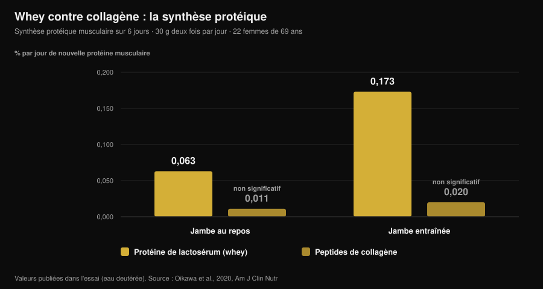

# Collagène en poudre : utile aux muscles et tendons ?

Par [Giammaria Loi](/autore/giammaria-loi) · mis à jour le 18 novembre 2026

Le collagène a fini sur l'étagère des protéines, à côté de la whey, avec la même étiquette : « protéine en poudre ». C'est une erreur de catégorie qui coûte cher. Sur le muscle, le collagène ne tient pas la comparaison, et ce n'est pas un avis : cela a été mesuré au traceur, gramme pour gramme. Mais il existe un tissu où quelque chose semble vraiment se passer — et ce n'est pas celui qu'on vous vend sur le pot.

## En bref

- **Comme protéine pour le muscle, c'est le pire choix du rayon.** Dans une étude au traceur, 30 g de whey deux fois par jour ont augmenté la synthèse protéique musculaire ; 30 g de collagène, à dose égale, **ne l'ont pas augmentée au-dessus du niveau de départ**, ni au repos ni après l'entraînement.
- **Sur les tendons, l'effet le plus grand est aussi le moins solide.** La plus large méta-analyse trouve son effet maximal sur la morphologie du tendon (SMD 0,67) mais lui attribue une certitude des preuves **très faible**. Le seul résultat en certitude modérée est la masse maigre (SMD 0,48).
- **Sur la force maximale, l'effet est quasi nul** (SMD 0,19) : si vous cherchez des kilos sur la barre, le collagène n'est pas le levier.
- **Le moment compte plus que la marque.** Dans les essais sur le tendon, la gélatine ou le collagène se prend avec de la vitamine C **environ une heure avant** le travail qui charge le tendon : 15 g une heure avant ont doublé un marqueur de synthèse du collagène.
- **Sur le genou douloureux, les résultats se contredisent.** 5 g par jour ont réduit la douleur chez 139 jeunes athlètes ; 10 g par jour n'ont pas fait mieux qu'un placebo chez 167 personnes actives d'environ 63 ans.

*Graphique Nurvan d'après les valeurs publiées par Oikawa et al., 2020 (Am J Clin Nutr) : 22 femmes de 69 ans, 30 g de protéines deux fois par jour pendant six jours, mesure à l'eau deutérée. Aucune valeur lue sur une figure.*

## Ce que c'est, et pourquoi ce n'est pas une protéine comme les autres

Le collagène est la protéine structurelle des tendons, des ligaments, de la peau et de l'os. En poudre, on l'achète sous forme de **peptides de collagène** ou de collagène hydrolysé : une protéine coupée en fragments courts, solubles dans l'eau et absorbés vite. La gélatine est la même protéine, moins fragmentée.

Le point critique est son profil en acides aminés. Le collagène est fait pour environ un tiers de glycine et contient très peu de leucine, l'acide aminé qui déclenche la fabrication de nouvelle protéine musculaire. Il ne contient pas du tout de tryptophane, l'un des acides aminés essentiels. C'est pourquoi, en nutrition, le collagène est une protéine **incomplète** : aucune étiquette ne le dit, mais la biochimie ne se négocie pas. Pour savoir combien de vraie protéine il vous faut et comment la répartir, nous l'avons écrit ici : [combien de protéines par repas, le mythe des 30 g](/fr/blog/combien-de-proteines-par-repas-limite).

## Le test le plus dur : collagène contre whey sur le muscle

En 2020, l'équipe de Stuart Phillips à McMaster a fait la comparaison directe. Vingt-deux femmes en bonne santé de 69 ans, en deux groupes, ont pris **30 g de whey ou 30 g de peptides de collagène deux fois par jour pendant six jours**, avec deux séances d'entraînement sur une seule jambe : la jambe entraînée et la jambe au repos se comparent ainsi chez la même personne.

Le résultat, mesuré à l'eau deutérée sur toute la semaine : avec la whey, la synthèse protéique musculaire est montée à **0,063 % par jour** dans la jambe au repos et à **0,173 %** dans la jambe entraînée. Avec le collagène, les valeurs sont restées à 0,011 % et 0,020 %, soit **pas significativement au-dessus du point de départ**. L'entraînement lui-même n'a pas suffi à faire fonctionner le collagène comme protéine.

Ce chiffre clôt la question « puis-je prendre du collagène à la place de la whey après l'entraînement ? ». Non.

## Et si je l'ajoute à la whey ?

Là, la recherche récente est plus intéressante et plus honnête. Quand vous prenez 30 g de whey après l'entraînement, la glycine sanguine **baisse** : la whey en contient peu et le corps en consomme. La glycine est l'acide aminé dont le tissu conjonctif a le plus besoin.

Une équipe de Maastricht l'a mesuré chez 14 hommes : avec la whey seule, la disponibilité en glycine sur les six heures après l'effort était négative (−8,9 mmol·360 min/L), alors que **5 g de collagène** ajoutés à 25 g de whey suffisent à la ramener au-dessus de zéro (+9,2). En ajouter 10 ou 15 g n'apporte rien de plus pour cet objectif et abaisse au contraire la leucine disponible : plus de collagène n'est pas mieux.

La même équipe a ensuite testé ce mélange 25 g de whey + 5 g de collagène contre un placebo sans calories : la synthèse protéique myofibrillaire — le muscle — a augmenté au repos comme après l'exercice, et celle du tissu conjonctif a augmenté au repos mais pas de façon significative dans la jambe entraînée. Attention à la lecture : la comparaison se faisait **contre placebo, pas contre la whey seule**. Elle montre que le mélange fonctionne, pas qu'il fait mieux que la whey.

## Là où il se passe vraiment quelque chose : le tendon

En 2024, *Sports Medicine* a publié la plus large revue systématique sur le sujet : 19 essais randomisés, 768 personnes, au moins 8 semaines de peptides de collagène associés à l'entraînement. Les effets positifs existent, mais l'essentiel est de les lire avec la **certitude des preuves** évaluée par la méthode GRADE.

*Graphique Nurvan d'après les valeurs publiées par Bischof et al., 2024 (Sports Medicine). SMD = différence moyenne standardisée : par convention 0,2 est un petit effet et 0,5 un effet moyen. La couleur de la barre indique la certitude GRADE déclarée par les auteurs. Aucune valeur lue sur une figure.*

Le graphique dit une chose qu'aucune fiche produit ne dit : **l'effet le plus grand est celui dont on est le moins sûr**. La morphologie du tendon gagne le plus (SMD 0,67) sur des preuves de certitude très faible ; la masse maigre gagne moins (SMD 0,48) avec la certitude la plus élevée de la série ; la force maximale ne bouge presque pas (SMD 0,19).

Un essai contrôlé montre ce que cela donne en pratique. Cinquante hommes modérément entraînés ont fait 14 semaines d'extensions de genoux à 70-85 % de leur maximum, trois fois par semaine, avec 5 g de peptides de collagène ou un placebo. Le groupe collagène a gagné davantage de **section transversale du tendon rotulien**, mais sur la raideur du tendon, la section du muscle et la force, **aucune différence entre les groupes**. Le tendon a grossi ; rien ne montre qu'il soit devenu plus solide.

## La fenêtre d'une heure, et la vitamine C

Les études sur le tendon reposent sur un détail qui se perd presque toujours dans le bouche-à-oreille : le moment. Le tendon est peu vascularisé, et sa synthèse de collagène augmente quand il est chargé.

Dans l'étude fondatrice, huit hommes ont pris 5 ou 15 g de gélatine enrichie en vitamine C **une heure avant** six minutes de corde à sauter, trois fois par jour pendant trois jours. Avec 15 g, le marqueur sanguin de synthèse du collagène a **doublé** ; le sérum prélevé après la prise, appliqué sur des ligaments reconstruits en laboratoire, a augmenté leur teneur en collagène et amélioré leurs propriétés mécaniques.

Ce sont huit personnes et des marqueurs, pas des blessures évitées. Mais cela explique pourquoi « quand j'y pense » et « une heure avant le travail du tendon » ne sont pas la même dose. Une revue de 2026 sur la nutrition en rééducation arrive à la même conclusion pratique : collagène ou gélatine avec vitamine C **avant** le travail de mise en charge, en appui du programme de rééducation, jamais à la place de la charge progressive. Sur l'alimentation pendant une blessure, nous avons un article dédié : [que manger quand on est blessé](/fr/blog/que-manger-quand-on-est-blesse).

## Le genou : deux études, deux réponses

L'argument qui vend le plus, c'est « ça fait passer les douleurs articulaires ». Ici la recherche se divise, et il vaut la peine de savoir sur quoi.

En 2017, 139 sujets sportifs souffrant de douleurs fonctionnelles du genou ont pris 5 g de peptides de collagène ou un placebo pendant 12 semaines : la douleur pendant l'activité s'est améliorée davantage dans le groupe collagène (−19,5 contre −13,9 points sur échelle visuelle, p = 0,046), confirmé par l'évaluation médicale.

En 2020, 167 personnes actives se plaignant du genou, d'âge médian 63 ans, ont pris 10 g par jour ou un placebo pendant 12 semaines : la douleur a baissé **de la même façon** dans les deux groupes (−1,6 contre −1,9 point), et aucun marqueur d'inflammation, de cartilage ou d'os n'a bougé.

Deux essais, dose doublée dans le second, résultat opposé. L'âge, le type de douleur et la population diffèrent : ce n'est pas une égalité qu'on tranche en choisissant l'étude qui arrange. C'est pour cela que la réponse honnête à cette promesse est « peut-être, chez certains », pas « oui ».

## Ce que dit vraiment la recherche

| Affirmation courante | Verdict | Source |
|---|---|---|
| « C'est une protéine, ça va après l'entraînement » | **Démenti** : 30 g de collagène n'augmentent pas la synthèse protéique musculaire ; 30 g de whey si | Oikawa et al., 2020 |
| « Ça fait prendre du muscle » | **À préciser** : la méta-analyse trouve plus de masse maigre (SMD 0,48, certitude modérée), mais les données mécanistiques ne l'expliquent pas par le collagène comme source de protéines | Bischof et al., 2024 ; Oikawa et al., 2020 |
| « Ça renforce les tendons » | **À préciser** : le tendon s'épaissit, mais raideur et force ne changent pas par rapport à l'entraînement seul, et la certitude des preuves est très faible | Jerger et al., 2023 ; Bischof et al., 2024 |
| « Ça enlève la douleur au genou » | **À préciser** : oui chez de jeunes athlètes avec 5 g pendant 12 semaines, non chez des personnes actives plus âgées avec 10 g | Zdzieblik et al., 2017 ; Bongers et al., 2020 |
| « Il faut le prendre avec de la vitamine C une heure avant » | **Confirmé sur les marqueurs** : 15 g de gélatine avec vitamine C une heure avant la charge doublent un marqueur de synthèse du collagène | Shaw et al., 2017 |
| « L'ajouter à la whey gâche la protéine » | **Démenti** : 5 g de collagène sur 25 g de whey ramènent la glycine en positif sans coûter de leucine | Aussieker et al., 2024 |
| « Plus on en prend, mieux c'est » | **Démenti** : au-delà de 5 g ajoutés à la whey, la leucine disponible baisse, et les essais efficaces utilisaient 5 à 15 g, pas plus | Aussieker et al., 2024 ; Shaw et al., 2017 |
| « Ça fait soulever plus lourd » | **Démenti** : sur la force maximale l'effet est de SMD 0,19, en certitude faible | Bischof et al., 2024 |

## Comment l'appliquer

1. **Ne remplacez pas les protéines par du collagène.** Couvrez d'abord vos besoins avec des sources complètes : viande, poisson, œufs, produits laitiers, légumineuses et soja, ou whey. Le collagène est un ajout, pas un remplacement.
2. **Si vous l'utilisez pour le tendon, regardez l'heure.** 10 à 15 g de peptides de collagène ou de gélatine avec vitamine C, **environ une heure avant** la séance qui charge ce tendon. Hors de cette fenêtre, les études ne disent rien.
3. **Avec la whey, 5 g suffisent.** C'est la dose qui ramène la glycine en positif après l'entraînement sans abaisser la leucine.
4. **Laissez du temps et ne mesurez qu'une chose.** Les essais durent de 8 à 14 semaines. Choisissez un indicateur avant de commencer — douleur sur un mouvement précis, ou charge tolérée sur un exercice — et regardez-le à 12 semaines, pas à 10 jours.
5. **N'attendez pas de kilos sur la barre.** Sur la force maximale, l'effet moyen est proche de zéro : si c'est votre objectif, le collagène n'est pas là qu'il faut dépenser.
6. **Douleur articulaire qui persiste, s'aggrave ou bloque le mouvement : consultez.** Un complément n'est pas un diagnostic, et un tendon qui fait mal depuis des mois n'est pas un problème de poudre.

> **Nurvan : un complément à la bonne heure, pas seulement à la bonne dose**
>
> Le collagène est l'un des rares compléments où le moment compte vraiment : une heure avant le travail du tendon. Dans Nurvan, vous enregistrez dose et heure dans le module compléments, et comme l'entraînement vit dans la même app, vous voyez séance après séance si vous l'avez bien pris dans la fenêtre — et si la charge sur cet exercice monte entre-temps. [Essayer Nurvan](https://nurvan.app)

## Questions fréquentes

**Le collagène en poudre fait-il grossir les muscles ?**
Pas comme source de protéines. Dans une comparaison directe au traceur, 30 g de peptides de collagène deux fois par jour n'ont pas élevé la synthèse protéique musculaire au-dessus du départ, alors que la même dose de whey l'a fait. La méta-analyse de 2024 trouve bien un gain de masse maigre (SMD 0,48), mais par un mécanisme que le collagène comme protéine n'explique pas : ce n'est pas une raison de remplacer les protéines du repas.

**Collagène ou whey ?**
Pour le muscle, la whey, sans discussion. Le collagène a du sens comme ajout ciblé sur le tissu conjonctif, à 5-15 g, et 5 g suffisent si vous le mettez avec la whey après l'entraînement.

**Quelle dose de collagène par jour ?**
Les essais qui ont trouvé des effets utilisaient 5 à 15 g par jour : 5 g dans les travaux sur la douleur de genou et le tendon rotulien, 15 g de gélatine dans les protocoles avant l'effort. Les doses plus élevées n'ont montré aucun avantage et, mélangées à la whey, abaissent la leucine disponible.

**Quand prendre le collagène ?**
Si la cible est le tendon, environ une heure avant la séance qui le charge, avec de la vitamine C : c'est le schéma des études aux résultats positifs sur les marqueurs. Si vous l'utilisez en complément des protéines d'après-entraînement, prenez-le avec la whey.

**La vitamine C est-elle vraiment nécessaire ?**
Dans les études, la gélatine était enrichie en vitamine C, car la vitamine C est un cofacteur nécessaire à la synthèse du collagène. Séparer les deux n'a pas été testé : si vous suivez ce protocole, suivez aussi ce détail.

## À lire aussi

- [Tier list des compléments pour la force : la science](/fr/blog/classement-complements-force-tier-list) — où se situe le collagène face aux compléments aux preuves plus solides.
- [Beef protein : la protéine de bœuf vaut-elle la whey ?](/fr/blog/beef-protein-proteines-de-boeuf-vs-whey) — l'autre poudre vendue comme protéine complète, mesurée à la même aune.
- [Que manger quand on est blessé](/fr/blog/que-manger-quand-on-est-blesse) — l'alimentation des semaines où le tissu conjonctif doit se reconstruire.

## Sources

1. Oikawa SY, Kamal MJ, Webb EK, McGlory C, Baker SK, Phillips SM, 2020. Whey protein but not collagen peptides stimulate acute and longer-term muscle protein synthesis with and without resistance exercise in healthy older women: a randomized controlled trial. *Am J Clin Nutr* 111(3):708-718. [PMID 31919527](https://pubmed.ncbi.nlm.nih.gov/31919527/) · [DOI 10.1093/ajcn/nqz332](https://doi.org/10.1093/ajcn/nqz332)
2. Bischof K, Moitzi AM, Stafilidis S, König D, 2024. Impact of Collagen Peptide Supplementation in Combination with Long-Term Physical Training on Strength, Musculotendinous Remodeling, Functional Recovery, and Body Composition in Healthy Adults: A Systematic Review with Meta-analysis. *Sports Med* 54(11):2865-2888. [PMID 39060741](https://pubmed.ncbi.nlm.nih.gov/39060741/) · [DOI 10.1007/s40279-024-02079-0](https://doi.org/10.1007/s40279-024-02079-0)
3. Jerger S, Centner C, Lauber B, Seynnes O, Friedrich T, Lolli D, Gollhofer A, König D, 2023. Specific collagen peptides increase adaptions of patellar tendon morphology following 14-weeks of high-load resistance training: A randomized-controlled trial. *Eur J Sport Sci* 23(12):2329-2339. [PMID 37424319](https://pubmed.ncbi.nlm.nih.gov/37424319/) · [DOI 10.1080/17461391.2023.2232758](https://doi.org/10.1080/17461391.2023.2232758)
4. Shaw G, Lee-Barthel A, Ross ML, Wang B, Baar K, 2017. Vitamin C-enriched gelatin supplementation before intermittent activity augments collagen synthesis. *Am J Clin Nutr* 105(1):136-143. [PMID 27852613](https://pubmed.ncbi.nlm.nih.gov/27852613/) · [DOI 10.3945/ajcn.116.138594](https://doi.org/10.3945/ajcn.116.138594)
5. Aussieker T, Janssen TAH, Hermans WJH, Holwerda AM, Senden JM, van Kranenburg JMX, Goessens JPB, Snijders T, van Loon LJC, 2024. Coingestion of Collagen With Whey Protein Prevents Postexercise Decline in Plasma Glycine Availability in Recreationally Active Men. *Int J Sport Nutr Exerc Metab* 34(4):189-198. [PMID 38604602](https://pubmed.ncbi.nlm.nih.gov/38604602/) · [DOI 10.1123/ijsnem.2023-0264](https://doi.org/10.1123/ijsnem.2023-0264)
6. Aussieker T, Kaiser J, Hermans WJH, Hendriks FK, Holwerda AM, Senden JM, van Kranenburg JMX, Goessens JPB, Braun U, Baar K, Snijders T, van Loon LJC, 2024. Ingestion of a Whey Plus Collagen Protein Blend Increases Myofibrillar and Muscle Connective Protein Synthesis Rates. *Med Sci Sports Exerc* 57(3):544-554. [PMID 39501478](https://pubmed.ncbi.nlm.nih.gov/39501478/) · [DOI 10.1249/MSS.0000000000003596](https://doi.org/10.1249/MSS.0000000000003596)
7. Zdzieblik D, Oesser S, Gollhofer A, König D, 2017. Improvement of activity-related knee joint discomfort following supplementation of specific collagen peptides. *Appl Physiol Nutr Metab* 42(6):588-595. [PMID 28177710](https://pubmed.ncbi.nlm.nih.gov/28177710/) · [DOI 10.1139/apnm-2016-0390](https://doi.org/10.1139/apnm-2016-0390)
8. Bongers CCWG, Ten Haaf DSM, Catoire M, Kersten B, Wouters JA, Eijsvogels TMH, Hopman MTE, 2020. Effectiveness of collagen supplementation on pain scores in healthy individuals with self-reported knee pain: a randomized controlled trial. *Appl Physiol Nutr Metab* 45(7):793-800. [PMID 31990581](https://pubmed.ncbi.nlm.nih.gov/31990581/) · [DOI 10.1139/apnm-2019-0654](https://doi.org/10.1139/apnm-2019-0654)

Indication pratique sur le collagène et la gélatine avant le travail de mise en charge en rééducation : Lee EJ, Kim J, et al., 2026. Rehabilitation Nutrition for Tendon and Ligament Injuries: From Collagen Remodeling to Return-to-Activity and Sport. *Healthcare (Basel)* 14(14). [PMID 42512652](https://pubmed.ncbi.nlm.nih.gov/42512652/) · [DOI 10.3390/healthcare14142136](https://doi.org/10.3390/healthcare14142136). Sujet choisi à partir de signaux de tendance de novembre 2026 : le collagène en poudre est entré dans les classements de croissance les 15-16 novembre 2026 (collagen powder 74 000 recherches par mois, +31 % ; collagen protein powder 22 200 recherches par mois, +242 %), avec des contenus concurrents composés presque uniquement de fiches produit. Sources scientifiques consultées via PubMed.

**Giammaria Loi** est le fondateur de Nurvan. Il soulève des poids depuis 2012, travaille comme entraîneur personnel et coach certifié FIPE depuis 2013 et participe à des compétitions nationales de powerlifting depuis 2018. Chaque article qu'il signe part des études scientifiques et arrive à ce qui marche vraiment en salle. [Page auteur](/autore/giammaria-loi)

> Note : contenu informatif, il ne remplace pas l'avis d'un médecin ou d'un professionnel qualifié.
