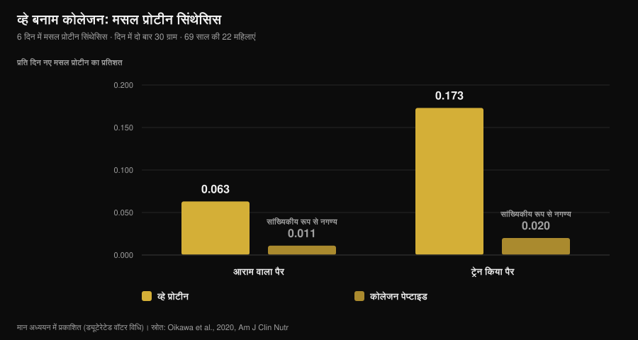
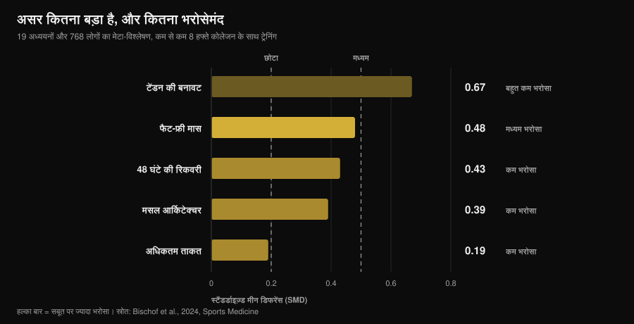

# कोलेजन पाउडर: मसल और टेंडन के लिए काम का है?

लेखक: [Giammaria Loi](/autore/giammaria-loi) · अपडेट 18 नवंबर 2026

कोलेजन प्रोटीन की शेल्फ पर जा पहुंचा है, व्हे के ठीक बगल में, उसी लेबल के साथ: "प्रोटीन पाउडर"। यह कैटेगरी की ऐसी गलती है जिसकी कीमत जेब चुकाती है। मसल के मामले में कोलेजन टिकता ही नहीं — और यह राय नहीं है, इसे ट्रेसर से ग्राम-दर-ग्राम नापा गया है। लेकिन एक ऊतक ऐसा है जहां सचमुच कुछ होता दिखता है, और वह डिब्बे के सामने छपा हुआ वादा नहीं है।

## एक नज़र में

- **मसल के लिए प्रोटीन के तौर पर यह शेल्फ का सबसे खराब विकल्प है।** एक ट्रेसर स्टडी में दिन में दो बार 30 ग्राम व्हे ने मसल प्रोटीन सिंथेसिस बढ़ाई; उसी खुराक में 30 ग्राम कोलेजन ने उसे **शुरुआती स्तर से ऊपर नहीं उठाया**, न आराम में, न ट्रेनिंग के बाद।
- **टेंडन पर सबसे बड़ा असर ही सबसे कमज़ोर सबूत वाला है।** सबसे बड़ा मेटा-विश्लेषण सबसे तगड़ा असर टेंडन की बनावट पर पाता है (SMD 0.67), लेकिन उस सबूत के भरोसे को **बहुत कम** आंकता है। मध्यम भरोसे वाला इकलौता नतीजा फैट-फ्री मास है (SMD 0.48)।
- **अधिकतम ताकत पर असर लगभग शून्य है** (SMD 0.19): बार पर किलो चाहिए तो कोलेजन वह लीवर नहीं है।
- **ब्रांड से ज़्यादा टाइमिंग मायने रखती है।** टेंडन वाली स्टडीज़ में जिलेटिन या कोलेजन विटामिन C के साथ, टेंडन पर लोड डालने वाले काम से **करीब एक घंटा पहले** लिया जाता है: एक घंटा पहले 15 ग्राम ने कोलेजन सिंथेसिस का एक मार्कर दोगुना कर दिया।
- **दर्द वाले घुटने पर नतीजे आपस में उलटे हैं।** रोज़ 5 ग्राम ने 139 युवा एथलीटों में दर्द घटाया; रोज़ 10 ग्राम लगभग 63 साल के 167 सक्रिय लोगों में प्लेसिबो से बेहतर नहीं निकला।

*Nurvan का चार्ट, Oikawa et al., 2020 (Am J Clin Nutr) में प्रकाशित मानों पर: 69 साल की 22 महिलाएं, छह दिन तक दिन में दो बार 30 ग्राम प्रोटीन, ड्यूटेरेटेड वॉटर से माप। कोई भी मान किसी तस्वीर से नहीं पढ़ा गया।*

## यह है क्या, और बाकी प्रोटीन जैसा क्यों नहीं

कोलेजन टेंडन, लिगामेंट, त्वचा और हड्डी का संरचनात्मक प्रोटीन है। पाउडर में यह **कोलेजन पेप्टाइड** या हाइड्रोलाइज़्ड कोलेजन के नाम से मिलता है: छोटे टुकड़ों में कटा प्रोटीन, जो पानी में घुलता है और जल्दी सोख लिया जाता है। जिलेटिन वही प्रोटीन है, बस कम टुकड़ों में।

असली पेच इसके अमीनो एसिड प्रोफाइल में है। कोलेजन का करीब एक तिहाई ग्लाइसीन है और ल्यूसीन बेहद कम — वही ल्यूसीन जो नए मसल प्रोटीन का निर्माण चालू करता है। ट्रिप्टोफैन, एक आवश्यक अमीनो एसिड, इसमें बिल्कुल नहीं है। इसीलिए पोषण विज्ञान में कोलेजन को **अधूरा** प्रोटीन कहा जाता है: कोई लेबल यह नहीं लिखता, पर बायोकेमिस्ट्री से सौदा नहीं होता। असली प्रोटीन कितना चाहिए और कैसे बांटें, इस पर हमने यहां लिखा है: [एक मील में कितना प्रोटीन](/hi/blog/ek-meal-mein-kitna-protein)।

## सबसे कड़ा टेस्ट: मसल पर कोलेजन बनाम व्हे

2020 में मैकमास्टर में स्टुअर्ट फिलिप्स के समूह ने सीधी भिड़ंत कराई। 69 साल की 22 स्वस्थ महिलाएं, दो समूहों में, **छह दिन तक दिन में दो बार 30 ग्राम व्हे या 30 ग्राम कोलेजन पेप्टाइड** लेती रहीं, और सिर्फ एक पैर की दो ट्रेनिंग सेशन हुए: इस तरह ट्रेन किए पैर और आराम वाले पैर की तुलना एक ही व्यक्ति के भीतर हो जाती है।

पूरे हफ्ते का नतीजा, ड्यूटेरेटेड वॉटर से नापा गया: व्हे के साथ मसल प्रोटीन सिंथेसिस आराम वाले पैर में **0.063% प्रति दिन** और ट्रेन किए पैर में **0.173%** तक पहुंची। कोलेजन के साथ ये मान 0.011% और 0.020% पर ही रहे, यानी **शुरुआती स्तर से सांख्यिकीय रूप से अलग नहीं**। ट्रेनिंग तक कोलेजन को प्रोटीन की तरह काम करने पर मजबूर नहीं कर पाई।

यह आंकड़ा "क्या वर्कआउट के बाद व्हे की जगह कोलेजन ले सकते हैं?" का जवाब बंद कर देता है। नहीं।

## और अगर व्हे में मिला दूं?

यहां हाल की रिसर्च ज़्यादा दिलचस्प और ज़्यादा ईमानदार है। ट्रेनिंग के बाद 30 ग्राम व्हे लेने पर खून में ग्लाइसीन **गिरता** है: व्हे में यह कम होता है और शरीर इसे खर्च करता है। ग्लाइसीन ही वह अमीनो एसिड है जिसकी संयोजी ऊतक को सबसे ज़्यादा ज़रूरत है।

मास्ट्रिख्ट के एक समूह ने 14 पुरुषों में इसे नापा: अकेले व्हे के साथ ट्रेनिंग के बाद छह घंटे में ग्लाइसीन की उपलब्धता ऋणात्मक रही (−8.9 mmol·360 min/L), जबकि 25 ग्राम व्हे में **5 ग्राम कोलेजन** मिलाना ही उसे शून्य से ऊपर लाने के लिए काफी है (+9.2)। 10 या 15 ग्राम डालने से इस मकसद के लिए कुछ नहीं मिलता, उल्टे उपलब्ध ल्यूसीन घट जाता है: ज़्यादा कोलेजन बेहतर नहीं है।

इसी समूह ने फिर 25 ग्राम व्हे + 5 ग्राम कोलेजन के उस मिश्रण को बिना कैलोरी वाले प्लेसिबो के मुकाबले परखा: मायोफाइब्रिलर प्रोटीन सिंथेसिस — यानी मसल — आराम में भी बढ़ी और कसरत के बाद भी, और संयोजी ऊतक की सिंथेसिस आराम में बढ़ी पर ट्रेन किए पैर में सार्थक रूप से नहीं। पढ़ते समय ध्यान रखें: तुलना **प्लेसिबो से थी, अकेले व्हे से नहीं**। यह दिखाता है कि मिश्रण काम करता है, यह नहीं कि वह व्हे से बेहतर है।

## जहां सचमुच कुछ होता है: टेंडन

2024 में *Sports Medicine* में इस विषय की सबसे बड़ी व्यवस्थित समीक्षा छपी: 19 रैंडमाइज़्ड ट्रायल, 768 लोग, ट्रेनिंग के साथ कम से कम 8 हफ्ते कोलेजन पेप्टाइड। सकारात्मक असर हैं, लेकिन असली बात उन्हें GRADE पद्धति से आंके गए **सबूत के भरोसे** के साथ पढ़ना है।

*Nurvan का चार्ट, Bischof et al., 2024 (Sports Medicine) में प्रकाशित मानों पर। SMD यानी स्टैंडर्डाइज़्ड मीन डिफरेंस: प्रचलित मानक में 0.2 छोटा और 0.5 मध्यम असर है। बार का रंग लेखकों द्वारा बताया गया GRADE भरोसा दिखाता है। कोई भी मान किसी तस्वीर से नहीं पढ़ा गया।*

यह चार्ट वह बात कहता है जो कोई प्रोडक्ट पेज नहीं कहता: **सबसे बड़ा असर वही है जिस पर हमें सबसे कम भरोसा है।** टेंडन की बनावट सबसे ज़्यादा कमाती है (SMD 0.67), पर बहुत कम भरोसे वाले सबूत पर; फैट-फ्री मास कम कमाता है (SMD 0.48), पर पूरे समूह में सबसे ऊंचे भरोसे के साथ; अधिकतम ताकत लगभग हिलती ही नहीं (SMD 0.19)।

एक नियंत्रित ट्रायल दिखाता है कि व्यवहार में इसका मतलब क्या है। पचास मध्यम रूप से सक्रिय पुरुषों ने 14 हफ्ते तक हफ्ते में तीन बार अपने अधिकतम के 70–85% पर लेग एक्सटेंशन किए, साथ में 5 ग्राम कोलेजन पेप्टाइड या प्लेसिबो। कोलेजन वाले समूह में **पटेलर टेंडन का क्रॉस-सेक्शनल एरिया** ज़्यादा बढ़ा, लेकिन टेंडन की कठोरता, मसल के क्रॉस-सेक्शन और ताकत में **दोनों समूहों के बीच कोई अंतर नहीं** था। टेंडन मोटा हुआ; यह साबित नहीं हुआ कि वह मज़बूत हुआ।

## एक घंटे की खिड़की, और विटामिन C

टेंडन वाली स्टडीज़ एक ऐसी बारीकी पर टिकी हैं जो सुनाने-सुनने में लगभग हमेशा छूट जाती है: समय। टेंडन में खून की सप्लाई कम होती है, और उसकी कोलेजन सिंथेसिस तभी बढ़ती है जब उस पर लोड पड़ता है।

इस दिशा को खोलने वाली स्टडी में आठ पुरुषों ने विटामिन C से भरपूर 5 या 15 ग्राम जिलेटिन छह मिनट की रस्सी-कूद से **एक घंटा पहले** लिया, तीन दिन तक दिन में तीन बार। 15 ग्राम पर खून में कोलेजन सिंथेसिस का मार्कर **दोगुना** हो गया; खुराक के बाद लिया गया सीरम प्रयोगशाला में तैयार लिगामेंट पर डालने से उनमें कोलेजन की मात्रा बढ़ी और यांत्रिक गुण सुधरे।

ये आठ लोग और मार्कर हैं, टली हुई चोटें नहीं। पर इससे साफ होता है कि "जब याद आए तब" और "टेंडन वाले काम से एक घंटा पहले" एक ही खुराक नहीं हैं। पुनर्वास पोषण पर 2026 की एक समीक्षा भी यही व्यावहारिक नतीजा देती है: लोडिंग वर्क से **पहले** कोलेजन या जिलेटिन विटामिन C के साथ, रिहैब प्रोग्राम के सहारे के तौर पर, कभी भी प्रोग्रेसिव लोड की जगह नहीं। चोट के दौरान क्या खाएं, इस पर हमारा अलग लेख है: [चोट लगने पर क्या खाएं](/hi/blog/chot-lagne-par-kya-khayein)।

## घुटना: दो स्टडी, दो जवाब

सबसे ज़्यादा बिकने वाला दावा है "जोड़ों का दर्द दूर करता है"। यहां रिसर्च बंट जाती है, और किस बात पर बंटती है यह जानना ज़रूरी है।

2017 में घुटने के फंक्शनल दर्द वाले 139 खिलाड़ियों ने 12 हफ्ते तक 5 ग्राम कोलेजन पेप्टाइड या प्लेसिबो लिया: गतिविधि के दौरान दर्द कोलेजन समूह में ज़्यादा घटा (विज़ुअल स्केल पर −19.5 बनाम −13.9, p = 0.046), और डॉक्टरों के आकलन ने भी यही कहा।

2020 में खुद बताए गए घुटने के दर्द वाले 167 सक्रिय लोगों ने, जिनकी औसत उम्र 63 साल थी, 12 हफ्ते तक रोज़ 10 ग्राम या प्लेसिबो लिया: दर्द दोनों समूहों में **बराबर** घटा (−1.6 बनाम −1.9), और सूजन, कार्टिलेज या हड्डी का कोई मार्कर नहीं बदला।

दो ट्रायल, दूसरे में दोगुनी खुराक, उलटा नतीजा। उम्र, दर्द का प्रकार और आबादी अलग हैं: यह ऐसा बराबरी का मुकाबला नहीं जिसे मनपसंद स्टडी चुनकर सुलझा लिया जाए। इसीलिए इस दावे का ईमानदार जवाब "शायद, कुछ लोगों में" है, "हां" नहीं।

## रिसर्च असल में क्या कहती है

| आम दावा | नतीजा | स्रोत |
|---|---|---|
| "यह प्रोटीन है, वर्कआउट के बाद चलेगा" | **गलत**: 30 ग्राम कोलेजन मसल प्रोटीन सिंथेसिस नहीं बढ़ाता; 30 ग्राम व्हे बढ़ाता है | Oikawa et al., 2020 |
| "मसल बढ़ाता है" | **स्पष्टीकरण ज़रूरी**: मेटा-विश्लेषण में फैट-फ्री मास बढ़ता है (SMD 0.48, मध्यम भरोसा), पर क्रियाविधि के आंकड़े इसे प्रोटीन स्रोत के तौर पर कोलेजन से नहीं समझाते | Bischof et al., 2024; Oikawa et al., 2020 |
| "टेंडन मज़बूत करता है" | **स्पष्टीकरण ज़रूरी**: टेंडन मोटा होता है, पर अकेली ट्रेनिंग की तुलना में कठोरता और ताकत नहीं बदलतीं, और सबूत का भरोसा बहुत कम है | Jerger et al., 2023; Bischof et al., 2024 |
| "घुटने का दर्द मिटाता है" | **स्पष्टीकरण ज़रूरी**: युवा एथलीटों में 5 ग्राम 12 हफ्ते पर हां, बड़ी उम्र के सक्रिय लोगों में 10 ग्राम पर नहीं | Zdzieblik et al., 2017; Bongers et al., 2020 |
| "विटामिन C के साथ एक घंटा पहले लेना चाहिए" | **मार्कर पर पुष्ट**: लोड से एक घंटा पहले विटामिन C के साथ 15 ग्राम जिलेटिन कोलेजन सिंथेसिस का मार्कर दोगुना करता है | Shaw et al., 2017 |
| "व्हे में मिलाने से प्रोटीन खराब हो जाता है" | **गलत**: 25 ग्राम व्हे में 5 ग्राम कोलेजन ग्लाइसीन को धनात्मक कर देता है, ल्यूसीन घटाए बिना | Aussieker et al., 2024 |
| "जितना ज़्यादा उतना अच्छा" | **गलत**: व्हे में 5 ग्राम से ऊपर जाने पर उपलब्ध ल्यूसीन गिरता है, और असरदार स्टडीज़ ने 5–15 ग्राम ही इस्तेमाल किया | Aussieker et al., 2024; Shaw et al., 2017 |
| "इससे ज़्यादा वज़न उठेगा" | **गलत**: अधिकतम ताकत पर असर SMD 0.19 है, वह भी कम भरोसे के साथ | Bischof et al., 2024 |

## इसे कैसे लागू करें

1. **प्रोटीन की जगह कोलेजन न लें।** पहले पूरी ज़रूरत संपूर्ण स्रोतों से पूरी करें: मांस, मछली, अंडे, डेयरी, दालें और सोया, या व्हे। कोलेजन जोड़ है, बदल नहीं।
2. **टेंडन के लिए ले रहे हैं तो घड़ी देखें।** विटामिन C के साथ 10–15 ग्राम कोलेजन पेप्टाइड या जिलेटिन, उस सेशन से **करीब एक घंटा पहले** जो उस टेंडन पर लोड डालता है। इस खिड़की के बाहर स्टडीज़ कुछ नहीं कहतीं।
3. **व्हे के साथ 5 ग्राम काफी है।** यही वह खुराक है जो ट्रेनिंग के बाद ग्लाइसीन को धनात्मक करती है और ल्यूसीन घटाती नहीं।
4. **समय दें और सिर्फ एक चीज़ नापें।** ट्रायल 8 से 14 हफ्ते चलते हैं। शुरू करने से पहले एक संकेतक तय करें — किसी खास मूवमेंट में दर्द, या किसी एक्सरसाइज़ में सहने लायक लोड — और उसे 12 हफ्ते पर देखें, 10 दिन पर नहीं।
5. **बार पर किलो की उम्मीद न रखें।** अधिकतम ताकत पर औसत असर शून्य के करीब है: अगर लक्ष्य यही है तो पैसा यहां लगाना ठीक नहीं।
6. **जोड़ों का दर्द बना रहे, बढ़े या मूवमेंट रोक दे: डॉक्टर के पास जाएं।** सप्लीमेंट निदान नहीं है, और महीनों से दर्द करता टेंडन पाउडर की समस्या नहीं है।

> **Nurvan: सही खुराक ही नहीं, सही समय वाला सप्लीमेंट**
>
> कोलेजन उन गिने-चुने सप्लीमेंट में है जहां समय सचमुच मायने रखता है: टेंडन वाले काम से एक घंटा पहले। Nurvan में आप खुराक और समय सप्लीमेंट मॉड्यूल में दर्ज करते हैं, और चूंकि ट्रेनिंग उसी ऐप में है, आप सेशन-दर-सेशन देख पाते हैं कि आपने उसे सही खिड़की में लिया या नहीं — और उस एक्सरसाइज़ का लोड इस बीच बढ़ रहा है या नहीं। [Nurvan आज़माएं](https://nurvan.app)

## अक्सर पूछे जाने वाले सवाल

**क्या कोलेजन पाउडर मसल बनाता है?**
प्रोटीन स्रोत के तौर पर नहीं। ट्रेसर से की गई सीधी तुलना में दिन में दो बार 30 ग्राम कोलेजन पेप्टाइड ने मसल प्रोटीन सिंथेसिस को शुरुआती स्तर से ऊपर नहीं उठाया, जबकि उसी खुराक के व्हे ने उठाया। 2024 का मेटा-विश्लेषण फैट-फ्री मास में बढ़त ज़रूर पाता है (SMD 0.48), पर ऐसी क्रियाविधि से जिसे प्रोटीन के रूप में कोलेजन नहीं समझाता: यह खाने के प्रोटीन को बदलने की वजह नहीं है।

**कोलेजन या व्हे?**
मसल के लिए व्हे, बिना बहस। कोलेजन का मतलब संयोजी ऊतक के लिए लक्षित जोड़ के तौर पर है, 5–15 ग्राम में, और अगर ट्रेनिंग के बाद व्हे के साथ ले रहे हैं तो 5 ग्राम काफी है।

**रोज़ कितना कोलेजन चाहिए?**
जिन ट्रायल में असर मिला उन्होंने रोज़ 5 से 15 ग्राम इस्तेमाल किया: घुटने के दर्द और पटेलर टेंडन वाले काम में 5 ग्राम, वर्कआउट से पहले वाले प्रोटोकॉल में 15 ग्राम जिलेटिन। इससे ज़्यादा खुराक का कोई फायदा नहीं दिखा और व्हे के साथ मिलाने पर यह उपलब्ध ल्यूसीन घटाती है।

**कोलेजन कब लेना चाहिए?**
अगर निशाना टेंडन है तो उस सेशन से करीब एक घंटा पहले जो उस पर लोड डालता है, विटामिन C के साथ: मार्कर पर सकारात्मक नतीजे देने वाली स्टडीज़ में यही तरीका था। अगर इसे वर्कआउट के बाद के प्रोटीन में जोड़ के तौर पर ले रहे हैं तो व्हे के साथ लें।

**क्या विटामिन C सचमुच ज़रूरी है?**
स्टडीज़ में जिलेटिन विटामिन C से भरपूर था, क्योंकि विटामिन C कोलेजन सिंथेसिस के लिए ज़रूरी सह-कारक है। दोनों को अलग करके जांचा नहीं गया: अगर उस प्रोटोकॉल पर चल रहे हैं तो यह बारीकी भी निभाएं।

## यह भी पढ़ें

- [स्ट्रेंथ सप्लीमेंट टियर लिस्ट: रिसर्च क्या कहती है](/hi/blog/strength-supplements-tier-list-hindi) — जिन सप्लीमेंट के सबूत ज़्यादा ठोस हैं, उनके मुकाबले कोलेजन कहां ठहरता है।
- [बीफ प्रोटीन पाउडर: क्या यह व्हे जितना असरदार है?](/hi/blog/beef-protein-powder-ya-whey-protein) — संपूर्ण प्रोटीन बताकर बेचा जाने वाला दूसरा पाउडर, उसी पैमाने पर।
- [चोट लगने पर क्या खाएं: ब्रेक के दौरान डाइट](/hi/blog/chot-lagne-par-kya-khayein) — उन हफ्तों की डाइट जब संयोजी ऊतक को फिर से बनना होता है।

## स्रोत

1. Oikawa SY, Kamal MJ, Webb EK, McGlory C, Baker SK, Phillips SM, 2020. Whey protein but not collagen peptides stimulate acute and longer-term muscle protein synthesis with and without resistance exercise in healthy older women: a randomized controlled trial. *Am J Clin Nutr* 111(3):708-718. [PMID 31919527](https://pubmed.ncbi.nlm.nih.gov/31919527/) · [DOI 10.1093/ajcn/nqz332](https://doi.org/10.1093/ajcn/nqz332)
2. Bischof K, Moitzi AM, Stafilidis S, König D, 2024. Impact of Collagen Peptide Supplementation in Combination with Long-Term Physical Training on Strength, Musculotendinous Remodeling, Functional Recovery, and Body Composition in Healthy Adults: A Systematic Review with Meta-analysis. *Sports Med* 54(11):2865-2888. [PMID 39060741](https://pubmed.ncbi.nlm.nih.gov/39060741/) · [DOI 10.1007/s40279-024-02079-0](https://doi.org/10.1007/s40279-024-02079-0)
3. Jerger S, Centner C, Lauber B, Seynnes O, Friedrich T, Lolli D, Gollhofer A, König D, 2023. Specific collagen peptides increase adaptions of patellar tendon morphology following 14-weeks of high-load resistance training: A randomized-controlled trial. *Eur J Sport Sci* 23(12):2329-2339. [PMID 37424319](https://pubmed.ncbi.nlm.nih.gov/37424319/) · [DOI 10.1080/17461391.2023.2232758](https://doi.org/10.1080/17461391.2023.2232758)
4. Shaw G, Lee-Barthel A, Ross ML, Wang B, Baar K, 2017. Vitamin C-enriched gelatin supplementation before intermittent activity augments collagen synthesis. *Am J Clin Nutr* 105(1):136-143. [PMID 27852613](https://pubmed.ncbi.nlm.nih.gov/27852613/) · [DOI 10.3945/ajcn.116.138594](https://doi.org/10.3945/ajcn.116.138594)
5. Aussieker T, Janssen TAH, Hermans WJH, Holwerda AM, Senden JM, van Kranenburg JMX, Goessens JPB, Snijders T, van Loon LJC, 2024. Coingestion of Collagen With Whey Protein Prevents Postexercise Decline in Plasma Glycine Availability in Recreationally Active Men. *Int J Sport Nutr Exerc Metab* 34(4):189-198. [PMID 38604602](https://pubmed.ncbi.nlm.nih.gov/38604602/) · [DOI 10.1123/ijsnem.2023-0264](https://doi.org/10.1123/ijsnem.2023-0264)
6. Aussieker T, Kaiser J, Hermans WJH, Hendriks FK, Holwerda AM, Senden JM, van Kranenburg JMX, Goessens JPB, Braun U, Baar K, Snijders T, van Loon LJC, 2024. Ingestion of a Whey Plus Collagen Protein Blend Increases Myofibrillar and Muscle Connective Protein Synthesis Rates. *Med Sci Sports Exerc* 57(3):544-554. [PMID 39501478](https://pubmed.ncbi.nlm.nih.gov/39501478/) · [DOI 10.1249/MSS.0000000000003596](https://doi.org/10.1249/MSS.0000000000003596)
7. Zdzieblik D, Oesser S, Gollhofer A, König D, 2017. Improvement of activity-related knee joint discomfort following supplementation of specific collagen peptides. *Appl Physiol Nutr Metab* 42(6):588-595. [PMID 28177710](https://pubmed.ncbi.nlm.nih.gov/28177710/) · [DOI 10.1139/apnm-2016-0390](https://doi.org/10.1139/apnm-2016-0390)
8. Bongers CCWG, Ten Haaf DSM, Catoire M, Kersten B, Wouters JA, Eijsvogels TMH, Hopman MTE, 2020. Effectiveness of collagen supplementation on pain scores in healthy individuals with self-reported knee pain: a randomized controlled trial. *Appl Physiol Nutr Metab* 45(7):793-800. [PMID 31990581](https://pubmed.ncbi.nlm.nih.gov/31990581/) · [DOI 10.1139/apnm-2019-0654](https://doi.org/10.1139/apnm-2019-0654)

पुनर्वास में लोडिंग वर्क से पहले कोलेजन और जिलेटिन पर व्यावहारिक संकेत: Lee EJ, Kim J, et al., 2026. Rehabilitation Nutrition for Tendon and Ligament Injuries: From Collagen Remodeling to Return-to-Activity and Sport. *Healthcare (Basel)* 14(14). [PMID 42512652](https://pubmed.ncbi.nlm.nih.gov/42512652/) · [DOI 10.3390/healthcare14142136](https://doi.org/10.3390/healthcare14142136)। विषय नवंबर 2026 के ट्रेंड संकेतों से चुना गया: कोलेजन पाउडर 15-16 नवंबर 2026 को ग्रोथ लिस्ट में आया (collagen powder हर महीने 74,000 सर्च, +31%; collagen protein powder हर महीने 22,200 सर्च, +242%), और प्रतिस्पर्धी कंटेंट लगभग पूरा प्रोडक्ट पेज है। वैज्ञानिक स्रोत PubMed से।

**Giammaria Loi** Nurvan के संस्थापक हैं। वे 2012 से वेट ट्रेनिंग कर रहे हैं, 2013 से FIPE-प्रमाणित पर्सनल ट्रेनर और कोच के तौर पर काम करते हैं और 2018 से राष्ट्रीय स्तर पर पावरलिफ्टिंग में हिस्सा लेते हैं। उनके हर लेख की शुरुआत वैज्ञानिक अध्ययनों से होती है और अंत उस बात पर, जो जिम में सचमुच काम करती है। [लेखक पृष्ठ](/autore/giammaria-loi)

> नोट: यह जानकारीपरक सामग्री है, यह डॉक्टर या किसी योग्य पेशेवर की सलाह का विकल्प नहीं है.
