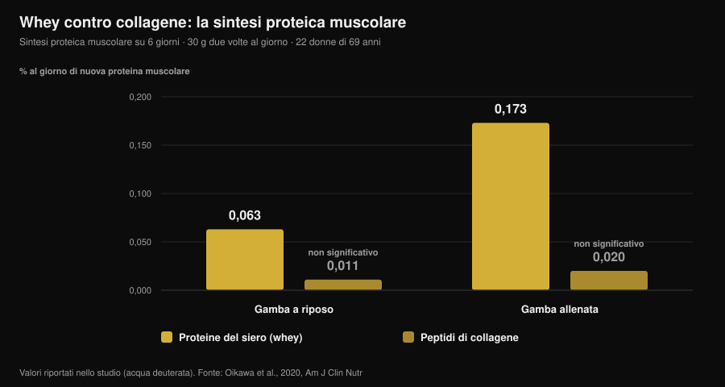

# Collagene in polvere: serve a muscoli e tendini?

Di [Giammaria Loi](/autore/giammaria-loi) · aggiornato il 18 novembre 2026

Il collagene è finito nello scaffale delle proteine, accanto alle whey, con la stessa etichetta: "proteine in polvere". È un errore di categoria che costa soldi. Sul muscolo il collagene non regge il confronto, e non è un'opinione: è stato misurato con il tracciante, grammo contro grammo. Ma esiste un tessuto su cui qualcosa sembra davvero succedere — e non è quello che ti vendono in copertina.

## In breve

- **Come proteina per il muscolo è la scelta peggiore.** In uno studio con tracciante, 30 g di whey due volte al giorno hanno alzato la sintesi proteica muscolare; 30 g di collagene, alla stessa dose, **non l'hanno alzata sopra il valore di partenza** né a riposo né dopo l'allenamento.
- **Sui tendini l'effetto più grande è anche quello meno solido.** La meta-analisi più ampia trova sulla morfologia del tendine l'effetto maggiore (SMD 0,67), ma le assegna una certezza delle prove **molto bassa**. L'unica voce con certezza moderata è la massa magra (SMD 0,48).
- **Sulla forza massimale l'effetto è quasi nullo** (SMD 0,19): se cerchi chili sul bilanciere, il collagene non è la leva.
- **I tempi contano più della marca.** Negli studi sui tendini la gelatina o il collagene si prendono con vitamina C **circa un'ora prima** del lavoro che carica il tendine: 15 g un'ora prima hanno raddoppiato un marcatore di sintesi del collagene.
- **Sul ginocchio dolorante i risultati si contraddicono.** 5 g al giorno hanno ridotto il dolore in 139 atleti giovani; 10 g al giorno non hanno fatto meglio del placebo in 167 persone attive di circa 63 anni.

*Grafico Nurvan sui valori pubblicati da Oikawa et al., 2020 (Am J Clin Nutr): 22 donne di 69 anni, 30 g di proteine due volte al giorno per sei giorni, misura con acqua deuterata. Nessun valore letto da una figura.*

## Che cos'è, e perché non è una proteina come le altre

Il collagene è la proteina strutturale di tendini, legamenti, pelle e ossa. In polvere lo trovi come **peptidi di collagene** o collagene idrolizzato: proteina spezzata in frammenti corti, che si sciolgono in acqua e si assorbono in fretta. La gelatina è la stessa proteina, meno frammentata.

Il punto critico è il suo profilo di aminoacidi. Il collagene è fatto per circa un terzo di glicina e ha pochissima leucina, l'aminoacido che accende la sintesi di nuova proteina muscolare. Gli manca del tutto il triptofano, uno degli aminoacidi essenziali. Per questo, in nutrizione, il collagene si definisce una proteina **incompleta**: nessuna etichetta lo dichiara, ma la biochimica non si negozia. Se vuoi capire quanta proteina "vera" ti serve e come distribuirla, ne abbiamo scritto qui: [quante proteine per pasto, esiste un limite](/blog/quante-proteine-per-pasto-limite).

## Il test più duro: collagene contro whey sul muscolo

Nel 2020 il gruppo di Stuart Phillips alla McMaster ha fatto il confronto diretto. Ventidue donne sane di 69 anni, divise in due gruppi, hanno preso **30 g di whey o 30 g di peptidi di collagene due volte al giorno per sei giorni**, con due sedute di allenamento su una gamba sola: così la gamba allenata e quella a riposo si confrontano nella stessa persona.

Il risultato, misurato con acqua deuterata sull'intera settimana: con le whey la sintesi proteica muscolare è salita a **0,063% al giorno** nella gamba a riposo e a **0,173%** in quella allenata. Con il collagene i valori sono rimasti a 0,011% e 0,020%, cioè **non significativamente sopra il punto di partenza**. Nemmeno l'allenamento, da solo, è bastato a far funzionare il collagene come proteina.

Questo è il numero che chiude la domanda "posso usare il collagene al posto delle whey dopo l'allenamento?". No.

## E se lo aggiungo alle whey?

Qui la ricerca recente è più interessante, e più onesta. Quando mangi 30 g di whey dopo l'allenamento, la glicina nel sangue **scende**: le whey ne contengono poca, e il corpo ne consuma. La glicina è l'aminoacido di cui il tessuto connettivo ha più bisogno.

Un gruppo di Maastricht lo ha misurato su 14 uomini: con whey da sola la disponibilità di glicina nelle sei ore dopo l'allenamento è risultata negativa (−8,9 mmol·360 min/L), mentre **bastano 5 g di collagene** aggiunti a 25 g di whey per riportarla sopra lo zero (+9,2). Aggiungerne 10 o 15 g non serve a quello scopo e abbassa invece la leucina disponibile: più collagene non è meglio.

Lo stesso gruppo ha poi testato quella miscela 25 g whey + 5 g collagene contro un placebo senza calorie: la sintesi proteica miofibrillare — il muscolo — è salita sia a riposo sia dopo l'esercizio, e quella del tessuto connettivo è salita a riposo ma non in modo significativo nella gamba allenata. Attenzione a come si legge: il confronto era **contro placebo, non contro le whey da sole**. Dimostra che la miscela funziona, non che sia meglio delle whey.

## Dove qualcosa succede davvero: il tendine

Nel 2024 è uscita su *Sports Medicine* la revisione sistematica più ampia sul tema: 19 studi randomizzati, 768 persone, almeno 8 settimane di peptidi di collagene insieme all'allenamento. Gli effetti positivi ci sono, ma la cosa importante è leggerli insieme alla **certezza delle prove** valutata con il metodo GRADE.

*Grafico Nurvan sui valori pubblicati da Bischof et al., 2024 (Sports Medicine). SMD = differenza media standardizzata: per convenzione 0,2 è un effetto piccolo e 0,5 medio. Il colore della barra indica la certezza GRADE dichiarata dagli autori. Nessun valore letto da una figura.*

Il grafico dice una cosa che le schede prodotto non dicono mai: **l'effetto più grande è quello di cui siamo meno sicuri**. La morfologia del tendine guadagna di più (SMD 0,67) ma su prove di certezza molto bassa; la massa magra guadagna meno (SMD 0,48) con la certezza più alta del gruppo; la forza massimale praticamente non si muove (SMD 0,19).

Un singolo studio controllato aiuta a vedere cosa significhi in pratica. Cinquanta uomini moderatamente allenati hanno fatto 14 settimane di estensioni delle gambe al 70-85% del massimale, tre volte a settimana, con 5 g di peptidi di collagene o placebo. Il gruppo collagene ha avuto un aumento maggiore della **sezione trasversa del tendine rotuleo**, ma su rigidità del tendine, sezione del muscolo e forza **non c'è stata differenza fra i gruppi**. Il tendine è diventato più grosso; non è stato dimostrato che sia diventato più forte.

## La finestra di un'ora, e la vitamina C

Negli studi sul collagene e il tessuto connettivo c'è un dettaglio che si perde quasi sempre nel passaparola: il momento. Il tendine ha poco sangue, e la sua sintesi di collagene si alza quando viene caricato.

Nello studio che ha aperto questo filone, otto uomini hanno preso 5 o 15 g di gelatina arricchita con vitamina C **un'ora prima** di sei minuti di salti con la corda, tre volte al giorno per tre giorni. Con 15 g il marcatore di sintesi del collagene nel sangue è **raddoppiato**; il siero prelevato dopo la dose, usato su legamenti ingegnerizzati in laboratorio, ne ha aumentato il contenuto di collagene e migliorato le proprietà meccaniche.

Sono otto persone e marcatori, non infortuni evitati. Ma spiegano perché la dose "quando capita" e la dose "un'ora prima del lavoro sul tendine" non sono la stessa cosa. Una revisione del 2026 sulla nutrizione in riabilitazione arriva alla stessa conclusione pratica: collagene o gelatina con vitamina C **prima** del lavoro di carico, come supporto al programma di riabilitazione, mai al posto del carico progressivo. Sul resto della dieta quando ti fermi per un infortunio, abbiamo un articolo dedicato: [cosa mangiare quando sei infortunato](/blog/cosa-mangiare-quando-sei-infortunato).

## Il ginocchio: due studi, due risposte

Il claim più venduto è "fa passare il dolore alle articolazioni". Qui la ricerca si divide, e vale la pena sapere su cosa.

Nel 2017, 139 soggetti sportivi con dolore funzionale al ginocchio hanno preso 5 g di peptidi di collagene o placebo per 12 settimane: il dolore durante l'attività è migliorato di più nel gruppo collagene (−19,5 contro −13,9 punti su scala visiva, p = 0,046), con la conferma della valutazione medica.

Nel 2020, 167 persone attive con dolore al ginocchio riferito, di età mediana 63 anni, hanno preso 10 g al giorno o placebo per 12 settimane: il dolore è calato in entrambi i gruppi **allo stesso modo** (−1,6 contro −1,9 punti), e nessun marcatore di infiammazione, cartilagine o osso si è mosso.

Due studi, dose doppia nel secondo, risultato opposto. Età, tipo di dolore e popolazione sono diversi: non è un pareggio che si risolve scegliendo lo studio che piace. È il motivo per cui su questo claim la risposta corretta è "forse, in qualcuno", non "sì".

## Cosa dice davvero la ricerca

| Affermazione diffusa | Verdetto | Fonte |
|---|---|---|
| "È una proteina, va bene dopo l'allenamento" | **Smentito**: 30 g di collagene non alzano la sintesi proteica muscolare; 30 g di whey sì | Oikawa et al., 2020 |
| "Fa crescere il muscolo" | **Da precisare**: la meta-analisi trova più massa magra (SMD 0,48, certezza moderata), ma i dati sul meccanismo non la spiegano con il collagene come fonte proteica | Bischof et al., 2024; Oikawa et al., 2020 |
| "Rinforza i tendini" | **Da precisare**: il tendine diventa più grosso, ma rigidità e forza non cambiano rispetto al solo allenamento, e la certezza delle prove è molto bassa | Jerger et al., 2023; Bischof et al., 2024 |
| "Toglie il dolore al ginocchio" | **Da precisare**: sì in atleti giovani con 5 g per 12 settimane, no in persone attive più anziane con 10 g | Zdzieblik et al., 2017; Bongers et al., 2020 |
| "Va preso con la vitamina C un'ora prima" | **Confermato sui marcatori**: 15 g di gelatina con vitamina C un'ora prima del carico raddoppiano un marcatore di sintesi del collagene | Shaw et al., 2017 |
| "Aggiungerlo alle whey rovina le proteine" | **Smentito**: 5 g di collagene su 25 g di whey riportano in positivo la glicina senza togliere leucina | Aussieker et al., 2024 |
| "Più ne prendi, meglio è" | **Smentito**: oltre 5 g aggiunti alle whey la leucina disponibile cala, e gli studi efficaci usano 5-15 g, non di più | Aussieker et al., 2024; Shaw et al., 2017 |
| "Ti fa alzare più chili" | **Smentito**: sulla forza massimale l'effetto è SMD 0,19, con certezza bassa | Bischof et al., 2024 |

## Come applicarlo

1. **Non sostituire le proteine con il collagene.** Prima copri il fabbisogno con fonti complete: carne, pesce, uova, latticini, legumi e soia, o whey. Il collagene è un'aggiunta, non un rimpiazzo.
2. **Se lo usi per il tendine, usa l'orologio.** 10-15 g di peptidi di collagene o gelatina con vitamina C, **circa un'ora prima** della seduta che carica quel tendine. Fuori da quella finestra gli studi non ti dicono niente.
3. **Se lo usi insieme alle whey, bastano 5 g.** È la dose che riporta in positivo la glicina dopo l'allenamento senza abbassare la leucina.
4. **Dai tempo e misura una cosa sola.** Gli studi durano da 8 a 14 settimane. Scegli un indicatore prima di partire — dolore durante un movimento preciso, o carico tollerato su un esercizio — e guardalo a 12 settimane, non a 10 giorni.
5. **Non aspettarti chili sul bilanciere.** Sulla forza massimale l'effetto medio è vicino a zero: se è quello il tuo obiettivo, il collagene non è dove conviene spendere.
6. **Dolore articolare che persiste, peggiora o blocca il movimento: vai dal medico.** Un integratore non è una diagnosi, e un tendine dolorante da mesi non è un problema di polveri.

> **Nurvan: un integratore con l'orario giusto, non solo la dose giusta**
>
> Il collagene è uno dei pochi integratori in cui il momento conta davvero: un'ora prima del lavoro sul tendine. In Nurvan registri dose e orario nel modulo integrazione, e siccome l'allenamento è nella stessa app vedi seduta per seduta se l'hai preso davvero nella finestra giusta — e se il carico su quell'esercizio sta salendo nel frattempo. [Prova Nurvan](https://nurvan.app)

## Domande frequenti

**Il collagene in polvere fa crescere i muscoli?**
Non come fonte proteica. In un confronto diretto con tracciante, 30 g di peptidi di collagene due volte al giorno non hanno alzato la sintesi proteica muscolare sopra il valore di partenza, mentre la stessa dose di whey l'ha alzata. La meta-analisi del 2024 trova un aumento della massa magra (SMD 0,48), ma con un meccanismo che il collagene come proteina non spiega: non è un motivo per sostituire le proteine del pasto.

**Meglio collagene o whey?**
Per il muscolo, whey, senza discussione. Il collagene ha senso come aggiunta mirata al tessuto connettivo, in dosi di 5-15 g, e 5 g bastano se lo metti insieme alle whey dopo l'allenamento.

**Quanto collagene al giorno serve?**
Gli studi che hanno trovato effetti usano da 5 a 15 g al giorno: 5 g nei lavori su dolore al ginocchio e tendine rotuleo, 15 g di gelatina nei protocolli pre-allenamento. Dosi più alte non hanno mostrato vantaggi e, in miscela con le whey, abbassano la leucina disponibile.

**Quando si prende il collagene?**
Se l'obiettivo è il tendine, circa un'ora prima della seduta che lo carica, con vitamina C: è lo schema usato negli studi con risultati positivi sui marcatori di sintesi. Se lo usi come aggiunta alle proteine del dopo-allenamento, va insieme alle whey.

**Serve davvero la vitamina C?**
Negli studi la gelatina era arricchita con vitamina C, perché la vitamina C è un cofattore necessario alla sintesi del collagene. Separare i due non è stato testato: se segui quel protocollo, segui anche quel dettaglio.

## Leggi anche

- [Tier list integratori forza: cosa dice la ricerca](/blog/classifica-integratori-forza-tier-list) — dove si colloca il collagene rispetto agli integratori che hanno prove più solide.
- [Beef protein: le proteine della carne valgono le whey?](/blog/beef-protein-proteine-carne-polvere) — l'altra polvere venduta come proteina completa, misurata sullo stesso metro.
- [Cosa mangiare quando sei infortunato](/blog/cosa-mangiare-quando-sei-infortunato) — la dieta nelle settimane in cui il tessuto connettivo deve ricostruirsi.

## Fonti

1. Oikawa SY, Kamal MJ, Webb EK, McGlory C, Baker SK, Phillips SM, 2020. Whey protein but not collagen peptides stimulate acute and longer-term muscle protein synthesis with and without resistance exercise in healthy older women: a randomized controlled trial. *Am J Clin Nutr* 111(3):708-718. [PMID 31919527](https://pubmed.ncbi.nlm.nih.gov/31919527/) · [DOI 10.1093/ajcn/nqz332](https://doi.org/10.1093/ajcn/nqz332)
2. Bischof K, Moitzi AM, Stafilidis S, König D, 2024. Impact of Collagen Peptide Supplementation in Combination with Long-Term Physical Training on Strength, Musculotendinous Remodeling, Functional Recovery, and Body Composition in Healthy Adults: A Systematic Review with Meta-analysis. *Sports Med* 54(11):2865-2888. [PMID 39060741](https://pubmed.ncbi.nlm.nih.gov/39060741/) · [DOI 10.1007/s40279-024-02079-0](https://doi.org/10.1007/s40279-024-02079-0)
3. Jerger S, Centner C, Lauber B, Seynnes O, Friedrich T, Lolli D, Gollhofer A, König D, 2023. Specific collagen peptides increase adaptions of patellar tendon morphology following 14-weeks of high-load resistance training: A randomized-controlled trial. *Eur J Sport Sci* 23(12):2329-2339. [PMID 37424319](https://pubmed.ncbi.nlm.nih.gov/37424319/) · [DOI 10.1080/17461391.2023.2232758](https://doi.org/10.1080/17461391.2023.2232758)
4. Shaw G, Lee-Barthel A, Ross ML, Wang B, Baar K, 2017. Vitamin C-enriched gelatin supplementation before intermittent activity augments collagen synthesis. *Am J Clin Nutr* 105(1):136-143. [PMID 27852613](https://pubmed.ncbi.nlm.nih.gov/27852613/) · [DOI 10.3945/ajcn.116.138594](https://doi.org/10.3945/ajcn.116.138594)
5. Aussieker T, Janssen TAH, Hermans WJH, Holwerda AM, Senden JM, van Kranenburg JMX, Goessens JPB, Snijders T, van Loon LJC, 2024. Coingestion of Collagen With Whey Protein Prevents Postexercise Decline in Plasma Glycine Availability in Recreationally Active Men. *Int J Sport Nutr Exerc Metab* 34(4):189-198. [PMID 38604602](https://pubmed.ncbi.nlm.nih.gov/38604602/) · [DOI 10.1123/ijsnem.2023-0264](https://doi.org/10.1123/ijsnem.2023-0264)
6. Aussieker T, Kaiser J, Hermans WJH, Hendriks FK, Holwerda AM, Senden JM, van Kranenburg JMX, Goessens JPB, Braun U, Baar K, Snijders T, van Loon LJC, 2024. Ingestion of a Whey Plus Collagen Protein Blend Increases Myofibrillar and Muscle Connective Protein Synthesis Rates. *Med Sci Sports Exerc* 57(3):544-554. [PMID 39501478](https://pubmed.ncbi.nlm.nih.gov/39501478/) · [DOI 10.1249/MSS.0000000000003596](https://doi.org/10.1249/MSS.0000000000003596)
7. Zdzieblik D, Oesser S, Gollhofer A, König D, 2017. Improvement of activity-related knee joint discomfort following supplementation of specific collagen peptides. *Appl Physiol Nutr Metab* 42(6):588-595. [PMID 28177710](https://pubmed.ncbi.nlm.nih.gov/28177710/) · [DOI 10.1139/apnm-2016-0390](https://doi.org/10.1139/apnm-2016-0390)
8. Bongers CCWG, Ten Haaf DSM, Catoire M, Kersten B, Wouters JA, Eijsvogels TMH, Hopman MTE, 2020. Effectiveness of collagen supplementation on pain scores in healthy individuals with self-reported knee pain: a randomized controlled trial. *Appl Physiol Nutr Metab* 45(7):793-800. [PMID 31990581](https://pubmed.ncbi.nlm.nih.gov/31990581/) · [DOI 10.1139/apnm-2019-0654](https://doi.org/10.1139/apnm-2019-0654)

Indicazione pratica su collagene e gelatina prima del lavoro di carico in riabilitazione: Lee EJ, Kim J, et al., 2026. Rehabilitation Nutrition for Tendon and Ligament Injuries: From Collagen Remodeling to Return-to-Activity and Sport. *Healthcare (Basel)* 14(14). [PMID 42512652](https://pubmed.ncbi.nlm.nih.gov/42512652/) · [DOI 10.3390/healthcare14142136](https://doi.org/10.3390/healthcare14142136). Tema scelto da segnali di tendenza di novembre 2026: il collagene in polvere è entrato nelle classifiche di crescita il 15-16 novembre 2026 (collagen powder 74.000 ricerche al mese, +31%; collagen protein powder 22.200 ricerche al mese, +242%), con contenuti concorrenti fatti quasi solo di schede prodotto. Fonti scientifiche consultate tramite PubMed.

**Giammaria Loi** è il fondatore di Nurvan. Si allena con i pesi dal 2012, lavora come personal trainer e coach certificato FIPE dal 2013 e gareggia nel powerlifting a livello nazionale dal 2018. Ogni articolo che firma parte dagli studi scientifici e arriva a ciò che funziona davvero in palestra. [Pagina autore](/autore/giammaria-loi)

> Nota: contenuto informativo, non sostituisce il parere di un medico o di un professionista qualificato.
