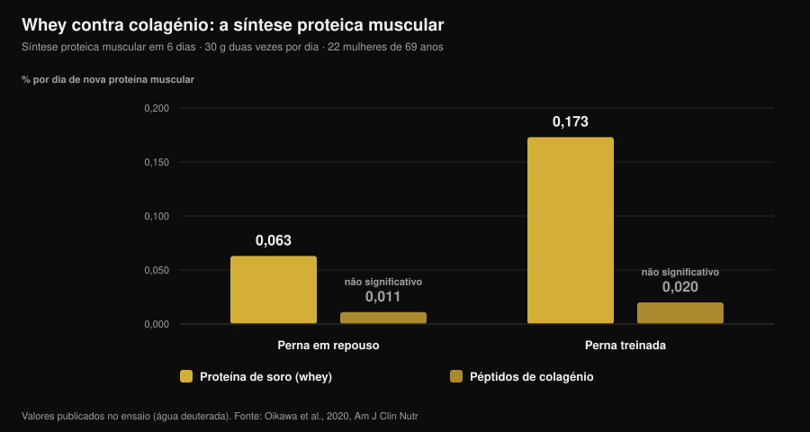

# Colagénio em pó: serve para músculos e tendões?

Por [Giammaria Loi](/autore/giammaria-loi) · atualizado a 18 de novembro de 2026

O colagénio foi parar à prateleira das proteínas, ao lado da whey, com o mesmo rótulo: "proteína em pó". É um erro de categoria que custa dinheiro. No músculo o colagénio não aguenta a comparação, e não é opinião: foi medido com marcador isotópico, grama a grama. Mas há um tecido onde algo parece mesmo acontecer — e não é o que vendem no rótulo.

## Em resumo

- **Como proteína para o músculo é a pior escolha da prateleira.** Num estudo com marcador, 30 g de whey duas vezes por dia aumentaram a síntese proteica muscular; 30 g de colagénio, na mesma dose, **não a elevaram acima do ponto de partida**, nem em repouso nem depois do treino.
- **Nos tendões, o maior efeito é também o menos sólido.** A meta-análise mais ampla encontra o efeito mais forte na morfologia do tendão (SMD 0,67), mas atribui-lhe uma certeza da evidência **muito baixa**. O único resultado com certeza moderada é a massa isenta de gordura (SMD 0,48).
- **Na força máxima o efeito é quase nulo** (SMD 0,19): se procura quilos na barra, o colagénio não é a alavanca.
- **O momento conta mais do que a marca.** Nos estudos sobre tendão, a gelatina ou o colagénio tomam-se com vitamina C **cerca de uma hora antes** do trabalho que carrega o tendão: 15 g uma hora antes duplicaram um marcador de síntese de colagénio.
- **No joelho dorido os resultados contradizem-se.** 5 g por dia reduziram a dor em 139 atletas jovens; 10 g por dia não fizeram melhor que o placebo em 167 pessoas ativas de cerca de 63 anos.

*Gráfico Nurvan sobre os valores publicados por Oikawa et al., 2020 (Am J Clin Nutr): 22 mulheres de 69 anos, 30 g de proteína duas vezes por dia durante seis dias, medição com água deuterada. Nenhum valor lido de uma figura.*

## O que é, e porque não é uma proteína como as outras

O colagénio é a proteína estrutural de tendões, ligamentos, pele e osso. Em pó compra-se como **péptidos de colagénio** ou colagénio hidrolisado: proteína partida em fragmentos curtos, que se dissolvem em água e se absorvem depressa. A gelatina é a mesma proteína, menos fragmentada.

O ponto crítico é o perfil de aminoácidos. O colagénio é cerca de um terço glicina e tem pouquíssima leucina, o aminoácido que liga a construção de proteína muscular nova. Falta-lhe por completo o triptofano, um dos aminoácidos essenciais. Por isso, em nutrição, o colagénio é uma proteína **incompleta**: nenhum rótulo o diz, mas a bioquímica não se negoceia. Para saber quanta proteína verdadeira precisa e como a distribuir, escrevemos sobre isso aqui: [quanta proteína por refeição, o mito dos 30 g](/pt/blog/quanta-proteina-por-refeicao-limite).

## O teste mais duro: colagénio contra whey no músculo

Em 2020 o grupo de Stuart Phillips, na McMaster, fez a comparação direta. Vinte e duas mulheres saudáveis de 69 anos, em dois grupos, tomaram **30 g de whey ou 30 g de péptidos de colagénio duas vezes por dia durante seis dias**, com dois treinos numa só perna: assim a perna treinada e a perna em repouso comparam-se dentro da mesma pessoa.

O resultado, medido com água deuterada ao longo de toda a semana: com whey a síntese proteica muscular subiu para **0,063% por dia** na perna em repouso e para **0,173%** na treinada. Com colagénio os valores ficaram em 0,011% e 0,020%, ou seja, **sem diferença significativa face ao início**. Nem o treino bastou para fazer o colagénio funcionar como proteína.

Este número fecha a pergunta "posso usar colagénio em vez de whey depois do treino?". Não.

## E se o juntar à whey?

Aqui a investigação recente é mais interessante e mais honesta. Quando toma 30 g de whey depois do treino, a glicina no sangue **desce**: a whey tem pouca e o corpo gasta-a. A glicina é o aminoácido de que o tecido conjuntivo mais precisa.

Um grupo de Maastricht mediu-o em 14 homens: só com whey, a disponibilidade de glicina nas seis horas depois do treino foi negativa (−8,9 mmol·360 min/L), enquanto **bastam 5 g de colagénio** juntos a 25 g de whey para a trazer acima de zero (+9,2). Juntar 10 ou 15 g nada acrescenta a esse objetivo e baixa a leucina disponível: mais colagénio não é melhor.

O mesmo grupo testou depois essa mistura de 25 g de whey + 5 g de colagénio contra um placebo sem calorias: a síntese proteica miofibrilar — o músculo — subiu tanto em repouso como depois do exercício, e a do tecido conjuntivo subiu em repouso mas não de forma significativa na perna treinada. Atenção à leitura: a comparação foi **contra placebo, não contra whey sozinha**. Mostra que a mistura funciona, não que seja melhor do que a whey.

## Onde algo acontece mesmo: o tendão

Em 2024 saiu na *Sports Medicine* a revisão sistemática mais ampla sobre o tema: 19 ensaios aleatorizados, 768 pessoas, pelo menos 8 semanas de péptidos de colagénio a par do treino. Os efeitos positivos existem, mas o que importa é lê-los com a **certeza da evidência** avaliada pelo método GRADE.

*Gráfico Nurvan sobre os valores publicados por Bischof et al., 2024 (Sports Medicine). SMD = diferença média padronizada: por convenção 0,2 é um efeito pequeno e 0,5 médio. A cor da barra indica a certeza GRADE declarada pelos autores. Nenhum valor lido de uma figura.*

O gráfico diz algo que nenhuma ficha de produto diz: **o maior efeito é aquele de que menos temos certeza**. A morfologia do tendão ganha mais (SMD 0,67) sobre evidência de certeza muito baixa; a massa isenta de gordura ganha menos (SMD 0,48) com a certeza mais alta do conjunto; a força máxima quase não se mexe (SMD 0,19).

Um ensaio controlado mostra o que isso significa na prática. Cinquenta homens moderadamente ativos fizeram 14 semanas de extensões de joelho a 70-85% do máximo, três vezes por semana, com 5 g de péptidos de colagénio ou placebo. O grupo do colagénio ganhou mais **secção transversal do tendão rotuliano**, mas na rigidez do tendão, secção do músculo e força **não houve diferença entre grupos**. O tendão ficou mais grosso; não ficou demonstrado que ficou mais forte.

## A janela de uma hora, e a vitamina C

Os estudos sobre tendão assentam num detalhe que quase sempre se perde ao recontar: o momento. O tendão tem pouco sangue, e a sua síntese de colagénio sobe quando é carregado.

No estudo que abriu esta linha, oito homens tomaram 5 ou 15 g de gelatina enriquecida com vitamina C **uma hora antes** de seis minutos a saltar à corda, três vezes por dia durante três dias. Com 15 g o marcador sanguíneo de síntese de colagénio **duplicou**; o soro colhido depois da dose, aplicado sobre ligamentos de engenharia tecidular em laboratório, aumentou o conteúdo de colagénio e melhorou as propriedades mecânicas.

São oito pessoas e marcadores, não lesões evitadas. Mas explicam porque "quando me lembro" e "uma hora antes do trabalho de tendão" não são a mesma dose. Uma revisão de 2026 sobre nutrição em reabilitação chega à mesma conclusão prática: colagénio ou gelatina com vitamina C **antes** do trabalho de carga, como apoio ao programa de reabilitação, nunca em vez da carga progressiva. Sobre o que comer durante a paragem por lesão temos um artigo dedicado: [o que comer quando está lesionado](/pt/blog/o-que-comer-quando-esta-lesionado).

## O joelho: dois estudos, duas respostas

A promessa que mais vende é "tira as dores articulares". Aqui a investigação divide-se, e vale a pena saber em quê.

Em 2017, 139 praticantes desportivos com dor funcional no joelho tomaram 5 g de péptidos de colagénio ou placebo durante 12 semanas: a dor durante a atividade melhorou mais no grupo do colagénio (−19,5 contra −13,9 pontos em escala visual, p = 0,046), com confirmação da avaliação médica.

Em 2020, 167 pessoas ativas com dor no joelho autorreportada, idade mediana de 63 anos, tomaram 10 g por dia ou placebo durante 12 semanas: a dor desceu **de igual modo** nos dois grupos (−1,6 contra −1,9 pontos), e nenhum marcador de inflamação, cartilagem ou osso se mexeu.

Dois ensaios, dose dupla no segundo, resultado oposto. Idade, tipo de dor e população são diferentes: não é um empate que se resolve escolhendo o estudo que agrada. É por isso que a resposta honesta a esta promessa é "talvez, nalgumas pessoas", não "sim".

## O que a investigação diz mesmo

| Afirmação comum | Veredito | Fonte |
|---|---|---|
| "É proteína, serve depois do treino" | **Desmentido**: 30 g de colagénio não elevam a síntese proteica muscular; 30 g de whey elevam | Oikawa et al., 2020 |
| "Faz crescer o músculo" | **A precisar**: a meta-análise encontra mais massa isenta de gordura (SMD 0,48, certeza moderada), mas os dados de mecanismo não o explicam pelo colagénio como fonte proteica | Bischof et al., 2024; Oikawa et al., 2020 |
| "Reforça os tendões" | **A precisar**: o tendão engrossa, mas rigidez e força não mudam face ao treino sozinho, e a certeza da evidência é muito baixa | Jerger et al., 2023; Bischof et al., 2024 |
| "Tira a dor no joelho" | **A precisar**: sim em atletas jovens com 5 g durante 12 semanas, não em pessoas ativas mais velhas com 10 g | Zdzieblik et al., 2017; Bongers et al., 2020 |
| "Deve tomar-se com vitamina C uma hora antes" | **Confirmado nos marcadores**: 15 g de gelatina com vitamina C uma hora antes da carga duplicam um marcador de síntese de colagénio | Shaw et al., 2017 |
| "Juntá-lo à whey estraga a proteína" | **Desmentido**: 5 g de colagénio em 25 g de whey devolvem a glicina a positivo sem custar leucina | Aussieker et al., 2024 |
| "Quanto mais, melhor" | **Desmentido**: acima de 5 g juntos à whey a leucina disponível baixa, e os ensaios com efeito usaram 5-15 g, não mais | Aussieker et al., 2024; Shaw et al., 2017 |
| "Faz levantar mais quilos" | **Desmentido**: na força máxima o efeito é SMD 0,19, com certeza baixa | Bischof et al., 2024 |

## Como aplicar

1. **Não substitua proteína por colagénio.** Cubra primeiro as necessidades com fontes completas: carne, peixe, ovos, laticínios, leguminosas e soja, ou whey. O colagénio é uma adição, não um substituto.
2. **Se o usa para o tendão, use o relógio.** 10-15 g de péptidos de colagénio ou gelatina com vitamina C, **cerca de uma hora antes** da sessão que carrega esse tendão. Fora dessa janela os estudos não dizem nada.
3. **Se o usa junto com whey, bastam 5 g.** É a dose que devolve a glicina a positivo depois do treino sem baixar a leucina.
4. **Dê tempo e meça uma só coisa.** Os ensaios duram 8 a 14 semanas. Escolha um indicador antes de começar — dor num movimento concreto, ou carga tolerada num exercício — e olhe para ele às 12 semanas, não aos 10 dias.
5. **Não espere quilos na barra.** Na força máxima o efeito médio é perto de zero: se é esse o objetivo, o colagénio não é onde vale a pena gastar.
6. **Dor articular que persiste, piora ou bloqueia o movimento: vá ao médico.** Um suplemento não é um diagnóstico, e um tendão que dói há meses não é um problema de pós.

> **Nurvan: um suplemento com a hora certa, não só a dose certa**
>
> O colagénio é um dos poucos suplementos em que o momento conta mesmo: uma hora antes do trabalho de tendão. No Nurvan regista dose e hora no módulo de suplementação, e como o treino está na mesma app vê sessão a sessão se o tomou dentro da janela — e se a carga nesse exercício está a subir entretanto. [Experimentar o Nurvan](https://nurvan.app)

## Perguntas frequentes

**O colagénio em pó faz crescer os músculos?**
Não como fonte proteica. Numa comparação direta com marcador, 30 g de péptidos de colagénio duas vezes por dia não elevaram a síntese proteica muscular acima do início, enquanto a mesma dose de whey elevou. A meta-análise de 2024 encontra um aumento de massa isenta de gordura (SMD 0,48), mas por um mecanismo que o colagénio como proteína não explica: não é motivo para substituir a proteína das refeições.

**Melhor colagénio ou whey?**
Para o músculo, whey, sem discussão. O colagénio faz sentido como adição dirigida ao tecido conjuntivo, em doses de 5-15 g, e 5 g bastam se o juntar à whey depois do treino.

**Quanto colagénio por dia é preciso?**
Os ensaios que encontraram efeitos usaram de 5 a 15 g por dia: 5 g nos trabalhos sobre dor no joelho e tendão rotuliano, 15 g de gelatina nos protocolos antes do exercício. Doses maiores não mostraram vantagem e, em mistura com whey, baixam a leucina disponível.

**Quando se toma o colagénio?**
Se o alvo é o tendão, cerca de uma hora antes da sessão que o carrega, com vitamina C: é o esquema usado nos estudos com resultados positivos nos marcadores. Se o usa como adição à proteína do pós-treino, vai junto com a whey.

**É mesmo precisa a vitamina C?**
Nos estudos a gelatina estava enriquecida com vitamina C, porque a vitamina C é um cofator necessário à síntese de colagénio. Separar as duas coisas não foi testado: se segue esse protocolo, siga também esse detalhe.

## Leia também

- [Tier list de suplementos para força: a evidência](/pt/blog/ranking-suplementos-forca-tier-list) — onde fica o colagénio face aos suplementos com provas mais sólidas.
- [Beef protein: a proteína de carne vale como a whey?](/pt/blog/beef-protein-proteina-de-carne-vs-whey-pt) — o outro pó vendido como proteína completa, medido pela mesma bitola.
- [O que comer quando está lesionado](/pt/blog/o-que-comer-quando-esta-lesionado) — a alimentação das semanas em que o tecido conjuntivo tem de se reconstruir.

## Fontes

1. Oikawa SY, Kamal MJ, Webb EK, McGlory C, Baker SK, Phillips SM, 2020. Whey protein but not collagen peptides stimulate acute and longer-term muscle protein synthesis with and without resistance exercise in healthy older women: a randomized controlled trial. *Am J Clin Nutr* 111(3):708-718. [PMID 31919527](https://pubmed.ncbi.nlm.nih.gov/31919527/) · [DOI 10.1093/ajcn/nqz332](https://doi.org/10.1093/ajcn/nqz332)
2. Bischof K, Moitzi AM, Stafilidis S, König D, 2024. Impact of Collagen Peptide Supplementation in Combination with Long-Term Physical Training on Strength, Musculotendinous Remodeling, Functional Recovery, and Body Composition in Healthy Adults: A Systematic Review with Meta-analysis. *Sports Med* 54(11):2865-2888. [PMID 39060741](https://pubmed.ncbi.nlm.nih.gov/39060741/) · [DOI 10.1007/s40279-024-02079-0](https://doi.org/10.1007/s40279-024-02079-0)
3. Jerger S, Centner C, Lauber B, Seynnes O, Friedrich T, Lolli D, Gollhofer A, König D, 2023. Specific collagen peptides increase adaptions of patellar tendon morphology following 14-weeks of high-load resistance training: A randomized-controlled trial. *Eur J Sport Sci* 23(12):2329-2339. [PMID 37424319](https://pubmed.ncbi.nlm.nih.gov/37424319/) · [DOI 10.1080/17461391.2023.2232758](https://doi.org/10.1080/17461391.2023.2232758)
4. Shaw G, Lee-Barthel A, Ross ML, Wang B, Baar K, 2017. Vitamin C-enriched gelatin supplementation before intermittent activity augments collagen synthesis. *Am J Clin Nutr* 105(1):136-143. [PMID 27852613](https://pubmed.ncbi.nlm.nih.gov/27852613/) · [DOI 10.3945/ajcn.116.138594](https://doi.org/10.3945/ajcn.116.138594)
5. Aussieker T, Janssen TAH, Hermans WJH, Holwerda AM, Senden JM, van Kranenburg JMX, Goessens JPB, Snijders T, van Loon LJC, 2024. Coingestion of Collagen With Whey Protein Prevents Postexercise Decline in Plasma Glycine Availability in Recreationally Active Men. *Int J Sport Nutr Exerc Metab* 34(4):189-198. [PMID 38604602](https://pubmed.ncbi.nlm.nih.gov/38604602/) · [DOI 10.1123/ijsnem.2023-0264](https://doi.org/10.1123/ijsnem.2023-0264)
6. Aussieker T, Kaiser J, Hermans WJH, Hendriks FK, Holwerda AM, Senden JM, van Kranenburg JMX, Goessens JPB, Braun U, Baar K, Snijders T, van Loon LJC, 2024. Ingestion of a Whey Plus Collagen Protein Blend Increases Myofibrillar and Muscle Connective Protein Synthesis Rates. *Med Sci Sports Exerc* 57(3):544-554. [PMID 39501478](https://pubmed.ncbi.nlm.nih.gov/39501478/) · [DOI 10.1249/MSS.0000000000003596](https://doi.org/10.1249/MSS.0000000000003596)
7. Zdzieblik D, Oesser S, Gollhofer A, König D, 2017. Improvement of activity-related knee joint discomfort following supplementation of specific collagen peptides. *Appl Physiol Nutr Metab* 42(6):588-595. [PMID 28177710](https://pubmed.ncbi.nlm.nih.gov/28177710/) · [DOI 10.1139/apnm-2016-0390](https://doi.org/10.1139/apnm-2016-0390)
8. Bongers CCWG, Ten Haaf DSM, Catoire M, Kersten B, Wouters JA, Eijsvogels TMH, Hopman MTE, 2020. Effectiveness of collagen supplementation on pain scores in healthy individuals with self-reported knee pain: a randomized controlled trial. *Appl Physiol Nutr Metab* 45(7):793-800. [PMID 31990581](https://pubmed.ncbi.nlm.nih.gov/31990581/) · [DOI 10.1139/apnm-2019-0654](https://doi.org/10.1139/apnm-2019-0654)

Indicação prática sobre colagénio e gelatina antes do trabalho de carga em reabilitação: Lee EJ, Kim J, et al., 2026. Rehabilitation Nutrition for Tendon and Ligament Injuries: From Collagen Remodeling to Return-to-Activity and Sport. *Healthcare (Basel)* 14(14). [PMID 42512652](https://pubmed.ncbi.nlm.nih.gov/42512652/) · [DOI 10.3390/healthcare14142136](https://doi.org/10.3390/healthcare14142136). Tema escolhido a partir de sinais de tendência de novembro de 2026: o colagénio em pó entrou nas listas de crescimento a 15-16 de novembro de 2026 (collagen powder 74.000 pesquisas por mês, +31%; collagen protein powder 22.200 pesquisas por mês, +242%), com conteúdos concorrentes feitos quase só de fichas de produto. Fontes científicas consultadas através da PubMed.

**Giammaria Loi** é o fundador da Nurvan. Treina com pesos desde 2012, trabalha como personal trainer e coach certificado FIPE desde 2013 e compete em powerlifting a nível nacional desde 2018. Cada artigo que assina parte dos estudos científicos e chega ao que funciona mesmo no ginásio. [Página do autor](/autore/giammaria-loi)

> Nota: conteúdo informativo, não substitui a opinião de um médico ou de um profissional qualificado.
