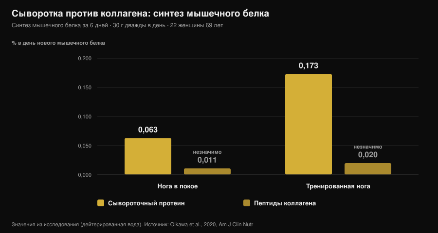
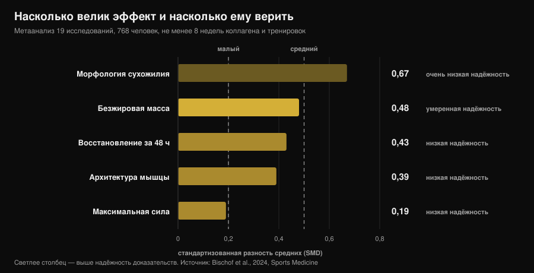

# Коллаген в порошке: помогает мышцам и сухожилиям?

Автор: [Giammaria Loi](/autore/giammaria-loi) · обновлено 18 ноября 2026

Коллаген оказался на полке с протеинами, рядом с сывороточным, под той же этикеткой: «протеин в порошке». Это ошибка категории, которая стоит денег. На мышцу коллаген не тянет — и это не мнение, это измерено меткой, грамм в грамм. Но есть ткань, где что-то действительно происходит, и это не то, что рисуют на банке.

## Коротко

- **Как белок для мышц это худший выбор на полке.** В исследовании с меткой 30 г сывороточного протеина дважды в день подняли синтез мышечного белка; 30 г коллагена в той же дозе **не подняли его выше исходного уровня** ни в покое, ни после тренировки.
- **У сухожилий самый большой эффект — одновременно самый ненадёжный.** Крупнейший метаанализ находит наибольший эффект для морфологии сухожилия (SMD 0,67), но оценивает надёжность этих данных как **очень низкую**. Единственный исход с умеренной надёжностью — безжировая масса (SMD 0,48).
- **На максимальную силу эффекта почти нет** (SMD 0,19): если нужны килограммы на штанге, коллаген — не тот рычаг.
- **Время приёма важнее марки.** В исследованиях на сухожилие желатин или коллаген принимают с витамином C **примерно за час до** работы, которая нагружает сухожилие: 15 г за час удвоили маркер синтеза коллагена.
- **По больному колену результаты противоречат друг другу.** 5 г в день снизили боль у 139 молодых спортсменов; 10 г в день не оказались лучше плацебо у 167 активных людей около 63 лет.

*График Nurvan по значениям, опубликованным Oikawa et al., 2020 (Am J Clin Nutr): 22 женщины 69 лет, 30 г белка дважды в день в течение шести дней, измерение дейтерированной водой. Ни одно значение не считано с рисунка.*

## Что это такое и почему это не обычный белок

Коллаген — структурный белок сухожилий, связок, кожи и костей. В порошке его продают как **пептиды коллагена** или гидролизованный коллаген: белок, разрезанный на короткие фрагменты, которые растворяются в воде и быстро всасываются. Желатин — тот же белок, менее раздробленный.

Критическая точка — аминокислотный профиль. Коллаген примерно на треть состоит из глицина и содержит очень мало лейцина — аминокислоты, которая запускает сборку нового мышечного белка. Триптофана, одной из незаменимых аминокислот, в нём нет вовсе. Поэтому в нутрициологии коллаген считают **неполноценным** белком: на этикетке этого не пишут, но с биохимией не договоришься. Сколько настоящего белка нужно и как его распределить, мы разбирали здесь: [сколько белка за один приём пищи](/ru/blog/skolko-belka-za-odin-priem-pishchi).

## Самая жёсткая проверка: коллаген против сыворотки на мышце

В 2020 году группа Стюарта Филлипса в Университете Макмастера провела прямое сравнение. Двадцать две здоровые женщины 69 лет, две группы, принимали **30 г сывороточного протеина или 30 г пептидов коллагена дважды в день в течение шести дней**, с двумя тренировками только на одну ногу: так тренированная и отдыхавшая нога сравниваются внутри одного человека.

Результат, измеренный дейтерированной водой за всю неделю: на сыворотке синтез мышечного белка вырос до **0,063% в день** в ноге в покое и до **0,173%** в тренированной. На коллагене значения остались на 0,011% и 0,020%, то есть **незначимо выше исходного уровня**. Даже тренировка не заставила коллаген работать как белок.

Это число закрывает вопрос «можно ли взять коллаген вместо сыворотки после тренировки?». Нет.

## А если добавить его к сыворотке?

Здесь недавние работы интереснее и честнее. Когда вы съедаете 30 г сывороточного протеина после тренировки, глицин в крови **падает**: в сыворотке его мало, а организм его тратит. Глицин — аминокислота, которая больше всего нужна соединительной ткани.

Группа из Маастрихта измерила это у 14 мужчин: на одной сыворотке доступность глицина за шесть часов после тренировки оказалась отрицательной (−8,9 ммоль·360 мин/л), тогда как **достаточно 5 г коллагена**, добавленных к 25 г сыворотки, чтобы вернуть её выше нуля (+9,2). Добавка 10 или 15 г для этой цели ничего не даёт и, наоборот, снижает доступный лейцин: больше коллагена — не лучше.

Та же группа затем проверила смесь 25 г сыворотки + 5 г коллагена против некалорийного плацебо: синтез миофибриллярного белка — мышцы — вырос и в покое, и после нагрузки, а синтез белка соединительной ткани вырос в покое, но незначимо в тренированной ноге. Читать надо аккуратно: сравнение шло **с плацебо, а не с сывороткой отдельно**. Это показывает, что смесь работает, а не что она лучше сыворотки.

## Где что-то действительно происходит: сухожилие

В 2024 году в *Sports Medicine* вышел самый крупный систематический обзор по теме: 19 рандомизированных исследований, 768 человек, минимум 8 недель пептидов коллагена вместе с тренировками. Положительные эффекты есть, но важно читать их вместе с **надёжностью доказательств** по методу GRADE.

*График Nurvan по значениям, опубликованным Bischof et al., 2024 (Sports Medicine). SMD — стандартизованная разность средних: по соглашению 0,2 считается малым эффектом, 0,5 — средним. Цвет столбца показывает надёжность GRADE, заявленную авторами. Ни одно значение не считано с рисунка.*

График говорит то, чего не говорит ни одна карточка товара: **самый большой эффект — тот, в котором мы меньше всего уверены**. Морфология сухожилия выигрывает больше всех (SMD 0,67), но на данных очень низкой надёжности; безжировая масса выигрывает меньше (SMD 0,48) при самой высокой надёжности в наборе; максимальная сила почти не двигается (SMD 0,19).

Одно контролируемое исследование показывает, как это выглядит на практике. Пятьдесят умеренно тренированных мужчин 14 недель делали разгибания ног с 70–85% от максимума три раза в неделю, принимая 5 г пептидов коллагена или плацебо. В группе коллагена сильнее выросла **площадь поперечного сечения надколенникового сухожилия**, но по жёсткости сухожилия, сечению мышцы и силе **разницы между группами не было**. Сухожилие стало толще; что оно стало прочнее, не показано.

## Окно в один час и витамин C

Исследования на сухожилии держатся на детали, которая почти всегда теряется в пересказе: на времени. У сухожилия мало сосудов, и синтез коллагена в нём растёт, когда его нагружают.

В работе, открывшей это направление, восемь мужчин принимали 5 или 15 г желатина, обогащённого витамином C, **за час до** шести минут прыжков на скакалке, три раза в день в течение трёх дней. На 15 г маркер синтеза коллагена в крови **удвоился**; сыворотка, взятая после приёма и нанесённая на выращенные в лаборатории связки, повысила в них содержание коллагена и улучшила механические свойства.

Это восемь человек и маркеры, а не предотвращённые травмы. Но это объясняет, почему «когда вспомню» и «за час до работы на сухожилие» — не одна и та же доза. Обзор 2026 года по питанию в реабилитации приходит к тому же практическому выводу: коллаген или желатин с витамином C **перед** нагрузочной работой, как поддержка программы реабилитации, и никогда вместо прогрессивной нагрузки. О питании во время паузы из-за травмы у нас есть отдельная статья: [что есть при травме](/ru/blog/chto-est-pri-travme).

## Колено: два исследования, два ответа

Самое продаваемое обещание — «снимает боль в суставах». Здесь исследования расходятся, и полезно знать, в чём.

В 2017 году 139 занимающихся спортом с функциональной болью в колене принимали 5 г пептидов коллагена или плацебо 12 недель: боль во время активности уменьшилась сильнее в группе коллагена (−19,5 против −13,9 балла по визуальной шкале, p = 0,046), что подтвердила и врачебная оценка.

В 2020 году 167 активных людей с заявленной болью в колене, медианный возраст 63 года, принимали 10 г в день или плацебо 12 недель: боль снизилась **одинаково** в обеих группах (−1,6 против −1,9 балла), и ни один маркер воспаления, хряща или кости не сдвинулся.

Два исследования, во втором доза вдвое больше, результат противоположный. Возраст, тип боли и выборка разные: это не ничья, которую решают выбором удобного исследования. Поэтому честный ответ на это обещание — «возможно, у кого-то», а не «да».

## Что на самом деле говорят исследования

| Распространённое утверждение | Вердикт | Источник |
|---|---|---|
| «Это белок, годится после тренировки» | **Опровергнуто**: 30 г коллагена не поднимают синтез мышечного белка; 30 г сыворотки поднимают | Oikawa et al., 2020 |
| «Растит мышцы» | **Требует уточнения**: метаанализ находит прирост безжировой массы (SMD 0,48, умеренная надёжность), но механистические данные не объясняют это коллагеном как источником белка | Bischof et al., 2024; Oikawa et al., 2020 |
| «Укрепляет сухожилия» | **Требует уточнения**: сухожилие становится толще, но жёсткость и сила не меняются относительно одной лишь тренировки, а надёжность данных очень низкая | Jerger et al., 2023; Bischof et al., 2024 |
| «Убирает боль в колене» | **Требует уточнения**: да у молодых спортсменов на 5 г за 12 недель, нет у активных людей постарше на 10 г | Zdzieblik et al., 2017; Bongers et al., 2020 |
| «Принимать с витамином C за час до» | **Подтверждено по маркерам**: 15 г желатина с витамином C за час до нагрузки удваивают маркер синтеза коллагена | Shaw et al., 2017 |
| «Добавление к сыворотке портит белок» | **Опровергнуто**: 5 г коллагена на 25 г сыворотки возвращают глицин в плюс, не отнимая лейцин | Aussieker et al., 2024 |
| «Чем больше, тем лучше» | **Опровергнуто**: свыше 5 г в смеси с сывороткой доступный лейцин падает, а работавшие исследования использовали 5–15 г, не больше | Aussieker et al., 2024; Shaw et al., 2017 |
| «С ним поднимешь больше» | **Опровергнуто**: на максимальную силу эффект SMD 0,19 при низкой надёжности | Bischof et al., 2024 |

## Как применять

1. **Не заменяйте белок коллагеном.** Сначала закройте норму полноценными источниками: мясо, рыба, яйца, молочное, бобовые и соя или сывороточный протеин. Коллаген — добавка, а не замена.
2. **Если берёте его ради сухожилия, смотрите на часы.** 10–15 г пептидов коллагена или желатина с витамином C **примерно за час до** тренировки, которая нагружает это сухожилие. Вне этого окна исследования ничего не говорят.
3. **Вместе с сывороткой хватает 5 г.** Это доза, которая возвращает глицин в плюс после тренировки, не снижая лейцин.
4. **Дайте время и измеряйте одно.** Исследования длятся от 8 до 14 недель. Выберите показатель заранее — боль в конкретном движении или переносимую нагрузку в упражнении — и смотрите на него через 12 недель, а не через 10 дней.
5. **Не ждите килограммов на штанге.** По максимальной силе средний эффект близок к нулю: если цель в этом, коллаген — не та статья расходов.
6. **Боль в суставе, которая не проходит, усиливается или блокирует движение: к врачу.** Добавка — не диагноз, а сухожилие, которое болит месяцами, — не вопрос порошков.

> **Nurvan: добавка в нужный час, а не только в нужной дозе**
>
> Коллаген — одна из немногих добавок, где время приёма действительно важно: за час до работы на сухожилие. В Nurvan вы вносите дозу и время в модуле добавок, а поскольку тренировка живёт в том же приложении, видно от занятия к занятию, попали ли вы в это окно — и растёт ли тем временем нагрузка в этом упражнении. [Попробовать Nurvan](https://nurvan.app)

## Частые вопросы

**Растит ли коллаген в порошке мышцы?**
Не как источник белка. В прямом сравнении с меткой 30 г пептидов коллагена дважды в день не подняли синтез мышечного белка выше исходного уровня, а та же доза сыворотки подняла. Метаанализ 2024 года действительно находит прирост безжировой массы (SMD 0,48), но через механизм, который коллаген как белок не объясняет: это не повод заменять белок в приёмах пищи.

**Коллаген или сывороточный протеин?**
Для мышц — сывороточный, без вариантов. Коллаген имеет смысл как точечная добавка для соединительной ткани, в дозе 5–15 г, и 5 г достаточно, если принимать его вместе с сывороткой после тренировки.

**Сколько коллагена в день нужно?**
В исследованиях с эффектом использовали от 5 до 15 г в день: 5 г в работах по боли в колене и надколенниковому сухожилию, 15 г желатина в протоколах перед нагрузкой. Более высокие дозы преимуществ не показали и в смеси с сывороткой снижают доступный лейцин.

**Когда принимать коллаген?**
Если цель — сухожилие, примерно за час до тренировки, которая его нагружает, с витамином C: именно так было в исследованиях с положительными результатами по маркерам. Если это добавка к белку после тренировки, принимайте вместе с сывороткой.

**Витамин C действительно нужен?**
В исследованиях желатин был обогащён витамином C, потому что витамин C — необходимый кофактор синтеза коллагена. Раздельный приём не проверяли: следуете протоколу — следуйте и этой детали.

## Читайте также

- [Тир-лист добавок для силы: что говорит наука](/ru/blog/reyting-sportivnykh-dobavok-dlya-sily) — где стоит коллаген относительно добавок с более твёрдыми доказательствами.
- [Говяжий протеин: он не хуже сывороточного?](/ru/blog/beef-protein-govyazhiy-protein-protiv-syvorotochnogo) — другой порошок, который продают как полноценный белок, по той же мерке.
- [Что есть при травме: питание во время паузы](/ru/blog/chto-est-pri-travme) — рацион недель, когда соединительная ткань должна восстановиться.

## Источники

1. Oikawa SY, Kamal MJ, Webb EK, McGlory C, Baker SK, Phillips SM, 2020. Whey protein but not collagen peptides stimulate acute and longer-term muscle protein synthesis with and without resistance exercise in healthy older women: a randomized controlled trial. *Am J Clin Nutr* 111(3):708-718. [PMID 31919527](https://pubmed.ncbi.nlm.nih.gov/31919527/) · [DOI 10.1093/ajcn/nqz332](https://doi.org/10.1093/ajcn/nqz332)
2. Bischof K, Moitzi AM, Stafilidis S, König D, 2024. Impact of Collagen Peptide Supplementation in Combination with Long-Term Physical Training on Strength, Musculotendinous Remodeling, Functional Recovery, and Body Composition in Healthy Adults: A Systematic Review with Meta-analysis. *Sports Med* 54(11):2865-2888. [PMID 39060741](https://pubmed.ncbi.nlm.nih.gov/39060741/) · [DOI 10.1007/s40279-024-02079-0](https://doi.org/10.1007/s40279-024-02079-0)
3. Jerger S, Centner C, Lauber B, Seynnes O, Friedrich T, Lolli D, Gollhofer A, König D, 2023. Specific collagen peptides increase adaptions of patellar tendon morphology following 14-weeks of high-load resistance training: A randomized-controlled trial. *Eur J Sport Sci* 23(12):2329-2339. [PMID 37424319](https://pubmed.ncbi.nlm.nih.gov/37424319/) · [DOI 10.1080/17461391.2023.2232758](https://doi.org/10.1080/17461391.2023.2232758)
4. Shaw G, Lee-Barthel A, Ross ML, Wang B, Baar K, 2017. Vitamin C-enriched gelatin supplementation before intermittent activity augments collagen synthesis. *Am J Clin Nutr* 105(1):136-143. [PMID 27852613](https://pubmed.ncbi.nlm.nih.gov/27852613/) · [DOI 10.3945/ajcn.116.138594](https://doi.org/10.3945/ajcn.116.138594)
5. Aussieker T, Janssen TAH, Hermans WJH, Holwerda AM, Senden JM, van Kranenburg JMX, Goessens JPB, Snijders T, van Loon LJC, 2024. Coingestion of Collagen With Whey Protein Prevents Postexercise Decline in Plasma Glycine Availability in Recreationally Active Men. *Int J Sport Nutr Exerc Metab* 34(4):189-198. [PMID 38604602](https://pubmed.ncbi.nlm.nih.gov/38604602/) · [DOI 10.1123/ijsnem.2023-0264](https://doi.org/10.1123/ijsnem.2023-0264)
6. Aussieker T, Kaiser J, Hermans WJH, Hendriks FK, Holwerda AM, Senden JM, van Kranenburg JMX, Goessens JPB, Braun U, Baar K, Snijders T, van Loon LJC, 2024. Ingestion of a Whey Plus Collagen Protein Blend Increases Myofibrillar and Muscle Connective Protein Synthesis Rates. *Med Sci Sports Exerc* 57(3):544-554. [PMID 39501478](https://pubmed.ncbi.nlm.nih.gov/39501478/) · [DOI 10.1249/MSS.0000000000003596](https://doi.org/10.1249/MSS.0000000000003596)
7. Zdzieblik D, Oesser S, Gollhofer A, König D, 2017. Improvement of activity-related knee joint discomfort following supplementation of specific collagen peptides. *Appl Physiol Nutr Metab* 42(6):588-595. [PMID 28177710](https://pubmed.ncbi.nlm.nih.gov/28177710/) · [DOI 10.1139/apnm-2016-0390](https://doi.org/10.1139/apnm-2016-0390)
8. Bongers CCWG, Ten Haaf DSM, Catoire M, Kersten B, Wouters JA, Eijsvogels TMH, Hopman MTE, 2020. Effectiveness of collagen supplementation on pain scores in healthy individuals with self-reported knee pain: a randomized controlled trial. *Appl Physiol Nutr Metab* 45(7):793-800. [PMID 31990581](https://pubmed.ncbi.nlm.nih.gov/31990581/) · [DOI 10.1139/apnm-2019-0654](https://doi.org/10.1139/apnm-2019-0654)

Практическое указание по коллагену и желатину перед нагрузочной работой в реабилитации: Lee EJ, Kim J, et al., 2026. Rehabilitation Nutrition for Tendon and Ligament Injuries: From Collagen Remodeling to Return-to-Activity and Sport. *Healthcare (Basel)* 14(14). [PMID 42512652](https://pubmed.ncbi.nlm.nih.gov/42512652/) · [DOI 10.3390/healthcare14142136](https://doi.org/10.3390/healthcare14142136). Тема выбрана по трендовым сигналам ноября 2026 года: коллаген в порошке попал в списки роста 15-16 ноября 2026 года (collagen powder 74 000 запросов в месяц, +31%; collagen protein powder 22 200 запросов в месяц, +242%), при этом конкурирующий контент состоит почти только из карточек товара. Научные источники найдены через PubMed.

**Giammaria Loi** — основатель Nurvan. Занимается с отягощениями с 2012 года, работает персональным тренером и коучем с сертификатом FIPE с 2013 года и выступает в пауэрлифтинге на национальном уровне с 2018 года. Каждая его статья начинается с научных работ и заканчивается тем, что действительно работает в зале. [Страница автора](/autore/giammaria-loi)

> Примечание: информационный материал, он не заменяет консультацию врача или квалифицированного специалиста.
