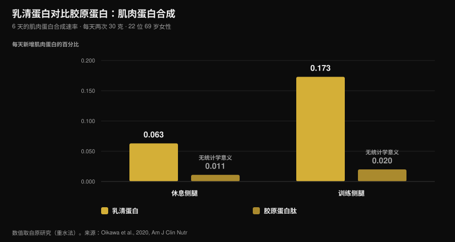
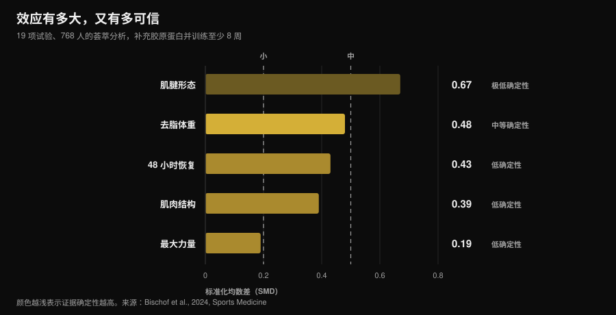

# 胶原蛋白粉对肌肉和肌腱有用吗？

作者：[Giammaria Loi](/autore/giammaria-loi) · 更新于 2026 年 11 月 18 日

胶原蛋白被摆进了蛋白粉货架，就在乳清蛋白旁边，贴着同样的标签：「蛋白粉」。这是一个花钱买来的分类错误。在肌肉这件事上，胶原蛋白根本比不过乳清——这不是观点，而是用同位素示踪、一克对一克量出来的。但确实有一种组织上似乎真的发生了什么，而那并不是罐子正面在卖的东西。

## 一分钟看懂

- **作为增肌蛋白，它是货架上最差的选择。** 在示踪研究中，每天两次 30 克乳清蛋白提高了肌肉蛋白合成；同样剂量的 30 克胶原蛋白**没有把它抬到基线以上**，休息时和训练后都没有。
- **在肌腱上，最大的效应同时也是最不牢靠的。** 规模最大的荟萃分析发现肌腱形态的效应最强（SMD 0.67），却把这条证据的确定性评为**极低**。唯一达到中等确定性的结局是去脂体重（SMD 0.48）。
- **对最大力量几乎没有作用**（SMD 0.19）：想在杠铃上多加几公斤，胶原蛋白不是那根杠杆。
- **时间点比品牌更重要。** 在肌腱研究里，明胶或胶原蛋白要配维生素 C，在加载肌腱的训练**前约一小时**服用：提前一小时 15 克让一项胶原合成标志物翻了一倍。
- **膝盖疼痛的结果互相矛盾。** 每天 5 克在 139 名年轻运动员身上减轻了疼痛；每天 10 克在 167 位约 63 岁的活跃人群中并不优于安慰剂。

*Nurvan 图表，基于 Oikawa et al., 2020（Am J Clin Nutr）发表的数值：22 位 69 岁女性，每天两次 30 克蛋白质，持续六天，以重水法测量。没有任何数值是从图片中读取的。*

## 它是什么，为什么不是普通的蛋白质

胶原蛋白是肌腱、韧带、皮肤和骨骼的结构蛋白。做成粉末后叫**胶原蛋白肽**或水解胶原蛋白：被切成短片段的蛋白质，易溶于水、吸收快。明胶是同一种蛋白质，只是切得没那么碎。

关键在氨基酸构成。胶原蛋白约三分之一是甘氨酸，而亮氨酸极少——亮氨酸正是启动新肌肉蛋白合成的那一个。色氨酸这种必需氨基酸，它完全没有。因此在营养学上胶原蛋白属于**不完全蛋白**：标签不会这么写，但生化规律不讲情面。关于到底需要多少真正的蛋白质、怎么分配，我们写过：[一餐能吸收多少蛋白质](/zh/blog/yi-can-neng-xishou-duoshao-danbai)。

## 最硬的考验：肌肉上的胶原蛋白对乳清蛋白

2020 年，麦克马斯特大学 Stuart Phillips 团队做了正面对比。22 位 69 岁的健康女性分成两组，**每天两次服用 30 克乳清蛋白或 30 克胶原蛋白肽，持续六天**，并且只训练一条腿：这样训练腿和休息腿可以在同一个人身上比较。

用重水法测量整整一周的结果：乳清组肌肉蛋白合成在休息腿升到**每天 0.063%**，训练腿升到 **0.173%**。胶原组停在 0.011% 和 0.020%，也就是**与起点相比没有显著差别**。连训练本身都没能让胶原蛋白像蛋白质那样起作用。

这个数字回答了「训练后能用胶原蛋白代替乳清吗」这个问题。不能。

## 那加进乳清里呢？

这里近年的研究更有意思，也更诚实。训练后吃下 30 克乳清蛋白时，血中甘氨酸会**下降**：乳清里甘氨酸本来就少，而身体又在消耗它。甘氨酸恰恰是结缔组织最需要的氨基酸。

马斯特里赫特的团队在 14 名男性身上做了测量：只喝乳清时，训练后六小时的甘氨酸可利用量是负的（−8.9 mmol·360 min/L），而在 25 克乳清里**加 5 克胶原蛋白**就足以把它拉回零以上（+9.2）。加到 10 克或 15 克对这个目的毫无额外好处，反而压低了可利用的亮氨酸：胶原蛋白不是越多越好。

同一团队随后把这个 25 克乳清 + 5 克胶原的配方与无热量安慰剂对比：肌原纤维蛋白合成——也就是肌肉——在休息和运动后都升高了，结缔组织蛋白合成在休息侧升高，但在训练腿没有达到显著。要注意怎么读：对照的是**安慰剂，不是单独的乳清**。它说明这个配方有效，而不是说明它胜过乳清。

## 真正发生变化的地方：肌腱

2024 年《Sports Medicine》刊出了该主题迄今最大规模的系统综述：19 项随机对照试验、768 人、至少 8 周胶原蛋白肽配合训练。正面效应确实存在，但关键是要和用 GRADE 方法评出的**证据确定性**一起读。

*Nurvan 图表，基于 Bischof et al., 2024（Sports Medicine）发表的数值。SMD 即标准化均数差：按惯例 0.2 为小效应、0.5 为中等效应。柱子的颜色表示作者标注的 GRADE 确定性。没有任何数值是从图片中读取的。*

这张图说了一件产品页永远不会说的事：**效应最大的那一项，恰恰是我们最没把握的那一项。** 肌腱形态收益最大（SMD 0.67），但建立在极低确定性的证据上；去脂体重收益较小（SMD 0.48），确定性却是全组最高；最大力量几乎纹丝不动（SMD 0.19）。

一项对照试验能说明这在实践中是什么样。50 名中等训练水平的男性做了 14 周腿屈伸，强度为最大重量的 70–85%，每周三次，服用 5 克胶原蛋白肽或安慰剂。胶原组的**髌腱横截面积**增加更多，但在肌腱刚度、肌肉横截面积和力量上，**两组没有差别**。肌腱变粗了；并没有证明它变强了。

## 一小时的窗口，以及维生素 C

肌腱研究都压在一个口口相传时几乎总被丢掉的细节上：时间。肌腱血供稀少，它的胶原合成在被加载时才会上升。

在开启这条线索的研究里，八名男性在六分钟跳绳**前一小时**服用 5 克或 15 克富含维生素 C 的明胶，每天三次，连续三天。15 克这一组，血中胶原合成标志物**翻倍**；服用后抽取的血清用于实验室培养的人工韧带，提高了其胶原含量并改善了力学性能。

这是八个人和一个标志物，不是避免的伤病。但它解释了为什么「想起来就吃」和「肌腱训练前一小时吃」不是同一个剂量。2026 年一篇关于康复营养的综述给出了同样的实务结论：胶原蛋白或明胶配维生素 C 放在加载训练**之前**，作为康复方案的辅助，绝不能代替渐进负荷。关于受伤期间怎么吃，我们有专门一篇：[受伤时该吃什么](/zh/blog/shoushang-shi-chi-shenme)。

## 膝盖：两项研究，两个答案

卖得最好的说法是「能缓解关节疼痛」。这里研究出现了分歧，值得知道分歧在哪。

2017 年，139 名有功能性膝痛的运动人群服用 5 克胶原蛋白肽或安慰剂 12 周：活动时的疼痛在胶原组改善更多（视觉量表 −19.5 对 −13.9，p = 0.046），医生评估也得出同样结论。

2020 年，167 名自述膝痛的活跃人群（年龄中位数 63 岁）服用每天 10 克或安慰剂 12 周：两组疼痛下降幅度**相同**（−1.6 对 −1.9），炎症、软骨和骨的标志物都没有变化。

两项试验，第二项剂量翻倍，结果相反。年龄、疼痛类型和人群都不同：这不是靠挑一项顺眼的研究就能打破的平局。所以对这个说法，诚实的回答是「也许，对某些人」，而不是「是」。

## 研究到底怎么说

| 常见说法 | 结论 | 来源 |
|---|---|---|
| 「它是蛋白质，练后喝没问题」 | **证伪**：30 克胶原蛋白不能提高肌肉蛋白合成；30 克乳清可以 | Oikawa et al., 2020 |
| 「能增肌」 | **需要限定**：荟萃分析确实发现去脂体重增加（SMD 0.48，中等确定性），但机制数据无法用「胶原作为蛋白源」来解释 | Bischof et al., 2024; Oikawa et al., 2020 |
| 「能强化肌腱」 | **需要限定**：肌腱变粗，但刚度和力量相对单纯训练没有变化，且证据确定性极低 | Jerger et al., 2023; Bischof et al., 2024 |
| 「能治膝盖痛」 | **需要限定**：年轻运动员用 5 克 12 周有效，年长活跃人群用 10 克无效 | Zdzieblik et al., 2017; Bongers et al., 2020 |
| 「要配维生素 C、提前一小时吃」 | **在标志物层面成立**：加载前一小时 15 克明胶配维生素 C 使胶原合成标志物翻倍 | Shaw et al., 2017 |
| 「掺进乳清会毁了蛋白质」 | **证伪**：25 克乳清里加 5 克胶原能把甘氨酸拉回正值，且不损失亮氨酸 | Aussieker et al., 2024 |
| 「越多越好」 | **证伪**：加到乳清里超过 5 克，可利用亮氨酸下降；有效的研究用的是 5–15 克，不是更多 | Aussieker et al., 2024; Shaw et al., 2017 |
| 「能让你举得更重」 | **证伪**：最大力量上的效应是 SMD 0.19，确定性低 | Bischof et al., 2024 |

## 怎么用

1. **不要用胶原蛋白替代蛋白质。** 先用完全蛋白源吃够：肉、鱼、蛋、乳制品、豆类和大豆，或者乳清。胶原蛋白是加法，不是替换。
2. **若为肌腱而吃，就看表。** 10–15 克胶原蛋白肽或明胶配维生素 C，在加载该肌腱的训练**前约一小时**服用。超出这个窗口，研究什么也没告诉你。
3. **和乳清一起用，5 克就够。** 这是训练后把甘氨酸拉回正值、又不压低亮氨酸的剂量。
4. **给够时间，只盯一个指标。** 试验周期是 8 到 14 周。开始前选定一个指标——某个动作时的疼痛，或某个动作可承受的负荷——到第 12 周再看，而不是第 10 天。
5. **别指望杠铃上多出公斤数。** 最大力量的平均效应接近零：如果那是你的目标，这笔钱不该花在这里。
6. **关节疼痛持续、加重或限制活动：去看医生。** 补剂不是诊断，疼了几个月的肌腱也不是靠粉末能解决的问题。

> **Nurvan：吃对时间的补剂，而不只是吃对剂量**
>
> 胶原蛋白是少数几种时间真正重要的补剂之一：肌腱训练前一小时。在 Nurvan 里，你在补剂模块记录剂量和时间，而训练就在同一个应用里，于是你能一次次训练地看到自己是否真的落在那个窗口里——以及这个动作的负荷是否同时在上升。[试用 Nurvan](https://nurvan.app)

## 常见问题

**胶原蛋白粉能增肌吗？**
作为蛋白质来源不能。在示踪法的直接对比中，每天两次 30 克胶原蛋白肽没有把肌肉蛋白合成抬到基线以上，而同样剂量的乳清做到了。2024 年的荟萃分析确实发现去脂体重增加（SMD 0.48），但其机制无法用胶原作为蛋白源解释：这不构成替换正餐蛋白质的理由。

**胶原蛋白还是乳清蛋白？**
为了肌肉，选乳清，没有争议。胶原蛋白作为针对结缔组织的定向补充才有意义，剂量 5–15 克；如果训练后和乳清一起喝，5 克就够。

**每天需要多少胶原蛋白？**
发现效应的试验用的是每天 5 到 15 克：膝痛与髌腱研究用 5 克，训练前方案用 15 克明胶。更高剂量没有显示优势，并且在与乳清混合时会降低可利用的亮氨酸。

**什么时候吃胶原蛋白？**
若目标是肌腱，在加载它的训练前约一小时，配维生素 C：这正是那些在标志物上得到阳性结果的研究所采用的安排。若只是作为练后蛋白质的补充，就和乳清一起喝。

**维生素 C 真的必要吗？**
研究中的明胶都强化了维生素 C，因为维生素 C 是胶原合成的必需辅因子。把两者分开服用没有被检验过：既然照这个方案走，就连这个细节一起照做。

## 延伸阅读

- [力量补剂等级榜：研究到底怎么说](/zh/blog/liliang-buji-dengji-bang) — 相对于证据更硬的补剂，胶原蛋白排在哪里。
- [牛肉蛋白粉真的能替代乳清蛋白吗？](/zh/blog/niurou-danbai-fen-haishi-rujiang-danbai) — 另一种被当作完全蛋白卖的粉末，用同一把尺子衡量。
- [受伤时该吃什么：停训期的饮食](/zh/blog/shoushang-shi-chi-shenme) — 结缔组织需要重建的那几周该怎么吃。

## 参考文献

1. Oikawa SY, Kamal MJ, Webb EK, McGlory C, Baker SK, Phillips SM, 2020. Whey protein but not collagen peptides stimulate acute and longer-term muscle protein synthesis with and without resistance exercise in healthy older women: a randomized controlled trial. *Am J Clin Nutr* 111(3):708-718. [PMID 31919527](https://pubmed.ncbi.nlm.nih.gov/31919527/) · [DOI 10.1093/ajcn/nqz332](https://doi.org/10.1093/ajcn/nqz332)
2. Bischof K, Moitzi AM, Stafilidis S, König D, 2024. Impact of Collagen Peptide Supplementation in Combination with Long-Term Physical Training on Strength, Musculotendinous Remodeling, Functional Recovery, and Body Composition in Healthy Adults: A Systematic Review with Meta-analysis. *Sports Med* 54(11):2865-2888. [PMID 39060741](https://pubmed.ncbi.nlm.nih.gov/39060741/) · [DOI 10.1007/s40279-024-02079-0](https://doi.org/10.1007/s40279-024-02079-0)
3. Jerger S, Centner C, Lauber B, Seynnes O, Friedrich T, Lolli D, Gollhofer A, König D, 2023. Specific collagen peptides increase adaptions of patellar tendon morphology following 14-weeks of high-load resistance training: A randomized-controlled trial. *Eur J Sport Sci* 23(12):2329-2339. [PMID 37424319](https://pubmed.ncbi.nlm.nih.gov/37424319/) · [DOI 10.1080/17461391.2023.2232758](https://doi.org/10.1080/17461391.2023.2232758)
4. Shaw G, Lee-Barthel A, Ross ML, Wang B, Baar K, 2017. Vitamin C-enriched gelatin supplementation before intermittent activity augments collagen synthesis. *Am J Clin Nutr* 105(1):136-143. [PMID 27852613](https://pubmed.ncbi.nlm.nih.gov/27852613/) · [DOI 10.3945/ajcn.116.138594](https://doi.org/10.3945/ajcn.116.138594)
5. Aussieker T, Janssen TAH, Hermans WJH, Holwerda AM, Senden JM, van Kranenburg JMX, Goessens JPB, Snijders T, van Loon LJC, 2024. Coingestion of Collagen With Whey Protein Prevents Postexercise Decline in Plasma Glycine Availability in Recreationally Active Men. *Int J Sport Nutr Exerc Metab* 34(4):189-198. [PMID 38604602](https://pubmed.ncbi.nlm.nih.gov/38604602/) · [DOI 10.1123/ijsnem.2023-0264](https://doi.org/10.1123/ijsnem.2023-0264)
6. Aussieker T, Kaiser J, Hermans WJH, Hendriks FK, Holwerda AM, Senden JM, van Kranenburg JMX, Goessens JPB, Braun U, Baar K, Snijders T, van Loon LJC, 2024. Ingestion of a Whey Plus Collagen Protein Blend Increases Myofibrillar and Muscle Connective Protein Synthesis Rates. *Med Sci Sports Exerc* 57(3):544-554. [PMID 39501478](https://pubmed.ncbi.nlm.nih.gov/39501478/) · [DOI 10.1249/MSS.0000000000003596](https://doi.org/10.1249/MSS.0000000000003596)
7. Zdzieblik D, Oesser S, Gollhofer A, König D, 2017. Improvement of activity-related knee joint discomfort following supplementation of specific collagen peptides. *Appl Physiol Nutr Metab* 42(6):588-595. [PMID 28177710](https://pubmed.ncbi.nlm.nih.gov/28177710/) · [DOI 10.1139/apnm-2016-0390](https://doi.org/10.1139/apnm-2016-0390)
8. Bongers CCWG, Ten Haaf DSM, Catoire M, Kersten B, Wouters JA, Eijsvogels TMH, Hopman MTE, 2020. Effectiveness of collagen supplementation on pain scores in healthy individuals with self-reported knee pain: a randomized controlled trial. *Appl Physiol Nutr Metab* 45(7):793-800. [PMID 31990581](https://pubmed.ncbi.nlm.nih.gov/31990581/) · [DOI 10.1139/apnm-2019-0654](https://doi.org/10.1139/apnm-2019-0654)

关于康复中加载训练前使用胶原蛋白或明胶的实务建议：Lee EJ, Kim J, et al., 2026. Rehabilitation Nutrition for Tendon and Ligament Injuries: From Collagen Remodeling to Return-to-Activity and Sport. *Healthcare (Basel)* 14(14). [PMID 42512652](https://pubmed.ncbi.nlm.nih.gov/42512652/) · [DOI 10.3390/healthcare14142136](https://doi.org/10.3390/healthcare14142136)。选题依据 2026 年 11 月的趋势信号：胶原蛋白粉于 2026 年 11 月 15 至 16 日进入增长榜单（collagen powder 每月 74,000 次搜索，+31%；collagen protein powder 每月 22,200 次搜索，+242%），而竞争内容几乎全是产品页。科学文献通过 PubMed 检索。

**Giammaria Loi** 是 Nurvan 的创始人。他自 2012 年开始力量训练，自 2013 年起担任 FIPE 认证的私人教练，并自 2018 年起在国家级powerlifting赛事中参赛。他署名的每篇文章都从科学研究出发，落到健身房里真正管用的做法。[作者页面](/autore/giammaria-loi)

> 注：本文为科普内容，不能替代医生或合格专业人士的意见。
