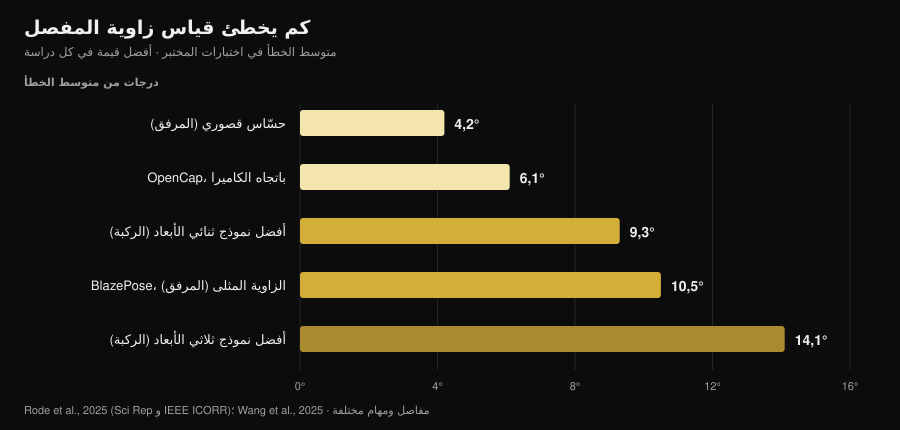
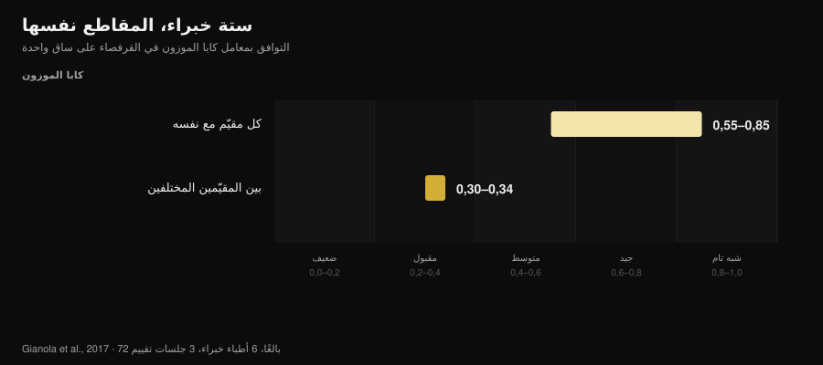

# تحليل التقنية بالذكاء الاصطناعي: ما مدى دقته؟

بقلم [Giammaria Loi](/autore/giammaria-loi) · حُدّث في 19 نوفمبر 2026

تسند الهاتف، تؤدي المجموعة، فيجيبك التطبيق: «انهيار الركبة للداخل، العمق 92 درجة». يبدو الأمر قياسًا. في 2026 صدرت عشرات التطبيقات من هذا النوع، ومن يبحث عن «تحليل التقنية بالذكاء الاصطناعي» لا يجد سوى صفحات المتجر. المشكلة أن لتلك الدرجات هامش خطأ مقيسًا في المختبر، ولا أحد يكتبه بجانبها.

## باختصار

- **أفضل مقدّر ثنائي الأبعاد يخطئ زاوية الركبة بـ 9,3 درجة وسطيًا.** هذه أفضل نتيجة عبر 2,2 مليون إطار و11 نموذجًا مفتوح المصدر: ولا واحد من النماذج المختبَرة بلغ الدقة اللازمة لتفسير سريري صحيح.
- **«الثلاثي الأبعاد» في التطبيق غالبًا أسوأ من الثنائي.** خطأ موضع المفاصل يرتفع من 72-122 مم في 2D إلى 146-249 مم حين يقدّر النموذج العمق أيضًا.
- **زاوية التصوير أهم من الخوارزمية.** حين تقع الحركة بالكامل داخل مستوى الصورة كان الخطأ عند المرفق 10,5 درجة؛ وخارج هذا المستوى يسوء بشكل معنوي.
- **العين البشرية ليست منقلة أيضًا.** ستة أطباء خبراء شاهدوا المقاطع نفسها فاتفقوا فيما بينهم بمعامل كابا 0,30-0,34، بينما اتفق كل واحد مع نفسه بين 0,55 و0,85.
- **الفيديو مفيد، لكن لأسئلة أخرى.** المعايير الثنائية والحكم الكلي موثوقة، أما الكسور العشرية فلا. اسأل «هل بقيت الركبة داخل حافة الحذاء؟» لا «كم درجة انهيار عندي؟».

*رسم Nurvan استنادًا إلى القيم المنشورة في Rode et al., 2025 (Scientific Reports وIEEE ICORR) وWang et al., 2025. تنبيه: مفاصل ومهام مختلفة، وليست مقارنة مباشرة. كل عمود هو أفضل قيمة منشورة في تلك الدراسة. لم تُقرأ أي قيمة من رسم بياني.*

## ماذا يفعل تطبيق تحليل الأداء فعلًا

خلف معظمها التقنية نفسها: *تقدير الوضعية*، شبكة عصبية تنظر إلى الصورة وتخمّن أين الكتف والورك والركبة والكاحل. ثم يحسب التطبيق الزوايا من تلك النقاط. هو لا يقيس جسمك، بل يستنتج مراكز المفاصل من البكسلات.

الفارق مهم. في المختبر يأتي موضع المفصل من علامات عاكسة وعدة كاميرات معايَرة؛ هنا يأتي من كاميرا واحدة، مع الملابس وإضاءة الصالة وبار يحجب جزءًا منك أحيانًا.

## أرقام أوسع اختبار

في نوفمبر 2025 نشر فريق من المعهد التقني الفدرالي في زيورخ في *Scientific Reports* أوسع مقارنة حتى اليوم: 25 مشاركًا، وأكثر من 2,2 مليون إطار لتمارين بدنية، و11 مقدّر وضعية مفتوح المصدر اختُبرت في 18 صيغة ثنائية الأبعاد و26 صيغة ثلاثية، جميعها مقابل نظام بصري بعلامات.

| القياس | مقدّرات 2D | مقدّرات 3D |
|---|---|---|
| متوسط خطأ موضع المفاصل | 72-122 مم | 146-249 مم |
| متوسط خطأ زاوية الركبة | من 9,3 درجة | من 14,1 درجة |
| متوسط خطأ زاوية المرفق | من 21,5 درجة | من 16,3 درجة |

*جدول Nurvan استنادًا إلى القيم المنشورة في Rode et al., 2025 (Scientific Reports). «من» تشير إلى أفضل نموذج في الفئة.*

قراءتان عمليتان. الأولى: حتى في أفضل الحالات يبلغ متوسط الخطأ عند الركبة نحو تسع درجات، ويكتب الباحثون أن أيًّا من النماذج المختبَرة لم ينزل تحت الخطأ الزاوي اللازم لتفسير سريري صحيح. الثانية: إضافة البعد الثالث تزيد الأمر سوءًا. حين يحاول النموذج تخمين العمق أيضًا من كاميرا واحدة يتضاعف خطأ الموضع. عبارة «3D» في وصف التطبيق ليست شهادة جودة.

وأجرى الفريق نفسه اختبارًا ثانيًا موجّهًا إلى المرفق: حين جرت الحركة **بالكامل داخل مستوى الصورة** — الحالة المثالية — كان متوسط الخطأ 10,5 درجة والجذر التربيعي لمتوسط الخطأ 14,7، مقابل 4,2 و6,0 لحسّاس قصوري مُرتدى. وأثّر الاتجاه نسبةً إلى الكاميرا في الدقة بشكل معنوي، ومال النموذج إلى تقدير الزوايا الكبيرة بأقل من قيمتها: أي تحديدًا حيث تريد أن تعرف إن كنت قد نزلت بما يكفي.

### زاوية التصوير ليست تفصيلًا

اختبرت دراسة 2025 في *Journal of Biomechanics* نظام OpenCap، أكثر الأنظمة دون علامات استخدامًا في البحث عبر الهاتف، على 53 شخصًا مصابًا بخشونة الركبة و30 شخصًا سليمًا. عند المشي **باتجاه** الكاميرا كان متوسط الخطأ 6,1 درجة بتوافق 0,67؛ وفي الاتجاه المعاكس ساء بشكل دال إحصائيًا. الشخص نفسه والبرنامج نفسه والقاعة نفسها: تغيّر الاتجاه فقط.

ينطبق هذا أيضًا على التحليل الثنائي الأبعاد اليدوي. عند نساء نشيطات بدنيًا، اعتمدت صلاحية زاوية الانهيار في المستوى الأمامي على عمق السكوات وعلى أي ساق كانت الحاملة وعلى كون الانهيار واضحًا أم لا. بالعربية الواضحة: القياس نفسه قد يكون صالحًا في حالة وغير صالح في أخرى.

## هل المدرّب البشري أفضل إذن؟

يعتمد على ما تطلبه منه. في دراسة إيطالية على 72 بالغًا، قيّم ستة أطباء خبراء المقاطع نفسها لسكوات على ساق واحدة في ثلاث جلسات مختلفة بمقياس مُثبَت. كان كل واحد متسقًا مع نفسه إلى حد جيد — كابا موزونة بين 0,55 و0,85 — لكن التوافق **بين** المقيّمين بقي بين 0,30 و0,34، أي «مقبول» وفق العرف.

*رسم Nurvan استنادًا إلى القيم المنشورة في Gianola et al., 2017 (72 بالغًا، ستة أطباء خبراء، ثلاث جلسات تقييم). نطاقات تفسير كابا هي العرف الشائع. لم تُقرأ أي قيمة من رسم بياني.*

ستة خبراء، المقطع نفسه، وأحكام لا تتطابق إلا قليلًا. ليست هذه تهمة لمهنة: هكذا هو تقييم الزوايا والأجزاء بالعين. وهذا يفسّر أن يعطيك مدرّبان تصحيحين مختلفين للرفعة نفسها دون أن يكون أحدهما مخطئًا في صنعته.

الجزء المفيد يأتي مباشرة بعد ذلك. حين يُطلب حكم **كلي** بدل التقييم جزءًا جزءًا، يتحسّن التوافق: لدى أشخاص سبقت لهم إصابة في الركبة، بلغ ثلاثة مقيّمين خبراء وثلاثة مبتدئين توافقًا جيدًا بالطريقة الكلية. ومعيار ثنائي مختار بعناية يصمد أمام المختبر: لدى رياضيات مراهقات، بلغ معيار «تنتهي الركبة داخل الحافة الداخلية للحذاء» مساحة تحت المنحنى تصل إلى 0,93 في كشف الانهيار المقيس ثلاثي الأبعاد، أي أعلى بكثير من معايير أخرى.

الفيديو أداة ممتازة للأسئلة ذات الإجابة الحاسمة. وهو منقلة رديئة.

## ماذا يقول البحث فعلًا

| ادعاء شائع | الحكم | المصدر |
|---|---|---|
| «التطبيق يقيس زواياك كما يفعل المختبر» | **منفي** | Rode et al., 2025 — لا أحد من المقدّرات الـ11 يبلغ الخطأ الزاوي اللازم للتفسير السريري |
| «إن كان ثلاثي الأبعاد فهو أدق» | **منفي** | Rode et al., 2025 — خطأ الموضع 72-122 مم في 2D مقابل 146-249 مم في 3D بكاميرا واحدة |
| «يكفي أن تظهر في الكادر، والزاوية تفصيل» | **منفي** | Rode et al., 2025؛ Wang et al., 2025 — الاتجاه نسبةً إلى الكاميرا يغيّر الخطأ بشكل معنوي |
| «المدرّب البشري موضوعي» | **يحتاج تدقيقًا** | Gianola et al., 2017 — ستة خبراء على المقاطع نفسها: توافق متبادل 0,30-0,34 كابا موزونة |
| «تحليل الأداء بالفيديو بلا فائدة» | **منفي** | Edwards وLiberatore, 2018؛ Erdman et al., 2024 — أحكام كلية موثوقة ومعايير ثنائية بمساحة تحت المنحنى حتى 0,93 |
| «يستطيع التطبيق إخبارك إن كانت الحركة آمنة لك» | **غير قابل للتحقق** | لا دراسة متاحة اختبرت التنبؤ بالإصابات لدى ممارسي رفع الأثقال |

## كيف تطبّق ذلك

1. **صوّر في مستوى الحركة.** الكاميرا على ارتفاع الورك، عمودية على المستوى الذي يهمّك: من الجانب للعمق والظهر، ومن الأمام للركبة. يجب أن تبقى الحركة كاملة داخل الكادر.
2. **كاميرا ثابتة وفي المكان نفسه دائمًا.** مقارنة حصتين لا معنى لها إلا إذا كان الكادر متطابقًا. علامة على الأرض أنفع من أي خوارزمية.
3. **اطرح أسئلة ثنائية.** «هل بقيت الركبة داخل حافة الحذاء؟»، «هل نزل الورك تحت الركبة؟»، «هل ابتعد البار عن الجسم؟». هذه هي الأسئلة التي تكون فيها العين، بشرية كانت أم اصطناعية، موثوقة.
4. **تجاهل الكسور العشرية.** إذا كتب التطبيق 92,4 درجة انثناء، فاقرأها «نحو 90، بهامش عشر درجات». زاوية تتغيّر 5 درجات بين أسبوع وآخر ضجيج لا تقدّم.
5. **الفيديو للتقنية والأرقام للحمل.** مقدار ما تدفعه فعلًا لا يظهر في إطار واحد، بل في سجل الأوزان والتكرارات و[RIR، بكل حدود هذا التقدير أيضًا](/ar/blog/ma-mada-diqat-rir).
6. **الألم أو التورّم أو خذلان المفصل ليس مشكلة تقنية يحلّها تطبيق.** هنا يلزم مختص صحي، لا زاوية تصوير أفضل.

### إذا كنت تدرّب آخرين عن بُعد

قاعدتان تحوّلان الفيديو إلى بيانات بدل أن يبقى رأيًا:

- **اطلب الكادر نفسه دائمًا.** حدّد الارتفاع والجهة والمسافة مرة واحدة ثم تمسّك بها. من دون ذلك تقارن تصويرًا مختلفًا لا أداءً مختلفًا.
- **اكتب المعايير قبل المشاهدة.** ثلاثة أسئلة ثنائية لكل تمرين، محسومة مسبقًا. هذه أبسط طريقة لئلا يختلف تقييمك اليوم عن تقييمك الثلاثاء الماضي، وهو ما يحدث حتى للمقيّمين الخبراء.

> **Nurvan: الفيديو يُظهر الشكل، والسجل يُظهر الحمل**
>
> في Nurvan يرى المدرّب لكل مجموعة الوزن والتكرارات وRIR، مع سجل التمرين مصفوفًا: وهي البيانات التي لا يعطيها إطار واحد، والتي تقول إن كان الطلب يرتفع فعلًا. يبقى الفيديو ما هو عليه، فحص شكل؛ أما قرارات البرمجة فتُتخذ على الأرقام. [جرّب Nurvan](https://nurvan.app)

## أسئلة شائعة

**هل تنفع تطبيقات تحليل الأداء بالذكاء الاصطناعي؟**
تنفع للإشارة إلى الفروق الفادحة، لا للقياس. في أوسع اختبار منشور حتى الآن، يبدأ متوسط خطأ زاوية الركبة من 9,3 درجة لأفضل النماذج الثنائية ومن 14,1 للثلاثية، ولا أحد منها يبلغ الدقة اللازمة لتفسير سريري. إذا قال لك التطبيق إن ركبة تنهار للداخل بوضوح فهو على الأرجح محق؛ أما إذا أعطاك رقمًا بفاصلة عشرية فذلك الرقم غير موثوق.

**من أي جهة أصوّر السكوات؟**
من حيث يحدث ما تريد رؤيته. من الجانب والكاميرا على ارتفاع الورك للعمق ومسار البار وميل الجذع؛ ومن الأمام لسلوك الركبتين. في الدراسات يغيّر الاتجاه نسبةً إلى الكاميرا الخطأ بشكل معنوي، فالتصوير من زاوية ثلاثة أرباع أسرع طريق إلى أرقام بلا معنى.

**الهاتف أم حسّاس يُرتدى؟**
لقياس زاوية: الحسّاس القصوري، ففي المقارنة المباشرة عند المرفق كان عند 4,2 درجة خطأ وسطي مقابل 10,5 لتقدير الفيديو في أفضل حالاته. أما لمشاهدة حركة كاملة فيبقى الفيديو أيسر وأغنى.

**هل يستطيع تطبيق أن يخبرني أن تقنيتي خطرة؟**
لا. تقيس الدراسات المتاحة مدى اقتراب النظام من المختبر في وصف الحركة، لا ما إذا كانت تلك الحركة ستسبب إصابة. إن كان لديك ألم أو عدم ثبات أو خذلان مفاجئ فالسؤال طبي ويُطرح على طبيب أو أخصائي علاج طبيعي.

## اقرأ أيضًا

- [هل ينجح التدريب عن بُعد؟ ما تقوله الدراسات](/ar/blog/hal-yanjah-altadrib-an-bud) — ما الذي يجب أن يراقبه المدرّب عن بُعد ليوازي المدرّب في الصالة.
- [ما مدى دقة تقديرك لـ RIR؟ ما تقوله الدراسات](/ar/blog/ma-mada-diqat-rir) — التقدير الآخر الذي يقوم عليه نصف التدريب.
- [برنامج تدريب بالذكاء الاصطناعي: ماذا تقول الدراسات](/ar/blog/barnamij-tadrib-bialdhakaa-alistinaei) — أين يصمد الذكاء الاصطناعي وأين لا يصمد.

## المصادر

1. Rode D, Dunkel A, Willi R, Wolf P, Xiloyannis M, Riener R, 2025. Assessment of monocular human pose estimation models for clinical movement analysis. *Scientific Reports* 15(1):38767. [PMID 41193590](https://pubmed.ncbi.nlm.nih.gov/41193590/) · [DOI 10.1038/s41598-025-22626-7](https://doi.org/10.1038/s41598-025-22626-7)
2. Rode D, Ceccarelli A, Esser A, Wolf P, Riener R, 2025. Accuracy of IMUs and Monocular Human Pose Estimation at Measuring Elbow Flexion. *IEEE Int Conf Rehabil Robot* 2025:773-778. [PMID 40644081](https://pubmed.ncbi.nlm.nih.gov/40644081/) · [DOI 10.1109/ICORR66766.2025.11063086](https://doi.org/10.1109/ICORR66766.2025.11063086)
3. Wang J, Xu W, Wu Z, Zhang H, Wang B, Zhou Z, Wang C, Li K, Nie Y, 2025. Evaluation of a smartphone-based markerless system to measure lower-limb kinematics in patients with knee osteoarthritis. *Journal of Biomechanics* 181:112529. [PMID 39862716](https://pubmed.ncbi.nlm.nih.gov/39862716/) · [DOI 10.1016/j.jbiomech.2025.112529](https://doi.org/10.1016/j.jbiomech.2025.112529)
4. Wade L, Needham L, McGuigan P, Bilzon J, 2022. Applications and limitations of current markerless motion capture methods for clinical gait biomechanics. *PeerJ* 10:e12995. [PMID 35237469](https://pubmed.ncbi.nlm.nih.gov/35237469/) · [DOI 10.7717/peerj.12995](https://doi.org/10.7717/peerj.12995)
5. Gianola S, Castellini G, Stucovitz E, Nardo A, Banfi G, 2017. Single leg squat performance in physically and non-physically active individuals: a cross-sectional study. *BMC Musculoskeletal Disorders* 18(1):299. [PMID 28709418](https://pubmed.ncbi.nlm.nih.gov/28709418/) · [DOI 10.1186/s12891-017-1660-8](https://doi.org/10.1186/s12891-017-1660-8)
6. Edwards S, Liberatore M, 2018. Reliability of a Squat Movement Competency Screen in Individuals With a Previous Knee Injury. *Journal of Sport Rehabilitation* 27(2). [PMID 28872403](https://pubmed.ncbi.nlm.nih.gov/28872403/) · [DOI 10.1123/jsr.2017-0064](https://doi.org/10.1123/jsr.2017-0064)
7. Erdman A, Loewen A, Dressing M, Wyatt C, Oliver G, Butler L, Sugimoto D, Black AM, Tulchin-Francis K, Bazett-Jones DM, Janosky J, Ulman S, 2024. A 2D video-based assessment is associated with 3D biomechanical contributors to dynamic knee valgus in the coronal plane. *Frontiers in Sports and Active Living* 6:1352286. [PMID 38558858](https://pubmed.ncbi.nlm.nih.gov/38558858/) · [DOI 10.3389/fspor.2024.1352286](https://doi.org/10.3389/fspor.2024.1352286)
8. Jamaludin NI, Sahabuddin FNA, Rasudin NS, Shaharudin S, 2022. The Concurrent Validity and Reliability of Single Leg Squat Among Physically Active Females with and without Dynamic Knee Valgus. *International Journal of Sports Physical Therapy* 17(4):574-584. [PMID 35693857](https://pubmed.ncbi.nlm.nih.gov/35693857/) · [DOI 10.26603/001c.35706](https://doi.org/10.26603/001c.35706)

اختير الموضوع من إشارات الاتجاهات في نوفمبر 2026: عشرات تطبيقات «AI form check» نُشرت في المتاجر خلال 2026، وصفحة نتائج أولى تتكوّن من صفحات منتجات فقط بلا أي رقم عن الدقة. المصادر العلمية عبر PubMed.

**Giammaria Loi** مؤسس Nurvan. يتدرّب بالأثقال منذ 2012، ويعمل مدرّبًا شخصيًا ومدرّبًا معتمدًا من FIPE منذ 2013، وينافس في رفع القوة على المستوى الوطني منذ 2018. كل مقال يوقّعه ينطلق من الدراسات العلمية ليصل إلى ما ينفع فعلًا في الصالة. [صفحة الكاتب](/autore/giammaria-loi)

> ملاحظة: محتوى معلوماتي لا يغني عن رأي طبيب أو مختص مؤهل.
