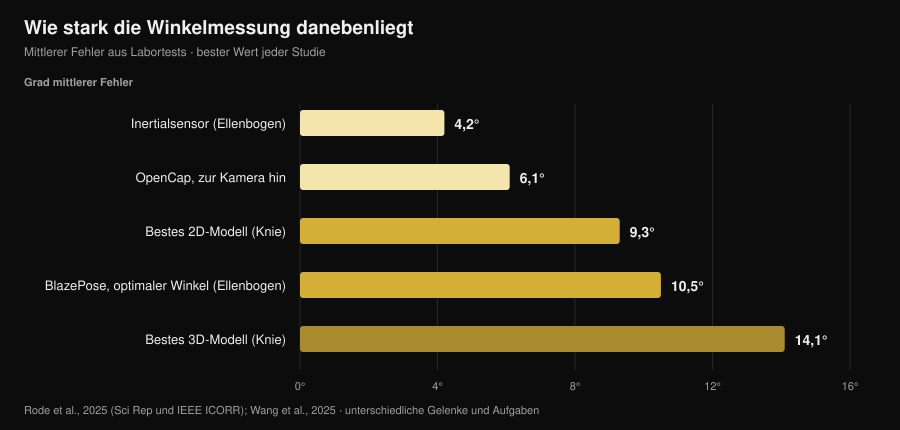
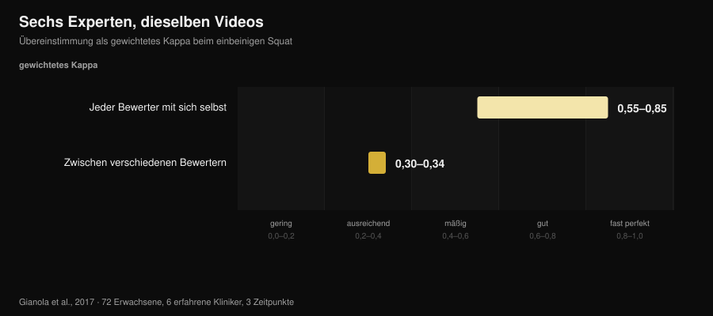

# KI-Form-Check: Wie genau ist er wirklich?

Von [Giammaria Loi](/autore/giammaria-loi) · aktualisiert am 19. November 2026

Du stellst das Handy auf, machst den Satz, und die App antwortet: „Knievalgus, Tiefe 92°". Das sieht aus wie eine Messung. 2026 sind Dutzende solcher Apps erschienen, und wer nach „KI Form Check" sucht, findet fast nur Store-Einträge. Das Problem: Diese Gradzahlen haben eine im Labor gemessene Fehlerspanne, und niemand schreibt sie daneben.

## Kurz gefasst

- **Der beste 2D-Schätzer liegt am Knie im Schnitt 9,3° daneben.** Das ist das günstigste Ergebnis über 2,2 Millionen Einzelbilder und 11 Open-Source-Modelle: Keines der getesteten Modelle erreichte die für eine klinische Auswertung nötige Genauigkeit.
- **Das „3D" der App ist oft schlechter als 2D.** Der Positionsfehler der Gelenke steigt von 72-122 mm in 2D auf 146-249 mm, sobald das Modell auch die Tiefe schätzen muss.
- **Der Kamerawinkel wiegt schwerer als der Algorithmus.** Lag die Bewegung vollständig in der Bildebene, betrug der Fehler am Ellenbogen 10,5°; außerhalb dieser Ebene wurde er deutlich größer.
- **Das menschliche Auge ist auch kein Winkelmesser.** Sechs erfahrene Kliniker, die dieselben Videos bewerteten, stimmten untereinander mit einem Kappa von 0,30-0,34 überein, jeder mit sich selbst dagegen mit 0,55 bis 0,85.
- **Video nützt — für andere Fragen.** Binäre Kriterien und Gesamturteile sind zuverlässig, Nachkommastellen nicht. Frage „Blieb das Knie innerhalb der Schuhkante?", nicht „Wie viel Grad Valgus habe ich?".

*Nurvan-Grafik nach den Werten in Rode et al., 2025 (Scientific Reports und IEEE ICORR) und Wang et al., 2025. Achtung: unterschiedliche Gelenke und Aufgaben, kein direkter Vergleich. Jeder Balken ist der beste in der jeweiligen Studie veröffentlichte Wert. Kein Wert wurde aus einer Abbildung abgelesen.*

## Was eine Form-Check-App wirklich tut

Hinter fast allen steckt dieselbe Technik: die *Posenschätzung*, ein neuronales Netz, das im Bild rät, wo Schulter, Hüfte, Knie und Sprunggelenk sind. Aus diesen Punkten berechnet die App Winkel. Sie misst nicht deinen Körper, sie leitet Gelenkmittelpunkte aus Pixeln ab.

Dieser Unterschied wiegt. Im Labor stammt die Gelenkposition aus reflektierenden Markern und mehreren kalibrierten Kameras; hier aus einer einzigen Kamera, mit Kleidung, Studiolicht und einer Hantel, die dich zeitweise verdeckt.

## Die Zahlen aus dem größten Test

Im November 2025 veröffentlichte eine Gruppe der ETH Zürich in *Scientific Reports* den bislang umfassendsten Vergleich: 25 Teilnehmende, über 2,2 Millionen Einzelbilder von Übungen, 11 Open-Source-Posenschätzer in 18 2D- und 26 3D-Varianten, alle gegen ein markerbasiertes optisches System.

| Maß | 2D-Schätzer | 3D-Schätzer |
|---|---|---|
| Mittlerer Positionsfehler der Gelenke | 72-122 mm | 146-249 mm |
| Mittlerer Fehler, Kniewinkel | ab 9,3° | ab 14,1° |
| Mittlerer Fehler, Ellenbogenwinkel | ab 21,5° | ab 16,3° |

*Nurvan-Tabelle nach den Werten in Rode et al., 2025 (Scientific Reports). „Ab" bezeichnet das beste Modell der Kategorie.*

Zwei praktische Lesarten. Erstens: Selbst im besten Fall liegt der mittlere Kniefehler bei rund neun Grad, und die Autoren schreiben, dass keines der getesteten Modelle unter den für eine korrekte klinische Auswertung nötigen Winkelfehler kommt. Zweitens: Die dritte Dimension macht es schlechter. Muss das Modell die Tiefe aus einer einzigen Kamera erraten, verdoppelt sich der Positionsfehler. „3D" in der App-Beschreibung ist kein Qualitätssiegel.

Dieselbe Gruppe testete gezielt den Ellenbogen: Lag die Bewegung **vollständig in der Bildebene** — der Idealfall —, betrug der mittlere Fehler 10,5° und der quadratische Mittelwert 14,7°, gegenüber 4,2° und 6,0° bei einem getragenen Inertialsensor. Die Ausrichtung zur Kamera beeinflusste die Genauigkeit signifikant, und das Modell unterschätzte große Beugewinkel: genau dort, wo du wissen willst, ob du tief genug warst.

### Der Kamerawinkel ist kein Detail

Eine Arbeit von 2025 im *Journal of Biomechanics* testete OpenCap, das in der Forschung meistgenutzte markerlose Smartphone-System, an 53 Personen mit Kniearthrose und 30 gesunden Kontrollen. **Zur** Kamera hin betrug der mittlere Fehler 6,1° bei einer Übereinstimmung von 0,67; in die Gegenrichtung wurde er statistisch signifikant schlechter. Dieselbe Person, dieselbe Software, derselbe Raum — nur die Richtung änderte sich.

Das gilt auch für die händische 2D-Analyse. Bei sportlich aktiven Frauen hing die Gültigkeit des frontalen Valguswinkels von der Kniebeugetiefe ab, vom Standbein und davon, ob der Valgus ausgeprägt war. Übersetzt: Dieselbe Messung kann in einer Bedingung gültig sein und in einer anderen nicht.

## Ist ein menschlicher Coach also besser?

Kommt darauf an, was du ihn fragst. In einer italienischen Studie mit 72 Erwachsenen bewerteten sechs erfahrene Kliniker dieselben Videos einbeiniger Kniebeugen zu drei Zeitpunkten mit einer validierten Skala. Jeder war mit sich selbst recht konsistent — gewichtetes Kappa 0,55 bis 0,85 —, doch die Übereinstimmung **zwischen** den Bewertern blieb bei 0,30 bis 0,34, konventionell „ausreichend".

*Nurvan-Grafik nach den Werten in Gianola et al., 2017 (72 Erwachsene, sechs erfahrene Kliniker, drei Bewertungszeitpunkte). Die Interpretationsbereiche des Kappa folgen der üblichen Konvention. Kein Wert wurde aus einer Abbildung abgelesen.*

Sechs Experten, dasselbe Video, kaum deckungsgleiche Urteile. Das ist kein Vorwurf an den Berufsstand: Es ist die Natur der Bewertung von Winkeln und Segmenten nach Augenmaß. Und es erklärt, warum zwei Coaches dir zum selben Kreuzheben zwei verschiedene Korrekturen geben können, ohne dass einer von beiden sein Handwerk verfehlt.

Der nützliche Teil folgt sofort. Wird ein **Gesamturteil** verlangt statt einer Bewertung Segment für Segment, steigt die Übereinstimmung: Bei Personen mit früherer Knieverletzung erreichten drei erfahrene und drei unerfahrene Bewerter mit der Gesamtmethode eine gute Übereinstimmung. Und ein gut gewähltes binäres Kriterium hält dem Laborvergleich stand: Bei jugendlichen Athletinnen erreichte das Kriterium „das Knie endet innerhalb der Innenkante des Schuhs" eine Fläche unter der Kurve von bis zu 0,93 beim Erkennen des in 3D gemessenen Valgus, deutlich über anderen Kriterien.

Video ist ein hervorragendes Werkzeug für Ja-Nein-Fragen. Als Winkelmesser taugt es wenig.

## Was die Forschung wirklich sagt

| Verbreitete Behauptung | Urteil | Quelle |
|---|---|---|
| „Die App misst deine Winkel wie ein Labor" | **Widerlegt** | Rode et al., 2025 — keiner der 11 getesteten Schätzer erreicht den für klinische Auswertung nötigen Winkelfehler |
| „3D heißt genauer" | **Widerlegt** | Rode et al., 2025 — Positionsfehler 72-122 mm in 2D gegenüber 146-249 mm in 3D mit einer Kamera |
| „Hauptsache im Bild, der Winkel ist Nebensache" | **Widerlegt** | Rode et al., 2025; Wang et al., 2025 — die Ausrichtung zur Kamera verändert den Fehler signifikant |
| „Ein menschlicher Coach ist objektiv" | **Zu präzisieren** | Gianola et al., 2017 — sechs Experten, dieselben Videos: Übereinstimmung 0,30-0,34 gewichtetes Kappa |
| „Form-Check per Video bringt nichts" | **Widerlegt** | Edwards und Liberatore, 2018; Erdman et al., 2024 — zuverlässige Gesamturteile und binäre Kriterien mit AUC bis 0,93 |
| „Eine App kann sagen, ob eine Übung für dich sicher ist" | **Nicht überprüfbar** | Keine verfügbare Studie hat Verletzungsvorhersagen bei Kraftsportlern getestet |

## So setzt du es um

1. **Filme in der Bewegungsebene.** Kamera auf Hüfthöhe, senkrecht zu der Ebene, die dich interessiert: seitlich für Tiefe und Rücken, frontal für das Knie. Die ganze Bewegung muss im Bild bleiben.
2. **Kamera still und immer am selben Punkt.** Zwei Einheiten zu vergleichen ergibt nur Sinn, wenn der Bildausschnitt identisch ist. Eine Markierung am Boden hilft mehr als jeder Algorithmus.
3. **Stelle binäre Fragen.** „Blieb das Knie innerhalb der Schuhkante?", „Ging die Hüfte unter das Knie?", „Entfernte sich die Hantel vom Körper?". Das sind die Fragen, bei denen das Auge — menschlich oder künstlich — zuverlässig ist.
4. **Ignoriere die Nachkommastellen.** Schreibt die App 92,4° Beugung, lies „etwa 90, plus/minus zehn Grad". Ein Winkel, der sich von Woche zu Woche um 5° ändert, ist Rauschen, kein Fortschritt.
5. **Video für die Technik, Zahlen für die Last.** Wie stark du wirklich drückst, zeigt kein Einzelbild. Das zeigt der Verlauf von Last, Wiederholungen und [RIR — mit allen Grenzen, die auch diese Schätzung hat](/de/blog/rir-wie-genau-wiederholungen-in-reserve).
6. **Schmerz, Schwellung oder Wegknicken sind kein Technikproblem für eine App.** Dafür braucht es medizinische Fachleute, nicht den besseren Bildausschnitt.

### Wenn du andere aus der Ferne betreust

Zwei Regeln, die aus Video ein Datum statt einer Meinung machen:

- **Verlange immer denselben Bildausschnitt.** Höhe, Seite und Abstand einmal festlegen, dann einfordern. Sonst vergleichst du Aufnahmen, nicht Ausführungen.
- **Schreibe die Kriterien auf, bevor du schaust.** Drei binäre Fragen pro Übung, vorab festgelegt. So weicht dein heutiges Urteil nicht von dem vom letzten Dienstag ab — was selbst erfahrenen Bewertern passiert.

> **Nurvan: Das Video zeigt die Form, der Verlauf zeigt die Last**
>
> In Nurvan sieht der Coach zu jedem Satz Last, Wiederholungen und RIR, mit dem Verlauf der Übung in einer Reihe: das Datum, das ein Einzelbild nicht liefern kann und das zeigt, ob die Anforderung wirklich steigt. Das Video bleibt, was es ist — eine Formkontrolle; Programmentscheidungen fallen anhand der Zahlen. [Nurvan testen](https://nurvan.app)

## Häufige Fragen

**Funktionieren KI-Form-Check-Apps?**
Sie funktionieren, um grobe Abweichungen zu melden, nicht zum Messen. Im bislang größten Test beginnt der mittlere Fehler am Kniewinkel bei 9,3° für die besten 2D-Modelle und bei 14,1° für 3D-Modelle, und keines erreicht die für eine klinische Auswertung nötige Genauigkeit. Meldet die App ein deutlich nach innen fallendes Knie, hat sie wahrscheinlich recht; gibt sie dir eine Zahl mit Komma, ist diese Zahl nicht belastbar.

**Von welcher Seite filme ich die Kniebeuge?**
Von dort, wo passiert, was du sehen willst. Seitlich auf Hüfthöhe für Tiefe, Hantelweg und Oberkörperneigung; frontal für das Verhalten der Knie. In den Studien verändert die Ausrichtung zur Kamera den Fehler signifikant — eine Dreiviertelperspektive ist der schnellste Weg zu sinnlosen Zahlen.

**Handy oder getragener Sensor?**
Zum Messen eines Winkels der Inertialsensor: im direkten Vergleich am Ellenbogen 4,2° mittlerer Fehler gegenüber 10,5° der Videoschätzung unter besten Bedingungen. Um eine ganze Bewegung zu betrachten, bleibt Video bequemer und informativer.

**Kann eine App sagen, ob meine Technik gefährlich ist?**
Nein. Die verfügbaren Studien messen, wie nah ein System bei der Beschreibung einer Bewegung an das Labor herankommt, nicht ob diese Bewegung zu einer Verletzung führt. Bei Schmerzen, Instabilität oder plötzlichem Wegknicken ist die Frage medizinisch und gehört zu Ärztin oder Physiotherapeut.

## Lies auch

- [Funktioniert Online-Coaching? Was Studien zeigen](/de/blog/funktioniert-online-coaching) — was ein Coach aus der Ferne kontrollieren muss, um einem vor Ort gleichzukommen.
- [Wie genau ist dein RIR? Das sagen die Studien](/de/blog/rir-wie-genau-wiederholungen-in-reserve) — die andere Schätzung, auf der das halbe Training ruht.
- [Trainingsplan mit KI: was die Studien zeigen](/de/blog/trainingsplan-mit-ki-studien) — wo künstliche Intelligenz trägt und wo nicht.

## Quellen

1. Rode D, Dunkel A, Willi R, Wolf P, Xiloyannis M, Riener R, 2025. Assessment of monocular human pose estimation models for clinical movement analysis. *Scientific Reports* 15(1):38767. [PMID 41193590](https://pubmed.ncbi.nlm.nih.gov/41193590/) · [DOI 10.1038/s41598-025-22626-7](https://doi.org/10.1038/s41598-025-22626-7)
2. Rode D, Ceccarelli A, Esser A, Wolf P, Riener R, 2025. Accuracy of IMUs and Monocular Human Pose Estimation at Measuring Elbow Flexion. *IEEE Int Conf Rehabil Robot* 2025:773-778. [PMID 40644081](https://pubmed.ncbi.nlm.nih.gov/40644081/) · [DOI 10.1109/ICORR66766.2025.11063086](https://doi.org/10.1109/ICORR66766.2025.11063086)
3. Wang J, Xu W, Wu Z, Zhang H, Wang B, Zhou Z, Wang C, Li K, Nie Y, 2025. Evaluation of a smartphone-based markerless system to measure lower-limb kinematics in patients with knee osteoarthritis. *Journal of Biomechanics* 181:112529. [PMID 39862716](https://pubmed.ncbi.nlm.nih.gov/39862716/) · [DOI 10.1016/j.jbiomech.2025.112529](https://doi.org/10.1016/j.jbiomech.2025.112529)
4. Wade L, Needham L, McGuigan P, Bilzon J, 2022. Applications and limitations of current markerless motion capture methods for clinical gait biomechanics. *PeerJ* 10:e12995. [PMID 35237469](https://pubmed.ncbi.nlm.nih.gov/35237469/) · [DOI 10.7717/peerj.12995](https://doi.org/10.7717/peerj.12995)
5. Gianola S, Castellini G, Stucovitz E, Nardo A, Banfi G, 2017. Single leg squat performance in physically and non-physically active individuals: a cross-sectional study. *BMC Musculoskeletal Disorders* 18(1):299. [PMID 28709418](https://pubmed.ncbi.nlm.nih.gov/28709418/) · [DOI 10.1186/s12891-017-1660-8](https://doi.org/10.1186/s12891-017-1660-8)
6. Edwards S, Liberatore M, 2018. Reliability of a Squat Movement Competency Screen in Individuals With a Previous Knee Injury. *Journal of Sport Rehabilitation* 27(2). [PMID 28872403](https://pubmed.ncbi.nlm.nih.gov/28872403/) · [DOI 10.1123/jsr.2017-0064](https://doi.org/10.1123/jsr.2017-0064)
7. Erdman A, Loewen A, Dressing M, Wyatt C, Oliver G, Butler L, Sugimoto D, Black AM, Tulchin-Francis K, Bazett-Jones DM, Janosky J, Ulman S, 2024. A 2D video-based assessment is associated with 3D biomechanical contributors to dynamic knee valgus in the coronal plane. *Frontiers in Sports and Active Living* 6:1352286. [PMID 38558858](https://pubmed.ncbi.nlm.nih.gov/38558858/) · [DOI 10.3389/fspor.2024.1352286](https://doi.org/10.3389/fspor.2024.1352286)
8. Jamaludin NI, Sahabuddin FNA, Rasudin NS, Shaharudin S, 2022. The Concurrent Validity and Reliability of Single Leg Squat Among Physically Active Females with and without Dynamic Knee Valgus. *International Journal of Sports Physical Therapy* 17(4):574-584. [PMID 35693857](https://pubmed.ncbi.nlm.nih.gov/35693857/) · [DOI 10.26603/001c.35706](https://doi.org/10.26603/001c.35706)

Thema aus Trendsignalen vom November 2026: Dutzende „AI form check"-Apps, die 2026 in den Stores erschienen sind, und eine erste Suchseite, die fast nur aus Produktseiten ohne jede Genauigkeitsangabe besteht. Wissenschaftliche Quellen über PubMed recherchiert.

**Giammaria Loi** ist der Gründer von Nurvan. Er trainiert seit 2012 mit Gewichten, arbeitet seit 2013 als Personal Trainer und FIPE-zertifizierter Coach und tritt seit 2018 auf nationaler Ebene im Powerlifting an. Jeder Artikel, den er zeichnet, beginnt bei den Studien und endet bei dem, was im Studio wirklich funktioniert. [Autorenseite](/autore/giammaria-loi)

> Hinweis: informativer Inhalt, der die Einschätzung einer Ärztin oder einer qualifizierten Fachkraft nicht ersetzt.
