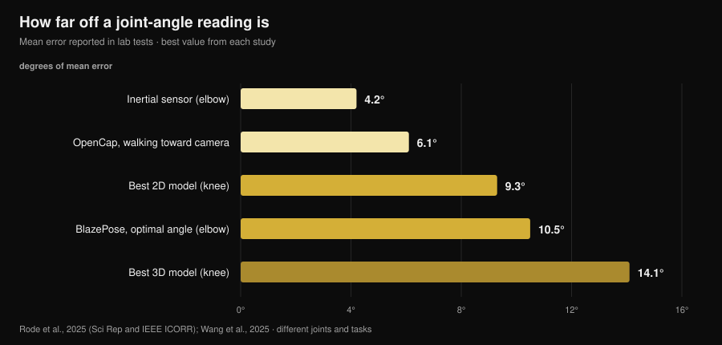
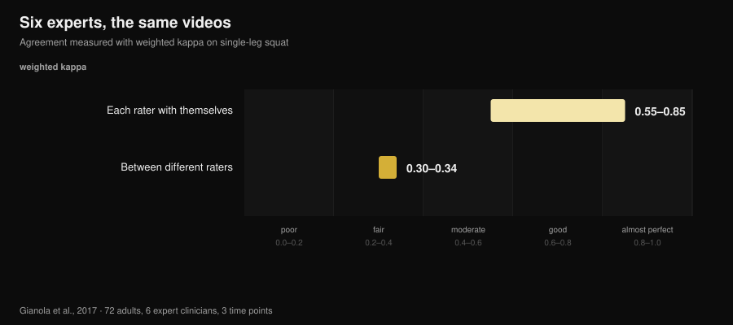

# AI form check: how accurate is it really?

By [Giammaria Loi](/autore/giammaria-loi) · updated 19 November 2026

You prop up your phone, do the set, and the app answers: "knee valgus, depth 92°". It looks like a measurement. Dozens of apps like this shipped in 2026, and a search for "AI form check" returns almost nothing but store listings. The catch is that those degrees on your screen carry a margin of error that has been measured in a lab, and nobody puts it on the screen next to them.

## In short

- **The best 2D estimator misses knee angle by 9.3° on average.** That is the most favourable result across 2.2 million frames and 11 open-source models, and none of the models tested reached the accuracy needed for correct clinical interpretation.
- **The app's "3D" is often worse than 2D.** Joint position error goes from 72-122 mm in 2D to 146-249 mm once the model also has to guess depth from one camera.
- **Camera angle matters more than the algorithm.** With the movement entirely inside the image plane, elbow error was 10.5°; outside that plane, accuracy dropped significantly.
- **The human eye is not a protractor either.** Six expert clinicians scoring the same videos agreed with each other at a weighted kappa of 0.30-0.34 — "fair" — while each agreed with themselves at 0.55-0.85.
- **Video is useful, for different questions.** Yes/no criteria and whole-movement judgements are reliable; decimal angles are not. Ask "did the knee track inside the edge of the shoe?", not "how many degrees of valgus do I have?".

*Nurvan chart from values reported in Rode et al., 2025 (Scientific Reports and IEEE ICORR) and Wang et al., 2025. Note: different joints and tasks, not a head-to-head comparison. Each bar is the best value published in that study. No value was read off a figure.*

## What a form check app actually does

Nearly all of them run on the same technology: *pose estimation*, a neural network that looks at the image and guesses where your shoulder, hip, knee and ankle are. The app then computes angles from those points. It does not measure your body; it infers joint centres from pixels.

That difference matters. In a lab, joint position comes from reflective markers and several calibrated cameras. Here it comes from one camera, through your clothes, in gym lighting, with a barbell that hides part of you on the way up.

## The numbers from the largest benchmark

In November 2025 a group at ETH Zurich published the broadest comparison so far in *Scientific Reports*: 25 participants, more than 2.2 million frames of physical exercise, 11 open-source pose estimators tested in 18 2D variants and 26 3D variants, all against a marker-based optical system.

| Measure | 2D estimators | 3D estimators |
|---|---|---|
| Mean joint position error | 72-122 mm | 146-249 mm |
| Mean error, knee angle | from 9.3° | from 14.1° |
| Mean error, elbow angle | from 21.5° | from 16.3° |

*Nurvan table from values reported in Rode et al., 2025 (Scientific Reports). "From" is the best model in that category.*

Two practical readings. First: even in the best case the average knee error is about nine degrees, and the authors state that none of the models tested got below the angular error needed for correct clinical interpretation. Second: adding the third dimension makes things worse. When the model has to infer depth from a single camera, position error roughly doubles. "3D" in an app description is not a quality badge.

The same group ran a second, targeted test on the elbow: with the movement happening **entirely within the image plane** — the ideal case — mean error was 10.5° and root mean square error 14.7°, against 4.2° and 6.0° for a worn inertial sensor. Orientation relative to the camera significantly affected accuracy, and the model tended to underestimate the largest flexion angles: exactly where you want to know whether you got deep enough.

### Camera angle is not a detail

A 2025 paper in the *Journal of Biomechanics* tested OpenCap, the smartphone markerless system most used in research, on 53 people with knee osteoarthritis and 30 healthy controls. Walking **toward** the camera, mean error was 6.1° with an agreement of 0.67; walking the other way, it got significantly worse. Same person, same software, same room — only the direction changed.

It holds for hand-made 2D analysis too. In physically active women, the validity of frontal-plane knee valgus depended on squat depth, on which leg was weight-bearing, and on whether the valgus was pronounced. In other words, the same measurement can be valid in one setup and not in another.

## So is a human coach better?

It depends what you ask them. In an Italian study of 72 adults, six expert clinicians scored the same single-leg squat videos at three separate time points using a validated scale. Each was reasonably consistent with themselves — weighted kappa 0.55 to 0.85 — but agreement **between** raters stayed at 0.30 to 0.34, conventionally read as "fair".

*Nurvan chart from values reported in Gianola et al., 2017 (72 adults, six expert clinicians, three scoring sessions). The kappa interpretation bands are the common convention. No value was read off a figure.*

Six experts, the same video, judgements that line up poorly. That is not an attack on the profession; it is what happens when you grade angles and segments by eye. It also explains how two coaches can give you two different cues on the same deadlift without either of them being bad at their job.

The useful part comes next. When raters give a **whole-movement** judgement instead of scoring segment by segment, agreement improves: in people with a previous knee injury, three expert and three novice raters reached good agreement using the overall method. And a well-chosen yes/no criterion holds up against the lab: in adolescent athletes, the criterion "the knee ends up inside the medial border of the shoe" reached an area under the curve of up to 0.93 for detecting 3D-measured valgus, well above other criteria.

Video is an excellent tool for yes/no questions. It is a poor goniometer.

## What the research actually says

| Common claim | Verdict | Source |
|---|---|---|
| "The app measures your angles like a lab" | **Busted** | Rode et al., 2025 — none of the 11 estimators tested reached the angular error needed for clinical interpretation |
| "3D means more accurate" | **Busted** | Rode et al., 2025 — position error 72-122 mm in 2D against 146-249 mm in single-camera 3D |
| "Just point the camera, the angle is a detail" | **Busted** | Rode et al., 2025; Wang et al., 2025 — orientation relative to the camera changes error significantly |
| "A human coach is objective" | **Needs nuance** | Gianola et al., 2017 — six experts on the same videos agreed at 0.30-0.34 weighted kappa |
| "Video form checks are useless" | **Busted** | Edwards and Liberatore, 2018; Erdman et al., 2024 — reliable whole-movement judgements and binary criteria with AUC up to 0.93 |
| "An app can tell you whether a lift is safe for you" | **Unverifiable** | No available study has tested injury prediction in people who lift weights |

## How to apply it

1. **Film in the plane of the movement.** Camera at hip height, perpendicular to the plane you care about: side-on for depth and back angle, front-on for knee tracking. The whole movement must stay inside the frame, first frame to last.
2. **Keep the camera still and in the same spot.** Comparing two sessions only means something if the framing is identical. A mark on the floor beats any algorithm.
3. **Ask binary questions.** "Did the knee stay inside the edge of the shoe?" "Did the hip crease drop below the knee?" "Did the bar drift away from the body?" Those are the questions an eye, human or artificial, answers reliably.
4. **Ignore the decimals.** If the app says 92.4° of flexion, read it as "around 90, give or take ten degrees". An angle that shifts by 5° week to week is noise, not progress.
5. **Use video for form and numbers for load.** How hard you are actually pushing does not show up in a frame. It shows up in the history of load, reps and [RIR — with all the limits that estimate has too](/en/blog/how-accurate-is-rir).
6. **Pain, swelling or a joint giving way is not a form problem for an app to solve.** That calls for a healthcare professional, not a better camera angle.

### If you coach people remotely

Two rules that turn video into data instead of opinion:

- **Always demand the same framing.** Specify height, side and distance once, then insist on it. Without that you are comparing camera setups, not executions.
- **Write the criteria before you watch.** Three binary questions per exercise, decided in advance. It is the simplest way to keep today's verdict in line with last Tuesday's — something even expert raters struggle with.

> **Nurvan: video shows the shape, history shows the load**
>
> In Nurvan your coach sees load, reps and RIR for every set, with the exercise history lined up: the data a single frame cannot give, and the data that tells you whether demand is actually rising. Video stays what it is, a form check; programming decisions get made on the numbers. [Try Nurvan](https://nurvan.app)

## FAQ

**Do AI form check apps work?**
They work for flagging gross differences, not for measuring. In the largest benchmark published so far, mean knee angle error starts at 9.3° for the best 2D models and 14.1° for 3D ones, and none of the models tested reached the accuracy needed for clinical interpretation. If the app tells you a knee is obviously collapsing inward, it is probably right; if it hands you a number with a decimal point, that number is not trustworthy.

**Which side should I film my squat from?**
From wherever the thing you want to see happens. Side-on at hip height for depth, bar path and torso angle; front-on for knee tracking. In the studies, orientation relative to the camera changes error significantly, so a three-quarter angle is the easiest way to get meaningless numbers.

**Phone or wearable sensor?**
To measure an angle, the inertial sensor: in the head-to-head on the elbow it sat at 4.2° mean error against 10.5° for video estimation in its best condition. To look at a whole movement, video stays more convenient and more informative.

**Can an app tell me whether my technique is dangerous?**
No. The available studies measure how close a system gets to lab equipment in describing a movement, not whether that movement will cause injury. If you have pain, instability or a joint that gives way, the question is a medical one for a doctor or physiotherapist.

## Read next

- [Does online coaching work? What the studies say](/en/blog/does-online-coaching-work) — what a remote coach has to monitor to match an in-person one.
- [How accurate is your RIR? What the studies say](/en/blog/how-accurate-is-rir) — the other estimate half your training rests on.
- [AI workout plans: what the research actually shows](/en/blog/ai-generated-workout-plans-research) — where artificial intelligence holds up and where it does not.

## Sources

1. Rode D, Dunkel A, Willi R, Wolf P, Xiloyannis M, Riener R, 2025. Assessment of monocular human pose estimation models for clinical movement analysis. *Scientific Reports* 15(1):38767. [PMID 41193590](https://pubmed.ncbi.nlm.nih.gov/41193590/) · [DOI 10.1038/s41598-025-22626-7](https://doi.org/10.1038/s41598-025-22626-7)
2. Rode D, Ceccarelli A, Esser A, Wolf P, Riener R, 2025. Accuracy of IMUs and Monocular Human Pose Estimation at Measuring Elbow Flexion. *IEEE Int Conf Rehabil Robot* 2025:773-778. [PMID 40644081](https://pubmed.ncbi.nlm.nih.gov/40644081/) · [DOI 10.1109/ICORR66766.2025.11063086](https://doi.org/10.1109/ICORR66766.2025.11063086)
3. Wang J, Xu W, Wu Z, Zhang H, Wang B, Zhou Z, Wang C, Li K, Nie Y, 2025. Evaluation of a smartphone-based markerless system to measure lower-limb kinematics in patients with knee osteoarthritis. *Journal of Biomechanics* 181:112529. [PMID 39862716](https://pubmed.ncbi.nlm.nih.gov/39862716/) · [DOI 10.1016/j.jbiomech.2025.112529](https://doi.org/10.1016/j.jbiomech.2025.112529)
4. Wade L, Needham L, McGuigan P, Bilzon J, 2022. Applications and limitations of current markerless motion capture methods for clinical gait biomechanics. *PeerJ* 10:e12995. [PMID 35237469](https://pubmed.ncbi.nlm.nih.gov/35237469/) · [DOI 10.7717/peerj.12995](https://doi.org/10.7717/peerj.12995)
5. Gianola S, Castellini G, Stucovitz E, Nardo A, Banfi G, 2017. Single leg squat performance in physically and non-physically active individuals: a cross-sectional study. *BMC Musculoskeletal Disorders* 18(1):299. [PMID 28709418](https://pubmed.ncbi.nlm.nih.gov/28709418/) · [DOI 10.1186/s12891-017-1660-8](https://doi.org/10.1186/s12891-017-1660-8)
6. Edwards S, Liberatore M, 2018. Reliability of a Squat Movement Competency Screen in Individuals With a Previous Knee Injury. *Journal of Sport Rehabilitation* 27(2). [PMID 28872403](https://pubmed.ncbi.nlm.nih.gov/28872403/) · [DOI 10.1123/jsr.2017-0064](https://doi.org/10.1123/jsr.2017-0064)
7. Erdman A, Loewen A, Dressing M, Wyatt C, Oliver G, Butler L, Sugimoto D, Black AM, Tulchin-Francis K, Bazett-Jones DM, Janosky J, Ulman S, 2024. A 2D video-based assessment is associated with 3D biomechanical contributors to dynamic knee valgus in the coronal plane. *Frontiers in Sports and Active Living* 6:1352286. [PMID 38558858](https://pubmed.ncbi.nlm.nih.gov/38558858/) · [DOI 10.3389/fspor.2024.1352286](https://doi.org/10.3389/fspor.2024.1352286)
8. Jamaludin NI, Sahabuddin FNA, Rasudin NS, Shaharudin S, 2022. The Concurrent Validity and Reliability of Single Leg Squat Among Physically Active Females with and without Dynamic Knee Valgus. *International Journal of Sports Physical Therapy* 17(4):574-584. [PMID 35693857](https://pubmed.ncbi.nlm.nih.gov/35693857/) · [DOI 10.26603/001c.35706](https://doi.org/10.26603/001c.35706)

Topic chosen from November 2026 trend signals: dozens of AI form check apps published on the stores through 2026, and a first page of search results made almost entirely of product pages with no accuracy figure. Scientific sources retrieved through PubMed.

**Giammaria Loi** is the founder of Nurvan. He has been lifting since 2012, has worked as a FIPE-certified personal trainer and coach since 2013, and has competed in powerlifting at national level since 2018. Every article he writes starts from the research and ends with what actually works in the gym. [Author page](/autore/giammaria-loi)

> Note: educational content, not a substitute for advice from a doctor or qualified professional.
