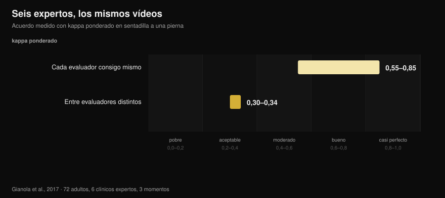

# Form check con IA: ¿qué precisión tiene de verdad?

Por [Giammaria Loi](/autore/giammaria-loi) · actualizado el 19 de noviembre de 2026

Apoyas el móvil, haces la serie y la app responde: "valgo de rodilla, profundidad 92°". Parece una medición. En 2026 salieron decenas de apps así, y quien busca "form check con IA" encuentra solo fichas de la tienda. El problema es que esos grados tienen un margen de error medido en laboratorio, y nadie te lo escribe al lado.

## En resumen

- **El mejor estimador 2D falla 9,3° de media en el ángulo de rodilla.** Es el mejor resultado sobre 2,2 millones de fotogramas y 11 modelos de código abierto: ninguno de los probados alcanzó la precisión necesaria para una interpretación clínica.
- **El "3D" de la app suele ser peor que el 2D.** El error de posición de las articulaciones pasa de 72-122 mm en 2D a 146-249 mm cuando el modelo también estima la profundidad.
- **El ángulo de grabación pesa más que el algoritmo.** Con el movimiento dentro del plano de la cámara, el error en el codo fue de 10,5°; fuera de ese plano empeora de forma significativa.
- **El ojo humano tampoco es un goniómetro.** Seis clínicos expertos que veían los mismos vídeos coincidieron entre ellos con un kappa de 0,30-0,34, mientras que cada uno consigo mismo estaba entre 0,55 y 0,85.
- **El vídeo sirve, pero para otras preguntas.** Los criterios binarios y los juicios de conjunto son fiables; los decimales no. Pregunta "¿la rodilla se quedó dentro del borde de la zapatilla?", no "¿cuántos grados de valgo tengo?".

*Gráfico de Nurvan con los valores publicados en Rode et al., 2025 (Scientific Reports e IEEE ICORR) y Wang et al., 2025. Atención: son articulaciones y tareas distintas, no una comparación directa. Cada barra es el mejor valor publicado en ese estudio. Ningún valor se ha leído de una figura.*

## Qué hace realmente una app de form check

Detrás de casi todas está la misma tecnología: la *estimación de pose*, una red neuronal que mira la imagen y adivina dónde están hombro, cadera, rodilla y tobillo. Con esos puntos la app calcula los ángulos. No mide tu cuerpo: deduce los centros articulares a partir de píxeles.

Es una diferencia que pesa. En laboratorio la posición de una articulación sale de marcadores reflectantes y varias cámaras calibradas; aquí sale de una sola cámara, con ropa, con la luz del gimnasio y con una barra que a ratos te tapa.

## Los números de la verificación más amplia

En noviembre de 2025 un grupo del Politécnico de Zúrich publicó en *Scientific Reports* la comparación más extensa hasta la fecha: 25 participantes, más de 2,2 millones de fotogramas de ejercicio físico, 11 estimadores de pose de código abierto probados en 18 variantes 2D y 26 variantes 3D, todos frente a un sistema óptico con marcadores.

| Medida | Estimadores 2D | Estimadores 3D |
|---|---|---|
| Error medio de posición articular | 72-122 mm | 146-249 mm |
| Error medio en el ángulo de rodilla | desde 9,3° | desde 14,1° |
| Error medio en el ángulo de codo | desde 21,5° | desde 16,3° |

*Tabla de Nurvan con los valores publicados en Rode et al., 2025 (Scientific Reports). "Desde" indica el mejor modelo de cada categoría.*

Dos lecturas prácticas. La primera: incluso en el mejor caso el error medio en la rodilla ronda los nueve grados, y los autores escriben que ninguno de los modelos probados baja del error angular necesario para una interpretación clínica correcta. La segunda: añadir la tercera dimensión empeora las cosas. Cuando el modelo intenta adivinar también la profundidad con una sola cámara, el error de posición se duplica. El "3D" de la descripción no es un sello de calidad.

El mismo grupo hizo una segunda prueba centrada en el codo: con el movimiento **íntegramente dentro del plano de la imagen** — la condición ideal — el error medio fue de 10,5° y el error cuadrático medio de 14,7°, frente a 4,2° y 6,0° de un sensor inercial llevado encima. La orientación respecto a la cámara influía de forma significativa, y el modelo tendía a subestimar las flexiones más amplias: justo donde querrías saber si has bajado lo suficiente.

### El ángulo de grabación no es un detalle

Un trabajo de 2025 en el *Journal of Biomechanics* probó OpenCap, el sistema sin marcadores desde móvil más usado en investigación, con 53 personas con artrosis de rodilla y 30 controles sanos. Caminando **hacia** la cámara el error medio fue de 6,1° con una concordancia de 0,67; en la dirección contraria empeoraba de forma estadísticamente significativa. Misma persona, mismo software, misma sala: solo cambiaba hacia dónde miraba.

Vale también para el análisis 2D hecho a mano. En mujeres activas, la validez del ángulo de valgo en el plano frontal dependía de la profundidad de la sentadilla, de qué pierna apoyaba y de si el valgo era marcado o no. Traducido: la misma medida puede ser válida en una condición y no en otra.

## ¿Entonces un entrenador humano es mejor?

Depende de lo que le pidas. En un estudio italiano con 72 adultos, seis clínicos expertos valoraron los mismos vídeos de sentadilla a una pierna en tres momentos distintos con una escala validada. Cada uno coincidía bastante consigo mismo — kappa ponderado de 0,55 a 0,85 — pero el acuerdo **entre** evaluadores se quedó entre 0,30 y 0,34, es decir "aceptable" por convención.

*Gráfico de Nurvan con los valores publicados en Gianola et al., 2017 (72 adultos, seis clínicos expertos, tres sesiones de valoración). Las franjas de interpretación del kappa son la convención habitual. Ningún valor se ha leído de una figura.*

Seis expertos, el mismo vídeo, juicios que casan poco. No es un ataque al gremio: es lo que pasa cuando se valoran ángulos y segmentos a ojo. Y explica que dos entrenadores te den dos correcciones distintas sobre el mismo peso muerto sin que ninguno esté haciendo mal su trabajo.

La parte útil viene justo después. Cuando se pide un juicio **de conjunto** en lugar de valorar segmento por segmento, el acuerdo mejora: en personas con una lesión previa de rodilla, tres evaluadores expertos y tres novatos alcanzaron buena concordancia con el método global. Y un criterio binario bien elegido aguanta la comparación con el laboratorio: en jóvenes deportistas, el criterio "la rodilla acaba dentro del borde interno de la zapatilla" alcanzó un área bajo la curva de hasta 0,93 para detectar el valgo medido en 3D, muy por encima de otros criterios.

El vídeo es una gran herramienta para preguntas de respuesta seca. Es un goniómetro pésimo.

## Qué dice de verdad la investigación

| Afirmación frecuente | Veredicto | Fuente |
|---|---|---|
| "La app mide tus ángulos como un laboratorio" | **Desmentido** | Rode et al., 2025 — ninguno de los 11 estimadores probados alcanza el error angular necesario para una interpretación clínica |
| "Si es 3D es más preciso" | **Desmentido** | Rode et al., 2025 — error de posición de 72-122 mm en 2D frente a 146-249 mm en 3D con una sola cámara |
| "Basta con enfocar, el ángulo es un detalle" | **Desmentido** | Rode et al., 2025; Wang et al., 2025 — la orientación respecto a la cámara cambia el error de forma significativa |
| "Un entrenador humano es objetivo" | **Matizable** | Gianola et al., 2017 — seis expertos sobre los mismos vídeos: acuerdo mutuo de 0,30-0,34 de kappa ponderado |
| "El form check por vídeo no sirve de nada" | **Desmentido** | Edwards y Liberatore, 2018; Erdman et al., 2024 — juicios de conjunto fiables y criterios binarios con AUC de hasta 0,93 |
| "La app puede decirte si un movimiento es seguro para ti" | **No verificable** | Ningún estudio disponible ha probado la predicción de lesiones en personas que entrenan con pesas |

## Cómo aplicarlo

1. **Graba en el plano del movimiento.** Cámara a la altura de la cadera, perpendicular al plano que te interesa: de lado para profundidad y espalda, de frente para el valgo. El movimiento entero debe caber en el encuadre.
2. **Cámara quieta y siempre en el mismo punto.** Comparar dos sesiones solo tiene sentido si el encuadre es idéntico. Una marca en el suelo vale más que cualquier algoritmo.
3. **Haz preguntas binarias.** "¿La rodilla se quedó dentro del borde de la zapatilla?", "¿la cadera bajó por debajo de la rodilla?", "¿la barra se alejó del cuerpo?". Son las preguntas en las que el ojo, humano o artificial, es fiable.
4. **Ignora los decimales.** Si la app escribe 92,4° de flexión, léelo como "unos 90, con una decena de grados de incertidumbre". Un ángulo que cambia 5° de una semana a otra es ruido, no progreso.
5. **Usa el vídeo para la técnica y los números para la carga.** Cuánto estás empujando de verdad no se ve en un fotograma: se ve en el historial de cargas, repeticiones y [RIR, con todos los límites que también tiene esa estimación](/es/blog/rir-precision-repeticiones-en-reserva).
6. **Dolor, hinchazón o fallos de la articulación no son un problema de técnica para resolver con una app.** Ahí hace falta un profesional sanitario, no un encuadre mejor.

### Si entrenas a otras personas a distancia

Dos reglas que convierten el vídeo en un dato y no en una opinión:

- **Pide siempre el mismo encuadre.** Especifica altura, lado y distancia una vez y exígelo después. Sin eso comparas grabaciones distintas, no ejecuciones distintas.
- **Escribe los criterios antes de mirar.** Tres preguntas binarias por ejercicio, decididas de antemano. Es la forma más sencilla de evitar que tu valoración de hoy no coincida con la del martes pasado, como les pasa también a los evaluadores expertos.

> **Nurvan: el vídeo muestra la forma, el historial muestra la carga**
>
> En Nurvan el entrenador ve en cada serie carga, repeticiones y RIR, con el historial del ejercicio en fila: el dato que un fotograma no puede dar y que dice si la exigencia está subiendo de verdad. El vídeo sigue siendo lo que es, un control de forma; las decisiones de programación se toman sobre los números. [Prueba Nurvan](https://nurvan.app)

## Preguntas frecuentes

**¿Funcionan las apps de form check con IA?**
Funcionan para señalar diferencias groseras, no para medir. En la verificación más amplia publicada hasta ahora, el error medio en el ángulo de rodilla parte de 9,3° en los mejores modelos 2D y de 14,1° en los 3D, y ninguno alcanza la precisión necesaria para una interpretación clínica. Si la app te dice que una rodilla se va claramente hacia dentro, probablemente tiene razón; si te da un número con decimales, ese número no es fiable.

**¿Desde qué lado grabo la sentadilla?**
Desde donde ocurre lo que quieres ver. De lado, cámara a la altura de la cadera, para profundidad, trayectoria de la barra e inclinación del tronco; de frente para el comportamiento de las rodillas. En los estudios la orientación respecto a la cámara cambia el error de forma significativa, así que una toma en tres cuartos es la vía rápida a números sin sentido.

**¿Mejor el móvil o un sensor que se lleva puesto?**
Para medir un ángulo, el sensor inercial: en la comparación directa sobre el codo estaba en 4,2° de error medio frente a 10,5° de la estimación por vídeo en su mejor condición. Para mirar un movimiento entero, el vídeo sigue siendo más cómodo e informativo.

**¿Puede una app decirme si mi técnica es peligrosa?**
No. Los estudios disponibles miden cuánto se acerca un sistema al laboratorio al describir un movimiento, no si ese movimiento causará una lesión. Si tienes dolor, inestabilidad o un fallo repentino, la pregunta es médica y se le hace a un médico o a un fisioterapeuta.

## Lee también

- [¿Funciona el coaching online? Esto dicen los estudios](/es/blog/funciona-el-coaching-online) — qué debe controlar un entrenador a distancia para valer lo que uno presencial.
- [¿Cuánto de preciso es el RIR? Qué dicen los estudios](/es/blog/rir-precision-repeticiones-en-reserva) — la otra estimación sobre la que se apoya medio entrenamiento.
- [Rutina de entrenamiento con IA: qué dicen los estudios](/es/blog/rutina-de-entrenamiento-con-ia) — dónde aguanta la inteligencia artificial y dónde no.

## Fuentes

1. Rode D, Dunkel A, Willi R, Wolf P, Xiloyannis M, Riener R, 2025. Assessment of monocular human pose estimation models for clinical movement analysis. *Scientific Reports* 15(1):38767. [PMID 41193590](https://pubmed.ncbi.nlm.nih.gov/41193590/) · [DOI 10.1038/s41598-025-22626-7](https://doi.org/10.1038/s41598-025-22626-7)
2. Rode D, Ceccarelli A, Esser A, Wolf P, Riener R, 2025. Accuracy of IMUs and Monocular Human Pose Estimation at Measuring Elbow Flexion. *IEEE Int Conf Rehabil Robot* 2025:773-778. [PMID 40644081](https://pubmed.ncbi.nlm.nih.gov/40644081/) · [DOI 10.1109/ICORR66766.2025.11063086](https://doi.org/10.1109/ICORR66766.2025.11063086)
3. Wang J, Xu W, Wu Z, Zhang H, Wang B, Zhou Z, Wang C, Li K, Nie Y, 2025. Evaluation of a smartphone-based markerless system to measure lower-limb kinematics in patients with knee osteoarthritis. *Journal of Biomechanics* 181:112529. [PMID 39862716](https://pubmed.ncbi.nlm.nih.gov/39862716/) · [DOI 10.1016/j.jbiomech.2025.112529](https://doi.org/10.1016/j.jbiomech.2025.112529)
4. Wade L, Needham L, McGuigan P, Bilzon J, 2022. Applications and limitations of current markerless motion capture methods for clinical gait biomechanics. *PeerJ* 10:e12995. [PMID 35237469](https://pubmed.ncbi.nlm.nih.gov/35237469/) · [DOI 10.7717/peerj.12995](https://doi.org/10.7717/peerj.12995)
5. Gianola S, Castellini G, Stucovitz E, Nardo A, Banfi G, 2017. Single leg squat performance in physically and non-physically active individuals: a cross-sectional study. *BMC Musculoskeletal Disorders* 18(1):299. [PMID 28709418](https://pubmed.ncbi.nlm.nih.gov/28709418/) · [DOI 10.1186/s12891-017-1660-8](https://doi.org/10.1186/s12891-017-1660-8)
6. Edwards S, Liberatore M, 2018. Reliability of a Squat Movement Competency Screen in Individuals With a Previous Knee Injury. *Journal of Sport Rehabilitation* 27(2). [PMID 28872403](https://pubmed.ncbi.nlm.nih.gov/28872403/) · [DOI 10.1123/jsr.2017-0064](https://doi.org/10.1123/jsr.2017-0064)
7. Erdman A, Loewen A, Dressing M, Wyatt C, Oliver G, Butler L, Sugimoto D, Black AM, Tulchin-Francis K, Bazett-Jones DM, Janosky J, Ulman S, 2024. A 2D video-based assessment is associated with 3D biomechanical contributors to dynamic knee valgus in the coronal plane. *Frontiers in Sports and Active Living* 6:1352286. [PMID 38558858](https://pubmed.ncbi.nlm.nih.gov/38558858/) · [DOI 10.3389/fspor.2024.1352286](https://doi.org/10.3389/fspor.2024.1352286)
8. Jamaludin NI, Sahabuddin FNA, Rasudin NS, Shaharudin S, 2022. The Concurrent Validity and Reliability of Single Leg Squat Among Physically Active Females with and without Dynamic Knee Valgus. *International Journal of Sports Physical Therapy* 17(4):574-584. [PMID 35693857](https://pubmed.ncbi.nlm.nih.gov/35693857/) · [DOI 10.26603/001c.35706](https://doi.org/10.26603/001c.35706)

Tema elegido a partir de señales de tendencia de noviembre de 2026: decenas de apps de "AI form check" publicadas en las tiendas durante 2026 y una primera página de resultados compuesta solo por fichas de producto sin un dato de precisión. Fuentes científicas consultadas a través de PubMed.

**Giammaria Loi** es el fundador de Nurvan. Entrena con pesas desde 2012, trabaja como entrenador personal y coach certificado FIPE desde 2013 y compite en powerlifting a nivel nacional desde 2018. Cada artículo que firma parte de los estudios científicos y llega a lo que funciona de verdad en el gimnasio. [Página del autor](/autore/giammaria-loi)

> Nota: contenido informativo, no sustituye la opinión de un médico o de un profesional cualificado.
