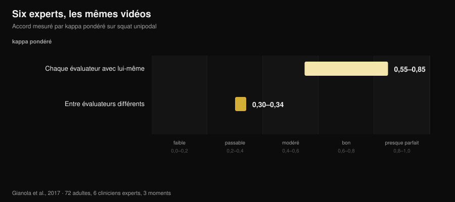

# Form check par IA : quelle précision réelle ?

Par [Giammaria Loi](/autore/giammaria-loi) · mis à jour le 19 novembre 2026

Vous posez le téléphone, vous faites la série, l'application répond : « valgus du genou, profondeur 92° ». Cela ressemble à une mesure. Des dizaines d'applications de ce type sont sorties en 2026, et qui cherche « form check IA » ne trouve que des fiches de store. Le problème : ces degrés affichés ont une marge d'erreur mesurée en laboratoire, et personne ne l'écrit à côté.

## En bref

- **Le meilleur estimateur 2D se trompe de 9,3° en moyenne sur l'angle du genou.** C'est le résultat le plus favorable sur 2,2 millions d'images et 11 modèles open source : aucun des modèles testés n'a atteint la précision requise pour une interprétation clinique.
- **Le « 3D » de l'application est souvent pire que le 2D.** L'erreur de position des articulations passe de 72-122 mm en 2D à 146-249 mm quand le modèle doit aussi estimer la profondeur.
- **L'angle de prise de vue compte plus que l'algorithme.** Avec le mouvement entièrement dans le plan de l'image, l'erreur au coude était de 10,5° ; hors de ce plan, elle se dégrade significativement.
- **L'œil humain n'est pas un rapporteur non plus.** Six cliniciens expérimentés jugeant les mêmes vidéos se sont accordés entre eux à un kappa de 0,30-0,34, alors que chacun avec lui-même se situait entre 0,55 et 0,85.
- **La vidéo sert, mais pour d'autres questions.** Les critères binaires et les jugements d'ensemble sont fiables ; les décimales ne le sont pas. Demandez « le genou est-il resté à l'intérieur du bord de la chaussure ? », pas « combien de degrés de valgus ? ».

*Graphique Nurvan d'après les valeurs publiées dans Rode et al., 2025 (Scientific Reports et IEEE ICORR) et Wang et al., 2025. Attention : articulations et tâches différentes, ce n'est pas une comparaison directe. Chaque barre est la meilleure valeur publiée dans l'étude. Aucune valeur lue sur une figure.*

## Ce que fait vraiment une application de form check

Derrière presque toutes, la même technologie : l'*estimation de pose*, un réseau de neurones qui regarde l'image et devine où se trouvent épaule, hanche, genou et cheville. L'application calcule ensuite les angles à partir de ces points. Elle ne mesure pas votre corps : elle déduit des centres articulaires à partir de pixels.

La différence compte. En laboratoire, la position d'une articulation vient de marqueurs réfléchissants et de plusieurs caméras calibrées ; ici, d'une seule caméra, avec les vêtements, la lumière de la salle et une barre qui vous masque par moments.

## Les chiffres de la plus large vérification

En novembre 2025, une équipe de l'École polytechnique de Zurich a publié dans *Scientific Reports* la comparaison la plus étendue à ce jour : 25 participants, plus de 2,2 millions d'images d'exercices physiques, 11 estimateurs de pose open source testés en 18 variantes 2D et 26 variantes 3D, tous face à un système optique à marqueurs.

| Mesure | Estimateurs 2D | Estimateurs 3D |
|---|---|---|
| Erreur moyenne de position articulaire | 72-122 mm | 146-249 mm |
| Erreur moyenne sur l'angle du genou | à partir de 9,3° | à partir de 14,1° |
| Erreur moyenne sur l'angle du coude | à partir de 21,5° | à partir de 16,3° |

*Tableau Nurvan d'après les valeurs publiées dans Rode et al., 2025 (Scientific Reports). « À partir de » indique le meilleur modèle de la catégorie.*

Deux lectures pratiques. D'abord : même dans le meilleur cas, l'erreur moyenne au genou avoisine neuf degrés, et les auteurs écrivent qu'aucun des modèles testés ne descend sous l'erreur angulaire nécessaire à une interprétation clinique correcte. Ensuite : ajouter la troisième dimension aggrave les choses. Quand le modèle doit deviner la profondeur avec une seule caméra, l'erreur de position double. Le « 3D » de la fiche n'est pas un gage de qualité.

La même équipe a mené un second test ciblé sur le coude : avec le mouvement **entièrement dans le plan de l'image** — la condition idéale — l'erreur moyenne était de 10,5° et l'erreur quadratique moyenne de 14,7°, contre 4,2° et 6,0° pour un capteur inertiel porté. L'orientation par rapport à la caméra influençait significativement la précision, et le modèle sous-estimait les flexions les plus amples : précisément là où vous voudriez savoir si vous êtes descendu assez bas.

### L'angle de prise de vue n'est pas un détail

Un travail de 2025 paru dans le *Journal of Biomechanics* a testé OpenCap, le système sans marqueurs sur smartphone le plus utilisé en recherche, sur 53 personnes atteintes d'arthrose du genou et 30 témoins sains. En marchant **vers** la caméra, l'erreur moyenne était de 6,1° avec une concordance de 0,67 ; dans l'autre sens, elle se dégradait de façon statistiquement significative. Même personne, même logiciel, même salle : seul le sens changeait.

Cela vaut aussi pour l'analyse 2D faite à la main. Chez des femmes actives, la validité de l'angle de valgus dans le plan frontal dépendait de la profondeur du squat, de la jambe d'appui et du caractère marqué ou non du valgus. Autrement dit : la même mesure peut être valide dans une condition et pas dans une autre.

## Un coach humain fait-il mieux ?

Cela dépend de la question. Dans une étude italienne portant sur 72 adultes, six cliniciens expérimentés ont noté les mêmes vidéos de squat unipodal à trois moments différents avec une échelle validée. Chacun était assez cohérent avec lui-même — kappa pondéré de 0,55 à 0,85 — mais l'accord **entre** évaluateurs est resté entre 0,30 et 0,34, soit « passable » par convention.

*Graphique Nurvan d'après les valeurs publiées dans Gianola et al., 2017 (72 adultes, six cliniciens experts, trois séances d'évaluation). Les plages d'interprétation du kappa sont la convention d'usage. Aucune valeur lue sur une figure.*

Six experts, la même vidéo, des jugements qui s'accordent peu. Ce n'est pas un procès fait à la profession : c'est ce qui arrive quand on note des angles et des segments à l'œil. Et cela explique que deux coachs vous donnent deux corrections différentes sur le même soulevé de terre sans qu'aucun ne fasse mal son métier.

La partie utile vient juste après. Quand on demande un jugement **d'ensemble** plutôt qu'une notation segment par segment, l'accord s'améliore : chez des personnes ayant eu une blessure au genou, trois évaluateurs experts et trois débutants ont atteint une bonne concordance avec la méthode globale. Et un critère binaire bien choisi tient la comparaison avec le laboratoire : chez de jeunes athlètes, le critère « le genou finit à l'intérieur du bord interne de la chaussure » a atteint une aire sous la courbe allant jusqu'à 0,93 pour détecter le valgus mesuré en 3D, bien au-dessus des autres critères.

La vidéo est un excellent outil pour les questions à réponse tranchée. C'est un mauvais goniomètre.

## Ce que dit vraiment la recherche

| Affirmation courante | Verdict | Source |
|---|---|---|
| « L'application mesure vos angles comme un laboratoire » | **Démenti** | Rode et al., 2025 — aucun des 11 estimateurs testés n'atteint l'erreur angulaire requise pour une interprétation clinique |
| « Si c'est 3D, c'est plus précis » | **Démenti** | Rode et al., 2025 — erreur de position 72-122 mm en 2D contre 146-249 mm en 3D monocaméra |
| « Il suffit de cadrer, l'angle est un détail » | **Démenti** | Rode et al., 2025 ; Wang et al., 2025 — l'orientation par rapport à la caméra change l'erreur de façon significative |
| « Un coach humain est objectif » | **À nuancer** | Gianola et al., 2017 — six experts sur les mêmes vidéos : accord mutuel de 0,30-0,34 de kappa pondéré |
| « Le form check vidéo ne sert à rien » | **Démenti** | Edwards et Liberatore, 2018 ; Erdman et al., 2024 — jugements d'ensemble fiables et critères binaires avec AUC jusqu'à 0,93 |
| « Une application peut dire si un mouvement est sûr pour vous » | **Non vérifiable** | Aucune étude disponible n'a testé la prédiction de blessures chez les pratiquants de musculation |

## Comment l'appliquer

1. **Filmez dans le plan du mouvement.** Caméra à hauteur de hanche, perpendiculaire au plan qui vous intéresse : de profil pour la profondeur et le dos, de face pour le genou. Le mouvement entier doit rester dans le cadre.
2. **Caméra fixe, toujours au même endroit.** Comparer deux séances n'a de sens que si le cadrage est identique. Une marque au sol vaut mieux que n'importe quel algorithme.
3. **Posez des questions binaires.** « Le genou est-il resté à l'intérieur du bord de la chaussure ? », « la hanche est-elle descendue sous le genou ? », « la barre s'est-elle éloignée du corps ? ». Ce sont les questions où l'œil, humain ou artificiel, est fiable.
4. **Ignorez les décimales.** Si l'application affiche 92,4° de flexion, lisez « environ 90, à une dizaine de degrés près ». Un angle qui varie de 5° d'une semaine à l'autre, c'est du bruit, pas un progrès.
5. **La vidéo pour la technique, les chiffres pour la charge.** Combien vous poussez vraiment ne se voit pas sur une image. Cela se voit dans l'historique des charges, des répétitions et du [RIR, avec toutes les limites de cette estimation](/fr/blog/rir-precision-repetitions-en-reserve).
6. **Douleur, gonflement ou dérobement ne sont pas un problème technique à régler avec une application.** Là, il faut un professionnel de santé, pas un meilleur cadrage.

### Si vous entraînez à distance

Deux règles qui transforment la vidéo en donnée plutôt qu'en opinion :

- **Exigez toujours le même cadrage.** Précisez hauteur, côté et distance une fois, puis tenez-y. Sinon vous comparez des prises de vue, pas des exécutions.
- **Écrivez les critères avant de regarder.** Trois questions binaires par exercice, décidées à l'avance. C'est le moyen le plus simple d'éviter que votre jugement d'aujourd'hui diffère de celui de mardi dernier — ce qui arrive même aux évaluateurs expérimentés.

> **Nurvan : la vidéo montre la forme, l'historique montre la charge**
>
> Dans Nurvan, le coach voit pour chaque série la charge, les répétitions et le RIR, avec l'historique de l'exercice aligné : la donnée qu'une image ne peut pas donner, et qui dit si la demande augmente vraiment. La vidéo reste ce qu'elle est, un contrôle de forme ; les décisions de programmation se prennent sur les chiffres. [Essayer Nurvan](https://nurvan.app)

## Questions fréquentes

**Les applications de form check par IA fonctionnent-elles ?**
Elles fonctionnent pour signaler des écarts grossiers, pas pour mesurer. Dans la plus large vérification publiée à ce jour, l'erreur moyenne sur l'angle du genou part de 9,3° pour les meilleurs modèles 2D et de 14,1° pour les 3D, et aucun des modèles testés n'atteint la précision requise pour une interprétation clinique. Si l'application signale un genou qui part nettement vers l'intérieur, elle a probablement raison ; si elle vous donne un chiffre à la virgule près, ce chiffre n'est pas fiable.

**De quel côté filmer mon squat ?**
Du côté où se passe ce que vous voulez voir. De profil, caméra à hauteur de hanche, pour la profondeur, la trajectoire de la barre et l'inclinaison du buste ; de face pour le comportement des genoux. Dans les études, l'orientation par rapport à la caméra change l'erreur de façon significative : un cadrage de trois quarts est le moyen le plus simple d'obtenir des chiffres sans valeur.

**Téléphone ou capteur porté ?**
Pour mesurer un angle, le capteur inertiel : dans la comparaison directe au coude, il était à 4,2° d'erreur moyenne contre 10,5° pour l'estimation vidéo dans sa meilleure condition. Pour observer un mouvement entier, la vidéo reste plus pratique et plus informative.

**Une application peut-elle me dire si ma technique est dangereuse ?**
Non. Les études disponibles mesurent à quel point un système se rapproche du laboratoire pour décrire un mouvement, pas si ce mouvement provoquera une blessure. En cas de douleur, d'instabilité ou de dérobement, la question est médicale et se pose à un médecin ou à un kinésithérapeute.

## À lire aussi

- [Le coaching en ligne fonctionne-t-il ? Les études](/fr/blog/le-coaching-en-ligne-fonctionne) — ce qu'un coach à distance doit contrôler pour valoir un coach en salle.
- [Le RIR est-il fiable ? Ce que disent les études](/fr/blog/rir-precision-repetitions-en-reserve) — l'autre estimation sur laquelle repose la moitié de l'entraînement.
- [Programme d'entraînement IA : ce que disent les études](/fr/blog/programme-entrainement-genere-par-ia) — où l'intelligence artificielle tient et où elle ne tient pas.

## Sources

1. Rode D, Dunkel A, Willi R, Wolf P, Xiloyannis M, Riener R, 2025. Assessment of monocular human pose estimation models for clinical movement analysis. *Scientific Reports* 15(1):38767. [PMID 41193590](https://pubmed.ncbi.nlm.nih.gov/41193590/) · [DOI 10.1038/s41598-025-22626-7](https://doi.org/10.1038/s41598-025-22626-7)
2. Rode D, Ceccarelli A, Esser A, Wolf P, Riener R, 2025. Accuracy of IMUs and Monocular Human Pose Estimation at Measuring Elbow Flexion. *IEEE Int Conf Rehabil Robot* 2025:773-778. [PMID 40644081](https://pubmed.ncbi.nlm.nih.gov/40644081/) · [DOI 10.1109/ICORR66766.2025.11063086](https://doi.org/10.1109/ICORR66766.2025.11063086)
3. Wang J, Xu W, Wu Z, Zhang H, Wang B, Zhou Z, Wang C, Li K, Nie Y, 2025. Evaluation of a smartphone-based markerless system to measure lower-limb kinematics in patients with knee osteoarthritis. *Journal of Biomechanics* 181:112529. [PMID 39862716](https://pubmed.ncbi.nlm.nih.gov/39862716/) · [DOI 10.1016/j.jbiomech.2025.112529](https://doi.org/10.1016/j.jbiomech.2025.112529)
4. Wade L, Needham L, McGuigan P, Bilzon J, 2022. Applications and limitations of current markerless motion capture methods for clinical gait biomechanics. *PeerJ* 10:e12995. [PMID 35237469](https://pubmed.ncbi.nlm.nih.gov/35237469/) · [DOI 10.7717/peerj.12995](https://doi.org/10.7717/peerj.12995)
5. Gianola S, Castellini G, Stucovitz E, Nardo A, Banfi G, 2017. Single leg squat performance in physically and non-physically active individuals: a cross-sectional study. *BMC Musculoskeletal Disorders* 18(1):299. [PMID 28709418](https://pubmed.ncbi.nlm.nih.gov/28709418/) · [DOI 10.1186/s12891-017-1660-8](https://doi.org/10.1186/s12891-017-1660-8)
6. Edwards S, Liberatore M, 2018. Reliability of a Squat Movement Competency Screen in Individuals With a Previous Knee Injury. *Journal of Sport Rehabilitation* 27(2). [PMID 28872403](https://pubmed.ncbi.nlm.nih.gov/28872403/) · [DOI 10.1123/jsr.2017-0064](https://doi.org/10.1123/jsr.2017-0064)
7. Erdman A, Loewen A, Dressing M, Wyatt C, Oliver G, Butler L, Sugimoto D, Black AM, Tulchin-Francis K, Bazett-Jones DM, Janosky J, Ulman S, 2024. A 2D video-based assessment is associated with 3D biomechanical contributors to dynamic knee valgus in the coronal plane. *Frontiers in Sports and Active Living* 6:1352286. [PMID 38558858](https://pubmed.ncbi.nlm.nih.gov/38558858/) · [DOI 10.3389/fspor.2024.1352286](https://doi.org/10.3389/fspor.2024.1352286)
8. Jamaludin NI, Sahabuddin FNA, Rasudin NS, Shaharudin S, 2022. The Concurrent Validity and Reliability of Single Leg Squat Among Physically Active Females with and without Dynamic Knee Valgus. *International Journal of Sports Physical Therapy* 17(4):574-584. [PMID 35693857](https://pubmed.ncbi.nlm.nih.gov/35693857/) · [DOI 10.26603/001c.35706](https://doi.org/10.26603/001c.35706)

Sujet choisi à partir des signaux de tendance de novembre 2026 : des dizaines d'applications d'« AI form check » publiées sur les stores en 2026 et une première page de résultats composée uniquement de fiches produit, sans aucun chiffre de précision. Sources scientifiques consultées via PubMed.

**Giammaria Loi** est le fondateur de Nurvan. Il s'entraîne avec des charges depuis 2012, exerce comme entraîneur personnel et coach certifié FIPE depuis 2013 et dispute des compétitions de powerlifting au niveau national depuis 2018. Chaque article qu'il signe part des études scientifiques pour arriver à ce qui fonctionne vraiment en salle. [Page auteur](/autore/giammaria-loi)

> Note : contenu informatif, qui ne remplace pas l'avis d'un médecin ou d'un professionnel qualifié.
