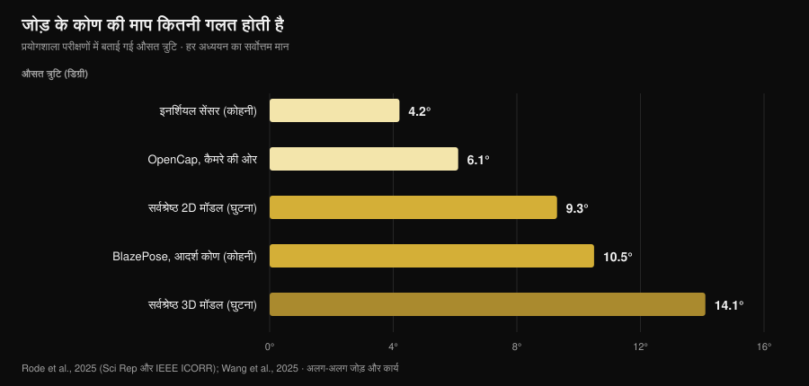
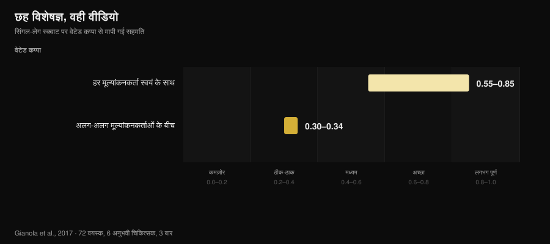

# AI फॉर्म चेक कितना सही है? रिसर्च के आंकड़े

लेखक: [Giammaria Loi](/autore/giammaria-loi) · अपडेट 19 नवंबर 2026

आप फ़ोन टिकाते हैं, सेट करते हैं, और ऐप जवाब देता है: "घुटना अंदर जा रहा है, गहराई 92°"। यह माप जैसा लगता है। 2026 में ऐसे दर्जनों ऐप आए, और "AI form check" खोजने पर लगभग सिर्फ़ स्टोर लिस्टिंग मिलती है। दिक्कत यह है कि स्क्रीन पर दिख रही उन डिग्रियों की एक त्रुटि-सीमा प्रयोगशाला में नापी जा चुकी है, और उसे कोई साथ में नहीं लिखता।

## संक्षेप में

- **सबसे अच्छा 2D एस्टिमेटर घुटने का कोण औसतन 9.3° गलत मापता है।** यह 22 लाख फ्रेम और 11 ओपन-सोर्स मॉडल में सबसे अनुकूल नतीजा है: परखे गए किसी भी मॉडल ने क्लिनिकल व्याख्या के लिए ज़रूरी सटीकता नहीं पाई।
- **ऐप का "3D" अक्सर 2D से खराब होता है।** जोड़ों की स्थिति की त्रुटि 2D में 72-122 मिमी से बढ़कर 146-249 मिमी हो जाती है, जब मॉडल गहराई भी आंकता है।
- **कैमरे का कोण एल्गोरिद्म से ज़्यादा मायने रखता है।** जब गति पूरी तरह इमेज प्लेन में थी, कोहनी की त्रुटि 10.5° रही; उस प्लेन से बाहर सटीकता काफ़ी गिर गई।
- **इंसानी आंख भी चांदा नहीं है।** छह अनुभवी चिकित्सकों ने वही वीडियो देखे और आपस में सिर्फ़ 0.30-0.34 वेटेड कप्पा पर सहमत हुए, जबकि हर कोई खुद से 0.55-0.85 पर सहमत था।
- **वीडियो काम का है, पर दूसरे सवालों के लिए।** हां/नहीं वाले मानक और समग्र आकलन भरोसेमंद हैं, दशमलव वाले कोण नहीं। पूछिए "घुटना जूते के किनारे के भीतर रहा?", न कि "मेरा वाल्गस कितने डिग्री है"।

*Nurvan चार्ट, मान Rode et al., 2025 (Scientific Reports और IEEE ICORR) तथा Wang et al., 2025 से। ध्यान दें: अलग-अलग जोड़ और अलग कार्य हैं, यह आमने-सामने की तुलना नहीं है। हर बार उस अध्ययन का सर्वश्रेष्ठ प्रकाशित मान है। कोई भी मान किसी आकृति से नहीं पढ़ा गया।*

## फॉर्म चेक ऐप असल में करता क्या है

लगभग सबके पीछे एक ही तकनीक है: *पोज़ एस्टिमेशन*। एक न्यूरल नेटवर्क तस्वीर देखकर अंदाज़ा लगाता है कि कंधा, कूल्हा, घुटना और टखना कहां हैं। फिर ऐप उन बिंदुओं से कोण निकालता है। वह आपके शरीर को नापता नहीं, पिक्सल से जोड़ों के केंद्र का अनुमान लगाता है।

यह फ़र्क़ भारी पड़ता है। प्रयोगशाला में जोड़ की स्थिति परावर्तक मार्कर और कई कैलिब्रेटेड कैमरों से आती है; यहां वह एक ही कैमरे से आती है — कपड़ों के साथ, जिम की रोशनी में, और एक बार के साथ जो बीच-बीच में आपको ढक देती है।

## सबसे बड़ी जांच के आंकड़े

नवंबर 2025 में ज्यूरिख के संघीय प्रौद्योगिकी संस्थान की टीम ने *Scientific Reports* में अब तक की सबसे व्यापक तुलना प्रकाशित की: 25 प्रतिभागी, व्यायाम के 22 लाख से ज़्यादा फ्रेम, 11 ओपन-सोर्स पोज़ एस्टिमेटर, 18 2D और 26 3D रूपों में परखे गए — सभी मार्कर-आधारित ऑप्टिकल सिस्टम के मुक़ाबले।

| माप | 2D एस्टिमेटर | 3D एस्टिमेटर |
|---|---|---|
| जोड़ों की स्थिति की औसत त्रुटि | 72-122 मिमी | 146-249 मिमी |
| घुटने के कोण की औसत त्रुटि | 9.3° से | 14.1° से |
| कोहनी के कोण की औसत त्रुटि | 21.5° से | 16.3° से |

*Nurvan तालिका, मान Rode et al., 2025 (Scientific Reports) से। "से" का अर्थ उस श्रेणी का सर्वश्रेष्ठ मॉडल।*

दो व्यावहारिक निष्कर्ष। पहला: सबसे अच्छी स्थिति में भी घुटने की औसत त्रुटि करीब नौ डिग्री है, और लेखक लिखते हैं कि परखे गए किसी मॉडल ने सही क्लिनिकल व्याख्या के लिए ज़रूरी कोण-त्रुटि को नहीं छुआ। दूसरा: तीसरा आयाम जोड़ने से बात बिगड़ती है। जब मॉडल एक ही कैमरे से गहराई भी आंकता है, स्थिति की त्रुटि दोगुनी हो जाती है। ऐप के विवरण में लिखा "3D" गुणवत्ता की गारंटी नहीं है।

इसी टीम ने कोहनी पर एक और परीक्षण किया: जब गति **पूरी तरह इमेज प्लेन में** हुई — आदर्श स्थिति — औसत त्रुटि 10.5° और रूट मीन स्क्वेयर त्रुटि 14.7° रही, जबकि पहने जाने वाले इनर्शियल सेंसर की 4.2° और 6.0°। कैमरे के सापेक्ष दिशा सटीकता को उल्लेखनीय रूप से प्रभावित करती रही, और मॉडल बड़े फ्लेक्शन कोणों को कम आंकता रहा — ठीक वहीं जहां आप जानना चाहते हैं कि आप काफ़ी नीचे गए या नहीं।

### कैमरे का कोण मामूली बात नहीं

2025 के *Journal of Biomechanics* के एक अध्ययन ने OpenCap को — शोध में सबसे ज़्यादा इस्तेमाल होने वाला स्मार्टफोन मार्करलेस सिस्टम — घुटने के ऑस्टियोआर्थराइटिस वाले 53 लोगों और 30 स्वस्थ लोगों पर परखा। कैमरे की **ओर** चलते हुए औसत त्रुटि 6.1° और सहमति 0.67 रही; उलटी दिशा में यह सांख्यिकीय रूप से काफ़ी बिगड़ गई। वही व्यक्ति, वही सॉफ़्टवेयर, वही कमरा — बदली सिर्फ़ दिशा।

यही बात हाथ से किए 2D विश्लेषण पर भी लागू होती है। शारीरिक रूप से सक्रिय महिलाओं में फ्रंटल प्लेन के वाल्गस कोण की वैधता स्क्वाट की गहराई, किस टांग पर भार था और वाल्गस स्पष्ट था या नहीं — इन पर निर्भर रही। यानी वही माप एक स्थिति में वैध हो सकती है और दूसरी में नहीं।

## तो क्या इंसानी कोच बेहतर है

यह इस पर निर्भर है कि आप उससे क्या पूछते हैं। 72 वयस्कों पर हुए एक इतालवी अध्ययन में छह अनुभवी चिकित्सकों ने एक मान्य स्केल से वही सिंगल-लेग स्क्वाट वीडियो तीन अलग मौकों पर आंके। हर कोई खुद से काफ़ी हद तक सुसंगत था — वेटेड कप्पा 0.55 से 0.85 — पर मूल्यांकनकर्ताओं के **बीच** सहमति 0.30 से 0.34 पर ही रही, जो परंपरा से "ठीक-ठाक" मानी जाती है।

*Nurvan चार्ट, मान Gianola et al., 2017 (72 वयस्क, छह अनुभवी चिकित्सक, तीन मूल्यांकन सत्र) से। कप्पा की व्याख्या पट्टियां प्रचलित परंपरा हैं। कोई भी मान किसी आकृति से नहीं पढ़ा गया।*

छह विशेषज्ञ, वही वीडियो, और आपस में कम मेल खाते फ़ैसले। यह पेशे पर आरोप नहीं है: आंख से कोण और अंग-खंड आंकने का स्वभाव ही ऐसा है। और यही समझाता है कि दो कोच एक ही डेडलिफ्ट पर दो अलग सुधार क्यों बता सकते हैं, बिना किसी के ग़लत हुए।

काम की बात इसके ठीक बाद है। जब खंड-दर-खंड अंक देने के बजाय **समग्र** फ़ैसला मांगा जाता है, सहमति सुधर जाती है: घुटने की पुरानी चोट वाले लोगों में तीन अनुभवी और तीन नए मूल्यांकनकर्ताओं ने समग्र विधि से अच्छी सहमति हासिल की। और सही चुना गया हां/नहीं वाला मानक प्रयोगशाला के सामने टिकता है: किशोर खिलाड़ियों में "घुटना जूते के भीतरी किनारे के अंदर रहता है" मानक ने 3D में मापे गए वाल्गस को पहचानने में 0.93 तक का AUC पाया, जो बाक़ी मानकों से कहीं ऊपर है।

वीडियो हां/नहीं वाले सवालों के लिए बेहतरीन औज़ार है। चांदे के तौर पर यह ख़राब है।

## रिसर्च असल में क्या कहती है

| आम दावा | नतीजा | स्रोत |
|---|---|---|
| "ऐप आपके कोण प्रयोगशाला की तरह नापता है" | **ग़लत** | Rode et al., 2025 — परखे गए 11 एस्टिमेटर में कोई भी क्लिनिकल व्याख्या के लिए ज़रूरी कोण-त्रुटि तक नहीं पहुंचा |
| "3D है तो ज़्यादा सटीक है" | **ग़लत** | Rode et al., 2025 — 2D में स्थिति त्रुटि 72-122 मिमी, एक कैमरे वाले 3D में 146-249 मिमी |
| "फ्रेम में आ जाए, कोण मामूली बात है" | **ग़लत** | Rode et al., 2025; Wang et al., 2025 — कैमरे के सापेक्ष दिशा त्रुटि को उल्लेखनीय रूप से बदल देती है |
| "इंसानी कोच वस्तुनिष्ठ होता है" | **स्पष्टीकरण चाहिए** | Gianola et al., 2017 — छह विशेषज्ञ, वही वीडियो: आपसी सहमति 0.30-0.34 वेटेड कप्पा |
| "वीडियो से फॉर्म चेक बेकार है" | **ग़लत** | Edwards और Liberatore, 2018; Erdman et al., 2024 — समग्र आकलन भरोसेमंद और हां/नहीं मानक AUC 0.93 तक |
| "ऐप बता सकता है कि यह मूवमेंट आपके लिए सुरक्षित है" | **असत्यापित** | उपलब्ध किसी अध्ययन ने वेट ट्रेनिंग करने वालों में चोट की भविष्यवाणी नहीं परखी |

## इसे कैसे लागू करें

1. **गति के तल में शूट करें।** कैमरा कूल्हे की ऊंचाई पर, उस तल के लंबवत जो आपको देखना है: गहराई और पीठ के लिए बगल से, घुटने के लिए सामने से। पूरी गति फ्रेम में रहनी चाहिए।
2. **कैमरा स्थिर और हमेशा एक ही जगह।** दो सेशन की तुलना तभी सार्थक है जब फ्रेम एक जैसा हो। फ़र्श पर एक निशान किसी भी एल्गोरिद्म से ज़्यादा काम का है।
3. **हां/नहीं वाले सवाल पूछें।** "घुटना जूते के किनारे के भीतर रहा?", "कूल्हा घुटने से नीचे गया?", "बार शरीर से दूर गई?" इन्हीं सवालों पर आंख — इंसानी हो या कृत्रिम — भरोसेमंद होती है।
4. **दशमलव को अनदेखा करें।** ऐप 92.4° फ्लेक्शन लिखे तो पढ़िए "लगभग 90, दस डिग्री ऊपर-नीचे"। हफ़्ते-दर-हफ़्ते 5° बदलने वाला कोण प्रगति नहीं, शोर है।
5. **तकनीक के लिए वीडियो, भार के लिए आंकड़े।** आप असल में कितना ज़ोर लगा रहे हैं, यह एक फ्रेम में नहीं दिखता। यह वज़न, रेप्स और [RIR के इतिहास में दिखता है — उस अनुमान की अपनी सीमाओं के साथ](/hi/blog/rir-kitna-sahi-hota-hai)।
6. **दर्द, सूजन या जोड़ का जवाब दे जाना ऐप से हल होने वाली तकनीकी समस्या नहीं है।** वहां बेहतर कैमरा कोण नहीं, स्वास्थ्य पेशेवर चाहिए।

### अगर आप दूर से लोगों को ट्रेन करते हैं

दो नियम जो वीडियो को राय के बजाय आंकड़ा बनाते हैं:

- **हमेशा वही फ्रेम मांगें।** ऊंचाई, दिशा और दूरी एक बार तय करें, फिर उस पर टिके रहें। वरना आप शूटिंग की तुलना करेंगे, एक्ज़ीक्यूशन की नहीं।
- **देखने से पहले मानक लिख लें।** हर एक्सरसाइज़ के लिए तीन हां/नहीं वाले सवाल, पहले से तय। यही सबसे आसान तरीक़ा है कि आज का आकलन पिछले मंगलवार से अलग न पड़े — यह अनुभवी मूल्यांकनकर्ताओं के साथ भी होता है।

> **Nurvan: वीडियो फ़ॉर्म दिखाता है, इतिहास भार दिखाता है**
>
> Nurvan में कोच हर सेट का वज़न, रेप्स और RIR देखता है, और एक्सरसाइज़ का इतिहास एक कतार में रहता है: यही वह आंकड़ा है जो कोई फ्रेम नहीं दे सकता और जो बताता है कि मांग सचमुच बढ़ रही है या नहीं। वीडियो वही रहता है जो है — फ़ॉर्म की जांच; प्रोग्रामिंग के फ़ैसले आंकड़ों पर होते हैं। [Nurvan आज़माएं](https://nurvan.app)

## अक्सर पूछे जाने वाले सवाल

**क्या AI फॉर्म चेक ऐप काम करते हैं?**
मोटी गड़बड़ियां पकड़ने के लिए काम करते हैं, नापने के लिए नहीं। अब तक की सबसे बड़ी जांच में घुटने के कोण की औसत त्रुटि सर्वश्रेष्ठ 2D मॉडलों में 9.3° से और 3D में 14.1° से शुरू होती है, और कोई भी क्लिनिकल व्याख्या लायक सटीकता तक नहीं पहुंचता। अगर ऐप कहे कि घुटना साफ़ तौर पर अंदर गिर रहा है, वह शायद सही है; अगर वह दशमलव वाला आंकड़ा दे, उस आंकड़े पर भरोसा न करें।

**स्क्वाट किस तरफ़ से शूट करूं?**
जहां वह हो रहा है जो आप देखना चाहते हैं। गहराई, बार पथ और धड़ के झुकाव के लिए बगल से, कैमरा कूल्हे की ऊंचाई पर; घुटनों के व्यवहार के लिए सामने से। अध्ययनों में कैमरे के सापेक्ष दिशा त्रुटि को काफ़ी बदल देती है, इसलिए तिरछा शूट करना बेमतलब आंकड़े पाने का सबसे तेज़ रास्ता है।

**फ़ोन या पहनने वाला सेंसर?**
कोण नापने के लिए इनर्शियल सेंसर: कोहनी की सीधी तुलना में वह 4.2° औसत त्रुटि पर था, जबकि सबसे अच्छी स्थिति में वीडियो अनुमान 10.5° पर। पूरी गति देखने के लिए वीडियो ज़्यादा सुविधाजनक और ज़्यादा जानकारी देने वाला रहता है।

**क्या ऐप बता सकता है कि मेरी तकनीक ख़तरनाक है?**
नहीं। उपलब्ध अध्ययन यह नापते हैं कि कोई सिस्टम गति का वर्णन करने में प्रयोगशाला के कितना क़रीब पहुंचता है, यह नहीं कि वह गति चोट पहुंचाएगी या नहीं। दर्द, अस्थिरता या अचानक जोड़ जवाब दे जाए तो यह चिकित्सीय सवाल है — डॉक्टर या फ़िज़ियोथेरेपिस्ट से पूछें।

## यह भी पढ़ें

- [ऑनलाइन कोचिंग काम करती है? रिसर्च क्या कहती है](/hi/blog/online-coaching-kaam-karta-hai) — दूर से ट्रेन करने वाले कोच को क्या नियंत्रित करना चाहिए।
- [आपका RIR कितना सही होता है? रिसर्च क्या कहती है](/hi/blog/rir-kitna-sahi-hota-hai) — वह दूसरा अनुमान जिस पर आधी ट्रेनिंग टिकी है।
- [AI workout plan: रिसर्च असल में क्या कहती है](/hi/blog/ai-se-banaya-workout-plan) — कृत्रिम बुद्धिमत्ता कहां टिकती है और कहां नहीं।

## स्रोत

1. Rode D, Dunkel A, Willi R, Wolf P, Xiloyannis M, Riener R, 2025. Assessment of monocular human pose estimation models for clinical movement analysis. *Scientific Reports* 15(1):38767. [PMID 41193590](https://pubmed.ncbi.nlm.nih.gov/41193590/) · [DOI 10.1038/s41598-025-22626-7](https://doi.org/10.1038/s41598-025-22626-7)
2. Rode D, Ceccarelli A, Esser A, Wolf P, Riener R, 2025. Accuracy of IMUs and Monocular Human Pose Estimation at Measuring Elbow Flexion. *IEEE Int Conf Rehabil Robot* 2025:773-778. [PMID 40644081](https://pubmed.ncbi.nlm.nih.gov/40644081/) · [DOI 10.1109/ICORR66766.2025.11063086](https://doi.org/10.1109/ICORR66766.2025.11063086)
3. Wang J, Xu W, Wu Z, Zhang H, Wang B, Zhou Z, Wang C, Li K, Nie Y, 2025. Evaluation of a smartphone-based markerless system to measure lower-limb kinematics in patients with knee osteoarthritis. *Journal of Biomechanics* 181:112529. [PMID 39862716](https://pubmed.ncbi.nlm.nih.gov/39862716/) · [DOI 10.1016/j.jbiomech.2025.112529](https://doi.org/10.1016/j.jbiomech.2025.112529)
4. Wade L, Needham L, McGuigan P, Bilzon J, 2022. Applications and limitations of current markerless motion capture methods for clinical gait biomechanics. *PeerJ* 10:e12995. [PMID 35237469](https://pubmed.ncbi.nlm.nih.gov/35237469/) · [DOI 10.7717/peerj.12995](https://doi.org/10.7717/peerj.12995)
5. Gianola S, Castellini G, Stucovitz E, Nardo A, Banfi G, 2017. Single leg squat performance in physically and non-physically active individuals: a cross-sectional study. *BMC Musculoskeletal Disorders* 18(1):299. [PMID 28709418](https://pubmed.ncbi.nlm.nih.gov/28709418/) · [DOI 10.1186/s12891-017-1660-8](https://doi.org/10.1186/s12891-017-1660-8)
6. Edwards S, Liberatore M, 2018. Reliability of a Squat Movement Competency Screen in Individuals With a Previous Knee Injury. *Journal of Sport Rehabilitation* 27(2). [PMID 28872403](https://pubmed.ncbi.nlm.nih.gov/28872403/) · [DOI 10.1123/jsr.2017-0064](https://doi.org/10.1123/jsr.2017-0064)
7. Erdman A, Loewen A, Dressing M, Wyatt C, Oliver G, Butler L, Sugimoto D, Black AM, Tulchin-Francis K, Bazett-Jones DM, Janosky J, Ulman S, 2024. A 2D video-based assessment is associated with 3D biomechanical contributors to dynamic knee valgus in the coronal plane. *Frontiers in Sports and Active Living* 6:1352286. [PMID 38558858](https://pubmed.ncbi.nlm.nih.gov/38558858/) · [DOI 10.3389/fspor.2024.1352286](https://doi.org/10.3389/fspor.2024.1352286)
8. Jamaludin NI, Sahabuddin FNA, Rasudin NS, Shaharudin S, 2022. The Concurrent Validity and Reliability of Single Leg Squat Among Physically Active Females with and without Dynamic Knee Valgus. *International Journal of Sports Physical Therapy* 17(4):574-584. [PMID 35693857](https://pubmed.ncbi.nlm.nih.gov/35693857/) · [DOI 10.26603/001c.35706](https://doi.org/10.26603/001c.35706)

विषय नवंबर 2026 के ट्रेंड संकेतों से चुना गया: 2026 में स्टोर पर आए दर्जनों "AI form check" ऐप, और सर्च का पहला पेज जिसमें सिर्फ़ प्रोडक्ट लिस्टिंग हैं, सटीकता का एक भी आंकड़ा नहीं। वैज्ञानिक स्रोत PubMed से लिए गए।

**Giammaria Loi** Nurvan के संस्थापक हैं। वे 2012 से वेट ट्रेनिंग करते हैं, 2013 से पर्सनल ट्रेनर और FIPE प्रमाणित कोच के रूप में काम करते हैं, और 2018 से राष्ट्रीय स्तर पर पावरलिफ्टिंग में प्रतिस्पर्धा करते हैं। उनके हर लेख की शुरुआत शोध से होती है और अंत उस पर जो जिम में सचमुच काम करता है। [लेखक पृष्ठ](/autore/giammaria-loi)

> नोट: यह जानकारीपरक सामग्री है, डॉक्टर या योग्य पेशेवर की सलाह का विकल्प नहीं।
