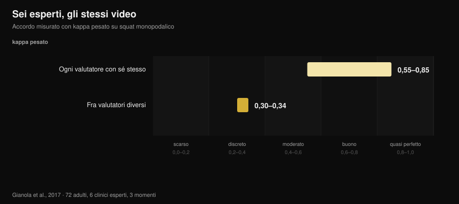

# Form check con l'AI: quanto sbaglia sulla tecnica

Di [Giammaria Loi](/autore/giammaria-loi) · aggiornato il 19 novembre 2026

Appoggi il telefono, fai la serie, l'app ti risponde "ginocchio in valgo, profondità 92°". Sembra una misura. Nel 2026 di app così ne sono uscite a decine, e in italiano chi cerca "form check AI" trova solo schede del negozio. Il problema è che quei gradi sul tuo schermo hanno un margine di errore misurato in laboratorio, e nessuno te lo scrive.

## In breve

- **Il miglior stimatore 2D sbaglia l'angolo del ginocchio di 9,3° in media.** È il risultato più favorevole su 2,2 milioni di fotogrammi e 11 modelli open source: nessuno di quelli testati ha raggiunto la precisione richiesta per un'interpretazione clinica.
- **Il "3D" dell'app è spesso peggio del 2D.** L'errore sulla posizione delle articolazioni passa da 72-122 mm in 2D a 146-249 mm quando il modello stima anche la profondità.
- **L'angolo di ripresa conta più dell'algoritmo.** Con il movimento perfettamente nel piano della telecamera l'errore sul gomito è di 10,5°; fuori da quel piano peggiora in modo significativo.
- **Nemmeno l'occhio umano è un metro.** Sei clinici esperti che guardavano gli stessi video hanno concordato fra loro con un kappa di 0,30-0,34: accordo "discreto", mentre ciascuno con sé stesso stava fra 0,55 e 0,85.
- **Il video serve, ma per domande diverse.** I criteri binari e i giudizi d'insieme sono affidabili; i gradi decimali no. Conviene chiedere "il ginocchio è finito dentro il bordo della scarpa?", non "quanti gradi di valgo ho".

*Grafico Nurvan sui valori riportati in Rode et al., 2025 (Scientific Reports e IEEE ICORR) e Wang et al., 2025. Attenzione: sono articolazioni e compiti diversi, non un confronto testa a testa. Ogni barra è il valore migliore pubblicato in quello studio. Nessun valore letto da una figura.*

## Che cosa fa davvero un'app di form check

Dietro quasi tutte c'è la stessa tecnologia: la *stima della posa* (pose estimation), cioè una rete neurale che guarda l'immagine e indovina dove sono spalla, anca, ginocchio, caviglia. Da quei punti l'app calcola gli angoli. Non misura il tuo corpo: ipotizza la posizione dei centri articolari a partire dai pixel.

È una differenza che pesa. In laboratorio la posizione di un'articolazione si ricava da marcatori riflettenti e più telecamere calibrate; qui si ricava da una fotocamera sola, con i vestiti, la luce della palestra e il bilanciere che a tratti ti nasconde.

## I numeri della verifica più ampia

A novembre 2025 un gruppo del Politecnico di Zurigo ha pubblicato su *Scientific Reports* il confronto più esteso finora: 25 partecipanti, oltre 2,2 milioni di fotogrammi di esercizi fisici, 11 stimatori di posa open source provati in 18 varianti 2D e 26 varianti 3D, tutti confrontati con un sistema ottico a marcatori.

| Misura | Stimatori 2D | Stimatori 3D |
|---|---|---|
| Errore medio di posizione delle articolazioni | 72-122 mm | 146-249 mm |
| Errore medio sull'angolo del ginocchio | da 9,3° | da 14,1° |
| Errore medio sull'angolo del gomito | da 21,5° | da 16,3° |

*Tabella Nurvan sui valori riportati in Rode et al., 2025 (Scientific Reports). "Da" indica il modello migliore della categoria.*

Due letture pratiche. La prima: anche nel caso migliore l'errore medio sul ginocchio è di circa 9 gradi, e gli autori scrivono che nessuno dei modelli testati scende sotto la soglia di errore necessaria per un'interpretazione clinica corretta. La seconda: aggiungere la terza dimensione peggiora le cose. Quando il modello prova a indovinare anche la profondità da una sola telecamera, l'errore di posizione raddoppia. Il "3D" scritto nella descrizione dell'app non è una garanzia di qualità.

Lo stesso gruppo ha fatto una seconda prova mirata sul gomito: con il movimento che avveniva **interamente nel piano dell'immagine** — la condizione ideale — l'errore medio era di 10,5° e lo scarto quadratico medio di 14,7°, contro 4,2° e 6,0° di un sensore inerziale indossato. L'orientamento rispetto alla telecamera influiva in modo significativo sull'accuratezza, e il modello tendeva a sottostimare le flessioni più ampie: proprio dove ti servirebbe sapere se sei sceso abbastanza.

### L'angolo di ripresa non è un dettaglio

Un lavoro del 2025 sul *Journal of Biomechanics* ha provato OpenCap, il sistema markerless da smartphone più diffuso in ricerca, su 53 persone con artrosi di ginocchio e 30 controlli sani. Camminando **verso** la telecamera l'errore medio era di 6,1° con una concordanza di 0,67; camminando nella direzione opposta peggiorava in modo statisticamente significativo. Stesso soggetto, stesso software, stessa stanza: cambiava solo da che parte era girato.

Vale anche per l'analisi 2D fatta a mano. Su donne attive, la validità dell'angolo di valgo misurato sul piano frontale dipendeva dalla profondità dello squat, da quale gamba era in appoggio e dal fatto che il valgo fosse marcato o no. Tradotto: la stessa misura può essere valida in una condizione e non esserlo in un'altra.

## Allora un coach umano è meglio?

Dipende da cosa gli chiedi. In uno studio italiano su 72 adulti, sei clinici esperti hanno valutato gli stessi video di squat monopodalico in tre momenti diversi, con una scala validata. Ciascuno era abbastanza d'accordo con sé stesso — kappa pesato da 0,55 a 0,85 — ma l'accordo **fra** valutatori è rimasto fra 0,30 e 0,34, cioè "discreto" per convenzione.

*Grafico Nurvan sui valori riportati in Gianola et al., 2017 (72 adulti, sei clinici esperti, tre momenti di valutazione). Le fasce di interpretazione del kappa sono la convenzione d'uso comune. Nessun valore letto da una figura.*

Sei esperti, lo stesso video, giudizi che si allineano poco. Non è un'accusa alla categoria: è la natura della valutazione a occhio di angoli e segmenti. E spiega perché due coach possono darti due correzioni diverse sullo stesso stacco senza che nessuno dei due stia sbagliando mestiere.

La parte utile arriva subito dopo. Quando si chiede un giudizio **d'insieme** invece di valutare segmento per segmento, l'accordo migliora: in uno studio su persone con un pregresso infortunio al ginocchio, tre valutatori esperti e tre alle prime armi hanno raggiunto una buona concordanza usando il metodo globale. E un criterio binario ben scelto regge il confronto con il laboratorio: su atlete adolescenti, il criterio "il ginocchio finisce dentro il bordo interno della scarpa" ha raggiunto un'area sotto la curva fino a 0,93 nel riconoscere il valgo misurato in 3D, contro valori molto più bassi di altri criteri.

Il video, insomma, è un ottimo strumento per domande a risposta secca. È un pessimo goniometro.

## Cosa dice davvero la ricerca

| Affermazione diffusa | Verdetto | Fonte |
|---|---|---|
| "L'app misura i tuoi angoli come un laboratorio" | **Smentito** | Rode et al., 2025 — nessuno degli 11 stimatori testati raggiunge l'errore angolare richiesto per un'interpretazione clinica |
| "Se è 3D è più preciso" | **Smentito** | Rode et al., 2025 — errore di posizione 72-122 mm in 2D contro 146-249 mm in 3D da telecamera singola |
| "Basta inquadrare, l'angolo di ripresa è un dettaglio" | **Smentito** | Rode et al., 2025; Wang et al., 2025 — l'orientamento rispetto alla telecamera cambia l'errore in modo significativo |
| "Un coach umano è oggettivo" | **Da precisare** | Gianola et al., 2017 — sei esperti sugli stessi video: accordo reciproco 0,30-0,34 di kappa pesato |
| "Il form check da video non serve a niente" | **Smentito** | Edwards e Liberatore, 2018; Erdman et al., 2024 — giudizi d'insieme affidabili e criteri binari con AUC fino a 0,93 |
| "L'app può dirti se un movimento è sicuro per te" | **Non verificabile** | Nessuno degli studi disponibili ha testato previsioni di infortunio su chi si allena con i pesi |

## Come applicarlo

1. **Filma nel piano del movimento.** Telecamera all'altezza dell'anca, perpendicolare al piano in cui avviene ciò che vuoi guardare: di lato per profondità e schiena, di fronte per il valgo. Il movimento deve stare tutto dentro l'inquadratura, dal primo all'ultimo fotogramma.
2. **Tieni la telecamera ferma e sempre nello stesso punto.** Il confronto fra due sedute ha senso solo se l'inquadratura è la stessa. Un segno sul pavimento vale più di qualsiasi algoritmo.
3. **Fai domande binarie.** "Il ginocchio è rimasto dentro il bordo della scarpa?", "L'anca è scesa sotto il ginocchio?", "Il bilanciere si è allontanato dal corpo?". Sono le domande su cui l'occhio, umano o artificiale, è affidabile.
4. **Ignora i decimali.** Se l'app scrive 92,4° di flessione, leggi "più o meno 90, con una decina di gradi di incertezza". Un angolo che cambia di 5° fra una settimana e l'altra non è un progresso: è rumore.
5. **Usa il video per la tecnica, i numeri per il carico.** Quanto stai spingendo davvero non si vede in un fotogramma. Si vede nello storico di carichi, ripetizioni e [RIR, con tutti i limiti che ha anche quella stima](/blog/quanto-e-preciso-il-rir).
6. **Dolore, gonfiore o cedimenti non sono un problema di tecnica da risolvere con un'app.** In quel caso serve un professionista sanitario, non un'inquadratura migliore.

### Se alleni altre persone a distanza

Due regole che rendono il video un dato utile invece di un'opinione:

- **Chiedi sempre la stessa inquadratura.** Specifica altezza, lato e distanza una volta sola, poi pretendila. Senza quello stai confrontando riprese diverse, non esecuzioni diverse.
- **Scrivi i criteri prima di guardare.** Tre domande binarie per esercizio, decise in anticipo. È il modo più semplice per evitare che la tua valutazione di oggi non coincida con quella di martedì scorso, come succede anche ai valutatori esperti.

> **Nurvan: il video mostra la forma, lo storico mostra il carico**
>
> In Nurvan il coach vede per ogni serie carico, ripetizioni e RIR, con lo storico dell'esercizio in fila: è il dato che un fotogramma non può dare, e che dice se la richiesta sta davvero salendo. Il video resta quello che è, un controllo di forma; le decisioni di programmazione si prendono sui numeri. [Prova Nurvan](https://nurvan.app)

## Domande frequenti

**Le app di AI form check funzionano?**
Funzionano per segnalare differenze grossolane, non per misurare. Nella verifica più ampia pubblicata finora, l'errore medio sull'angolo del ginocchio parte da 9,3° per i migliori modelli 2D e da 14,1° per quelli 3D, e nessuno dei modelli testati raggiunge la precisione richiesta per un'interpretazione clinica. Se l'app ti dice che un ginocchio cede verso l'interno in modo evidente, probabilmente ha ragione; se ti dà un numero con la virgola, quel numero non è affidabile.

**Da che lato devo filmare lo squat?**
Da dove avviene ciò che vuoi vedere. Di lato, telecamera all'altezza dell'anca, per profondità, traiettoria del bilanciere e inclinazione del busto; di fronte per il comportamento delle ginocchia. Negli studi l'orientamento rispetto alla telecamera cambia l'errore in modo significativo, quindi una ripresa a tre quarti è il modo più semplice per ottenere numeri senza senso.

**Meglio il telefono o un sensore indossabile?**
Per misurare un angolo, il sensore inerziale: nel confronto diretto sul gomito era a 4,2° di errore medio contro 10,5° della stima da video nella condizione migliore. Per guardare un movimento intero, il video resta più comodo e più informativo.

**Un'app può dirmi se la mia tecnica è pericolosa?**
No. Gli studi disponibili misurano quanto un sistema si avvicina al laboratorio nel descrivere un movimento, non se quel movimento causerà un infortunio. Se hai dolore, instabilità o un cedimento improvviso, la domanda è medica e va posta a un medico o a un fisioterapista.

## Leggi anche

- [Coaching online funziona? Cosa dicono gli studi](/blog/coaching-online-funziona-studi) — che cosa deve controllare un coach a distanza per valere quanto uno in sala.
- [Quanto è preciso il tuo RIR? Cosa dicono gli studi](/blog/quanto-e-preciso-il-rir) — l'altra stima su cui si basa mezzo allenamento.
- [Schede di allenamento fatte dall'AI: cosa dicono gli studi](/blog/scheda-allenamento-ai-studi) — dove l'intelligenza artificiale regge e dove no.

## Fonti

1. Rode D, Dunkel A, Willi R, Wolf P, Xiloyannis M, Riener R, 2025. Assessment of monocular human pose estimation models for clinical movement analysis. *Scientific Reports* 15(1):38767. [PMID 41193590](https://pubmed.ncbi.nlm.nih.gov/41193590/) · [DOI 10.1038/s41598-025-22626-7](https://doi.org/10.1038/s41598-025-22626-7)
2. Rode D, Ceccarelli A, Esser A, Wolf P, Riener R, 2025. Accuracy of IMUs and Monocular Human Pose Estimation at Measuring Elbow Flexion. *IEEE Int Conf Rehabil Robot* 2025:773-778. [PMID 40644081](https://pubmed.ncbi.nlm.nih.gov/40644081/) · [DOI 10.1109/ICORR66766.2025.11063086](https://doi.org/10.1109/ICORR66766.2025.11063086)
3. Wang J, Xu W, Wu Z, Zhang H, Wang B, Zhou Z, Wang C, Li K, Nie Y, 2025. Evaluation of a smartphone-based markerless system to measure lower-limb kinematics in patients with knee osteoarthritis. *Journal of Biomechanics* 181:112529. [PMID 39862716](https://pubmed.ncbi.nlm.nih.gov/39862716/) · [DOI 10.1016/j.jbiomech.2025.112529](https://doi.org/10.1016/j.jbiomech.2025.112529)
4. Wade L, Needham L, McGuigan P, Bilzon J, 2022. Applications and limitations of current markerless motion capture methods for clinical gait biomechanics. *PeerJ* 10:e12995. [PMID 35237469](https://pubmed.ncbi.nlm.nih.gov/35237469/) · [DOI 10.7717/peerj.12995](https://doi.org/10.7717/peerj.12995)
5. Gianola S, Castellini G, Stucovitz E, Nardo A, Banfi G, 2017. Single leg squat performance in physically and non-physically active individuals: a cross-sectional study. *BMC Musculoskeletal Disorders* 18(1):299. [PMID 28709418](https://pubmed.ncbi.nlm.nih.gov/28709418/) · [DOI 10.1186/s12891-017-1660-8](https://doi.org/10.1186/s12891-017-1660-8)
6. Edwards S, Liberatore M, 2018. Reliability of a Squat Movement Competency Screen in Individuals With a Previous Knee Injury. *Journal of Sport Rehabilitation* 27(2). [PMID 28872403](https://pubmed.ncbi.nlm.nih.gov/28872403/) · [DOI 10.1123/jsr.2017-0064](https://doi.org/10.1123/jsr.2017-0064)
7. Erdman A, Loewen A, Dressing M, Wyatt C, Oliver G, Butler L, Sugimoto D, Black AM, Tulchin-Francis K, Bazett-Jones DM, Janosky J, Ulman S, 2024. A 2D video-based assessment is associated with 3D biomechanical contributors to dynamic knee valgus in the coronal plane. *Frontiers in Sports and Active Living* 6:1352286. [PMID 38558858](https://pubmed.ncbi.nlm.nih.gov/38558858/) · [DOI 10.3389/fspor.2024.1352286](https://doi.org/10.3389/fspor.2024.1352286)
8. Jamaludin NI, Sahabuddin FNA, Rasudin NS, Shaharudin S, 2022. The Concurrent Validity and Reliability of Single Leg Squat Among Physically Active Females with and without Dynamic Knee Valgus. *International Journal of Sports Physical Therapy* 17(4):574-584. [PMID 35693857](https://pubmed.ncbi.nlm.nih.gov/35693857/) · [DOI 10.26603/001c.35706](https://doi.org/10.26603/001c.35706)

Tema scelto da segnali di tendenza di novembre 2026: decine di app di "AI form check" pubblicate sugli store nel 2026 e una prima pagina di risultati, in italiano, composta solo da schede prodotto senza un dato di accuratezza. Fonti scientifiche consultate tramite PubMed.

**Giammaria Loi** è il fondatore di Nurvan. Si allena con i pesi dal 2012, lavora come personal trainer e coach certificato FIPE dal 2013 e gareggia nel powerlifting a livello nazionale dal 2018. Ogni articolo che firma parte dagli studi scientifici e arriva a ciò che funziona davvero in palestra. [Pagina autore](/autore/giammaria-loi)

> Nota: contenuto informativo, non sostituisce il parere di un medico o di un professionista qualificato.
