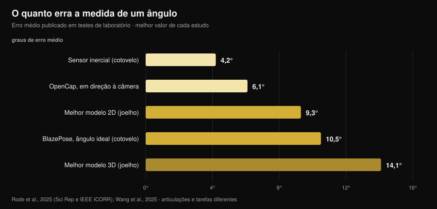
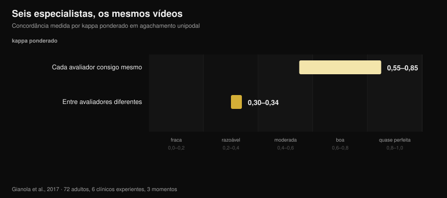

# Form check com IA: qual é a precisão real?

Por [Giammaria Loi](/autore/giammaria-loi) · atualizado em 19 de novembro de 2026

Você apoia o celular, faz a série e o app responde: "valgo de joelho, profundidade 92°". Parece uma medição. Em 2026 saíram dezenas de apps assim, e quem procura "form check com IA" encontra apenas fichas de loja. O problema é que esses graus têm uma margem de erro medida em laboratório, e ninguém escreve isso ao lado.

## Em resumo

- **O melhor estimador 2D erra 9,3° em média no ângulo do joelho.** É o resultado mais favorável em 2,2 milhões de quadros e 11 modelos de código aberto: nenhum dos testados atingiu a precisão necessária para uma interpretação clínica.
- **O "3D" do app costuma ser pior que o 2D.** O erro de posição das articulações vai de 72-122 mm em 2D para 146-249 mm quando o modelo também estima a profundidade.
- **O ângulo de filmagem pesa mais que o algoritmo.** Com o movimento inteiramente no plano da imagem, o erro no cotovelo foi de 10,5°; fora desse plano, piorou de forma significativa.
- **O olho humano também não é um transferidor.** Seis clínicos experientes avaliando os mesmos vídeos concordaram entre si com kappa de 0,30-0,34, enquanto cada um consigo mesmo ficou entre 0,55 e 0,85.
- **O vídeo serve, mas para outras perguntas.** Critérios binários e julgamentos de conjunto são confiáveis; decimais não. Pergunte "o joelho ficou dentro da borda do tênis?", não "quantos graus de valgo eu tenho?".

*Gráfico Nurvan com os valores publicados em Rode et al., 2025 (Scientific Reports e IEEE ICORR) e Wang et al., 2025. Atenção: são articulações e tarefas diferentes, não uma comparação direta. Cada barra é o melhor valor publicado naquele estudo. Nenhum valor foi lido de uma figura.*

## O que um app de form check realmente faz

Por trás de quase todos está a mesma tecnologia: a *estimativa de pose*, uma rede neural que olha a imagem e adivinha onde estão ombro, quadril, joelho e tornozelo. Com esses pontos o app calcula os ângulos. Ele não mede o seu corpo: deduz centros articulares a partir de pixels.

É uma diferença que pesa. No laboratório a posição de uma articulação vem de marcadores refletivos e várias câmeras calibradas; aqui vem de uma câmera só, com roupa, com a luz da academia e com uma barra que às vezes esconde parte de você.

## Os números da verificação mais ampla

Em novembro de 2025 um grupo do Instituto Federal de Tecnologia de Zurique publicou na *Scientific Reports* a comparação mais extensa até hoje: 25 participantes, mais de 2,2 milhões de quadros de exercícios, 11 estimadores de pose de código aberto testados em 18 variantes 2D e 26 variantes 3D, todos contra um sistema óptico com marcadores.

| Medida | Estimadores 2D | Estimadores 3D |
|---|---|---|
| Erro médio de posição das articulações | 72-122 mm | 146-249 mm |
| Erro médio no ângulo do joelho | a partir de 9,3° | a partir de 14,1° |
| Erro médio no ângulo do cotovelo | a partir de 21,5° | a partir de 16,3° |

*Tabela Nurvan com os valores publicados em Rode et al., 2025 (Scientific Reports). "A partir de" indica o melhor modelo da categoria.*

Duas leituras práticas. A primeira: mesmo no melhor caso o erro médio no joelho é de cerca de nove graus, e os autores escrevem que nenhum dos modelos testados fica abaixo do erro angular necessário para uma interpretação clínica correta. A segunda: acrescentar a terceira dimensão piora. Quando o modelo tenta adivinhar também a profundidade com uma câmera só, o erro de posição dobra. O "3D" na descrição do app não é selo de qualidade.

O mesmo grupo fez um segundo teste focado no cotovelo: com o movimento **inteiramente dentro do plano da imagem** — a condição ideal — o erro médio foi de 10,5° e o erro quadrático médio de 14,7°, contra 4,2° e 6,0° de um sensor inercial vestido. A orientação em relação à câmera influenciou a precisão de forma significativa, e o modelo tendia a subestimar as flexões maiores: justamente onde você quer saber se desceu o suficiente.

### O ângulo de filmagem não é um detalhe

Um trabalho de 2025 no *Journal of Biomechanics* testou o OpenCap, o sistema sem marcadores por smartphone mais usado em pesquisa, em 53 pessoas com artrose de joelho e 30 controles saudáveis. Caminhando **em direção** à câmera, o erro médio foi de 6,1° com concordância de 0,67; no sentido oposto piorou de forma estatisticamente significativa. Mesma pessoa, mesmo software, mesma sala: mudava só a direção.

Vale também para a análise 2D feita à mão. Em mulheres ativas, a validade do ângulo de valgo no plano frontal dependia da profundidade do agachamento, de qual perna apoiava e de o valgo ser ou não acentuado. Traduzindo: a mesma medida pode ser válida numa condição e não em outra.

## Então um treinador humano é melhor?

Depende do que você pede a ele. Num estudo italiano com 72 adultos, seis clínicos experientes avaliaram os mesmos vídeos de agachamento unipodal em três momentos com uma escala validada. Cada um concordava razoavelmente consigo mesmo — kappa ponderado de 0,55 a 0,85 —, mas a concordância **entre** avaliadores ficou entre 0,30 e 0,34, ou seja "razoável" pela convenção.

*Gráfico Nurvan com os valores publicados em Gianola et al., 2017 (72 adultos, seis clínicos experientes, três sessões de avaliação). As faixas de interpretação do kappa seguem a convenção usual. Nenhum valor foi lido de uma figura.*

Seis especialistas, o mesmo vídeo, julgamentos que combinam pouco. Não é uma acusação à categoria: é o que acontece quando se avaliam ângulos e segmentos a olho. E explica por que dois treinadores podem dar duas correções diferentes para o mesmo terra sem que nenhum esteja errando de profissão.

A parte útil vem logo depois. Quando se pede um julgamento **de conjunto** em vez de avaliar segmento por segmento, a concordância melhora: em pessoas com lesão prévia de joelho, três avaliadores experientes e três iniciantes chegaram a boa concordância com o método global. E um critério binário bem escolhido aguenta a comparação com o laboratório: em atletas adolescentes, o critério "o joelho termina dentro da borda interna do tênis" alcançou área sob a curva de até 0,93 para identificar o valgo medido em 3D, bem acima de outros critérios.

O vídeo é uma ótima ferramenta para perguntas de resposta seca. É um péssimo goniômetro.

## O que a pesquisa realmente diz

| Afirmação comum | Veredito | Fonte |
|---|---|---|
| "O app mede seus ângulos como um laboratório" | **Desmentido** | Rode et al., 2025 — nenhum dos 11 estimadores testados atinge o erro angular necessário para interpretação clínica |
| "Se é 3D é mais preciso" | **Desmentido** | Rode et al., 2025 — erro de posição 72-122 mm em 2D contra 146-249 mm em 3D com câmera única |
| "Basta enquadrar, o ângulo é detalhe" | **Desmentido** | Rode et al., 2025; Wang et al., 2025 — a orientação em relação à câmera muda o erro de forma significativa |
| "Um treinador humano é objetivo" | **A precisar** | Gianola et al., 2017 — seis especialistas nos mesmos vídeos: concordância mútua de 0,30-0,34 de kappa ponderado |
| "Form check por vídeo não serve para nada" | **Desmentido** | Edwards e Liberatore, 2018; Erdman et al., 2024 — julgamentos de conjunto confiáveis e critérios binários com AUC até 0,93 |
| "O app pode dizer se um movimento é seguro para você" | **Não verificável** | Nenhum estudo disponível testou previsão de lesão em quem treina com pesos |

## Como aplicar

1. **Filme no plano do movimento.** Câmera na altura do quadril, perpendicular ao plano que interessa: de lado para profundidade e costas, de frente para o joelho. O movimento inteiro precisa caber no enquadramento.
2. **Câmera parada e sempre no mesmo ponto.** Comparar duas sessões só faz sentido se o enquadramento for idêntico. Uma marca no chão vale mais que qualquer algoritmo.
3. **Faça perguntas binárias.** "O joelho ficou dentro da borda do tênis?", "o quadril desceu abaixo do joelho?", "a barra se afastou do corpo?". São as perguntas em que o olho, humano ou artificial, é confiável.
4. **Ignore os decimais.** Se o app escreve 92,4° de flexão, leia "mais ou menos 90, com uns dez graus de incerteza". Um ângulo que muda 5° de uma semana para outra é ruído, não progresso.
5. **Use o vídeo para a técnica e os números para a carga.** O quanto você está realmente empurrando não aparece num quadro. Aparece no histórico de cargas, repetições e [RIR, com todos os limites que essa estimativa também tem](/pt/blog/rir-precisao-repeticoes-em-reserva).
6. **Dor, inchaço ou falseio não são problema de técnica para resolver com um app.** Aí é preciso um profissional de saúde, não um enquadramento melhor.

### Se você treina outras pessoas a distância

Duas regras que transformam o vídeo em dado e não em opinião:

- **Peça sempre o mesmo enquadramento.** Especifique altura, lado e distância uma vez e depois exija. Sem isso você compara filmagens, não execuções.
- **Escreva os critérios antes de olhar.** Três perguntas binárias por exercício, decididas antes. É o jeito mais simples de evitar que sua avaliação de hoje não bata com a da terça passada, algo que acontece até com avaliadores experientes.

> **Nurvan: o vídeo mostra a forma, o histórico mostra a carga**
>
> No Nurvan o treinador vê em cada série carga, repetições e RIR, com o histórico do exercício enfileirado: o dado que um quadro não dá e que diz se a exigência está mesmo subindo. O vídeo continua sendo o que é, um controle de forma; as decisões de programação saem dos números. [Experimente o Nurvan](https://nurvan.app)

## Perguntas frequentes

**Os apps de form check com IA funcionam?**
Funcionam para sinalizar diferenças grosseiras, não para medir. Na maior verificação publicada até agora, o erro médio no ângulo do joelho parte de 9,3° nos melhores modelos 2D e de 14,1° nos 3D, e nenhum atinge a precisão necessária para interpretação clínica. Se o app diz que um joelho está claramente caindo para dentro, provavelmente tem razão; se entrega um número com vírgula, esse número não é confiável.

**De que lado devo filmar o agachamento?**
De onde acontece o que você quer ver. De lado, câmera na altura do quadril, para profundidade, trajetória da barra e inclinação do tronco; de frente para o comportamento dos joelhos. Nos estudos a orientação em relação à câmera muda o erro de forma significativa, então uma tomada em três quartos é o caminho mais rápido para números sem sentido.

**Celular ou sensor vestível?**
Para medir um ângulo, o sensor inercial: na comparação direta no cotovelo ele ficou em 4,2° de erro médio contra 10,5° da estimativa por vídeo na melhor condição. Para olhar um movimento inteiro, o vídeo segue mais prático e mais informativo.

**Um app pode dizer se minha técnica é perigosa?**
Não. Os estudos disponíveis medem o quanto um sistema se aproxima do laboratório ao descrever um movimento, não se esse movimento vai causar lesão. Se há dor, instabilidade ou falseio, a pergunta é médica e se faz a um médico ou fisioterapeuta.

## Leia também

- [O coaching online funciona? O que dizem os estudos](/pt/blog/o-coaching-online-funciona) — o que um treinador a distância precisa controlar para valer tanto quanto um presencial.
- [Qual é a precisão do seu RIR? O que dizem os estudos](/pt/blog/rir-precisao-repeticoes-em-reserva) — a outra estimativa em que metade do treino se apoia.
- [Treino gerado por IA: o que dizem os estudos](/pt/blog/treino-gerado-por-ia-estudos) — onde a inteligência artificial se sustenta e onde não.

## Fontes

1. Rode D, Dunkel A, Willi R, Wolf P, Xiloyannis M, Riener R, 2025. Assessment of monocular human pose estimation models for clinical movement analysis. *Scientific Reports* 15(1):38767. [PMID 41193590](https://pubmed.ncbi.nlm.nih.gov/41193590/) · [DOI 10.1038/s41598-025-22626-7](https://doi.org/10.1038/s41598-025-22626-7)
2. Rode D, Ceccarelli A, Esser A, Wolf P, Riener R, 2025. Accuracy of IMUs and Monocular Human Pose Estimation at Measuring Elbow Flexion. *IEEE Int Conf Rehabil Robot* 2025:773-778. [PMID 40644081](https://pubmed.ncbi.nlm.nih.gov/40644081/) · [DOI 10.1109/ICORR66766.2025.11063086](https://doi.org/10.1109/ICORR66766.2025.11063086)
3. Wang J, Xu W, Wu Z, Zhang H, Wang B, Zhou Z, Wang C, Li K, Nie Y, 2025. Evaluation of a smartphone-based markerless system to measure lower-limb kinematics in patients with knee osteoarthritis. *Journal of Biomechanics* 181:112529. [PMID 39862716](https://pubmed.ncbi.nlm.nih.gov/39862716/) · [DOI 10.1016/j.jbiomech.2025.112529](https://doi.org/10.1016/j.jbiomech.2025.112529)
4. Wade L, Needham L, McGuigan P, Bilzon J, 2022. Applications and limitations of current markerless motion capture methods for clinical gait biomechanics. *PeerJ* 10:e12995. [PMID 35237469](https://pubmed.ncbi.nlm.nih.gov/35237469/) · [DOI 10.7717/peerj.12995](https://doi.org/10.7717/peerj.12995)
5. Gianola S, Castellini G, Stucovitz E, Nardo A, Banfi G, 2017. Single leg squat performance in physically and non-physically active individuals: a cross-sectional study. *BMC Musculoskeletal Disorders* 18(1):299. [PMID 28709418](https://pubmed.ncbi.nlm.nih.gov/28709418/) · [DOI 10.1186/s12891-017-1660-8](https://doi.org/10.1186/s12891-017-1660-8)
6. Edwards S, Liberatore M, 2018. Reliability of a Squat Movement Competency Screen in Individuals With a Previous Knee Injury. *Journal of Sport Rehabilitation* 27(2). [PMID 28872403](https://pubmed.ncbi.nlm.nih.gov/28872403/) · [DOI 10.1123/jsr.2017-0064](https://doi.org/10.1123/jsr.2017-0064)
7. Erdman A, Loewen A, Dressing M, Wyatt C, Oliver G, Butler L, Sugimoto D, Black AM, Tulchin-Francis K, Bazett-Jones DM, Janosky J, Ulman S, 2024. A 2D video-based assessment is associated with 3D biomechanical contributors to dynamic knee valgus in the coronal plane. *Frontiers in Sports and Active Living* 6:1352286. [PMID 38558858](https://pubmed.ncbi.nlm.nih.gov/38558858/) · [DOI 10.3389/fspor.2024.1352286](https://doi.org/10.3389/fspor.2024.1352286)
8. Jamaludin NI, Sahabuddin FNA, Rasudin NS, Shaharudin S, 2022. The Concurrent Validity and Reliability of Single Leg Squat Among Physically Active Females with and without Dynamic Knee Valgus. *International Journal of Sports Physical Therapy* 17(4):574-584. [PMID 35693857](https://pubmed.ncbi.nlm.nih.gov/35693857/) · [DOI 10.26603/001c.35706](https://doi.org/10.26603/001c.35706)

Tema escolhido a partir de sinais de tendência de novembro de 2026: dezenas de apps de "AI form check" publicados nas lojas em 2026 e uma primeira página de resultados formada apenas por fichas de produto, sem nenhum dado de precisão. Fontes científicas consultadas via PubMed.

**Giammaria Loi** é o fundador da Nurvan. Treina com pesos desde 2012, trabalha como personal trainer e coach certificado FIPE desde 2013 e compete em powerlifting em nível nacional desde 2018. Cada artigo que assina parte dos estudos científicos e chega ao que funciona de verdade na academia. [Página do autor](/autore/giammaria-loi)

> Nota: conteúdo informativo, não substitui a opinião de um médico ou de um profissional qualificado.
