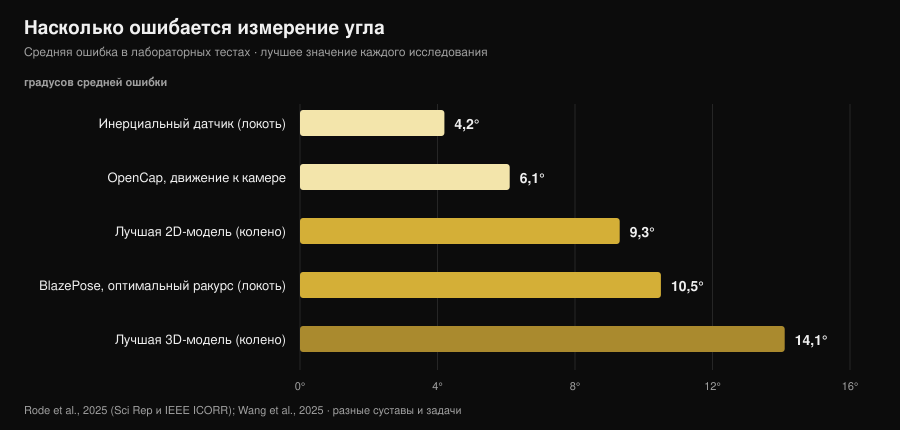
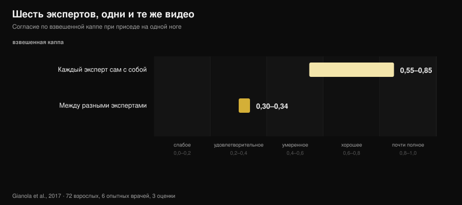

# ИИ-разбор техники по видео: насколько он точен

Автор: [Giammaria Loi](/autore/giammaria-loi) · обновлено 19 ноября 2026

Вы ставите телефон, делаете подход, и приложение отвечает: «вальгус колена, глубина 92°». Похоже на измерение. В 2026 году таких приложений вышли десятки, а по запросу «ИИ разбор техники» выдача состоит из карточек магазина. Проблема в том, что у этих градусов есть погрешность, измеренная в лаборатории, и рядом с ними её никто не пишет.

## Коротко

- **Лучший 2D-оценщик ошибается на угле колена в среднем на 9,3°.** Это самый благоприятный результат на 2,2 миллиона кадров и 11 моделей с открытым кодом: ни одна из протестированных не достигла точности, нужной для клинической интерпретации.
- **«3D» в приложении часто хуже, чем 2D.** Ошибка положения суставов растёт с 72-122 мм в 2D до 146-249 мм, когда модель оценивает ещё и глубину.
- **Ракурс съёмки важнее алгоритма.** Когда движение целиком лежит в плоскости кадра, ошибка на локте составила 10,5°; вне этой плоскости точность значимо падает.
- **Человеческий глаз — тоже не транспортир.** Шесть опытных клиницистов, оценивавших одни и те же видео, согласовались между собой на уровне каппы 0,30-0,34, тогда как каждый сам с собой — на 0,55-0,85.
- **Видео полезно, но для других вопросов.** Бинарные критерии и общая оценка движения надёжны, десятые доли градуса — нет. Спрашивайте «колено осталось внутри края кроссовка?», а не «сколько у меня градусов вальгуса».

*График Nurvan по значениям из Rode et al., 2025 (Scientific Reports и IEEE ICORR) и Wang et al., 2025. Внимание: разные суставы и задачи, это не прямое сравнение. Каждый столбец — лучшее опубликованное значение в соответствующем исследовании. Ни одно значение не считано с рисунка.*

## Что на самом деле делает такое приложение

Почти за всеми стоит одна и та же технология — *оценка позы*: нейросеть смотрит на изображение и угадывает, где плечо, таз, колено и голеностоп. По этим точкам приложение считает углы. Оно не измеряет ваше тело, а выводит центры суставов из пикселей.

Разница существенная. В лаборатории положение сустава получают со светоотражающих маркеров и нескольких откалиброванных камер; здесь — с одной камеры, через одежду, при зальном свете и со штангой, которая временами вас закрывает.

## Цифры самой масштабной проверки

В ноябре 2025 года группа из Швейцарской высшей технической школы Цюриха опубликовала в *Scientific Reports* самое обширное на сегодня сравнение: 25 участников, более 2,2 миллиона кадров физических упражнений, 11 оценщиков позы с открытым кодом в 18 двумерных и 26 трёхмерных вариантах — все против маркерной оптической системы.

| Показатель | 2D-оценщики | 3D-оценщики |
|---|---|---|
| Средняя ошибка положения суставов | 72-122 мм | 146-249 мм |
| Средняя ошибка угла колена | от 9,3° | от 14,1° |
| Средняя ошибка угла локтя | от 21,5° | от 16,3° |

*Таблица Nurvan по значениям из Rode et al., 2025 (Scientific Reports). «От» — лучшая модель в категории.*

Два практических вывода. Первый: даже в лучшем случае средняя ошибка на колене около девяти градусов, и авторы пишут, что ни одна из протестированных моделей не опускается ниже угловой ошибки, необходимой для корректной клинической интерпретации. Второй: третье измерение делает хуже. Когда модель пытается угадать ещё и глубину с одной камеры, ошибка положения удваивается. «3D» в описании приложения — не знак качества.

Та же группа провела второй тест, нацеленный на локоть: когда движение происходило **целиком в плоскости кадра** — идеальное условие — средняя ошибка составила 10,5°, среднеквадратичная 14,7°, против 4,2° и 6,0° у надетого инерциального датчика. Ориентация относительно камеры значимо влияла на точность, а модель занижала большие углы сгибания: ровно там, где вам и нужно знать, достаточно ли глубоко вы опустились.

### Ракурс — не мелочь

Работа 2025 года в *Journal of Biomechanics* проверила OpenCap, самую популярную в исследованиях безмаркерную систему для смартфона, на 53 людях с артрозом колена и 30 здоровых. При ходьбе **к** камере средняя ошибка была 6,1° при согласованности 0,67; в обратную сторону она статистически значимо ухудшалась. Тот же человек, та же программа, то же помещение — менялось только направление.

То же касается ручного 2D-анализа. У физически активных женщин валидность угла вальгуса во фронтальной плоскости зависела от глубины приседа, от опорной ноги и от выраженности самого вальгуса. Перевод: одно и то же измерение может быть валидным в одних условиях и невалидным в других.

## Значит, живой тренер лучше?

Зависит от вопроса. В итальянском исследовании на 72 взрослых шесть опытных клиницистов оценивали одни и те же видео приседа на одной ноге в три разных момента по валидированной шкале. Каждый был достаточно согласован сам с собой — взвешенная каппа от 0,55 до 0,85, — но согласие **между** оценщиками осталось на уровне 0,30-0,34, то есть «удовлетворительное» по общепринятой шкале.

*График Nurvan по значениям из Gianola et al., 2017 (72 взрослых, шесть опытных клиницистов, три сессии оценки). Полосы интерпретации каппы — общепринятая конвенция. Ни одно значение не считано с рисунка.*

Шесть экспертов, одно и то же видео, плохо сходящиеся оценки. Это не упрёк профессии: так устроена оценка углов и сегментов на глаз. И это объясняет, почему два тренера могут дать вам две разные поправки на одной и той же тяге, и при этом никто из них не ошибается в ремесле.

Полезное начинается дальше. Когда просят **общую** оценку движения вместо разбора по сегментам, согласие растёт: у людей с перенесённой травмой колена три опытных и три начинающих оценщика достигли хорошего согласия при общем методе. А удачно выбранный бинарный критерий выдерживает сравнение с лабораторией: у юных спортсменок критерий «колено оказывается внутри внутреннего края кроссовка» дал площадь под кривой до 0,93 при выявлении вальгуса, измеренного в 3D, намного выше других критериев.

Видео — отличный инструмент для вопросов с коротким ответом. И плохой угломер.

## Что говорит исследование на самом деле

| Распространённое утверждение | Вердикт | Источник |
|---|---|---|
| «Приложение измеряет углы как лаборатория» | **Опровергнуто** | Rode et al., 2025 — ни один из 11 протестированных оценщиков не достигает угловой ошибки, нужной для клинической интерпретации |
| «Если 3D, значит точнее» | **Опровергнуто** | Rode et al., 2025 — ошибка положения 72-122 мм в 2D против 146-249 мм в 3D с одной камеры |
| «Главное попасть в кадр, ракурс — мелочь» | **Опровергнуто** | Rode et al., 2025; Wang et al., 2025 — ориентация относительно камеры значимо меняет ошибку |
| «Живой тренер объективен» | **Требует уточнения** | Gianola et al., 2017 — шесть экспертов на одних видео: взаимное согласие 0,30-0,34 взвешенной каппы |
| «Разбор техники по видео бесполезен» | **Опровергнуто** | Edwards и Liberatore, 2018; Erdman et al., 2024 — надёжные общие оценки и бинарные критерии с AUC до 0,93 |
| «Приложение скажет, безопасно ли вам это движение» | **Не проверяемо** | Ни одно доступное исследование не проверяло прогноз травм у занимающихся с отягощениями |

## Как это применить

1. **Снимайте в плоскости движения.** Камера на высоте таза, перпендикулярно нужной плоскости: сбоку — для глубины и спины, спереди — для колена. Всё движение должно помещаться в кадр.
2. **Камера неподвижна и всегда в одной точке.** Сравнивать две тренировки имеет смысл только при одинаковом кадре. Метка на полу полезнее любого алгоритма.
3. **Задавайте бинарные вопросы.** «Колено осталось внутри края кроссовка?», «таз ушёл ниже колена?», «штанга отошла от тела?». Именно на таких вопросах глаз — человеческий или искусственный — надёжен.
4. **Игнорируйте десятые доли.** Если приложение пишет 92,4° сгибания, читайте «около 90, плюс-минус десяток градусов». Угол, изменившийся на 5° за неделю, — это шум, а не прогресс.
5. **Видео — для техники, цифры — для нагрузки.** Насколько сильно вы на самом деле толкаете, на кадре не видно. Это видно в истории весов, повторений и [RIR — со всеми ограничениями и этой оценки](/ru/blog/naskolko-tochen-rir).
6. **Боль, отёк или подкашивание — не вопрос техники, решаемый приложением.** Здесь нужен медицинский специалист, а не удачный ракурс.

### Если вы тренируете людей удалённо

Два правила, которые превращают видео в данные, а не в мнение:

- **Требуйте один и тот же кадр.** Один раз задайте высоту, сторону и расстояние — и держитесь этого. Иначе вы сравниваете съёмки, а не исполнения.
- **Пропишите критерии до просмотра.** Три бинарных вопроса на упражнение, решённых заранее. Это простейший способ не разойтись с собственной оценкой недельной давности — с опытными оценщиками это тоже случается.

> **Nurvan: видео показывает форму, история показывает нагрузку**
>
> В Nurvan тренер видит по каждому подходу вес, повторения и RIR, а история упражнения выстроена в ряд: это те данные, которых не даст ни один кадр и которые показывают, действительно ли растёт требование. Видео остаётся тем, чем является, — проверкой формы; решения по программе принимаются по цифрам. [Попробовать Nurvan](https://nurvan.app)

## Частые вопросы

**Работают ли приложения ИИ-разбора техники?**
Они работают, чтобы заметить грубые отклонения, а не чтобы измерять. В самой масштабной опубликованной проверке средняя ошибка угла колена начинается с 9,3° у лучших 2D-моделей и с 14,1° у 3D, и ни одна не достигает точности, нужной для клинической интерпретации. Если приложение говорит, что колено явно заваливается внутрь, оно, скорее всего, право; если оно даёт число с десятыми, этому числу верить нельзя.

**С какой стороны снимать присед?**
Оттуда, где происходит то, что вы хотите увидеть. Сбоку, камера на высоте таза — для глубины, траектории штанги и наклона корпуса; спереди — для поведения коленей. В исследованиях ориентация относительно камеры значимо меняет ошибку, так что съёмка в три четверти — самый быстрый способ получить бессмысленные числа.

**Телефон или носимый датчик?**
Для измерения угла — инерциальный датчик: в прямом сравнении на локте у него 4,2° средней ошибки против 10,5° у видеооценки в лучших условиях. Чтобы смотреть движение целиком, видео остаётся удобнее и информативнее.

**Может ли приложение сказать, что моя техника опасна?**
Нет. Доступные исследования измеряют, насколько система приближается к лаборатории в описании движения, а не вызовет ли это движение травму. При боли, нестабильности или внезапном подкашивании вопрос медицинский — к врачу или физиотерапевту.

## Читайте также

- [Работает ли онлайн-коучинг? Что говорят исследования](/ru/blog/rabotaet-li-onlayn-kouching) — что удалённый тренер обязан контролировать, чтобы не уступать залу.
- [Насколько точен ваш RIR? Что говорят исследования](/ru/blog/naskolko-tochen-rir) — вторая оценка, на которой держится половина тренировки.
- [План тренировок от ИИ: что говорят исследования](/ru/blog/plan-trenirovok-ot-ii) — где искусственный интеллект держится, а где нет.

## Источники

1. Rode D, Dunkel A, Willi R, Wolf P, Xiloyannis M, Riener R, 2025. Assessment of monocular human pose estimation models for clinical movement analysis. *Scientific Reports* 15(1):38767. [PMID 41193590](https://pubmed.ncbi.nlm.nih.gov/41193590/) · [DOI 10.1038/s41598-025-22626-7](https://doi.org/10.1038/s41598-025-22626-7)
2. Rode D, Ceccarelli A, Esser A, Wolf P, Riener R, 2025. Accuracy of IMUs and Monocular Human Pose Estimation at Measuring Elbow Flexion. *IEEE Int Conf Rehabil Robot* 2025:773-778. [PMID 40644081](https://pubmed.ncbi.nlm.nih.gov/40644081/) · [DOI 10.1109/ICORR66766.2025.11063086](https://doi.org/10.1109/ICORR66766.2025.11063086)
3. Wang J, Xu W, Wu Z, Zhang H, Wang B, Zhou Z, Wang C, Li K, Nie Y, 2025. Evaluation of a smartphone-based markerless system to measure lower-limb kinematics in patients with knee osteoarthritis. *Journal of Biomechanics* 181:112529. [PMID 39862716](https://pubmed.ncbi.nlm.nih.gov/39862716/) · [DOI 10.1016/j.jbiomech.2025.112529](https://doi.org/10.1016/j.jbiomech.2025.112529)
4. Wade L, Needham L, McGuigan P, Bilzon J, 2022. Applications and limitations of current markerless motion capture methods for clinical gait biomechanics. *PeerJ* 10:e12995. [PMID 35237469](https://pubmed.ncbi.nlm.nih.gov/35237469/) · [DOI 10.7717/peerj.12995](https://doi.org/10.7717/peerj.12995)
5. Gianola S, Castellini G, Stucovitz E, Nardo A, Banfi G, 2017. Single leg squat performance in physically and non-physically active individuals: a cross-sectional study. *BMC Musculoskeletal Disorders* 18(1):299. [PMID 28709418](https://pubmed.ncbi.nlm.nih.gov/28709418/) · [DOI 10.1186/s12891-017-1660-8](https://doi.org/10.1186/s12891-017-1660-8)
6. Edwards S, Liberatore M, 2018. Reliability of a Squat Movement Competency Screen in Individuals With a Previous Knee Injury. *Journal of Sport Rehabilitation* 27(2). [PMID 28872403](https://pubmed.ncbi.nlm.nih.gov/28872403/) · [DOI 10.1123/jsr.2017-0064](https://doi.org/10.1123/jsr.2017-0064)
7. Erdman A, Loewen A, Dressing M, Wyatt C, Oliver G, Butler L, Sugimoto D, Black AM, Tulchin-Francis K, Bazett-Jones DM, Janosky J, Ulman S, 2024. A 2D video-based assessment is associated with 3D biomechanical contributors to dynamic knee valgus in the coronal plane. *Frontiers in Sports and Active Living* 6:1352286. [PMID 38558858](https://pubmed.ncbi.nlm.nih.gov/38558858/) · [DOI 10.3389/fspor.2024.1352286](https://doi.org/10.3389/fspor.2024.1352286)
8. Jamaludin NI, Sahabuddin FNA, Rasudin NS, Shaharudin S, 2022. The Concurrent Validity and Reliability of Single Leg Squat Among Physically Active Females with and without Dynamic Knee Valgus. *International Journal of Sports Physical Therapy* 17(4):574-584. [PMID 35693857](https://pubmed.ncbi.nlm.nih.gov/35693857/) · [DOI 10.26603/001c.35706](https://doi.org/10.26603/001c.35706)

Тема выбрана по трендовым сигналам ноября 2026 года: десятки приложений «AI form check», вышедших в магазинах в 2026 году, и первая страница выдачи, состоящая почти только из карточек приложений без единой цифры точности. Научные источники найдены через PubMed.

**Giammaria Loi** — основатель Nurvan. Тренируется с отягощениями с 2012 года, работает персональным тренером и сертифицированным коучем FIPE с 2013 года, выступает в пауэрлифтинге на национальном уровне с 2018 года. Каждая его статья начинается с научных работ и заканчивается тем, что действительно работает в зале. [Страница автора](/autore/giammaria-loi)

> Примечание: информационный материал, не заменяет консультацию врача или квалифицированного специалиста.
