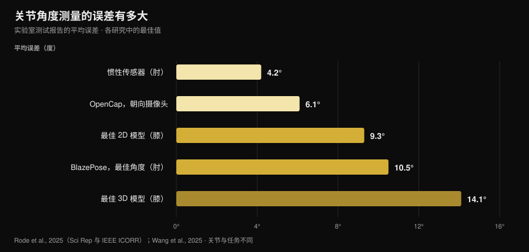
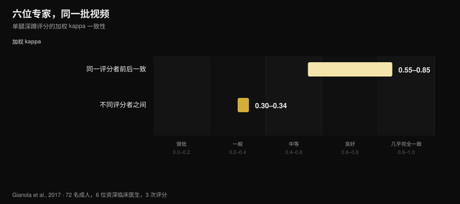

# AI 动作检查到底准不准？研究给出数字

作者 [Giammaria Loi](/autore/giammaria-loi) · 更新于 2026 年 11 月 19 日

你把手机架好，做完一组，app 回答："膝内扣，深度 92°"。这看起来像一次测量。2026 年这样的 app 出了几十个，而搜索"AI 动作检查"得到的几乎只有应用商店页面。问题在于，屏幕上那些度数有一个实验室里测出来的误差范围，没人把它写在旁边。

## 要点速览

- **最好的 2D 估计器测膝关节角度平均差 9.3°。** 这是在 220 万帧、11 个开源模型中最理想的结果：受测模型没有一个达到临床解读所需的精度。
- **app 里的"3D"常常比 2D 更差。** 关节位置误差从 2D 的 72-122 毫米升到 146-249 毫米，因为模型还要猜深度。
- **拍摄角度比算法更重要。** 动作完全落在画面平面内时，肘关节误差为 10.5°；偏离这个平面，精度显著下降。
- **人眼同样不是量角器。** 六位资深临床医生看同一批视频，彼此之间的加权 kappa 只有 0.30-0.34，而每个人与自己前后一致为 0.55-0.85。
- **视频有用，但适合另一类问题。** 二选一的判断和整体评价是可靠的，小数点后的角度不可靠。该问"膝盖有没有越过鞋的内缘"，而不是"我内扣了几度"。

*Nurvan 图表，数据取自 Rode et al., 2025（Scientific Reports 与 IEEE ICORR）和 Wang et al., 2025。注意：涉及不同关节与不同任务，并非一对一比较。每根柱子都是该研究公布的最佳值。没有任何数值取自图像读数。*

## AI 动作检查 app 到底在做什么

几乎所有产品背后都是同一项技术：*姿态估计*。神经网络看着画面，猜测肩、髋、膝、踝在哪里，再由这些点算出角度。它并没有测量你的身体，而是从像素推断关节中心的位置。

这个区别很重要。实验室里，关节位置来自反光标记点和多台标定过的摄像机；这里只有一台摄像机，再加上衣物、健身房的灯光，以及一根时不时挡住你的杠铃。

## 最大规模评测的数字

2025 年 11 月，苏黎世联邦理工学院的团队在 *Scientific Reports* 上发表了迄今最广泛的比较：25 名受试者、220 万帧以上的运动画面、11 个开源姿态估计器，测试了 18 个 2D 变体和 26 个 3D 变体，全部与基于标记点的光学系统对照。

| 指标 | 2D 估计器 | 3D 估计器 |
|---|---|---|
| 关节位置平均误差 | 72-122 毫米 | 146-249 毫米 |
| 膝关节角度平均误差 | 从 9.3° 起 | 从 14.1° 起 |
| 肘关节角度平均误差 | 从 21.5° 起 | 从 16.3° 起 |

*Nurvan 表格，数据取自 Rode et al., 2025（Scientific Reports）。"从…起"表示该类别中表现最好的模型。*

两点实用解读。第一：即使最好的情况，膝关节平均误差也在九度左右，作者明确写道，受测模型没有一个低于正确临床解读所需的角度误差。第二：加上第三个维度反而更糟。当模型要用一台摄像机同时猜测深度时，位置误差翻倍。应用说明里的"3D"不是质量保证。

同一团队又针对肘关节做了一次测试：当动作**完全发生在画面平面内**（理想条件）时，平均误差为 10.5°，均方根误差 14.7°，而佩戴式惯性传感器为 4.2° 和 6.0°。相对摄像机的朝向显著影响精度，并且模型倾向于低估较大的屈曲角度——恰恰是你想知道自己是否蹲够深的那一段。

### 拍摄角度不是小事

2025 年 *Journal of Biomechanics* 的一项研究测试了 OpenCap，这是研究中最常用的智能手机无标记系统，对象是 53 名膝骨关节炎患者和 30 名健康对照。**朝向**摄像机行走时，平均误差为 6.1°，一致性 0.67；反方向行走时，误差出现统计学上的显著恶化。同一个人、同一套软件、同一个房间，变的只是朝向。

手工 2D 分析同样如此。在身体活跃的女性中，额状面膝内扣角度的有效性取决于深蹲深度、支撑腿是哪一条，以及内扣是否明显。换句话说：同一个测量在一种条件下有效，在另一种条件下未必。

## 那么人类教练更好吗

要看你问他什么。在一项针对 72 名成人的意大利研究中，六位资深临床医生用一套经过验证的量表，在三个不同时间点评分同一批单腿深蹲视频。每个人与自己相当一致——加权 kappa 0.55 到 0.85——但评分者**之间**的一致性只有 0.30 到 0.34，按惯例属于"一般"。

*Nurvan 图表，数据取自 Gianola et al., 2017（72 名成人、六位资深临床医生、三次评分）。kappa 的解释区间采用通行惯例。没有任何数值取自图像读数。*

六位专家、同一段视频，判断却难以对齐。这不是在指责这个行业：用肉眼评判角度和体段本来就是这样。它也解释了为什么两位教练会对同一次硬拉给出两种不同的纠正，而两人都不算外行。

有用的部分紧随其后。当要求给出**整体**判断、而不是逐段打分时，一致性会提高：在有膝关节旧伤的人群中，三位资深和三位新手评分者用整体法达到了良好一致。而选得好的二元判断经得起与实验室的对照：在青少年运动员中，"膝盖最终落在鞋的内缘以内"这一判断，在识别 3D 测得的内扣时曲线下面积最高达 0.93，远高于其他判断条目。

视频是回答是非题的好工具，却是糟糕的量角器。

## 研究实际上怎么说

| 常见说法 | 结论 | 来源 |
|---|---|---|
| "app 像实验室一样测你的角度" | **不成立** | Rode et al., 2025 — 11 个受测估计器没有一个达到临床解读所需的角度误差 |
| "标 3D 就更准" | **不成立** | Rode et al., 2025 — 2D 位置误差 72-122 毫米，单摄像机 3D 为 146-249 毫米 |
| "拍到就行，角度是小事" | **不成立** | Rode et al., 2025；Wang et al., 2025 — 相对摄像机的朝向显著改变误差 |
| "人类教练是客观的" | **需补充** | Gianola et al., 2017 — 六位专家看同一批视频，相互一致性仅 0.30-0.34 加权 kappa |
| "视频动作检查毫无用处" | **不成立** | Edwards 与 Liberatore, 2018；Erdman et al., 2024 — 整体判断可靠，二元判断 AUC 最高 0.93 |
| "app 能告诉你这个动作对你是否安全" | **无法验证** | 现有研究没有在力量训练人群中检验过损伤预测 |

## 怎么用

1. **在动作所在的平面拍摄。** 摄像机与髋同高，垂直于你关心的平面：侧面看深度和背部，正面看膝盖。整个动作从第一帧到最后一帧都要在画面里。
2. **摄像机固定，位置始终一致。** 只有画面一致，两次训练的对比才有意义。地上做个记号比任何算法都管用。
3. **提二选一的问题。** "膝盖有没有越过鞋的内缘？""髋有没有低于膝？""杠铃有没有离开身体？"这些问题上，无论人眼还是算法都可靠。
4. **忽略小数点。** app 写 92.4° 屈曲，就读成"大约 90 度，上下十度"。一个角度一周之间变化 5°，那是噪声，不是进步。
5. **视频看动作，数字看负荷。** 你到底推得有多狠，单帧画面看不出来。它在重量、次数和 [RIR 的历史记录里——这个估计同样有它的局限](/zh/blog/rir-guji-zhunque-ma)。
6. **疼痛、肿胀或关节打软，不是靠 app 解决的技术问题。** 那需要医疗专业人员，而不是更好的取景。

### 如果你在远程带学员

两条规则，能把视频变成数据而不是意见：

- **始终要求同样的取景。** 高度、方位、距离说明一次，之后坚持执行。否则你比较的是不同的拍摄，而不是不同的执行。
- **看之前先写下判断标准。** 每个动作三个二选一的问题，提前定好。这是最简单的办法，避免今天的判断和上周二对不上——这种事连资深评分者也会遇到。

> **Nurvan：视频看形状，历史看负荷**
>
> 在 Nurvan 里，教练能看到每一组的重量、次数和 RIR，动作的历史记录排成一行：这是单帧画面给不了的数据，也是判断训练要求是否真的在上升的依据。视频仍然是它本来的角色——形状检查；训练安排的决定由数字来做。[试试 Nurvan](https://nurvan.app)

## 常见问题

**AI 动作检查 app 有用吗？**
用来提示明显偏差有用，用来测量没用。在迄今最大规模的评测中，膝关节角度平均误差最好的 2D 模型为 9.3° 起，3D 模型为 14.1° 起，没有一个达到临床解读所需的精度。如果 app 说某侧膝盖明显往内塌，它多半是对的；如果它给你一个带小数的数字，那个数字不可信。

**深蹲该从哪一侧拍？**
从你想看的事情发生的那一侧。侧面、摄像机与髋同高，看深度、杠铃轨迹和躯干前倾；正面看膝盖的走向。研究中相对摄像机的朝向会显著改变误差，所以斜四十五度拍摄是最快得到无意义数字的方法。

**手机还是佩戴式传感器？**
测角度选惯性传感器：在肘关节的直接比较中，它是 4.2° 平均误差，而视频估计在最佳条件下是 10.5°。要观察一个完整动作，视频仍然更方便、信息更多。

**app 能告诉我动作是不是危险吗？**
不能。现有研究测量的是系统描述动作时与实验室的接近程度，而不是这个动作会不会造成损伤。如果你有疼痛、不稳或突然打软，这是医学问题，应该问医生或物理治疗师。

## 延伸阅读

- [线上教练真的有用吗？研究怎么说](/zh/blog/xianshang-jiaolian-youxiao-ma) — 远程教练必须盯住什么，才能顶得上现场带练。
- [你的 RIR 估得准吗？研究怎么说](/zh/blog/rir-guji-zhunque-ma) — 支撑着半套训练的另一个估计值。
- [AI 健身计划：研究到底怎么说](/zh/blog/ai-shengcheng-jianshen-jihua) — 人工智能在哪里站得住，在哪里站不住。

## 参考文献

1. Rode D, Dunkel A, Willi R, Wolf P, Xiloyannis M, Riener R, 2025. Assessment of monocular human pose estimation models for clinical movement analysis. *Scientific Reports* 15(1):38767. [PMID 41193590](https://pubmed.ncbi.nlm.nih.gov/41193590/) · [DOI 10.1038/s41598-025-22626-7](https://doi.org/10.1038/s41598-025-22626-7)
2. Rode D, Ceccarelli A, Esser A, Wolf P, Riener R, 2025. Accuracy of IMUs and Monocular Human Pose Estimation at Measuring Elbow Flexion. *IEEE Int Conf Rehabil Robot* 2025:773-778. [PMID 40644081](https://pubmed.ncbi.nlm.nih.gov/40644081/) · [DOI 10.1109/ICORR66766.2025.11063086](https://doi.org/10.1109/ICORR66766.2025.11063086)
3. Wang J, Xu W, Wu Z, Zhang H, Wang B, Zhou Z, Wang C, Li K, Nie Y, 2025. Evaluation of a smartphone-based markerless system to measure lower-limb kinematics in patients with knee osteoarthritis. *Journal of Biomechanics* 181:112529. [PMID 39862716](https://pubmed.ncbi.nlm.nih.gov/39862716/) · [DOI 10.1016/j.jbiomech.2025.112529](https://doi.org/10.1016/j.jbiomech.2025.112529)
4. Wade L, Needham L, McGuigan P, Bilzon J, 2022. Applications and limitations of current markerless motion capture methods for clinical gait biomechanics. *PeerJ* 10:e12995. [PMID 35237469](https://pubmed.ncbi.nlm.nih.gov/35237469/) · [DOI 10.7717/peerj.12995](https://doi.org/10.7717/peerj.12995)
5. Gianola S, Castellini G, Stucovitz E, Nardo A, Banfi G, 2017. Single leg squat performance in physically and non-physically active individuals: a cross-sectional study. *BMC Musculoskeletal Disorders* 18(1):299. [PMID 28709418](https://pubmed.ncbi.nlm.nih.gov/28709418/) · [DOI 10.1186/s12891-017-1660-8](https://doi.org/10.1186/s12891-017-1660-8)
6. Edwards S, Liberatore M, 2018. Reliability of a Squat Movement Competency Screen in Individuals With a Previous Knee Injury. *Journal of Sport Rehabilitation* 27(2). [PMID 28872403](https://pubmed.ncbi.nlm.nih.gov/28872403/) · [DOI 10.1123/jsr.2017-0064](https://doi.org/10.1123/jsr.2017-0064)
7. Erdman A, Loewen A, Dressing M, Wyatt C, Oliver G, Butler L, Sugimoto D, Black AM, Tulchin-Francis K, Bazett-Jones DM, Janosky J, Ulman S, 2024. A 2D video-based assessment is associated with 3D biomechanical contributors to dynamic knee valgus in the coronal plane. *Frontiers in Sports and Active Living* 6:1352286. [PMID 38558858](https://pubmed.ncbi.nlm.nih.gov/38558858/) · [DOI 10.3389/fspor.2024.1352286](https://doi.org/10.3389/fspor.2024.1352286)
8. Jamaludin NI, Sahabuddin FNA, Rasudin NS, Shaharudin S, 2022. The Concurrent Validity and Reliability of Single Leg Squat Among Physically Active Females with and without Dynamic Knee Valgus. *International Journal of Sports Physical Therapy* 17(4):574-584. [PMID 35693857](https://pubmed.ncbi.nlm.nih.gov/35693857/) · [DOI 10.26603/001c.35706](https://doi.org/10.26603/001c.35706)

选题依据 2026 年 11 月的趋势信号：2026 年各大应用商店上线了数十款"AI 动作检查"应用，而搜索结果首页几乎全是产品页，没有一个精度数字。科学文献通过 PubMed 检索。

**Giammaria Loi** 是 Nurvan 的创始人。他自 2012 年开始力量训练，2013 年起担任私人教练和 FIPE 认证教练，2018 年起在国家级力量举赛事中参赛。他署名的每篇文章都从研究出发，落到健身房里真正有效的做法。[作者页面](/autore/giammaria-loi)

> 注：本文为科普内容，不能替代医生或专业人士的意见。
